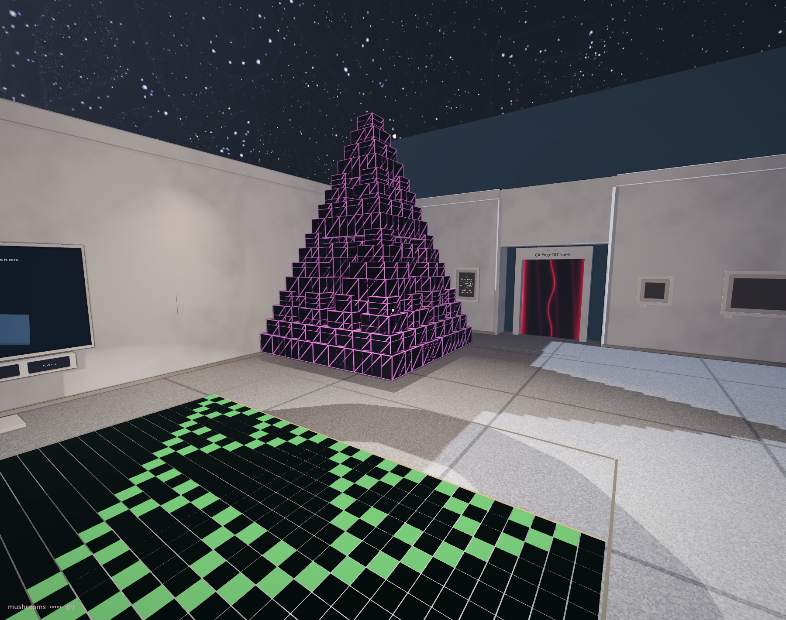

# The same pattern, different work

<!-- @ca_rule_explorer -->

Can two constructions resemble one another without doing the same calculation?

Press 90 on the explorer’s CA RULES panel, then RST to return to the central seed. Press STEP a few times. Follow the triangular gaps that develop between occupied cells. Choose a larger triangle and look for smaller ones arranged within its boundary. Add rows, up to fifteen steps, when you need more to compare; at the sixteenth the pattern's two diagonal edges meet around the ring and every new row from then on is empty.

The small black point is back at the desk. Take it along the rail: the numbers follow an address, while the row stays still. Use its trigger and the next row arrives. In the previous room it placed a seed. Here we have given the same held object another relation to the work: it lets us inspect a place and advance a process.

Each new cell is still calculated from a local neighbourhood. No instruction tells the display to draw a large triangle and then decorate it with smaller triangles. The repeated structure becomes visible through many applications of the rule.

Choose one triangular gap in the rule display. The same rows lie enlarged on the floor between the desk and the pyramid. Follow them away from the desk: each row takes one more step in the calculation. Walk into a dark triangle. The cells are empty; the floor still holds you. Here, absence is something drawn beneath your feet.

Keep a few occupied cells around the gap in mind, so there is more to recognise than the outline. Carry that small arrangement to the pyramid. Move sideways. The cubes hide and uncover one another; the floor image stays flat. Where would your remembered gap fit, and would your body fit there too? If one part refuses the match, stay with that part before choosing a different resemblance. We have found something the shared appearance did not tell us.

<!-- @sierpinski_pyramid -->

Now turn to the Sierpinski pyramid. Find a small pyramid and compare where its neighbours sit. Then step back and look for the same arrangement at the next scale. This construction repeats its arrangement recursively at half the spacing: four copies at the lower corners, one at the apex and one more directly above it, which lifts the top into a spire. The cubes do not shrink with the spacing, so neighbouring copies overlap. Its procedure begins with a shape and a copying arrangement, rather than a row whose next state must be calculated. The cubes inherit a position in a copying arrangement; they do not consult a neighbourhood to decide their next state.

The resemblance is useful because it gives you a question to test. At which scales do gaps correspond? Which relations are altered by moving from a flat history to a volume? You need not force every visible feature into a match. A failed correspondence tells you where the analogy stops.

The row's next state and the pyramid's smaller copies can lead the eye towards a related form. The pleasure of recognising it gives us a reason to compare their making. A name for the resemblance can accompany that inquiry without finishing it.[^ca-resemblance]

Keep the pyramid fixed and press SEED at the desk. Two adjacent cells now begin the history. Build a few rows again. Where do the familiar triangular relations return, and do they ever overlap? Press SEED once more to return to the single cell. How much of the resemblance belonged to the rule, and how much to the beginning we gave it?

Before leaving the desk, turn RULE until the plate reads 222 and step from the single seed. A filled triangle spreads until its edges meet around this ring. One dark address remains; the rest has stopped changing. Try 190, then the 30 and 110 buttons. Follow a small patch rather than the whole picture. Does it return, travel, disappear? How many rows would you need before trusting that description?

Stephen Wolfram proposed four broad kinds of behaviour: settling into uniformity, repeating, appearing random, and sustaining local structures that interact.[^ca-classes] These names make differences easier to discuss. Our short history, from one chosen seed, cannot settle how a rule behaves from other beginnings. Nor does the plate's “Turing Complete” turn the picture into a demonstrated computer. We can let the name give us another task.

<!-- @ -->

We will return to the pyramid's way of making in Fractals. First, two almost matching volumes will let us follow one changed value through the same procedure. We have asked how similar appearances can be made differently. What happens when we keep the making the same and alter one small part of the beginning?

[^ca-resemblance]: The explorer's plate captions Rule 90 “Sierpiński” and Rule 110 “Turing Complete”. This comparison earns the first word only as a question about resemblance. The second is a theorem rather than a caption: Matthew Cook proved in 2004 that Rule 110 can carry out any computation ([“Universality in elementary cellular automata”](https://www.complex-systems.com/abstracts/v15_i01_a01/), *Complex Systems* 15), by reading its persisting structures as signals and their collisions as logic — an account of states, operations and results that no organised appearance supplies on its own. The Rule 110 display in the first hall is where to begin asking for it.

[^ca-classes]: Stephen Wolfram, [“Universality and complexity in cellular automata”](https://doi.org/10.1016/0167-2789(84)90245-8), *Physica D* 10 (1984). The classification concerns broad behaviour across initial conditions; his [later account](https://www.wolframscience.com/nks/p231--four-classes-of-behavior/) illustrates it from random beginnings. A finite, single-seed run supplies an example to investigate, not a proof of a class.
