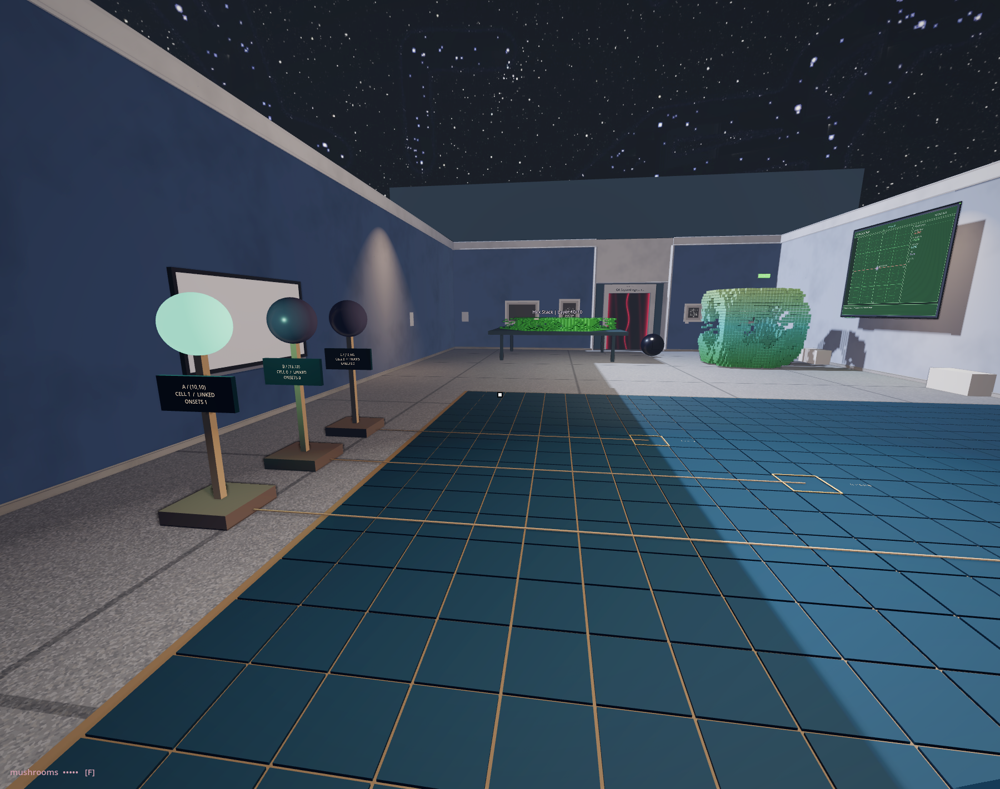

# A pattern visits an address

<!-- @game_of_life_petri -->

Five green cells wait in the dish. A larger version spreads across the floor beyond it. Three lamps stand along its edge. They are dark.

Take the small black point beside the controls. Its trigger carries STEP with you. Press it four times. The arrangement has changed at every step; now something about it has returned. Compare its position with one of the gold squares. What has travelled?

REPLAY brings the five cells back. This time keep your attention on the square marked A, at address (10,10). Step towards it. A cell becomes occupied; a lamp lights. Step again. Follow the square for a while, even when the more recognisable figure tempts your eye away. The address keeps its place. The pattern is already elsewhere.

You can cross the large display. Its empty cells still support your feet. In the previous room, occupancy became a stepping tile over a lower basin. Here it becomes colour on an ordinary floor. We have carried the array forward and given it another job. A zero does not contain an instruction to make a hole.

Stay beside one of the gold squares as its value changes. The pattern visits; the place continues to hold you. A lamp answers the cell, while your weight makes no difference to its next state. Sharing an address with the calculation has not made you one of its conditions.

*The same present has room around it now. An empty square remains somewhere to stand.*

Try BLINKER. Three cells lie in a line. One step turns the line; another brings it back. Watch A, the middle cell. The surroundings alternate while this address remains occupied. Its lamp stays lit. Returning, travelling and staying can belong to different parts of the same small event. The names for these, now that you have watched them, are still life, oscillator and spaceship: the block the glider will meet is the first, the blinker the second, the glider the third.

The dish runs Conway's Game of Life.[^ca-conway] Each fixed address answers its eight neighbours. None is instructed to travel.

In the glider beginning, four generations reproduce the arrangement one address further along each axis. No instruction has moved a glider object. No cell carries a ticket for that journey. We recognise a body across successive relations among sites. The recognition is useful: it lets us anticipate a visit. It also leaves something out. Following the figure, we can miss the cells that cease to participate. Press TRACE. For one generation after each step, a cell that has just stopped is marked in red and one that has just begun in blue; the figure you were following is seen to be leaving a wake, and the wake is where the rule was working.

Try LINK while a lamp is lit. The light goes out; the figure remains. STEP still changes it. The lamp receives the state of one fixed address. Disconnecting it changes that relation, not the rule.

That address could have been connected to another object. Here it controls an opal lamp. The lamp does not recognise a glider: any occupied state at its assigned address will light it when connected. Nor does its light return an influence to the cells. We have made a small, one-way traffic between the simulation and the room. Its boundary is a decision we can inspect and change.

Press LINK again to reconnect the lamps. Choose MEET. The same glider begins with a four-cell block in its path. Predict which lamps will light. Advance, then compare with GLIDER. Both choices prepare a fresh beginning; LINK keeps its setting. Stay with the encounter before checking its recorded outcome.[^ca-meet] What can the figure continue to be after this meeting?

Gardner's 1970 account describes Conway searching for rules whose small beginnings could develop for a while without making their outcome obvious. This was a design ambition, not a proof that growth must always stop. Our finite, wrapped board adds its own conditions. A small experiment can keep a question open without standing for every possible world.

There is pleasure in the travelling figure and in the room answering it. We need not turn that pleasure into proof of a living creature, or ask a fluid-looking body to stand for every possible difference. This body has particular conditions. Another encounter may interrupt it; another connection may let it do something we have not yet tried.

RUN advances this local experiment slowly and holds it at generation 48. The museum clock continues. We leave a finite observation, not a verdict on everything the rule can make.

<!-- @ -->

The floor continues into a level gallery. The mould and growth networks have space around them; past the dark sphere, a table holds a hexagonal field. Here the neighbourhood and the birth condition both change: six neighbours instead of eight, birth on two. The Random Flip control allows occasional reversals of the rule’s answer. Generations stack upward into a terrain. Time has acquired thickness again, through another agreement.

So far the visitor has chosen a beginning and watched an output. In the next room, approaching a surface enters the calculation. What happens when the body doing the observing becomes one of the conditions?

[^ca-conway]: Martin Gardner, “Mathematical Games,” *Scientific American* 223 (October 1970), [original article](https://www.scientificamerican.com/article/mathematical-games-1970-10/), [article reproduction](https://ibiblio.org/lifepatterns/october1970.html). Gardner reports Conway's exploratory criteria, including the absence of a simple proof of unbounded growth for a starting pattern. That criterion should not be recast as a theorem forbidding unbounded growth. Our installed work uses finite periodic boundaries and a local observation limit.

[^ca-meet]: In the installed MEET beginning, the field is empty within six generations. Only A lights, before the first update: the block already occupies its address. This is one encounter under the unchanged rule, not a result for every meeting of a glider and a block.
