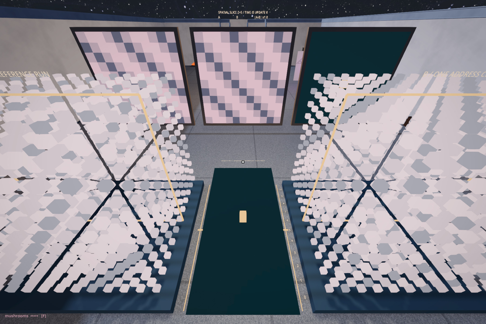

# How far does one difference go?

<!-- @self_organization_ca -->

Two volumes wait at the same update. Their colours almost agree. Somewhere in B, one address holds a value one greater than its counterpart in A. Can you find it without the instrument telling you where to look?

Walk between them. Thin gold frames mark the same depth in both volumes. As you pass the numbered edges of the floor image, the frames move with you. The cases ahead show A, B and their difference at that depth; the floor carries the same difference image. A wall is a slice through space. It is not the next generation. Watch the update counter while you walk. Z SLICE offers the same choice from the console.

Before taking the first update, stop at five. The changed address appears in the section. Walk to six and it disappears from that picture. Come back. It is still there. We have moved past the difference, not removed it. An empty section could have been all we saw of this volume.



Return to the console. Press STEP. Follow the lit difference for a few updates, then use REPLAY to meet the same beginning again. ONE CELL removes the intervention, or restores it. With the intervention removed, both runs should agree through every update, even when the disturbance is loud. What would it mean if they did not?

The two runs receive the same forcing value at the same address and update. This is a deliberately shared, reproducible schedule. Without that agreement, a second source of difference would enter while we were trying to follow the first. The comparison makes a small experimental world inside a larger one whose clock continues.

Here is the local instruction, before storage:

```gdscript
var drive:float=disturbance*sample(i,tick)
var va:float=clampf(a[i]*(1.0-coupling)+sa/neighbours[i].size()*coupling+drive,0.0,9.0)
```

`sa` is the sum of A's valid neighbours. Interior cells have twenty-six; the corner has seven. Every cell reads the previous volume. PULL changes how far it moves toward that average. DRIVE changes the size of the added disturbance. The controls reset both runs, keeping the comparison legible. One gesture no longer changes both tendencies at once.

Bring DRIVE to zero. Choose the uniform beginning with SEED, leave PULL at 0.25 and ONE CELL enabled. In INTEGER storage, press STEP. The difference is gone. Replay, switch STORE to FRACTIONAL and take the same step. Now twenty-seven addresses differ, but the largest difference is smaller than before: 0.75 instead of one.

More places carry it. Less of it remains at any one place.

The fork is one short line:

```gdscript
na[i]=float(int(va)) if integer_storage else va
```

The integer conversion removes the fractional part of these nonnegative values. The pull that took five toward four produced 4.75. The stored integer is four. Around it, smaller fractional changes also fell away. A rule about neighbours was accompanied by another rule about what a value may keep. In this comparison the neighbour rule stayed the same; storage decided how much of its answer could remain.

Continue the fractional run. The wall of difference becomes broad and luminous. Look up at the gain printed on the readout above the console. The display is increasing its sensitivity as the largest difference fades. Its brightness is a decision about visibility. Read the maximum alongside the number of affected cells: that count includes only differences above 0.000001. A trace may leave the counter before it leaves the stored values.

Turn PULL down to zero, with DRIVE still zero, and replay. The intervention stays at its original address. This stillness keeps whole a memory that the smoothing run spread thin. We would miss something if we arrived already certain that a moving, complicated-looking field must be the more interesting body.

This hall was conceived under the name *Edge of Chaos*. It borrows a question from Christopher Langton: under what conditions can a pattern retain information, carry it elsewhere and change it through an encounter?[^ca-edge] Let the name remain a question here.

The neighbour average belongs to the same family of operations as a blur: a mark can spread while becoming fainter. With matched forcing added, our two volumes let us follow what survives that smoothing and what storage discards. A spreading difference alone does not establish chaotic amplification. The integer conversion introduces thresholds of its own. We have measured some consequences of those choices. We have not located the one permissible region where life, computation or queerness can exist.

The other works remain in the rear gallery: a screen that keeps the successive states of a one-dimensional automaton as rows, local transmission and recovery drawn by chance — the susceptible, infected and recovered of 1927 laid on a grid, the fourth choice settled by a draw[^ca-sir] — a fog field whose cell rule fills it solid within two updates, and cracks that finish spreading across their plate within a couple of seconds of being built. Each asks for its own account of what passes between neighbours, what is stored, and what the image omits. Similar-looking motion, where there is any, does not make their rules equivalent.

<!-- @ -->

The next hall, the first of Fractals, changes the instruction. Instead of waiting for local exchanges to assemble a larger resemblance, a procedure explicitly asks for another instance of itself. Carry this distinction with you: a form can resemble its neighbour, inherit an earlier state, or be told to repeat. The resemblance does not yet explain the making.

[^ca-edge]: Christopher Langton, [“Computation at the edge of chaos: phase transitions and emergent computation”](https://doi.org/10.1016/0167-2789(90)90064-V), *Physica D* 42 (1990). His experiments associated information storage, transmission and modification with a transition between ordered and disordered behaviour. His λ counts the fraction of rule-table entries whose output differs from a designated quiescent state. It is not the proportion of living cells in a displayed field. PULL changes the strength of neighbour averaging in another model; this hall has not measured Langton's transition.

[^ca-sir]: W. O. Kermack and A. G. McKendrick, “A contribution to the mathematical theory of epidemics”, *Proceedings of the Royal Society A* 115 (1927). In the rear gallery each cell is infected with a fixed probability per infected neighbour and recovers with another: two draws and a grid.
