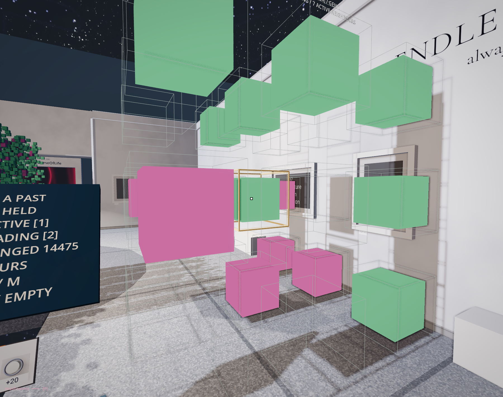
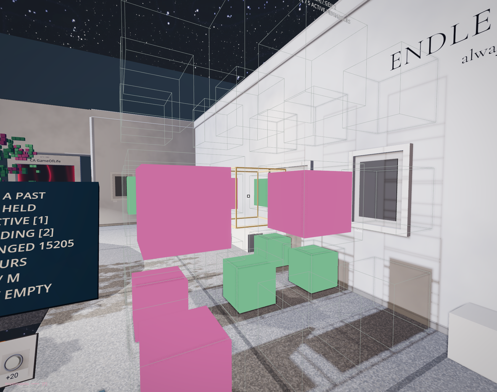

# A cell with a past

How would you recognise a cell that has stopped being active but has not yet disappeared?

The previous hall let three cells answer a question about the next row. Here the neighbourhood reaches behind what we can see. A cell can now hold three states, and it consults twenty-six neighbours instead of two. A small volume waits above the opening in the floor. Walk along its rim. Two marks that seemed to touch can separate as you move; another cell has been behind them all along.

<!-- @structure_growth -->

Beside the volume, twenty-seven positions have been pulled apart. You can walk between them. They show one cell and its neighbours from the small structure, enlarged enough to follow without losing the address. The central position wears a golden frame; the finer outlines keep the empty places visible. Move around a cube that blocks your view. What looked like a crowded surface begins to give up its separate positions.

Begin at the console. The structure is held at its starting generation. Pink means active. Lift the familiar black point beside the controls. Carry it with you; its trigger gives the structure one step while you keep looking at the cells. Press once and look for green. A green cell is still occupied, still drawn where the surface allows it, but it has stopped contributing to its neighbours' active count. Follow it through another step. What does it leave available?

Each position consults a cube of three by three by three positions. Remove the position itself and twenty-six neighbours remain: through faces, along edges, across corners. Only the active state, numbered one, contributes to the count. A green neighbour holds state two. Being present and being counted have parted company.

The inscription `6-8/6-8/3/M` names this installation's agreement. An active cell survives with six, seven or eight active neighbours. An empty cell becomes active with those same counts. Three states are available: empty, active, fading. `M` denotes the surrounding Moore neighbourhood, which this implementation fixes at twenty-six positions.

REPLAY, then STEP once. The cell inside the golden frame is green. Walk around its enlarged neighbourhood and count the pink cells: seven. This is a reading of position `(26, 22, 24)` in the original volume, following the same updates. Seven would be enough for an empty cell to begin. Will this one become pink at the next step? Birth is tempting, but its present state sends it down another branch. In this three-state rule, fading must become empty, however many active neighbours it has. Press STEP again and return to the golden frame. The place remains; the cell has gone. It must first become empty. Only a later generation can consider its birth again. Disappearance takes time, and that interval changes where new activity is possible. We have acquired another means of shaping a body: a position can retain a past that temporarily prevents a beginning.

*The golden frame keeps the address while the rule changes what can occupy it. The two views follow successive generations from the same position.*

Every answer is written into a second array. The old volume supplies all the questions before the arrays exchange places. There is no privileged first cell whose new answer reaches its neighbours early. STEP gives this local agreement one generation; the rest of the museum keeps running.

Press VIEW. The structure and its enlarged neighbourhood take on a gradient from dark to light with height. Nothing has advanced. The same cells can look like one continuous material now that their different states share a colour scale. Press VIEW again and recover the distinction. The finish has changed what we can readily recognise. Which reading did we take for the object itself?

The console also separates ACTIVE, FADING and DRAWN. The last number can be smaller than the first two added together. The renderer omits occupied cells surrounded on all six faces by occupied cells. Their state remains in the calculation. What the surface conceals can still help determine its next form. These visible cubes have no individual collision bodies; their appearance is not a promise of footholds.

Try RUN, then hold it. REPLAY returns to the same seeded beginning, so a second observation can follow a detail missed the first time. Twenty steps fit the initial observation budget. At that limit the machine holds; +20 permits another interval without reseeding. Read the generation count, and CHANGED on a line below it, beside DRAWN. A stopped clock alone cannot tell us whether the configuration has stopped changing. Zero changed cells, after an update under these fixed conditions, gives stronger evidence: that whole state reproduced itself.

There is an edge to this world too. Its outer cells stay empty. They do not wrap around to the opposite face as the previous board did. Near that boundary, a cell cannot find the same company it might find in the interior. The body has a rule, a beginning, an edge and a chosen duration of observation. Its organic appearance does not tell us which of these has made a particular feature possible.

<!-- @ -->

The floor opens into a level gallery beyond the volume. The dark orb remains beside the route as a further encounter. For now, carry the difference between an active cell, a lingering cell and a cell hidden by the drawing. The familiar wish to give something life has opened into more particular questions. What must remain? What must become available again? In the next hall, generations will themselves become a structure laid out in space. A past we have just replaced will become something we can approach.
