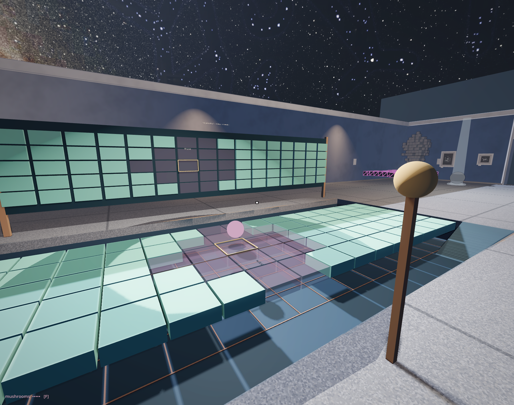

# The surface includes you

<!-- @decaying_bridge -->

The path looks available. Five tiles across, a longer line ahead. Its colours repeat in panels on a free-standing frieze beside the path. Beneath it lies a shallow basin, already drawn with the addresses of tiles that have not yet disappeared.

Begin at the desk. Press SOURCE once to put the pink probe in your place. The readout shows PROBE / NEAR. Press RUN. Follow the gold square W. The number falls. The tile changes colour, then becomes a faint sheet through which the basin is visible. Stop the local experiment. How much of a path is still there?

Use NEAR/FAR to withdraw the probe and run again. Watch the edge of the depleted region before its centre. Something returns through what remained around it. There is no separate instruction ordering this particular patch to grow back into its old outline.

RESTORE prepares a full bridge. Change SOURCE to VISITOR and start RUN. Your position now takes the probe's place. Approach the marked region, wait, move away. The ordinary museum floor continues alongside the basin; recovery ramps rise at either end on the desk's side. On the bridge, lingering can cost you support. The faint tile can still be seen after it can no longer carry you.

You can bring the black point from beside the desk into this relation. Hold it near the surface and use its trigger to give the rule another position. The same object that carried STEP in the previous hall now brings a location as well. Release it and continue stepping: the input has withdrawn, but its consequences remain.

Look up to find W again. A gold frame holds its place on the frieze. Wait above the tile while watching its colour there. The change stays in front of you; the consequence arrives beneath your feet. When the surface gives way, you are still looking at the same address from a little lower down.

*One cell, two surfaces. The basin receives the body when the bridge can no longer carry it.*

The bridge calls its number health. A tile can still carry you after it has stopped helping its neighbours recover.[^ca-presence-thresholds] The frieze wears the same changing colour, but its backing stays solid. A room can wear an answer without offering the same way through it.

No scale weighs your feet. The rule reads proximity, so the surface can respond before you stand on the cell. The pink probe can produce the same influence without a person above it. How much of our first explanation came from the event, and how much did the bridge invite us to supply?

Choose CHAIN, then STEP. Switch ORDER, repeat; reverse it and try again.[^ca-presence-order] Watch the next neighbour. The loop has a direction too. We have returned to the Life dish's two buffers, where the separation between an old answer and a new one mattered.

Restore the full bridge and return to the visitor input. Choose where you intend to cross. Leave the clock running. If the route changes beneath you, where do you go next? The position you take there becomes another condition of the field. There is pleasure in architecture answering us, and a stranger pleasure when its answer interrupts the role we expected it to play. A fully depleted field with no healthy neighbours remains depleted. Withdrawal alone does not promise repair.

At thirty simulated seconds this study holds. The museum continues. We leave with a more precise question than whether the path is living: which relations let it carry a body, recover, or become unavailable? Our position has entered the conditions. What the surface permits can change that position in return.

<!-- @ -->

The next room asks what a cell can receive from its neighbourhood when counting healthy neighbours is no longer enough. A softer-looking surface will need another working rule to earn that difference.

[^ca-presence-thresholds]: The stored value ranges from zero to one. A value strictly above 0.5 contributes to a neighbour's recovery; at or above 0.2, the tile supplies collision support. The installed VISITOR input uses three-dimensional distance from the cell centre to the tracked body's origin, not weight or contact pressure. The tutorial separates those thresholds and the compact model's held-point input.

[^ca-presence-order]: CHAIN sets three adjacent values to 0.600, 0.495 and 0.000 with SOURCE NONE. ORDER restores this beginning and switches between reading the previous field throughout (SYNC) and reading already-written answers (SCAN). REVERSE restores the beginning and changes traversal direction. The tutorial works through the first update; the comparison changes a schedule, not elapsed simulated time.
