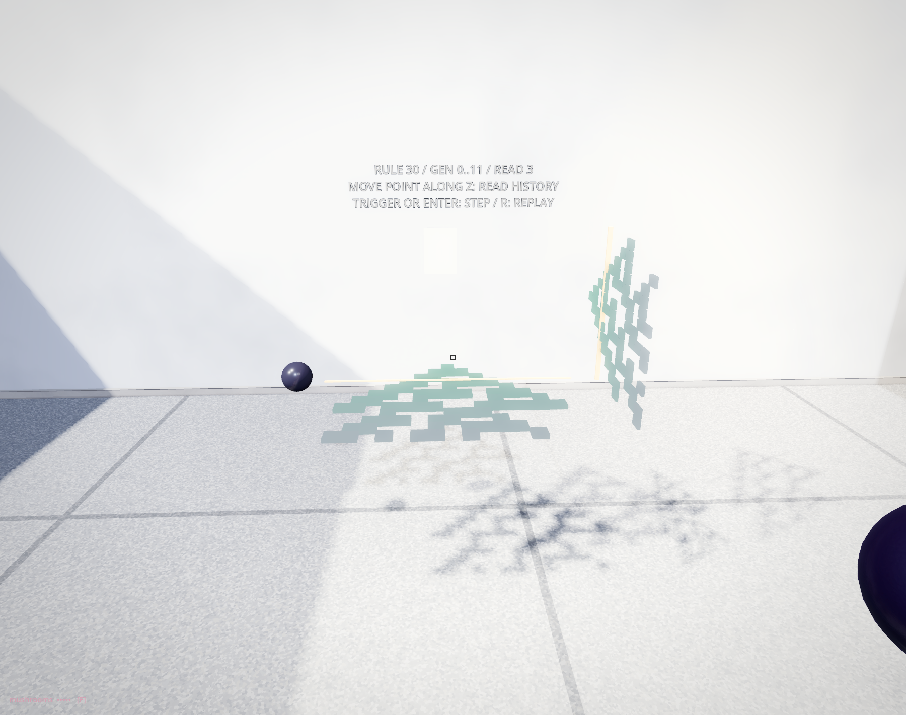

# Keep a generation

## Learning elements

- A history made from independent array snapshots.
- Generation and site as different indices.
- One record mapped to two arrangements.
- Visible geometry and collision as separate responsibilities.
- Reading an earlier state without reversing the calculation.
- A fixed record budget and an explicit restart.

## Walk beside the record

We are in Endless Museum. The desk, the tiles in the basin and the upright lattice show the same Rule 30 history. Twelve rows greet you. Walk along the margin: gold follows your position through the record. Turn back. The later rows remain.

Return to the desk and press REPLAY, then STEP. A single occupied site becomes three. This is the row rule from the opening hall. The previous room expanded the neighbourhood into a three-state volume; here we return to the simpler row to investigate **what happens when its past is kept**. The map's historical name, CA_GameOfLife, does not name this rule. Conway's Life is the next hall's main lesson.

## Continue with the point

We carry arrays, loops, an old-to-next update and the small PointBody. Save the previous lesson's script, then attach `history.gd` to the existing `PointStudy` Node3D in the museum. Keep unit scale, place it on level floor with about 2 × 2 metres clear, and face its positive Z side. Put the unchanged `point_body.gd` beside it. The museum supplies the camera, lighting, player and XR Tools; these files create the study itself.

This is a small comparison you can walk around. One saved row becomes a horizontal band and a vertical strip. Move the held point along Z to select an existing generation. Trigger, or Enter, appends a new row. R restarts. Release parks the point at the selected row. In the installed basin your body selects the row; in this reconstruction your familiar point is the reader. The small tiles are not a replacement floor course.



*The code below after eleven steps. Gold reads generation three; all twelve saved rows remain.*

## Save an independent row

`current` is the latest state. `history[g]` is a saved generation; `history[g][x]` reads one site in it. We append in time order: generation zero stays at index zero. This differs from a display that keeps only its newest rows and discards old ones.

`current.duplicate()` gives the record its own row. These entries are Boolean values, so a shallow copy is sufficient. Appending `current` alone would share that array: a later in-place edit could alter the supposed snapshot. A history of nested objects would need a more specific copying agreement.

`next_row` still reads only the old row while writing a fresh one. Left, centre and right make an index from 0 to 7. `ANSWERS` stores Rule 30 in that ascending order, 000 to 111. Left and right wrap at the row's ends. We have not added a new automaton.

The record holds 24 generations, including the seed. At capacity STEP returns without changing it. REPLAY clears the record and begins again from `seeds`. There is no claim of unlimited memory.

## Give the record two uses

In `deck_position`, site X stays horizontal. In `screen_position`, the same site rises vertically. Generation G becomes depth Z in both. A gold marker shows the selected generation, but it contributes no support.

`redraw` reads the record. It does not evolve it. A recorded true cell shows a cube in each view. The horizontal cube also enables its matching collision shape; the upright cube has no collision. Each cell has a reserved instance, indexed by `g * WIDTH + x`. A zero-sized basis hides inactive instances. `set_deferred` changes collision after the current physics work finishes.

An unoccupied recorded cell and an unrecorded future slot both show no cube. The label distinguishes them: it reports the recorded range and refuses a selection outside it. The installed desk makes this distinction with different dark tones as well.

## Complete study — history.gd

The two mapping functions are the part to change in your own arrangement. `make_display` builds the repeated geometry and collision pool once. `redraw` updates those existing receivers. There are no required scene children hidden behind references.

```gdscript
extends Node3D
const PointBody = preload("point_body.gd")
const WIDTH := 15
const ROWS := 24
const CELL := 0.08
const ANSWERS := [false, true, true, true, true, false, false, false]
var seeds: Array[int] = [7]
var current: Array[bool] = []
var history: Array[Array] = []
var selected := 0
var point: XRToolsPickable
var reading := Label3D.new()
var deck := MultiMesh.new()
var screen := MultiMesh.new()
var shapes: Array[CollisionShape3D] = []
var deck_mark: MeshInstance3D
var screen_mark: MeshInstance3D

func _ready() -> void:
	make_display()
	point = PointBody.new()
	add_child(point)
	point.action_pressed.connect(func(_body): step())
	replay()
	park()

func replay() -> void:
	current.resize(WIDTH)
	current.fill(false)
	for x in seeds:
		assert(x >= 0 and x < WIDTH)
		current[x] = true
	history.clear()
	history.append(current.duplicate())
	selected = 0
	redraw()

func next_row(old: Array[bool]) -> Array[bool]:
	var next: Array[bool] = []
	next.resize(WIDTH)
	for x in WIDTH:
		var left := old[posmod(x - 1, WIDTH)]
		var self_cell := old[x]
		var right := old[posmod(x + 1, WIDTH)]
		next[x] = ANSWERS[4 * int(left) + 2 * int(self_cell) + int(right)]
	return next

func step() -> void:
	if history.size() == ROWS:
		return
	current = next_row(current)
	history.append(current.duplicate())
	selected = history.size() - 1
	redraw()

func select_row(g: int) -> void:
	if g < 0 or g >= history.size():
		return
	selected = g
	deck_mark.position.z = g * CELL
	screen_mark.position.z = g * CELL
	reading.text = "RULE 30 / GEN 0..%d / READ %d\nMOVE POINT ALONG Z: READ HISTORY\nTRIGGER OR ENTER: STEP / R: REPLAY" % [history.size() - 1, selected]

func _physics_process(_delta: float) -> void:
	if point.held():
		var p := to_local(point.global_position)
		select_row(floori(p.z / CELL + 0.5))
	else:
		park()

func park() -> void:
	point.position = Vector3(-0.85, 1.05, selected * CELL)

func _unhandled_key_input(event: InputEvent) -> void:
	if event is InputEventKey and event.pressed and not event.echo:
		if event.keycode == KEY_ENTER:
			step()
			get_viewport().set_input_as_handled()
		elif event.keycode == KEY_R:
			replay()
			get_viewport().set_input_as_handled()

func deck_position(x: int, g: int) -> Vector3:
	return Vector3((x - 7) * CELL, 1.0, g * CELL)

func screen_position(x: int, g: int) -> Vector3:
	return Vector3(0.85, 1.05 + x * 0.055, g * CELL)

func make_view(mm: MultiMesh, size: Vector3) -> void:
	mm.transform_format = MultiMesh.TRANSFORM_3D
	mm.use_colors = true
	mm.instance_count = WIDTH * ROWS
	var cube := BoxMesh.new()
	cube.size = size
	mm.mesh = cube
	var view := MultiMeshInstance3D.new()
	view.multimesh = mm
	var finish := StandardMaterial3D.new()
	finish.shading_mode = BaseMaterial3D.SHADING_MODE_UNSHADED
	finish.vertex_color_use_as_albedo = true
	view.material_override = finish
	add_child(view)

func marker(size: Vector3, at: Vector3) -> MeshInstance3D:
	var mark := MeshInstance3D.new()
	var cube := BoxMesh.new()
	cube.size = size
	mark.mesh = cube
	mark.position = at
	var gold := StandardMaterial3D.new()
	gold.albedo_color = Color("ffcc72")
	mark.material_override = gold
	add_child(mark)
	return mark

func make_display() -> void:
	make_view(deck, Vector3(CELL, 0.022, CELL))
	make_view(screen, Vector3(0.014, 0.05, CELL * 0.9))
	var support := StaticBody3D.new()
	add_child(support)
	var tile := BoxShape3D.new()
	tile.size = Vector3(CELL, 0.022, CELL)
	for g in ROWS:
		for x in WIDTH:
			var shape := CollisionShape3D.new()
			shape.shape = tile
			shape.position = deck_position(x, g)
			shape.disabled = true
			support.add_child(shape)
			shapes.append(shape)
	deck_mark = marker(Vector3(1.4, 0.008, 0.012), Vector3(0, 1.018, 0))
	screen_mark = marker(Vector3(0.025, 0.86, 0.012), Vector3(0.85, 1.435, 0))
	reading.position = Vector3(0, 2.1, 0.9)
	reading.font_size = 30
	reading.pixel_size = 0.0015
	reading.outline_size = 4
	add_child(reading)

func redraw() -> void:
	for g in ROWS:
		for x in WIDTH:
			var i := g * WIDTH + x
			var occupied: bool = g < history.size() and history[g][x]
			var basis := Basis.IDENTITY if occupied else Basis.IDENTITY.scaled(Vector3.ZERO)
			var colour := Color("78d9bd").lerp(Color("e2a4de"), float(g) / (ROWS - 1))
			deck.set_instance_transform(i, Transform3D(basis, deck_position(x, g)))
			screen.set_instance_transform(i, Transform3D(basis, screen_position(x, g)))
			deck.set_instance_color(i, colour)
			screen.set_instance_color(i, colour)
			shapes[i].set_deferred("disabled", not occupied)
	select_row(selected)
```

## Carried file — point_body.gd

This is the same point as in the previous two halls. Its construction is printed here so the pair of files is complete; you do not need to rebuild or redesign it. The inherited pickable action supplies the trigger signal.

```gdscript
extends XRToolsPickable
## Point Lines' frozen point construction, made smaller for the hand model.
var tint := Color("25212a")
var desktop_pointer: WeakRef

func _init() -> void:
	freeze = true
	freeze_mode = RigidBody3D.FREEZE_MODE_KINEMATIC
	release_mode = XRToolsPickable.ReleaseMode.FROZEN
	ranged_grab_method = XRToolsPickable.RangedMethod.NONE
	collision_layer = 4
	collision_mask = 0
	var surface := MeshInstance3D.new()
	var sphere := SphereMesh.new()
	sphere.radius = 0.085
	sphere.height = 0.17
	sphere.radial_segments = 24
	sphere.rings = 12
	surface.mesh = sphere
	add_child(surface)
	var boundary := CollisionShape3D.new()
	var shape := SphereShape3D.new()
	shape.radius = 0.085
	boundary.shape = shape
	add_child(boundary)

func _ready() -> void:
	super._ready()
	var finish := StandardMaterial3D.new()
	finish.albedo_color = tint
	finish.roughness = 0.24
	get_child(0).material_override = finish

func held() -> bool:
	return is_picked_up() or (desktop_pointer != null and desktop_pointer.get_ref() != null)

func on_desktop_grab(pointer: Node) -> void:
	desktop_pointer = weakref(pointer)

func on_desktop_drop(_pointer: Node) -> void:
	desktop_pointer = null
```

## Read without rewriting

Make six rows. Hold the point and move it back toward generation one. Both gold marks return there. STEP still calculates from the latest `current`, not from the selected row. Selection changes the reading; it does not fork the history. While held, your point's position continues to select the row under your hand after a step.

In the large installation, walking back also leaves the update clock alone. Its manual ROW button pauses RUN; walking does not. That distinction belongs to the controls, not to Rule 30.

## Make another beginning

Change `seeds` from `[7]` to `[5, 9]`, then run the study. Predict the first new row: sites 4, 5, 6, 8, 9 and 10 should appear. Confirm it in both views. Keep that history and change the screen's mapping to `1.05 + (WIDTH - 1 - x) * 0.055`. The wall reading flips vertically; the horizontal tiles, saved rows and future calculation should stay the same. Explain why.

## What travels onward

We can keep a state without confusing it with the current calculation, and change its display without changing the record. Next, a two-dimensional grid holds one present. A glider will seem to move through it while the addressed cells remain in place. A pattern's apparent movement and our stored history are different constructions.
