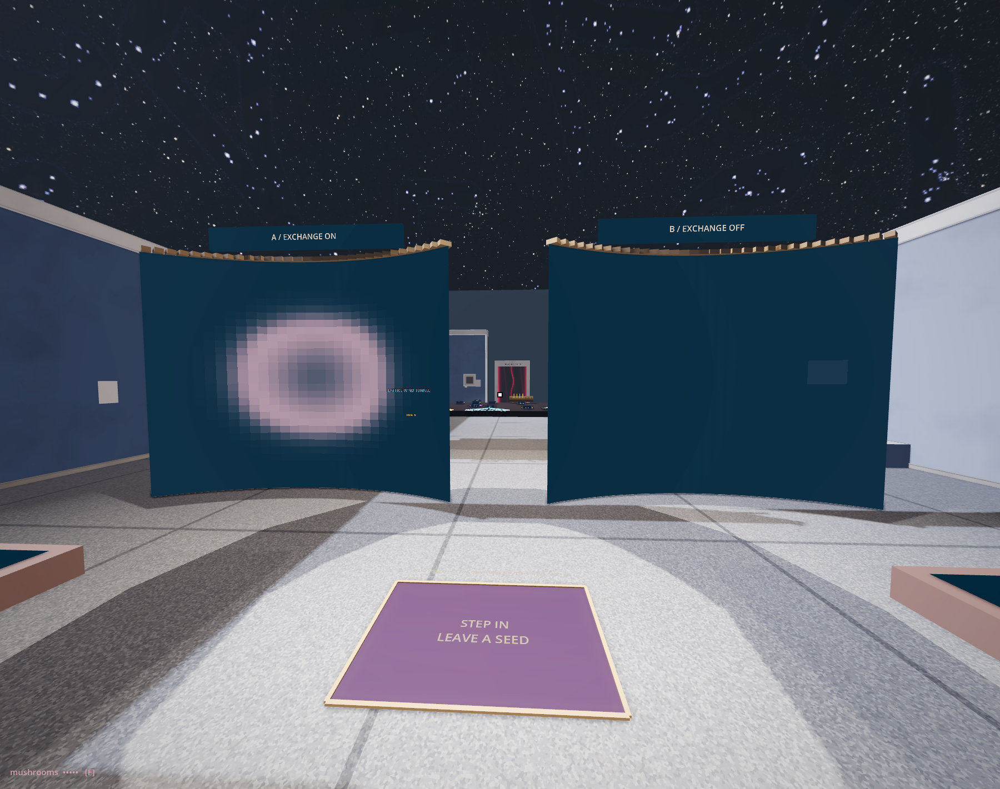

# What can a cell receive?

<!-- @rd_artifact -->

The Shader wall has a relative here. Its colours also came from a field with a past. These tables offer a different comparison: let one field receive from its neighbours while withholding that relation from the other.

Two small squares wait on the tables. Behind them, the same squares wait on curved walls. The room has already enlarged their answer, although neither field has taken a step.

Find the small gold frame on either table, just outside the seeded square. This is W; the side desk reads its values. V is zero there in both fields. Press STEP once. On the left, a little arrives. On the right, nothing. Look back at the pictures: can you find that difference without the numbers?

Press +100 and let the local clock complete its hundred updates. The fields begin to part. They began with the same values, at the same addresses. They have the same reaction. What has the right-hand square been denied?

EXCHANGE B turns its neighbourhood exchange on and restores both beginnings. Advance again. The two fields now agree. Switch exchange off, replay, and look for the first place where they differ. We can locate the missing relation before giving the result a name.

In the previous hall a neighbour had to be healthy enough to count. Here each cell holds two concentrations, U and V; how much a neighbour differs becomes part of what it can offer. Both fields perform the same local reaction.[^ca-gray-scott] Only one can receive through the surrounding cells.

Return to W. Nothing was planted there. Something has arrived on the left. On the right, the initial square has nearly faded by the end of those hundred updates. Keep the two pictures beside one another for a while.

“Soft” is not a promise that every boundary has disappeared. At the edge of this grid, neighbours wrap to the opposite side. The wall has a visible border that the calculation does not share. The tutorial opens the arithmetic of that exchange.

Use VIEW U/V. Another distribution appears without a single new update. The initial view doubles V before mapping it into colour; the U view has its own palette. A colour can saturate while the stored value still has room to change. An image is already an interpretation of the field.

Now walk between the two curved displays. Find a patch on a wall, then look for it on the table. Each pair shares the same texture. At the desk you could take in the small field; here you turn within its enlarged image.

Press COAT. The colour surfaces disappear while the table fields continue. Bring them back. The fixed museum floor carries you through both views.[^ca-soft-coating] The field has become something the room can wear. Perhaps you would keep it here, or want it closer, as a lining against a body. What would you change for that other use?

Between the displays, a small floor mark says **STEP IN / LEAVE A SEED**. Cross it. Both fields receive the same small second patch. With the clock running, watch beyond its edge as well as at its centre. Exchange lets some concentration leave the place where you put it. Try this after the first hundred updates: the new patch thins in A while the earlier pattern continues to spread. What lets something travel can also let it disperse.

There is also the small black point beside the desk. Take it to either table and hold it above a place you choose. Its trigger gives both fields a seed at that address. We have brought the same object onward, but changed what its position can do. On the bridge it helped remove support; here it introduces a concentration. Neither consequence belongs to the sphere alone.

Stay on the mark. It does not keep replenishing the seed. Leave and return to place it again. INJECT makes the same intervention from the desk. We are no longer only watching a prepared beginning; we have entered another event into its history. REPLAY can restore that beginning. It cannot make our first encounter with the difference happen again.

*The floor receives your arrival. What happens to the seed continues through the field's own relations.*

<!-- @the_clockmaker_of_rules -->

Further on, the clockmaker has laid out trays, stencils and small worlds. The brass shapes make reading and writing almost look like trades we could perform with our hands. Find the fractional ring. It is a still radial diagram. Its graded appearance does not demonstrate a running Lenia field,[^ca-lenia] and the ornamental crank cannot advance it.

Compare that invitation with the walls we have just left. Both offer pleasure in a patterned body; their means of producing it differ. We need neither reject the ornament nor grant it an operation it does not have. A diagram can help us imagine the machine, then leave us with something still to build.

<!-- @ -->

The local study holds after 2,400 updates. The museum goes on. We have watched a field change and a room wear its image. Carry a question from those surfaces: could a similar form have another way of becoming?

[^ca-soft-coating]: COAT toggles the wall display meshes. Their geometry stays fixed and has no collision shapes; the museum floor supplies support. Sharing a field texture does not create a sensing or growing body. Those would require additional operations.

[^ca-gray-scott]: The reaction is Peter Gray and Stephen Scott's (*Chemical Engineering Science* 39, 1984), diffused across a grid; the feed .037 and kill .060 the readout prints lie in the range John Pearson mapped in “Complex patterns in a simple system” (*Science* 261, 1993).

[^ca-lenia]: Lenia (Bert Wang-Chak Chan, *Complex Systems* 28, 2019) is a continuous automaton: its cells hold fractions, read a ring-shaped neighbourhood weighted by distance, and grow by a smooth function of what they find there. The still ring on the tray pictures that neighbourhood; nothing in it is being updated.
