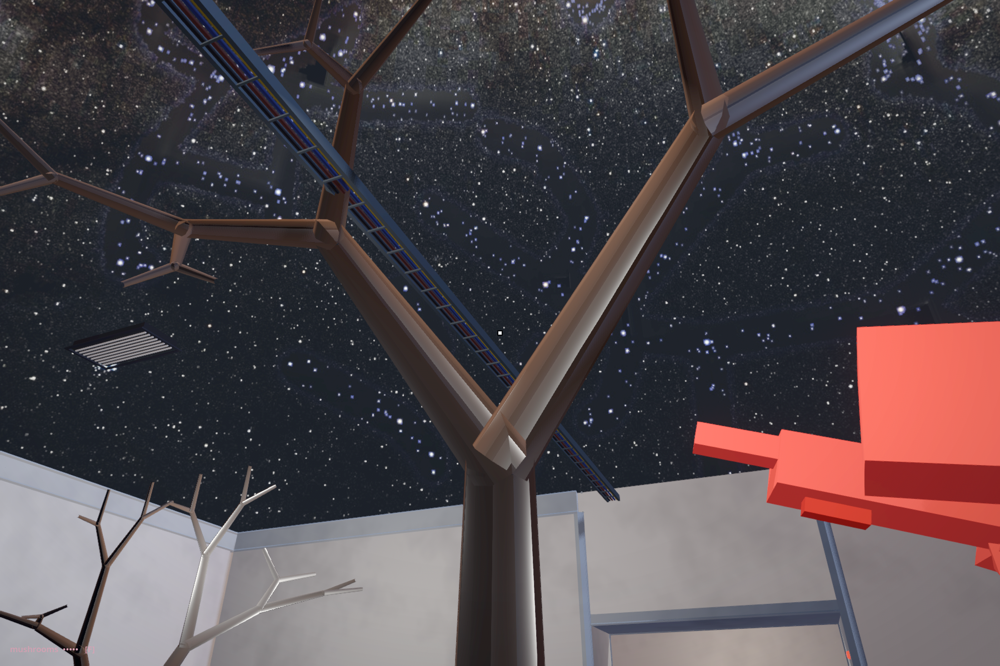

# Where will the next branch go?

<!-- @recursive_tree_2 -->

A trunk waits. Where would you put its first fork?

Press GROW. Two branches appear at its tip. Press again, following one of those branches rather than the outline of the whole tree. Each new pair begins where a previous segment ends. Predict the next fork before asking for it.

The previous room let one call become several. Here we give those calls a place to start, a direction and a length. Four presses leave thirty-one segments, including the trunk. The fourth generation contains sixteen of them. Shorter branches do not mean fewer branches.

Beside the desk, the same tree fits between your hands. A rose point and a black point mark its first fork. Take one. Turn it sideways. Its children move with it; the other family of branches stays. You have changed one attachment, and the change has travelled further than your hand. Look up at the large canopy. It has received the same turn.

The grip lets you turn a branch within a bounded arc. It keeps the length. On release the sphere returns to that branch's tip. There are two kinds of reach here: where your hand can go, and what we allow that movement to alter. A local decision can have many descendants without reaching everything. Release the point before returning to the desk. Its ANGLE and LENGTH controls rebuild the whole specimen; they leave your local edit behind.

Leave the generation count where it is and press ANGLE. The tree opens. Press again: its branches draw closer to the direction their parents were taking. The button cycles through three turns, measured from the parent direction. Follow the same first fork. Its descendants have moved, but none has been added or removed.

Now press LENGTH. The ratio changes from 0.70 to 0.85: each child inherits more of its parent's length. The next press takes it to 0.50. You can make a crowded body or a much smaller one without changing the number of segments. Walk around it. A branch that seemed short from the desk may have been pointing towards you.

These lines come from the growing tree's implementation:

```gdscript
var new_length = parent_data.length * length_reduction
```

And, after the new direction has been calculated:

```gdscript
var end_position = parent_pos + branch_direction * new_length
```

The second line hands the next fork its beginning. A vector, a multiplication and an addition carry the body further. What looked like a tree can be followed as a succession of these handovers.

Press FORKS at the fourth generation. Three descendants now leave each tip. The display rises from thirty-one to one hundred and twenty-one segments. This change adds connections to the branching graph; turning or lengthening its existing edges did not. A visible crossing of two branches still does not join them in the program.

RESET returns to the trunk and the original settings. This specimen uses no random variation. Repeat the same choices and the same branches return. Now press GROW once more and watch where the new branches appear. Every unfinished tip advances in the same press. The desk holds those tips in a queue and works through one generation at a time.

We could instead follow one branch all the way to its last twig before returning for its siblings. A self-call can take that route. With the same fixed angles and lengths, the completed tree could look the same; watching it being made would be a different encounter. Here the next generation waits for your hand. The surrounding museum continues.

There is no light to seek, no root taking water, no neighbour whose shade changes the next fork. At the desk, the branches are visible meshes; they do not offer the player's body a climbable support. In the aisle, the same branch geometry has been enlarged and made solid. Walk towards its trunk. It stops you. Step beside it and look up. The first fork is now above your head.

Grow to the fourth generation again, then return to ANGLE and LENGTH. Open the turn to sixty-five degrees and let each child keep 0.85 of its parent's length. Some tips turn down towards the floor. The count has stayed at thirty-one, but the space beneath them has changed. Walk back among them. What looked like a small adjustment at the desk changes how far the branches reach over you.

The same fork can be something to stand beneath or something to get past. Those meanings arrive with us. The instruction contains neither. We have given the branches size and solidity; we have not taught them to make room for us.

Beside the controls, two flat drawings follow the tree. The plan keeps its spread and leaves out height; the side view keeps height and leaves out depth. A branch can become a short mark, or a dot, by pointing along the direction that drawing omits. Nothing has been cut from the tree. Something has been left out of the account.

Press KEEP before turning a point. Rose lines retain that view while black lines follow the present branches. Walk beneath the canopy, then return. Which difference mattered while you were there? The drawings remember endpoints, not the way you ducked or the branch you thought would stop you. Try describing the tree again. “A smaller branch follows a larger one” may now need a place, a direction, and a body to which it matters.

KEEP does not undo the turn, save this room for another visit, or choose the better tree. It holds one comparison until you replace or clear it. Something caught your attention; the instrument gives you time to decide what to do with that difference.



<!-- @recursive_tree -->

Across the approach, the red block tree has already spent its calls. Choose a large branch and follow it towards its smaller descendants. At a fork, predict the next division, then find another fork at a similar depth. A shared procedure need not give them the same dimensions or the same number of children.

Press STRATA. Colour separates three branching levels from the trunk. Follow a route to its last visible block. REACH draws the accumulated bounds; ENDS adds marks at the handover and terminal branches. FORM returns the original colours. These readings belong to the same built geometry. Changing the view does not draw another tree.

This tree does use random choices, from the seed shown on its desk. The choices vary its branches within a fixed construction rule. A seed can repeat an arrangement; it cannot tell us which arrangements the rule never permits. Even the blunt boxes can persuade us to call it organic. We can enjoy that recognition and still ask what it has made too easy to recognise.

<!-- @ -->

The small tree further in begins with a sentence. A short string is rewritten four times, then read as steps and turns. Its angle control changes how those turns are drawn. The letters can stay while the branches move.

Look back at the two studies near the entrance: the growing tree keeps its proportions; the red tree repeats a seeded draw. Beside them, the little grammar tree gives instructions letters we will learn to read in a later hall. Which one most readily becomes a tree in your eyes? That recognition arrives before any of them has met soil, light or wind.

Further in, the downward trees, the mesh fractal, the desk and the small subdivision cubes keep other possibilities in view. They need not all answer the same question. The old enclosure remains a detour around something we cannot see from every position. We have more procedures to learn before resemblance becomes our only way to choose a body.

Next comes Cantor: another generation, this time made by deciding what will be removed.
