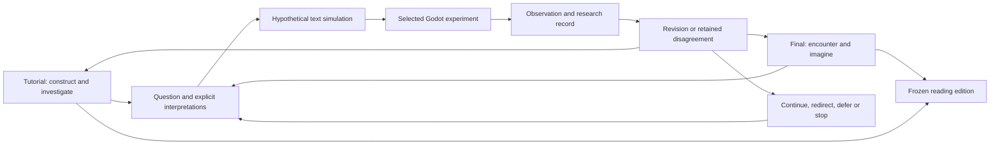

# The book as a literary and computational research apparatus

14 October 2026 · Architecture and proposed practice. The seed-bench companion and scoped scripted experiment exist; human reconstruction remains open and no edition is frozen.

Ada's book has two simultaneous forms: a readable literary work and an experimental environment through which selected passages can be interpreted, reconstructed, questioned and rewritten. Writing can propose something that does not yet exist. An experiment can change the writing, its implementation or the next research question.

Within that book, `tutorial.md` and `final.md` are equal participants in research. The tutorial develops the capacity to construct, understand, predict and change an apparatus. The final develops situated critical and associative inquiry through technical operations, history, artistic interpretation and possible futures. It investigates what an apparatus reveals, conceals, privileges, excludes or makes desirable, without treating an interpretation as a technical finding. Either can initiate an experiment; its consequences can revise either or both. These are different responsibilities, not exclusive territories: a reconstruction can change an artistic question and a literary proposition can demand new technical knowledge.

This architecture adds connections to the existing book. [The book frame](BOOK_FRAME.md) retains publication order; [Course World](course/COURSE_WORLD.md) retains the Endless Museum as the learner's environment. The student builds a growing study using its supplied player, lighting and interaction components. A portable study can isolate a mechanism and return to its hall. No second museum or replacement book index is required.

## Six connected components

| Component | Responsibility | Where it lives |
| --- | --- | --- |
| Two text practices | Construction and experimentation in the tutorial; encounter and possibility in the final; either can initiate and receive research | The hall's existing `tutorial.md` and `final.md`, or explicitly identified drafts |
| Simulation proposition | A selected interpretation with actors, conditions, rules, intervention and exclusions | `proposition.md` and interpretation entries in a companion experiment |
| Text simulation | A hypothetical sequence that exposes assumptions and possible consequences | `text-simulation.md`, labelled as reasoning rather than execution |
| Godot experiment | One executable interpretation, with a reproducible incoming state and declared limits | Established scene/script locations; the companion references exact versions |
| Research record | Retained data, observations, failures, captures, contributions and learning debt | The experiment record and linked evidence, with their source/build identities |
| Revision and edition | Revised text/code/questions, preserved predecessors and a curated reading route | Revision records and, later, a frozen edition manifest |



These arrows describe editorial and experimental work. They are not an installed automation pipeline. The relation is many-to-many: several passages can inform one experiment; one passage can support several worlds; the same world can prompt incompatible accounts. Failure, deferral and abandonment remain retrievable dispositions. They need not become published chapters.

After a cycle, review both texts explicitly: revise, retain with reasons, or keep an open question. There is no quota requiring two rewrites. A disagreement may remain productive when the implementation, conjecture and interpretation are clearly identified. Neither text must explain or justify everything in the other, and a literary passage need not become an experiment at all. `final.md` is final for a selected edition, not a final interpretation.

## Selecting knowledge and composing attention

The [encounter research loop](course/ENCOUNTER_RESEARCH_LOOP.md), recorded with Palle on 15 October, turns this architecture into a repeatable working practice. It connects situated description and first-use explanations to one controlled comparison, actual reader response and revision of either text or apparatus. Its [cycle record](course/ENCOUNTER_CYCLE_TEMPLATE.md) preserves evidence and open questions between sessions.

The [writing specification](course/randomness-research-2026-10-14/WRITING_SPEC.md) makes the editorial process explicit: research pool → selection → paragraph cards → competing routes → draft → ghost reading → editorial review → final → experimental return. The pool exceeds the chapter; unused material remains available. Cards retain information, job, attitude, reader gain, bridge and size, with optional critical pressure and experimental potential. A network becomes a chosen sequence of changing questions.

Edge, leak, technical bias and attachment are ways to find a consequential question, not a chapter template. Each selected critical association names an operation or encounter, a rival reading and what could change our minds. Critique can initiate an experiment; the experiment can undermine the critique. Scientific, critical and artistic attention transform each other.

Ghost-reader review follows prefixes of prose and reports changing understanding and expectations; it is separate from tutorial reconstruction. AI cannot certify human desire or pleasure and cannot automatically select the final route. A human editorial decision can retain friction with reasons. The [Random Definition example](course/randomness-research-2026-10-14/WRITING_PILOT.md) is proposed, not a completed reading trial.

## Read, reconstruct, investigate

| Entry | What the reader receives | First local example |
| --- | --- | --- |
| Read | A coherent literary route that works without Godot or implementation details | [Current Random Definition passage](../../commons/maps/Random_Definition/final.md) and [new blog draft](RECURSIVE_BOOK_BLOG.md) |
| Reconstruct | Prerequisites, complete code, exact continuation, comparisons and a return to the museum | [Existing seed lesson](../../commons/maps/Random_Definition/tutorial.md); the five-view companion supplies the current reconstruction |
| Investigate | Competing interpretations, retained versions, open debt, observations and decisions | [Seed-bench companion](experiments/random-definition/seed-bench-001/proposition.md) |

These are entry modes into the same work. The present Markdown links make them navigable without adding a new interface. The book is a curated route through a larger research graph. The museum makes selected parts of that graph spatial and operational. Neither written track needs to cover every artifact. Some halls, including the five particle tutorial hosts in the current audit, still lack their proposed lessons; the architecture describes their intended roles, not universal present completion.

## Companion directories and identity

Keep hall prose, tutorials, map data and scenes at their current locations. Add a small directory under `doc/book/experiments/<hall-or-topic>/<experiment-id>/` containing:

```text
proposition.md       selected question, assumptions and alternatives
experiment.json     identities, source references, state and evidence links
text-simulation.md  hypothetical sequence, including predicted failures
observations.md     actual evidence log, initially explicitly empty
revision.md         before/after links and decisions, initially pending
captures/           created when an actual capture exists
```

The [record contract](experiments/README.md) and [first record](experiments/random-definition/seed-bench-001/experiment.json) make this concrete. Stable passage, interpretation, experiment and run IDs have different roles. Preserve an exact source excerpt and a recoverable version. A path or a hash alone is insufficient if the old bytes disappear. Use a reachable Git commit/blob or an archived snapshot plus hash; mutable branch names are navigation aids only. A later passage edit creates a new source version and leaves the old binding intact.

Working source references do not duplicate or supersede the hall. Immutable evidence snapshots are the deliberate exception. Store a run once and refer to it from competing accounts. Keep the existing sleeve and remembering-wall examples as design branches in [the research spec](course/randomness-research-2026-10-14/text_experiments.json); the seed companion now has a scoped scripted run and open human trial. There is no migration of every hall in this pass.

## The smallest useful pilot

Begin with the existing seed lesson's 4×4 case: sixteen cells and forty-eight retained values, grouped into ordered triples. Compare a colour interpretation with a height interpretation without drawing again. [The proposition](experiments/random-definition/seed-bench-001/proposition.md) defines the mapping, controls and an independent reference fixture.

The current [five-view recipe](experiments/random-definition/seed-bench-001/SPATIAL_VIEWS.md) shows flat colour, neutral bars, colour plus height, scale and rotation from the same stored triples. Compare flat/combined views for height and bars/combined views for colour; scale and turn use different fixed shapes and must name that difference. The original two-view records remain recoverable. The pilot is installed as seed_study in Random_Definition; the older grids, atmospheric source and neighbouring sphere remain distinct encounters. Scripted verification does not close human interpretation, headset or independent reconstruction checks.

The tutorial's existing channel-swap exercise and the final's question about assigning values different work both motivate the mapping. Each has an exact source binding in the companion. A text simulation predicts a consequence. Godot must test the implementation. An observation records what changed and what stayed fixed. Separate reviews of the tutorial and final, and a decision about further work, complete the return. The first comparison has a mostly predictable numerical outcome; its initial purpose is to test the method, reconstruction and encounter. A later experiment is selected from what actually happens, with continue, redirect, defer or stop all available. The sleeve is one possible later investigation, not the predetermined second build.

## Evidence and contribution

Preserve the differences between proposition, text simulation, execution, observation and interpretation. An AI account of what a scene might do is a hypothesis. Code inspection is not a run. A headless run is not a headset encounter. A screenshot is evidence of an image, and its interpretation identifies the actual image and observer. A scripted reconstruction is not evidence that an independent person learned the mechanism.

The accepted seven-step cycle and three verification levels remain in [the research specification](course/randomness-research-2026-10-14/SPEC.md). Loading, stability, performance, physical VR and independent reconstruction remain separate. Retaining random values supports data replay; acquiring a genuinely new unpredictable outcome is a different operation. A proposed record has no fabricated result or Godot scene path.

Contributions record who or what proposed, interpreted, implemented, observed and selected a change, including AI model/version when known. Unknown origin stays unknown. The person returning to the work may not have composed or understood all of it. Learning debt distinguishes an unverified claim, an unfamiliar working mechanism and an unresolved interpretation. Give each a question, responsible position where known, evidence links and a possible next investigation. A passing test can settle a claim while leaving understanding open.

Reader contributions enter as proposed records with source version, method, assistance and limits. A reviewer records accept, revise, defer or reject with reasons and links. Acceptance of an observation does not automatically accept its interpretation or publish its text. Preserve conflicting accounts and consent for any attributed human quotation or capture. Nothing here sends a contribution or publishes a chapter automatically.

## Frozen editions and the continuing research graph

A reading edition must remain identifiable while the research continues. Freeze a selected route, not a moving branch. An edition manifest must name:

- A unique edition ID, parent edition, date, draft/frozen/published status and responsible editorial decision.
- Ordered chapters and exact passage/tutorial versions, using recoverable Git objects or bundled snapshots with byte hashes.
- Images, assets, code/build dependencies and any supplied downloads, each with provenance and recoverable versions. External mutable resources need a retained permitted copy or an explicit availability limitation.
- Included experiment/interpretation IDs, evidence scope, open learning debt, contributions and dispositions. Deferred branches remain discoverable without becoming part of the reading order.
- The readable output file and its hash, plus a human-readable change record from the parent edition. Freezing source files alone does not verify the rendered reading edition.

After freezing, corrections produce a new edition linked to its predecessor. Model updates, code changes and new observations do not silently alter old chapter content. Branches can keep developing outside that frozen selection. Publication is a separate decision from freezing a local candidate. No edition or exporter is claimed complete by this architecture pass.

## Work order

Keep the existing twenty main tasks and original five writing tasks; add W006–W010 for composition and reading review. The user has selected the 48-value seed bench as the first planned pilot. Main .002 records that choice alongside any remaining route/host details; .003 builds the seed cycle using this companion. Writing .001 binds both source texts and their questions; .002 completes the reciprocal run and reviews each text; .005 selects further work from actual evidence rather than automatically selecting the sleeve. Writing .003 audits claims and reconstructed lessons; .004 makes editorial dispositions and prepares the identifiable edition candidate. W006 builds the pool, W007 cards/routes, W008 drafts and ghost reading, W009 a critical return, and W010 editorial/human selection. W004 now also waits for W010; the five particle lessons do not wait for these new writing tasks. [The task plan](course/randomness-research-2026-10-14/TASKS.md) carries the exact acceptance criteria.

The five particle lessons retain their existing order and local baselines. A selected lesson may gain a passage/experiment companion; it need not create a new book format or wait for the optional sleeve. Current hall sequences, the noise exit to Shaders and optional research returns remain as specified.

The supplied architecture is preserved [byte for byte](course/randomness-research-2026-10-14/imports/2026-10-14-book-architecture/manifest.json), including its pasted diagram formatting. This document replaces that residue with a small readable diagram and distinguishes the existing book, these new companion documents and the future executable work.
