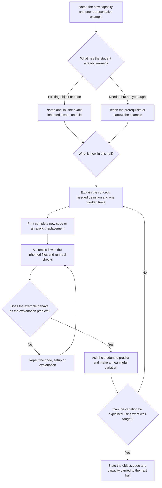
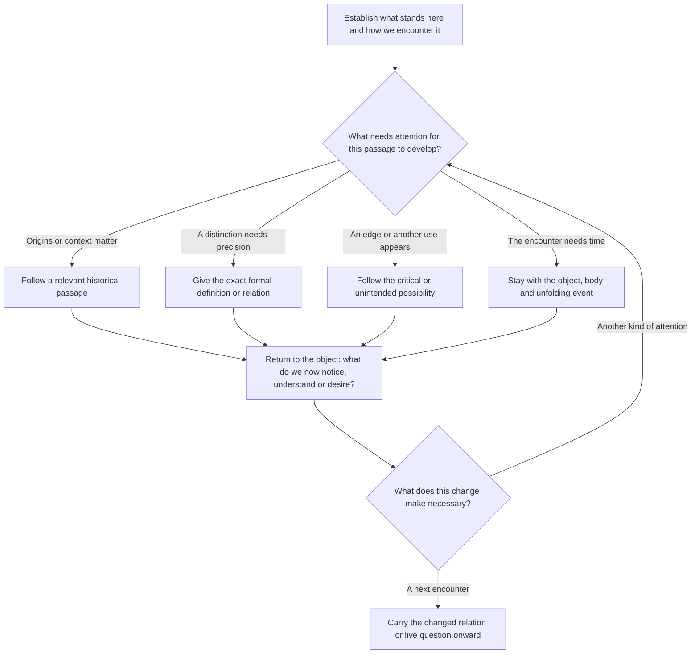

# Two texts in one conceptual space

## Differently situated researcher and writer · 15 October 2026

The [independent literary handoff](INDEPENDENT_LITERARY_HANDOFF.md) records Palle's supplied division of labour: the situated researcher supplies verified material conditions and uncertainties; a separately situated writer develops a complete literary candidate; Palle chooses calibration examples and adoption. The final need not explain the apparatus's intended meaning. Interpretations and proposed gems stay outside the writer's factual dossier unless requested. Read the chapter as literature before conducting its separate technical reading; factual constraints remain available before drafting.

Three different calibration encounters are being prepared: the five-row abacus, Geiger, and cellular automata (Palle's choice of third area). The [candidate packet](../iterations/2026-10-15-independent-writer/index.html) preserves existing passages without marking them approved. The current local “we” direction remains; selecting a subject is not selecting an exact passage or a book-wide voice. Writer-proposed order changes remain reviewable proposals, with Random Definition's room/final alignment maintained upon adoption.

## Chosen opening voice · 15 October 2026

After reading the moving-spheres-to-RAND opening in several perspectives, Palle said of the “we” version: “ok I think that voice works.” Use its shared, situated voice as the working reference for this opening: we encounter, act and think together, with scientific distinctions introduced where they change the encounter. Keep the identity of the voice open and let feelings remain open rather than instructing the reader what to feel. The [selected passage and comparison record](../iterations/2026-10-15-bachelard-opening/README.md) are retained; the opening is now in Random Definition's final. This is a concrete local choice, not approval of every sentence or a requirement to rewrite every hall in “we”.

## Scientific and poetic attention · 15 October 2026

Palle clarified that none of the three moving-sphere openings was a clear winner. The desired change concerns attention: scientific and poetic, grounded in the actual encounter. [Authors' strategies](writing-patterns/AUTHOR_STRATEGIES.md) collects selectable operations, starting with Bachelard, with scene-specific uses and limits. Choose a strategy for a live writing need; do not make its author a permanent narrator or its sequence a compulsory chapter template. Keep implementation, reported experience and imaginative proposals distinguishable. The collection is available for trials; it does not establish an approved voice or revise the chapter by itself.

For the reusable working process and resumption checklist, use [From encounter to revision](ENCOUNTER_RESEARCH_LOOP.md) and its [cycle record](ENCOUNTER_CYCLE_TEMPLATE.md). These preserve the method developed with Random Definition; the roles and scope decisions below remain its writing contract.

Palle's direction, 13 October 2026. The roles below record his distinction; the decision trees are an editorial proposal to try on Random Definition. They are not an accepted prose sample or a compulsory sequence of paragraphs.

> “We are really standing in a conceptual space.”

## The two roles

| | tutorial.md | final.md |
| --- | --- | --- |
| Reader's activity | Reconstruct, understand, predict and modify a working example. | Encounter the object and follow what it opens in thought, history, desire and action. |
| Kind of text | A cumulative programming lesson inside the museum. | A literary passage in the museum's novel, written with Palle's OOO orientation. |
| What travels onward | An object, usable code, a concept and a new capacity. | A changed relation to an object, an unresolved possibility or a question the next encounter can develop. |
| Exact knowledge | Define what is needed to understand and build the operation. | Define what is needed to understand the object or the stakes of the passage. Precision belongs here too. |
| Evidence | Printed new code plus explicit inherited dependencies; real execution and behavioural checks. | Current encounters checked against maps and scripts; historical claims sourced; formal claims checked; invention and interpretation recognisable as such. |
| Successful reading | The student can explain what the new part does and make a meaningful change. | The reader sees or wants something in this particular algorithm that the initial encounter did not yet disclose. |

The distinction is the work a passage does, not an exclusive division into facts on one side and feelings on the other. Both texts teach. A formal definition may appear in both when it serves a different need; refer back when repeating it would add nothing. A historical detail belongs in the tutorial if it is needed for the construction, but a biographical excursion usually has more room in the final.

## Tutorial decision tree

This is a decision process for the writer. The student's prose need not expose these headings. Keep control construction and room setup proportionate to the new subject. An intelligent future student still needs an untaught concept explained. A passing test establishes that a program works; it does not answer the reader-comprehension branch for us.

## Final decision tree

The literary voice can move among four kinds of attention. These can overlap within a paragraph.

| Attention | What the writer needs to find | Reason to enter it |
| --- | --- | --- |
| Orientation / object | What stands here, what it does, what meets or resists a body, what has changed since the previous room. | The reader needs a place and a concrete encounter. |
| Historical | A person, practice, dispute or circumstance that helps us understand this object or algorithm. | Its origin, purpose or inherited vocabulary changes the encounter. |
| Formal | An exact definition, relation or limit, with the relevant conditions. | A distinction cannot be understood accurately without it. |
| Critical / unintended | What an arrangement permits, frustrates, normalises or unexpectedly enables; an edge, misuse, pleasure or other possible relation. | The encounter exposes a consequential choice or invites another use. |

One possible journey is **room → history → formal definition → room again → critical position**. A different hall might begin with a failure, reach a definition through it, and only later discover its history. Follow the object's problem and the passage's rhythm. Do not write every hall as four labelled mini-essays or force every branch into every text. “Return” can be a thread held through a long passage, not a repeated sentence announcing that we are back in the museum.

## Situated description and first-use explanations

Palle's direction, 15 October 2026: describe a little more of what the visitor actually sees, and briefly explain concepts the reader has not yet encountered. Apply this when revising each hall; do not assume a term is known merely because it occurs in code, an artifact title or a planning note.

Anchor an unfamiliar operation in a visible or audible event: what object is here, what changes, what stays, and what a hand can do. Introduce the necessary meaning inline, where it helps the reader interpret that event. Avoid defining one unfamiliar term entirely through another. Detailed construction remains in the tutorial; the final needs enough explanation to sustain its encounter and argument. This is a readability check, not a compulsory paragraph template.

Use that description in the research loop: keep the claim about implemented behaviour separate from an observed visitor response. After one controlled change, can the reader identify what changed and what remained, explain the relevant distinction in their own words, and propose a further comparison? Record confusion or a different interpretation without treating either as failed participation. Source inspection can ground the description; it cannot establish that the reader understood it or saw it clearly in VR.

## What OOO changes in this writing

Palle names object-oriented ontology as the orientation of the literary voice. For this book, the following are proposed writing consequences, not a summary of the whole philosophical tradition:

- Give the object attention before making it illustrate a thesis. Its material, behaviour and relations can complicate what the narrator expects.
- A formal description is a way to understand the object, not a reason to stop encountering it. Watch what happens when its relation to a hand, another object or a use changes.
- Let nonhuman things participate in what happens. Code, surfaces, gravity, cards, threads and generators have consequences even when they frustrate the intended lesson.
- Keep the formal rule, its implementation, the encounter and our interpretation distinguishable. An object need not speak or acquire human intentions for a passage to give it presence.
- Let critical thought arise from something particular. The unforeseen can be funny, useful, troubling, queer or beautiful; it need not end as a diagnosis of exclusion.

The final belongs to a novel. Across halls, objects, capacities and questions recur and change. An excursion should affect that continuing experience. Literary freedom does not authorise invented biography or the claim that an imagined artifact is already installed.

## A content tree and a reading timeline for each text

Palle's further direction, 13 October 2026: make the tree for **each particular text**, then its timeline, with a mini instruction for each node and its bridge to the next. The general decision trees above help the writer make choices; they do not replace these individual plans.

Keep two linked plans per hall: one for `tutorial.md`, one for `final.md`. They draw on shared research but select and order it for different reader activities. Make a plan when working on that text; do not manufacture unresearched plans for the whole spine.

1. **Map the possibilities.** Root the content tree in this text's central problem. Give candidate nodes stable IDs. Mark them selected, reserve or needing evidence; a reserve branch has a reason for staying outside this draft. Cross-links can show relations that a tree alone cannot hold. The graph records our approaches to the object, not everything the object is.
2. **Choose the path.** Arrange selected nodes along a reading timeline. This is the order of the reader's encounter, not necessarily chronology, walking order or one paragraph per node. Revisit a node when returning changes its meaning. Record the dependencies that limit reordering, especially in the tutorial.
3. **Write the instructions.** For each stop, name the reader's gain, give a short imperative to the writer, set the depth and a rough word allowance, and state the bridge to the next stop. Allocate the text's total budget across these stops, including transitions; avoid equal slices that flatten the important passages. A bridge explains why this development leads there: a question becomes necessary, an expectation breaks, an operation needs a prerequisite, or an earlier object changes meaning. “Next, discuss history” is not a bridge.
4. **Keep the evidence attached.** Link current artifacts, inherited lessons, code checks and historical sources beside the plan. Distinguish an installed encounter, a student reconstruction, an interpretation and an imagined extension. Evidence is a foundation for writing, not material that must all appear in the prose.
5. **Revise the route as prose develops.** Check whether each stop earns its space and whether its bridge works in the actual reading. Cut or move a node when it repeats a gain; expand it when it hides a new concept. Preserve a promising unused branch. Check length against the budget below. There is no required number of nodes, minimum to fill or universal opening/ending.

Use this compact timeline table in each plan:

| Order / node | Reader gains | Mini instruction to the writer | Depth / word allowance | Bridge to next node |
| --- | --- | --- | --- | --- |
| Stable ID and specific subject | What changes in understanding, attention or ability | What to do in the passage | Kind of attention and approximate prose words; code counted separately | Why the next stop follows; what question, object or operation crosses over |

Tutorial order protects learning dependencies. Final order develops attention, tension, historical understanding and possibility. A good final may delay an explanation for literary effect; a tutorial cannot omit the explanation a learner needs to use its new operation. Plans remain working proposals until judged through prose. A completed plan is not evidence of a successful reading.

## Paragraph movements: information, job and attitude

Palle's comparison of the randomness chapters in *The Nature of Code* and *10 PRINT* adds another scale to the plan. After choosing the nodes, sketch the paragraph timeline inside them. A node may need several paragraphs, a diagram, a code block or a pause for an action. Keep these separate reading events visible.

For each proposed paragraph record **information → job → attitude → reader change → bridge**, with a share of its node's word allowance. Information names what enters; job names what the writing does; attitude names how it approaches its object and reader. “Historical” identifies a kind of information, whereas “curious”, “uneasy” or “skeptical” describes an attitude. A precise definition can be offered patiently; a question can be playful or exacting. Do not confuse tone with accuracy or require a different tone in every paragraph.

The [reference reading notes](writing-patterns/REFERENCE_READINGS.md) locate selected source paragraphs and interpret their movements. The [pattern examples](writing-patterns/PATTERNS.md) supply three original Ada routes with mini instructions and short prose samples: **build and vary**, **leave the object and return changed**, and **a claim meets resistance**. The [interactive library](http://localhost:3003/writing-patterns) adds five adaptations from the source readings, editable variations, side-by-side comparison and per-hall reading notes. Saved variations live in `writing-patterns/experiments.json`; see the [library guide](writing-patterns/README.md). These are alternatives for developing a passage, not compulsory stages or author-style imitation.

Inspect both tracks across a draft: does information accumulate coherently, and does attention develop rather than remain in one explanatory register? Check the bridges in the actual prose. A long sequence of facts may need an encounter or a consequence; an extended imagined scene may need a precise distinction. Neither is an automatic defect. Merge, expand or move paragraphs according to what the reader needs. The paragraph timeline plans a reading; it does not script how a student must feel.

## Size constraint and the possibility of another map

Palle's updated direction, 15 October 2026: length should follow the number and depth of the selected gems, normally **600–1,500 prose words per text**. This supersedes the earlier provisional 450–700 final / 600–900 tutorial targets and 800/1,000 review thresholds. A gem is a productive, investigable relation; it is not another name for every artifact. Here a chapter means a hall's tutorial/final pair, not an entire sequence.

| Text | Aim for body prose | Scope review required above |
| --- | --- | --- |
| tutorial.md | 600–1,500 words, according to the selected reconstruction | 1,500 words, or earlier if learning load becomes dense |
| final.md | 600–1,500 words, according to the selected gems | 1,500 words, or earlier if attention becomes crowded |

Do not fill toward 1,500 or divide a budget equally among artifacts. Choose the encounters that develop a question, give their necessary explanations and let other objects remain optional. A six-encounter text may use fewer words than a three-encounter text whose gems need more development. Shorter is fine when the job is complete. Crossing the range or becoming dense requires a recorded editorial decision: revise, defer a branch, propose another map, or justify a local exception. Word count alone does not authorise another map or establish a successful reading.

Count headings, captions, lists, table explanations and inline code in the reading; exclude fenced code, markup, link destinations and reference notes. Report substantial notes separately rather than using them to hide required explanation. Record new executable code separately in nonblank lines, distinguishing the teaching operation from interface/support files. Code still costs attention even though its syntax is not charged as prose. Do not cut necessary new code, move an essential definition into a footnote, or omit setup to pass the word count. The testable reconstruction contract remains intact.

Give each timeline node an approximate allowance and check the sum. These are planning amounts, not equal paragraph quotas: move words toward the concept that needs them. Recheck the pair's total and the density of new ideas after drafting; a short text can still be overloaded.

When a text exceeds its limit or carries too many new ideas:

1. **Repetition?** Remove repeated setup, duplicated explanation and old code already available through an exact inherited reference. Keep the reason, definition and worked example a learner needs.
2. **An optional excursion?** Return it to the reserve tree or an optional companion reading with a clear purpose. Do not relocate a prerequisite needed to complete this lesson.
3. **A second learning destination?** If the excess needs its own explanation, worked example or investigation, test whether it merits a map. A good split names the first hall's complete capacity, the object/state it hands over, the second hall's distinct capacity or encounter, and a corresponding spatial/interactive reason to stop there. Check whether an existing later hall can receive it first. Length alone does not justify a room.
4. **One indivisible encounter?** Keep the necessary development and record a justified local budget exception. A long historical passage in the final may belong to the same encounter; it need not become an artificial second programming lesson. Review literary rhythm and learning load together.

A split proposal should show the two revised trees and timelines, their budgets, and the bridge between the halls. Preserve the different jobs of tutorial and final in both. No map or spine change is made merely to satisfy a word count.

## Try the distinction on Random Definition

**Tutorial:** return to the existing cube grid and carried point. Introduce local generator state, a seed, successive requests and RGB assignment. Trace one discarded draw; reconstruct and test it. Carry explicit sampled data toward Entropy.

**Final, possible journey:** encounter the two returning pictures; follow the number-book object toward the historical preparation of random tables; make the formal distinction between a deterministic sequence and the use assigned to each value; return to the same seed producing a changed palette; follow the possibility of assigning the draws another job. The history needs verified sources. The formal passage must distinguish the rule from a claim about every meaning of randomness. The critical possibility should be allowed to develop rather than immediately be explained away.

This is a route proposal, not the next final already written. The room supplies the encountered objects, but the text can travel through the conceptual space they open.

The individual, editable plans are now [Random Definition — tutorial tree and timeline](text-plans/Random_Definition/tutorial.md) and [Random Definition — final tree and timeline](text-plans/Random_Definition/final.md). Both begin at the current main-spine location, after Wavefunctions and before Random Entropy. They plan the next draft; they do not describe a rewrite already made.

## Palle's checkpoint and remaining decisions

Settled direction: clarify the two roles; write the final as a literary/OOO passage in conceptual space; allow orientation, history, formal precision and critical attention to lead into one another.

Still to establish in actual writing: narrator and address, pace, density, whether the proposed size budgets work, how far a particular excursion should go, and one passage Palle recognises as a baseline. The current Random Definition final has not acquired that status through this document.

Use phuman_in_the_loop to show the actual passage, what it attempts, what changed and the next consequential question. Score the writing with evidence; do not raise its score because a better plan has been written. The earlier 6/10 concerned the existing pair under its previous brief and is not a validation of this new approach.
