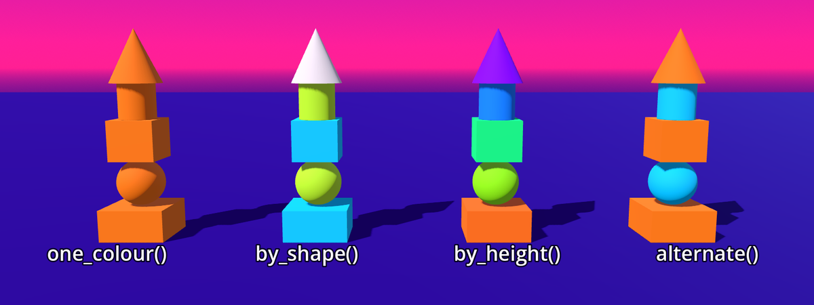

<!-- chapter 4 · color (spine sequence 4) · functional text · 2 October 2026
Check it from doc/book/course/:
python functional_text/check.py --taxonomy taxonomy.json --godot functional/ch04.md
taxonomy.json holds every entry it needs (its patch: functional/patches/).
The opening picture is the encyclopedia's /course/sketch/04-color.png;
../sketch/img/04-color.png is the same file. -->
# 4 Colour by Function



*[four towers of the same five shapes, each coloured by its own function]*

A colour is three numbers.
A function returns one.
A class gives each object its own numbers.

<!-- section 4.1
needs: _ready, func, extends, Node3D, var, :=, for, in, if, %, ==, MeshInstance3D, BoxMesh, SphereMesh, mesh, position, Vector3, +, add_child, =, script, node, base_scene, delete_a_node, run_the_project, root_node, new
gives: Color, rgb, material, albedo_color, StandardMaterial3D
-->
<!-- builds: chroma_stack, one colour (Color_Context_Placed) -->
## 4.1 A colour is three numbers

*[one tower of five pieces, box, ball, box, ball, box, all in orange]*

Delete every node you added: keep the base scene's own.
Each example replaces the root node's script.

<!-- code: claim="get_children().filter(func(c): return c is MeshInstance3D).size() == 5" claim="get_children().filter(func(c): return c is MeshInstance3D)[1].mesh is SphereMesh and get_children().filter(func(c): return c is MeshInstance3D)[4].mesh is BoxMesh" claim="get_children().filter(func(c): return c is MeshInstance3D).all(func(c): return c.mesh.material == get_children().filter(func(d): return d is MeshInstance3D)[0].mesh.material)" claim="get_children().filter(func(c): return c is MeshInstance3D)[2].mesh.material.albedo_color == Color(1, 0.45, 0.1)" -->
```gdscript
extends Node3D

func _ready():
	var orange := StandardMaterial3D.new()
	orange.albedo_color = Color(1, 0.45, 0.1)
	for storey in 5:
		var piece := MeshInstance3D.new()
		piece.mesh = BoxMesh.new()
		if storey % 2 == 1:
			piece.mesh = SphereMesh.new()
		piece.mesh.material = orange
		piece.position = Vector3(0, storey + 0.5, 0)
		add_child(piece)
```

Run the project: five pieces, all orange.

- `Color(1, 0.45, 0.1)` holds red, green and blue, each 0 to 1.
  - `Color` is RGB: red, green and blue light, mixed.
- A material is what a mesh wears: its colour and how it shines.
  - `StandardMaterial3D` is Godot's usual material.
  - `albedo_color` is a material's own colour.
  - `mesh.material` puts the material on the mesh.
- `.new()` makes a new one of the kind named before it.
  - `MeshInstance3D.new()` makes each piece in code.
- Change the colour to `Color(0.5, 0.5, 0.5)`: the tower turns grey.
  - Three equal numbers make a grey.
  - Restore: `Color(1, 0.45, 0.1)`.

Five pieces wear one material: `orange`.

<!-- section 4.2
needs: Color, albedo_color, StandardMaterial3D, material, new, extends, Node3D, =, func, _ready, var, :=, for, in, if, %, ==, +, -, /, true, false, MeshInstance3D, BoxMesh, SphereMesh, mesh, position, Vector3, add_child, call, run_the_project, function
gives: parameter, return, ->, void, by_height, local_variable, inverted
-->
<!-- builds: chroma_stack, four rules (Color_Context_Placed) -->
## 4.2 A function returns a value

*[four towers: all orange; red boxes, blue balls; blue foot to orange top; orange and blue in turn]*

*[diagram: `2` goes into `by_height(up)`; a `Color` comes back; `var c` keeps it]*

The same tower four times, coloured by four rules.

**Example 4.1: four colour rules on one tower**

<!-- code: claim="get_children().filter(func(c): return c is MeshInstance3D).size() == 20" claim="one_colour() == Color(1, 0.45, 0.1) and by_shape(true) == Color(0.15, 0.35, 0.9)" claim="alternate(alternate(one_colour())).is_equal_approx(one_colour()) and alternate(one_colour()).is_equal_approx(Color(0, 0.55, 0.9))" -->
```gdscript
extends Node3D

func one_colour() -> Color:
	return Color(1, 0.45, 0.1)

func by_shape(ball) -> Color:
	if ball:
		return Color(0.15, 0.35, 0.9)
	return Color(0.9, 0.15, 0.15)

func by_height(up) -> Color:
	return Color(up / 5, 0.4, 1 - up / 5)

func alternate(below) -> Color:
	return below.inverted()

func add_piece(place, ball, colour):
	var look := StandardMaterial3D.new()
	look.albedo_color = colour
	var piece := MeshInstance3D.new()
	piece.mesh = BoxMesh.new()
	if ball:
		piece.mesh = SphereMesh.new()
	piece.mesh.material = look
	piece.position = place
	add_child(piece)

func _ready():
	var below := one_colour()
	for storey in 5:
		var ball := storey % 2 == 1
		var up := storey + 0.5
		add_piece(Vector3(-3, up, 0), ball, one_colour())
		add_piece(Vector3(-1, up, 0), ball, by_shape(ball))
		add_piece(Vector3(1, up, 0), ball, by_height(up))
		add_piece(Vector3(3, up, 0), ball, below)
		below = alternate(below)
```

Run the project: four towers of the same five pieces.

- `_ready` is a function: a named block of code.
- Each rule is a function.
  - It takes values and can return one.
  - `-> Color` says it returns a `Color`.
  - `return` ends the function and sends a value back.
  - `var c := by_height(2)` keeps the returned value.
- `one_colour()` returns orange, whatever the piece.
- `by_shape(ball)` returns blue for a ball, red for a box.
- `by_height(up)` returns blue low down, orange high up.
- `alternate(below)` returns a colour made from the one under it.
  - `inverted()` returns the opposite colour: one minus each number.
  - Orange, blue, orange: the opposite of the opposite is the first.
- `ball`, `up` and `below` are parameters.
  - A parameter is a value a function is given when it is called.
- In `_ready`, `ball` keeps a test's result, `true` or `false`.
  - `by_shape(ball)` hands that value in: the parameter `ball` holds it.
  - Only the value goes in: the names need not match.
- `add_piece(place, ball, colour)` returns nothing: it builds.
  - `void` marks a function that returns no value: `-> void`.
  - Its `look` and `piece` are local variables.
  - A local variable lives only inside its function.
  - Each call makes a new `look`: each piece wears its own.

The pieces are the same.
The function decides the colour.

<!-- section 4.3
needs: Color, material, MeshInstance3D, BoxMesh, extends, Node3D, func, _ready, _process, $, =, +, position, scale, Vector3, mouse_point(), add_a_node, run_the_project, z, node, rgb, var, new, add_child, mesh
gives: SpotLight3D, light_color
-->
<!-- builds: flashlight_demo (Color_Flashlight) -->
## 4.3 Light has a colour

*[a white board under red, green and blue pools of light; their overlaps yellow, cyan, magenta, white]*

A material has a colour.
So does light.

Create a board and three lamps.
A `SpotLight3D` is a node that shines a cone of light.

**Example 4.2: three lamps on a board**

<!-- code: claim="red.light_color == Color(1, 0, 0) and blue.light_color == Color(0, 0, 1)" claim="is_equal_approx(blue.position.y, 1.3)" -->
```gdscript
extends Node3D

var board = MeshInstance3D.new()
var red = SpotLight3D.new()
var green = SpotLight3D.new()
var blue = SpotLight3D.new()

func _ready():
	board.mesh = BoxMesh.new()
	add_child(board)
	add_child(red)
	add_child(green)
	add_child(blue)
	board.position = Vector3(0, 1.5, 0)
	board.scale = Vector3(4, 3, 0.1)
	red.position = Vector3(-0.4, 1.7, 1)
	green.position = Vector3(0.4, 1.7, 1)
	red.light_color = Color(1, 0, 0)
	green.light_color = Color(0, 1, 0)
	blue.light_color = Color(0, 0, 1)

func _process(_delta):
	blue.position = $Supplied.mouse_point() + Vector3(0, 1.3, 0)
```

Run the project: a red pool and a green pool.
Move the mouse in front of the board: blue follows.

- The pools overlap in new colours.
  - Red and green overlap in yellow.
  - Green and blue make cyan.
  - Blue and red make magenta.
  - All three make white.
- `light_color` is the colour of a light.
- A `SpotLight3D` shines away from you, along -z, onto the board.

A material gives light back.
A lamp gives light out.
Two lamps add: `Color(1, 0, 0)` and `Color(0, 1, 0)` make `Color(1, 1, 0)`.

<!-- section 4.4
needs: point, Color, x, y, z, function, return, ->, material, StandardMaterial3D, new, albedo_color, extends, Node3D, func, _ready, _process, $, =, position, scale, Vector3, mouse_point(), MeshInstance3D, BoxMesh, SphereMesh, mesh, delete_a_node, add_a_node, run_the_project, metre, var, add_child
gives: colour_from
-->
<!-- builds: nail_color_controller, hand_color_controller (Color_Nails) -->
## 4.4 A colour for every place

*[a lime point over a white square; beside it, a tall swatch in that place's colour]*

A point and a colour are both three numbers.

Make a point, a square and a swatch.
The code creates all three.

**Example 4.3: a colour from a place**

<!-- code: claim="colour_from(Vector3(1, 0.5, 0)) == Color(1, 0.5, 0)" claim="swatch.mesh.material.albedo_color == colour_from(point.position) and point.position.y == 0.5" -->
```gdscript
extends Node3D

var point = MeshInstance3D.new()
var square = MeshInstance3D.new()
var swatch = MeshInstance3D.new()

func colour_from(p) -> Color:
	return Color(p.x, p.y, p.z)

func _ready():
	point.mesh = SphereMesh.new()
	add_child(point)
	square.mesh = BoxMesh.new()
	add_child(square)
	swatch.mesh = SphereMesh.new()
	add_child(swatch)
	square.scale = Vector3(1, 0.02, 1)
	square.position = Vector3(0.5, 0, 0.5)
	swatch.scale = Vector3(0.5, 1, 0.15)
	swatch.position = Vector3(-1, 1, 0.5)
	swatch.mesh.material = StandardMaterial3D.new()

func _process(_delta):
	point.position = $Supplied.mouse_point()
	point.position.y = 0.5
	swatch.mesh.material.albedo_color = colour_from(point.position)
```

Run the project and move the mouse over the square.

- Toward the right, the swatch reddens.
- Toward you, it turns blue.
- Leave a place, come back: the same colour.
- `colour_from(p)` reads a point as a colour.
  - x is red, y is green, z is blue.
  - `point` follows the mouse at y 0.5: green stays at half.
- `square` marks where x and z run from 0 to 1.

Every colour has a place in a box one metre wide.
The function turns the place into the colour.

<!-- section 4.5
needs: Color, function, return, ->, extends, Node3D, var, :=, func, _ready, for, in, $, *, /, +, =, MeshInstance3D, BoxMesh, StandardMaterial3D, new, albedo_color, material, position, scale, Vector3, add_child, delete_a_node, run_the_project, x, y, z, point, grid, supplied, mesh, script
gives: from_hsv, hsv, hue, saturation, hue_for, colour_at, lerp
borrows: band_mesh
-->
<!-- builds: rainbow (Color_Rainbow); pillarcolorcollection (Color_Pillar) -->
## 4.5 Around the hue circle

*[the rainbow arch at six bands and at forty-eight; a grid of pillars, hue across, saturation toward you, brightness up]*

Stop the project, then replace the script.

**Example 4.4: the rainbow in bands**

<!-- code: claim="$Supplied._ft_calls.count('band') == 6" claim="is_equal_approx(hue_for(3, 6), 0.4)" claim="Color.from_hsv(0, 1, 1) == Color.from_hsv(1, 1, 1)" claim="3 / 6 == 0" -->
```gdscript
extends Node3D

var bands := 6

func hue_for(i, n):
	return 0.8 * i / n

func _ready():
	for i in bands:
		$Supplied.band(i, bands, Color.from_hsv(hue_for(i, bands), 1, 1))
```

Run the project: six bands.

HSV is a colour as hue, saturation and brightness.

- Hue is where a colour sits on the colour circle.
  - Hue 0 is red, hue 1 red again: the circle closes.
  - In HSV, a rainbow is one number changing: hue.
- Saturation is how strong a colour is, from grey to full.
- `Color.from_hsv()` makes a `Color` from hue, saturation and brightness.
  - It is built into Godot.
  - So is `lerp()`: it returns a value between two ends.
- The band mesh is the rainbow's arch, supplied.
  - `$Supplied.band(i, n, colour)` colours band `i` of `n`.
- `hue_for(i, n)` shares the hue out among `n` bands.
  - Without `->`, the function may return any value: here, a number.
  - `3 / 6` is 0: with no `.0`, the parts drop.
  - `0.8 * i` comes first, with its parts, so nothing is dropped.
  - `0.8` stops the bands before they come round to red.
- Saturation 1 and brightness 1: every band at full strength.
- Set `bands` to 48: thinner bands, the same arch.
  - Restore: `bands` to 6.

**Example 4.5: the HSV pillars**

<!-- code: alone claim="get_children().filter(func(c): return c is MeshInstance3D).size() == 160" claim="colour_at(Vector3(2, 1, 0.75)) == Color.from_hsv(0.5, 0.5, 0.5)" -->
```gdscript
extends Node3D

func colour_at(p) -> Color:
	return Color.from_hsv(p.x / 4, p.z / 1.5, p.y / 2)

func _ready():
	for x in 8:
		for z in 4:
			for y in 5:
				var look := StandardMaterial3D.new()
				var block := MeshInstance3D.new()
				block.mesh = BoxMesh.new()
				block.position = Vector3(x * 0.5, y * 0.4 + 0.2, z * 0.5)
				block.scale = Vector3(0.3, 0.38, 0.3)
				look.albedo_color = colour_at(block.position)
				block.mesh.material = look
				add_child(block)
```

Run the project: a grid of pillars.

- `colour_at(p)` returns a colour for any point.
  - Along x, the hue goes round.
  - Toward you, along z, the colours grow strong.
  - Up each pillar, black turns to full colour.

HSV walks the colour circle with one number, hue.
`colour_at` has a colour for every point.
The pillars show a few.

<!-- section 4.6
needs: address, function, %, +, ==, if, return, ->, Color, StandardMaterial3D, new, albedo_color, material, for, in, func, _ready, _process, $, =, extends, Node3D, cell_at(), x, z, run_the_project, MeshInstance3D, BoxMesh, mesh, scale, position, Vector3, add_child, metre, var, :=, Input, action, is_action_pressed, quotes
gives: ink, ui_accept
-->
<!-- builds: gridcolorizer (Color_Grid_Pallet) -->
## 4.6 A rule over the floor

*[a floor of eight by eight tiles in four colours, in diagonal stripes, one tile white]*

**Example 4.6: a rule over the floor**

<!-- code: claim="ink(0, 0) == ink(4, 0) and ink(1, 2) == ink(2, 1) and ink(0, 0) != ink(1, 0)" claim="$Supplied.cell_at(3, 2).mesh.material.albedo_color == Color(1, 1, 1)" claim="Input.call('action_press', 'ui_accept') == null and call('_process', 0.0) == null and $Supplied.cell_at(3, 2).mesh.material.albedo_color == ink(3, 2) and Input.call('action_release', 'ui_accept') == null" -->
```gdscript
extends Node3D

func ink(x, z) -> Color:
	if (x + z) % 4 == 0:
		return Color(1, 0.2, 0.6)
	if (x + z) % 4 == 1:
		return Color(1, 0.55, 0.1)
	if (x + z) % 4 == 2:
		return Color(0.6, 1, 0.2)
	return Color(0.2, 0.9, 1)

func rule():
	for x in 8:
		for z in 8:
			var look := StandardMaterial3D.new()
			look.albedo_color = ink(x, z)
			$Supplied.cell_at(x, z).mesh.material = look

func _ready():
	for x in 8:
		for z in 8:
			var tile := MeshInstance3D.new()
			tile.mesh = BoxMesh.new()
			tile.scale = Vector3(0.95, 0.1, 0.95)
			tile.position = Vector3(x, 0, z)
			add_child(tile)
	rule()
	$Supplied.cell_at(3, 2).mesh.material.albedo_color = Color(1, 1, 1)

func _process(_delta):
	if Input.is_action_pressed("ui_accept"):
		rule()
```

Run the project: the floor in four colours, one tile white.

- `_ready` lays eight by eight tiles, one metre apart.
- `rule()` finds each tile with `cell_at(x, z)` and paints it.
- Then `_ready` paints one tile white, outside the rule.
  - Each tile wears its own `look`: one turns white alone.
- `ink(x, z)` returns one of four colours for an address.
  - `(x + z) % 4` is 0, 1, 2 or 3: four inks, in stripes.
  - The first `return` it reaches ends the function.
- Press Space: the rule runs again, and the white is gone.
  - `ui_accept` is the action that Space and Enter set off.

A rule reaches every address.
Your colour stays until the rule runs again.

<!-- section 4.7
needs: function, Inspector, Color, from_hsv, StandardMaterial3D, built_in_class, new, albedo_color, material, MeshInstance3D, CylinderMesh, mesh, scale, position, y, var, :=, func, _ready, _process, extends, Node3D, $, =, +, *, -, /, for, in, Vector3, add_child, mouse_point(), point, script, supplied, node, scene, run_the_project, call, hue, origin, if, Input, is_action_pressed, ui_accept, quotes, root_node
gives: class, object, method, class_name, @export, SprayCan, spray
borrows: paint_call, point_on_canvas()
admin: create_a_new_script
-->
<!-- builds: ball_painting_demo (Color_Paint) -->
## 4.7 A class of your own

*[thirty cans in three rows of colours before a canvas; a lime can held up, a lime patch on the canvas]*

A class is a plan you write for things.
It holds their data and their behaviour.
An object is one thing made from a class.

**Create a new script** `spray_can.gd`: click Script, at the top.
Choose File, then New Script.
Type the name and choose Create.
Replace its code with the code below, then press Ctrl+S.

**Example 4.7: thirty spray cans from one class**

<!-- code: alone claim="colour == Color(0.6, 1, 0.2) and get_children().filter(func(c): return c is MeshInstance3D).size() == 1" -->
```gdscript
class_name SprayCan
extends Node3D

@export var colour := Color(0.6, 1, 0.2)

func _ready():
	var look := StandardMaterial3D.new()
	look.albedo_color = colour
	var can := MeshInstance3D.new()
	can.mesh = CylinderMesh.new()
	can.scale = Vector3(0.1, 0.12, 0.1)
	can.position.y = 0.12
	can.mesh.material = look
	add_child(can)

func spray(holder):
	holder.paint_at(holder.point_on_canvas(position), colour)
```

- `class_name SprayCan` names the class, so other scripts can use it.
- `colour` is its data: each can has its own.
  - `@export` shows `colour` in the Inspector, to set per object.
- `spray(holder)` is its behaviour, a method.
  - A method is a function that belongs to a class.
  - In it, `position` and `colour` are this can's own.
  - `holder` holds the canvas, a supplied wall.
  - `point_on_canvas(position)` is the point on the canvas straight ahead.
  - `paint_at(point, colour)` paints a colour into the canvas picture.

`spray_can.gd` goes on no node.
The root node's script makes the cans.

<!-- code: claim="get_children().filter(func(c): return c is SprayCan).size() == 31 and held.colour == Color(0.6, 1, 0.2)" claim="$Supplied._ft_calls.count('paint_at') == 0" claim="Input.call('action_press', 'ui_accept') == null and call('_process', 0.0) == null and $Supplied._ft_calls.count('paint_at') == 1 and Input.call('action_release', 'ui_accept') == null" claim="29 / 30 == 0" -->
```gdscript
extends Node3D

var held := SprayCan.new()

func _ready():
	for row in 3:
		for k in 10:
			var can := SprayCan.new()
			can.colour = Color.from_hsv((row * 10 + k) / 30.0, 0.8, 1)
			can.position = Vector3(k * 0.2 - 0.9, 0, row * 0.2 + 1)
			add_child(can)
	add_child(held)

func _process(_delta):
	held.position = $Supplied.mouse_point() + Vector3(0, 1.2, 0)
	if Input.is_action_pressed("ui_accept"):
		held.spray($Supplied)
```

Run the project, hold Space and move the mouse.
The lime can paints.

- `SprayCan.new()` makes an object of your class: one can.
  - `.new()` has made objects all along.
  - `StandardMaterial3D` is a Godot built-in class.
- `(row * 10 + k) / 30.0` shares the hue circle among thirty.
  - `30.0`, not `30`: else the division drops to 0.
- `_ready` runs when a node joins the scene: at `add_child()`.
  - So each can's `colour` is set before `add_child()`.
- `held` is one more, in the class's own lime.
  - `held.spray($Supplied)` calls the method on that one can.

`class_name` puts `SprayCan` among the kinds you can add.

1. Add a `SprayCan` under the root node.
2. In the Inspector, choose its `colour`, then run the project.
   - Your can stands at the origin, in that colour.

Each object has its own data, and shares the methods.

<!-- section 4.8
needs: class, object, class_name, @export, new, Color, StandardMaterial3D, albedo_color, material, MeshInstance3D, BoxMesh, mesh, scale, position, y, rotate_y, var, :=, func, _ready, extends, Node3D, $, =, +, *, -, %, ==, if, for, in, Vector3, add_child, SprayCan, delete_a_node, create_a_new_script, run_the_project, point, node, script, root_node, SphereMesh
gives: Pane, alpha, transparency, TRANSPARENCY_ALPHA
-->
<!-- builds: color_constellation_office, gradient_interpolator (Color_Walls) -->
## 4.8 Objects in a room

*[twelve see-through panes, cyan and orange, in three rows, the outer rows turned; overlaps mixed; the white point behind]*

1. Delete `SprayCan`.
2. Create a new script `pane.gd`.

**Example 4.8: twelve panes**

<!-- code: alone claim="colour.a == 0.5 and get_children().filter(func(c): return c is MeshInstance3D).size() == 1" -->
```gdscript
class_name Pane
extends Node3D

@export var colour := Color(0, 1, 1, 0.5)
@export var width := 1.5
@export var turn := 0.0

func _ready():
	var look := StandardMaterial3D.new()
	look.albedo_color = colour
	look.transparency = StandardMaterial3D.TRANSPARENCY_ALPHA
	var glass := MeshInstance3D.new()
	glass.mesh = BoxMesh.new()
	glass.scale = Vector3(width, 2.4, 0.04)
	glass.position.y = 1.2
	glass.mesh.material = look
	add_child(glass)
	rotate_y(turn)
```

- `Color(0, 1, 1, 0.5)` has a fourth number: alpha.
  - Alpha is the colour's opacity.
  - 0 is fully transparent, 1 fully opaque.
- `transparency` is how a material lets the view behind it through.
  - `StandardMaterial3D.TRANSPARENCY_ALPHA` lets alpha decide.
  - `TRANSPARENCY_ALPHA`, in capitals, is a fixed setting of the class.
- `rotate_y(turn)`, bare, turns this pane.

`Pane` is a see-through pane, set by `colour`, `width` and `turn`.
The root node's script places twelve.

<!-- code: claim="get_children().filter(func(c): return c is Pane).size() == 12" claim="point.position == Vector3(0, 1, -3)" claim="is_equal_approx(1 + 3 % 2 * 0.6, 1.6) and 1 + 2 % 2 * 0.6 == 1" -->
```gdscript
extends Node3D

var point = MeshInstance3D.new()

func _ready():
	point.mesh = SphereMesh.new()
	add_child(point)
	point.position = Vector3(0, 1, -3)
	for row in 3:
		for k in 4:
			var pane := Pane.new()
			if (row + k) % 2 == 1:
				pane.colour = Color(1, 0.55, 0.1, 0.5)
			pane.width = 1 + k % 2 * 0.6
			pane.turn = row * 0.3 - 0.3
			pane.position = Vector3(k * 1.4 - 2.1, 0, row * 1.2 - 1.2)
			add_child(pane)
```

Run the project: twelve panes you see through.
`point` stands behind them, tinted by each pane in front.

- A pane mixes into the view behind: panes do not add.
  - Where cyan crosses orange, the two mix.
- `1 + k % 2 * 0.6` is 1 or 1.6: `%`, then `*`, then `+`.
- Twelve objects from one class.
  - Each has its own colour, width and turn.

One class holds the rule.
Each object holds its own numbers.

<!-- section 4.x
needs: function, hue, SprayCan, @export, lerp, SpotLight3D, colour_from, ink, %, class, body, mesh
-->
## Exercises

1. Write a fifth rule: a colour from the distance to `point`.
2. Sweep the hue from pink to orange: which way round is shorter?
3. Give `SprayCan` an `@export` for its height: place three, each its own.
4. Mix two colours with `lerp()`, then mix their hues: compare the middles.
5. Add a fourth `SpotLight3D`, white: what happens to the coloured pools?
6. In `colour_from(p)`, let the mouse set green, and keep blue at half.
7. Change `% 4` to `% 3` in `ink`: which ink is never used?

## Your room

Your figure becomes a class.
`@export` its colour and its height.
Colour its parts with functions of your own.
Place three, each in its own colour.

### What it hides

Three numbers do not say how a colour looks.
Another lamp, screen or neighbouring colour: the same numbers look different.
A ball asks for no blue: the painter Kandinsky chose it.
A function can give a body any colour.
It cannot change how that colour is read.

> **Types** (chapter 4) · *RGB*: a colour mixed from red, green and blue light · *material*: what a mesh wears: its colour and how it shines
> · *parameter*: a value a function is given when it is called · `by_height`: your function: a colour for a height · *local variable*: a variable that lives only inside its function
> · `colour_from`: your function: a colour for a point in a box
> · *HSV*: a colour as hue, saturation and brightness · *hue*: where a colour sits on the colour circle · *saturation*: how strong a colour is, from grey to full · `hue_for`: your function: a hue for one band of many · `colour_at`: your function: a colour for any point
> · `ink`: your function: one of four colours for an address
> · *class*: a plan you write for things: their data and behaviour · *object*: one thing made from a class · *method*: a function that belongs to a class · `SprayCan`: your class: a can with a colour that sprays · `spray`: a `SprayCan` method: paints its colour onto the canvas
> · `Pane`: your class: a see-through pane of one colour · *alpha*: a colour's fourth number: its opacity
>
> **Code** · `Color` · `albedo_color` · `StandardMaterial3D` · `return` · `->` · `void` · `inverted` · `SpotLight3D` · `light_color` · `from_hsv` · `lerp` · `ui_accept` · `class_name` · `@export` · `transparency` · `TRANSPARENCY_ALPHA`
>
> **Supplied** · *band mesh* · `paint_at(point, colour)` · `point_on_canvas(position)`
