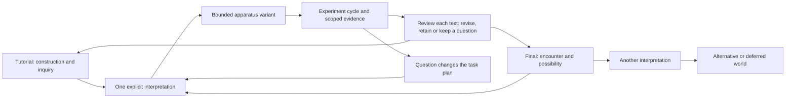

# The book can propose its next apparatus

**Method revision, 14 October 2026.** The three new texts clarify a reciprocal practice: a passage proposes a possible world, an implementation makes one interpretation operational, and observations can change the passage, the apparatus and the future work. This document incorporates that direction into the existing research specification. It does not claim that the sleeve, a remembering wall or the new pilot has been built.

The texts are preserved as [critique](imports/2026-10-14-recursive-writing/critique.md), [Text–World clarification](imports/2026-10-14-recursive-writing/text_world_loop.md) and [A Book That Can Build Its Own Rooms](imports/2026-10-14-recursive-writing/a_book_that_can_build_its_own_rooms.md). The first refers to the earlier eighteen-stop proposal and 25 checks. The current local plan already retains Definition → Entropy and five particle lessons; those improvements remain. The missing step was making writing an initiating instrument, rather than mainly an account revised afterward.

## Two connected cycles

The approved world cycle remains: **baseline → one-condition change → observe/compare → preserve → replay → independently reconstruct → propose or implement a further change**. The writing cycle is **generate → read → question → test → revise → rediscover**. Either can initiate a return through the other.

The arrows describe a research process, not automatic code execution from prose. Metaphor, ambiguity and history remain available to the writing. A companion record states which interpretation is being tried, its assumptions and what it leaves out. Two implementations can disagree without one becoming the definitive meaning of a sentence. Several readings can coexist after the same experiment.

A scene is one provisional realization. A scripted observation concerns the tested behaviour. A person's account concerns an encounter. None alone proves the literary passage true or exhausts its meaning.

## A companion record for a selected passage

Reuse the experiment record in [RESEARCH_RECORD.md](RESEARCH_RECORD.md). Add only the fields that make the text/world relationship retrievable. [text_experiments.json](text_experiments.json) contains two **design examples with no simulated or headset results**.

| Record element | What must be recoverable |
| --- | --- |
| Passage | Stable companion ID, source path, exact excerpt and document hash/version. A later edit preserves this source; it does not silently rebind the experiment to new words. |
| Proposition | What the passage invites us to investigate; distinguish the source's words from the collaborator's paraphrase. |
| Interpretation | Its own ID, assumptions, selected operations, excluded possibilities and alternatives. One passage can have several interpretations. |
| Apparatus | Versioned scene/script or explicitly described textual model, parameters, predecessor and replay contract. Unbuilt fields remain null, not plausible invented paths. |
| Evidence | Source inspection, textual thought experiment, executed desktop simulation, AI image interpretation or human VR encounter; observer/tool, source/build, method and limitations. A screenshot interpretation links to the actual image. |
| Learning debt | What is unverified, what is not yet understood, who/what contributed it, which evidence is missing, and what test or return might change the question. These are not all the same kind of uncertainty. |
| Revision | New passage, apparatus, both, a retained disagreement or a deliberate decision to defer. Link the before/after objects and the observation or source inspection that prompted it. |
| Plan consequence | A change to tasks/dependencies, a new branch or a reason to continue unchanged. Preserve the previous plan and the decision; do not report a proposed revision as an applied one. |

Use separate IDs for a passage, its interpretations and its experiments. Record a many-to-many relationship: one passage may produce several variants; one variant may support incompatible accounts. Canonical, experimental, deferred and abandoned are distinct dispositions, not a ladder on which everything must become canonical. No new runtime graph service is needed for the pilot: JSON plus linked Markdown is sufficient. The new [book-level architecture](../../RECURSIVE_ARCHITECTURE.md) places concrete companion records under [book experiments](../../experiments/README.md), while these sleeve/wall examples remain design branches in the specification.

## Dissipated authorship and learning debt

The user-supplied essay names the position directly: **“The author is not dead. The author is dissipated.”** Here authorship extends across agents, materials, sources and different moments of understanding. A nominal author may encounter and learn from material they did not personally compose. They remain responsible for selecting, questioning and deciding what is asserted or published.

Learning debt is the distance between what the apparatus makes available and what a particular collaborator presently understands. It can include a working implementation whose mechanism they have not yet reconstructed, a claim lacking evidence, or a connection whose consequences remain unexplored. A passing test may settle one technical question without eliminating this debt. Returning later may transform the question rather than merely close it.

“Unauthored material” names material not personally authored by the person returning to it, or material whose individual origin cannot yet be established. It does not mean creation without contributors or exemption from attribution. Keep known contributors, models/versions when available, sources and rights; record unknown origin as unknown. Do not assign every supplied sentence to the user, or turn a useful mistake into established knowledge.

## The first pilot: three linked outcomes

Keep the pilot smaller than the research route. Task .002 selects a bounded interpretation and available evidence level; .003 supplies the seed-bench cycle, and writing .001–.002 supply its passage/interpretation record and reciprocal trial. This is a proposed pilot scope, not an implementation authorization inferred from the critique's “I would authorize” phrasing.

The pilot produces three linked outcomes: **an apparatus result, independent reviews of tutorial and final, and a reasoned decision about the next work**. A review can revise, retain with reasons or preserve an open question. “No meaningful difference” and “the interpretation was not useful” remain possible results. The next task may be a bodily-memory experiment, a different record adapter or a new paragraph; it need not be the next item in the original queue.

The supplied concrete architecture makes the smallest proposal specific: sixteen triples, forty-eight retained values, RGB and a height interpretation. [The companion proposition](../../experiments/random-definition/seed-bench-001/proposition.md) defines a shared 4×4 layout and keeps RGB fixed while only the height rule changes. Its [hypothetical trace](../../experiments/random-definition/seed-bench-001/text-simulation.md) exposes assumptions before execution. Its observation and revision logs now contain the first scoped native run and two text reviews. Human encounter and independent reconstruction remain open; the hypothetical trace stays separate from the actual results. The sleeve remains a later experiment in relations between objects.

The six connected components are the two text practices, simulation proposition, text simulation, Godot experiment, research record, and revision/edition. Tutorial and final can each start the loop and receive its consequences. Read, Reconstruct and Investigate are three entry modes into that material. A frozen reading edition must identify exact sources and output; a changing research graph must not silently replace its chapters. Writing task W004 carries that future edition work.

The user has selected the 48-value seed bench as the first pilot in the task plan. Its companion binds a real tutorial exercise and a real final passage, with distinct questions. This is a small test of the method before broader research. After actual evidence, W002 reviews both texts independently and W005 chooses the next work from what happened. A review may revise, retain with reasons or preserve an unresolved question. Both texts need not change. Further work can be redirected, deferred or stopped; the imagined sleeve is not automatically next. State what could make us reconsider the question before testing, and preserve contrary or inconclusive results.

### Compare two kinds of attention without building a new hall

Keep Definition → Entropy as the current proposed opening. Trial the source-oriented alternative as a small source comparison beside Definition, using the known saved record and accurately labelled instruments first. A dedicated Source Lab stays deferred.

| Trial | Starting material and question | What to compare |
| --- | --- | --- |
| A: Definition → source comparison | The same retained arrangement; what made its arrival possible, and what would count as a new acquisition? | Distinctions the visitor can make about provenance, replay and new acquisition; the question they want to pursue. |
| B: Definition → Entropy | The same retained arrangement; which neighbouring relations did its numerical account omit? | What the visitor chooses to keep, what the gauge leaves out, and the next experiment they propose. |

Keep baseline/parameters, available controls and evidence method comparable; record order and prior exposure. If both trials use the same people, alternate their order where practical and disclose the limitation. Do not invent a universal score or declare one short encounter a general learning result. If the source adapter is unbuilt, a textual walkthrough can compare interpretations only; it is not a runtime or human encounter test. Optional secure acquisition remains separate from replay.

### Two productive passage interpretations

For the sleeve passage, begin with sixteen entities and fixed retained samples. Interpretation A may connect neighbours with visible links; interpretation B may make those links persistent constraints. Specify what each permits and excludes. A visible connection is not force coupling; a constraint model is not evidence of wearability. A symbolic/textual prototype can expose assumptions before a bounded Godot variant, but cannot establish how a wrist feels inside it. The sleeve remains one possible question, not the required first build.

For a remembering wall, compare a fixed response with one explicit contact-count threshold that changes permeability. Preserve the incoming trajectory, update order and predecessor. Determine whether response occurs on the threshold contact or the next one. “Memory” initially means the declared state/update rule; comfort, agency and the meaning of refusal remain further questions. This is an optional particle E2 branch, not a sixth tutorial or a claim about the installed collision artifact.

The curl-flow discrepancy offers an existing source-inspection entry: the code's seeding, respawn draws and frame updates constrain the replay claim. One response is to revise the claim, another to repair the implementation, another to retain the disagreement as a question. Preserve the specific passage and source versions before claiming that an actual book sentence was contradicted; the initial record has no invented screenshot or run result.

## Let observations revise the task graph

Use the existing task files and generator. At the first pilot and after each selected research extension, record a decision to continue, branch, reprioritize, replace or abandon proposed work. Writing task .005 is the first such review; it occurs before the proposed source/distribution expansion. The five particle lessons retain a separate continuation track.

For a graph revision, preserve the previous route/task files with hashes; attach the observation, unresolved question or user clarification; list changed IDs and dependencies; explain what became unnecessary or newly useful; then regenerate and validate the new graph. Keep IDs for surviving work. Cancel superseded tasks with a reason rather than deleting their history. Add new IDs rather than reusing old ones for unrelated work. Preserve claimed work and execution evidence; reconcile its scope with the active collaborator before changing it. A new graph must remain acyclic and keep dependencies resolvable.

Both the generator definitions and canonical JSON must reflect an accepted change, so regeneration cannot quietly restore the abandoned plan. Writing .005 proposes the concrete change and records whether it was selected; it cannot authorize arbitrary publishing or museum changes. Work already within the user's selected scope can proceed without another approval ritual. A real expansion of scope needs the corresponding decision.

[plan_revisions.json](plan_revisions.json) records this actual document revision and its predecessor. Its basis is the new user-supplied method, **not an observed pilot result**. Future observation-led revisions should use the same record. No scheduled follow-up is implied by the essay's imagined six-month return.

## What counts as verification

Use the existing three verification levels and seven-step world cycle, extended by a round trip: select a question from tutorial, final or both → preserve an interpretation → change an apparatus → record scoped evidence → review each text independently → decide the next apparatus/task change. Check the traceable relationship, not whether the visitor endorses the method or produces a surprising result.

Demonstrate that two interpretations can coexist, a predecessor survives a revision, an unbuilt variant cannot be reported as observed, and a rejected proposal remains retrievable. For independent reconstruction, supply the passage, companion interpretation and declared code/assets; do not expect metaphor alone to specify a program. For the writing return, ask what the author or visitor now understands differently, if anything. Technical replay and a meaningful reading have different evidence.

Source inspection, text-only reasoning, executed simulation, AI screenshot interpretation, human desktop use, physical VR and independent human reconstruction remain labelled separately. Keep scene loading, stability and performance separate as already agreed. The design examples and static checks in this pass do not complete a reciprocal runtime pilot.

## Critical and compositional return

The [writing specification](WRITING_SPEC.md) adds selection and reader attention. A technically grounded association can become an operational proposition with a rival reading and an advance revision condition. Its result can revise the criticism as well as the apparatus. Literary route A/B, hall-order A/B and mapping A/B retain separate identities. Ghost reading is a model response to a versioned prefix, never a substitute for human experience or tutorial reconstruction.
