# The Godot Course, Sketched

*2026-10-02. The whole course sketched before it is written: one chapter per spine sequence, one picture per chapter. The data is [sketch.json](sketch.json); the encyclopedia shows it at /course/sketch.*

## The rules

1. The order is the Ada spine: its 25 sequences, one chapter each; you learn programming by building the Ada examples of that sequence's halls.
2. Part I (sequences 1 to 5) climbs the Learning Processing ladder (Shiffman) in Godot 4.6 and GDScript: shapes and coordinates, flow, interaction, variables, conditionals, loops, functions, objects, arrays. A concept is used only after it is taught; a part a hall needs earlier is supplied and named as borrowed.
3. From sequence 6 (change) on, the content is The Nature of Code (Shiffman) in the spine's order; shaders, isosurfaces, boolean surfaces, graph theory and the last three sequences are Ada's own.
4. The voice is The Nature of Code's: second person, friendly, exact, as little text as possible. One idea per short numbered section, a picture for every idea, the code, a sentence or two of why; numbered examples, a few exercises, one running project.
5. Build from the ground up: each chapter uses only what came before. Haeckel's radiolaria and other specific forms are case studies for later, noted as hooks.
6. Godot 4.6, GDScript, desktop first, the headset where a hall is about being held or walked. The course look: hot pink sky, violet ground, acid lime body, cyan, orange, off-white, lavender for what has no collider.

**The running project.** One running project goes through the whole book: your room, and a figure you make yourself (after Learning Processing's Zoog). The figure is composed from Godot's shapes (1), moves and decides (2), stands on a floor of copies (3), becomes a class (4) and is kept in an array and dressed in a pattern (5). Then it is thrown (6), becomes a Mover that forces push (7), gets a net hung over it and a marble (8), and swings and rings (9). It wanders by seeded chance (10), climbs a noise hill (11), wears a computed skin (12), climbs a Rule 90 stair (13) and walks through a Menger sponge (14). It keeps a garden, a family of plants grown by one rule with different genes (15), and enters a world bred from one seed (16). It walks through a soft curtain (17), stands in a doorway cut from a field (18) and from solids (19), and is copied into a flock (20). It learns (21), finds its way through the room's graph (22), stands where an impossible body closes (23) and is wired to the laboratory's handles (24). In 25 the room is released with one body any visitor can change.

**Stills or video?** Yes, for the chapters about motion: the picture is a short Godot Movie Maker clip of the real scene with the line of code on screen, because a still cannot show a rate, a settling, a wander or a flock, and the overlay ties the picture to the line that causes it. Keep stills for static forms (3, 5, 14, 19 and most of the rest). Clips are recorded windowed with --write-movie and --fixed-fps, because a headless run draws no frames. Clips planned for chapters 6, 7, 8, 9, 10, 13, 17, 20. The 25 chapter pictures exist as stills, and one proof clip is recorded (chapter 6: Godot Movie Maker, 98 frames at 30 fps, the two lines of code and their live values over the real scene). The 197 section figures are described, not yet rendered; the other clips are planned, not recorded.

## Contents

- **Part I, Coding with Bodies:** 1 Points Build Bodies; 2 Bodies That Change; 3 Many From One; 4 Colour by Function; 5 A Source, Many Copies
- **Part II, Motion:** 6 A Curve of Steps; 7 Arrows That Push; 8 Finding the Form; 9 What Returns
- **Part III, Chance and Skin:** 10 Chance Enters the Grid; 11 Chance That Remembers; 12 Every Pixel at Once
- **Part IV, Growth:** 13 Rules in Time; 14 Again, Smaller; 15 A Sentence Grows; 16 Rules Build Worlds
- **Part V, Many Kinds of Body:** 17 Matter That Yields; 18 Bodies From Fields; 19 Three Verbs for Solids; 20 Many Bodies, Local Rules
- **Part VI, Beyond:** 21 Bodies That Learn; 22 What Connections Permit; 23 Where Foundations Fail; 24 The QFEP Laboratory; 25 Open the Room

## Part I: Coding with Bodies

Part I teaches programming from nothing, using the first five spine sequences. Each sequence takes the next rungs of the Learning Processing ladder, in order. Primitives (ch1) opens with how to make a script and press Play, then teaches shapes and coordinates, flow, interaction and variables. Transformation (ch2) teaches conditionals. array_tutorial (ch3) teaches loops. Color (ch4) teaches functions, then objects. Tiling (ch5) teaches arrays. Every chapter builds the main examples of its halls with only what came before. Where a hall needs something earlier, a small supplied part does the job and is named as borrowed. The running project is My Room: a figure you make yourself (Learning Processing's Zoog). It is composed from Godot's shapes, then moves and decides, then stands on a floor of copies, then becomes a class with colour functions, and is finally kept in an array and dressed in a pattern.

### 1. Points Build Bodies

*Three numbers place a body; a script makes it stay, move and follow you.* (sequence `primitives`)

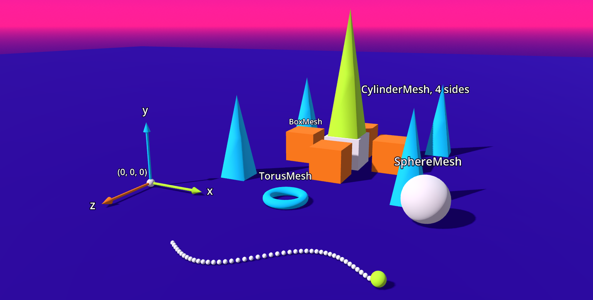

*A court of Godot's own shapes at chosen coordinates: pyramids, cubes, a sphere and a torus, the origin with its three axes, and the dots a point leaves as it follows the mouse.*

**You make:** A court of your own shapes, built from Godot's primitive meshes at chosen coordinates, with a point that follows your mouse and draws.

**New:** flow: a script on a node; _ready() runs once when you press Play · shapes and coordinates: Vector3(x, y, z), y up, counted from the origin; a node's position set from the script · shapes and coordinates: MeshInstance3D with Godot's primitive meshes; StaticBody3D + CollisionShape3D, a boundary apart from the surface · flow: _process() runs every frame · interaction: reading the mouse every frame; duplicate() and add_child() make a copy in code · variables: var, := and a starting value; += and arithmetic; a counter of your own  
**Follows:** Learning Processing ch. 1-4 (no Nature of Code chapter)

- **1.1 Press Play.** A script is text on a node: the lines in func _ready() run once, when you press Play.  
  *Figure: The empty room, pink sky over violet floor, and the same room after Play with one lime sphere that a one-line _ready placed.*
- **1.2 Somewhere to count from.** Every place in a 3D world is three numbers, x, y and z, counted from zero.  
  *Figure: The origin sphere with three short axes (lime x, cyan y, orange z), from above and to one side.*
- **1.3 A position needs a body.** A position stays invisible until you give it a mesh, and a mesh lets things pass until you give it a collider.  
  *Figure: Three stations in a row: an empty label, a white sphere, and a sphere that stops the cyan feeler.*
- **1.4 Godot's own shapes.** Box, sphere, cylinder, prism and torus are shapes you set with a few numbers.  
  *Figure: A row of lime primitives (box, sphere, cylinder, prism, torus) and a sphere at 4, 8, 16 and 64 segments.*
- **1.5 Two points, three points.** Give the supplied helper two points and it draws a line; give it three and it fills a face.  
  *Figure: Two white spheres joined by a thin white segment, and three spheres closed into a lime triangle seen from slightly above.*
- **1.6 Every frame.** _process runs again every frame, so a number can count while the program runs.  
  *Figure: A frame-counter panel in three stills a second apart, the number larger each time.*
- **1.7 Follow the mouse.** Read the mouse in _process and the point goes there; leave a copy behind each frame with duplicate() and add_child(), and you are drawing.  
  *Figure: Top view: a lime point at the cursor with a trail of small white dots behind it.*
- **1.8 Name a number.** A variable is a name for a value you can read, change and use again: keep the court's sizes in variables.  
  *Figure: The court from the front right in the course look: cyan corner pyramids, a lime spire on an off-white pedestal, orange cubes, an off-white sphere.*

**Examples:** Example 1.1: three stations (position, surface, boundary) · Example 1.2: a court of your own shapes · Example 1.3: the frame counter · Example 1.4: draw with the mouse  
**Exercises:** (1) Make the collider bigger than the mesh and find the gap with the probe. (2) Set a SphereMesh to 4 radial segments: what body is it now? (3) Count by twos, then move the count into _ready and say what happens. (4) Halve the whole court by changing one variable.  
**Your room:** Start your room: a figure of your own made from Godot's shapes, placed by coordinates, with its sizes in variables, following the mouse.

*Borrowed (supplied, named):* base.tscn: floor, pink sky, sun, camera and a node named Point, in the course look (kit-base) · line(a, b) and triangle(a, b, c): supplied helpers that draw a segment or a filled face between points; they stay supplied until 11.7 opens the ArrayMesh they build · mouse_point(): the point on the floor under the cursor · contact_probe.gd: a moving cyan feeler that stops at colliders (Point One kit) · the frame-counter panel: a Label3D whose text you set

*Hooks for later:* Dürer's truncated solid from Melencolia I, rebuilt from its corners once vertices sit in an array. · Archimedes' polygons closing on the circle (Primitives_Portals), once loops exist. · LeWitt's location drawings: an instruction as coordinates. · Kandinsky's point that becomes a plane as it grows.

### 2. Bodies That Change

*Bodies move, turn and grow every frame, and an if decides when.* (sequence `transformation`)

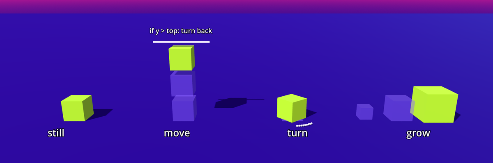

*Still, move, turn, grow: two earlier poses in lavender, the present one in lime; the moving cube turns back at the top line.*

**You make:** A pickup cube that bobs, turns and pulses, a carrier that waits at each bank, a wall that opens as you come, and a room you can scale small.

**New:** delta: the time since the last frame; position += speed * delta · rotate_y() and scale (Godot transforms); translate(): a step along the body's own axes · conditionals: if and a true-or-false test; comparisons < > == != · conditionals: else and elif; bool, a variable that remembers a state · conditionals: and, or, not; Input.is_action_pressed(), keys as conditions · length(): the distance between two points, b - a; queue_free(): remove a node, as when a cube is collected · parent and child: a child moves, turns and grows with its parent  
**Follows:** Learning Processing ch. 5 (no Nature of Code chapter)

- **2.1 A little every frame.** Add a small step to position in every _process and the body travels; multiply the step by delta and the speed holds at any frame rate.  
  *Figure: A lime cube rising in three poses, the two earlier poses in lavender.*
- **2.2 Turn and grow.** rotate_y() turns a body around its own axis, and scale multiplies its size; both keep its shape.  
  *Figure: One cube turned in three steps, and one cube at three sizes.*
- **2.3 If it passes the line.** An if asks a question that is true or false: if the cube is above the top, reverse its speed.  
  *Figure: The rising cube under a white top line with 'if y > top: turn back' above it.*
- **2.4 Wait, then go back.** A bool remembers whether the body is moving or waiting, and else says what happens otherwise.  
  *Figure: The carrier cube resting at the far bank over a fire basin, a half-full timer bar under it.*
- **2.5 Close enough.** Measure the distance to the visitor with length(); under the reach, open the slat, shrink the block or collect the cube with queue_free().  
  *Figure: A wall of slats from above, the ones nearest a cyan walker turned open.*
- **2.6 Keys decide.** Input.is_action_pressed() asks about a key, and and, or and not join several questions into one.  
  *Figure: The cyan walker between orange pusher blocks, the arrow keys drawn on the floor.*
- **2.7 Children follow.** A child moves, turns and grows with its parent: scale the room and everything in it follows.  
  *Figure: The room at scale = 4, the orange door walkable, its scale-1 outline in lavender.*
- **2.8 Order matters.** translate() moves along the body's own axes, so turning then moving is not the same as moving then turning.  
  *Figure: Two finned forms from one start, X-then-Y in cyan and Y-then-X in orange, pointing different ways.*

**Examples:** Example 2.1: the pickup cube (bob, turn, pulse) · Example 2.2: a cube bouncing between floor and top · Example 2.3: the carrier that waits at each bank · Example 2.4: the wall that opens as you come · Example 2.5: a room scaled by four  
**Exercises:** (1) Make the pickup cube pause at the top before it falls. (2) Open the slats only if the visitor is close and moving. (3) Steer the plank with two keys and cross the gap. (4) Swap rotate and translate, and say where the fin will point before you run it.  
**Your room:** Your figure moves, turns and grows; keys steer it, walls turn it back, and it waits at an edge.

*Borrowed (supplied, named):* walker.tscn: the cyan capsule you steer with WASD, the visitor (kit-base) · rider code: carries whoever stands on a carrier (_translate_rider in the hall) · lerp() and pingpong(): built-ins that pick a value between two ends; called, not written

*Hooks for later:* Carroll's DRINK ME (Trans_Scale): what uniform scaling keeps and what it gives a body. · The platform-game pickup as a study in game feel. · Escher's stairs return in the foundations crisis.

### 3. Many From One

*A loop makes a row, a grid, a lattice and a floor with a rule.* (sequence `array_tutorial`)

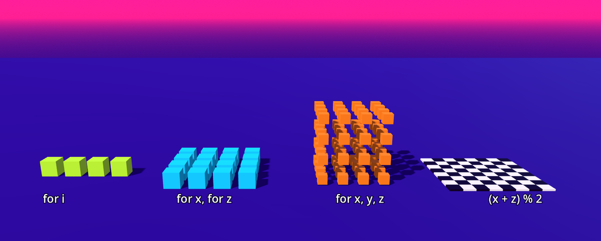

*Four loops, four bodies: for i, for x and z, for x, y and z, and (x + z) % 2.*

**You make:** A hall of copies: a row, a 4 x 4 grid, a 4 x 4 x 4 lattice you can fly through, and an off-white and near-black floor whose rule changes with the beat.

**New:** loops: while, repeat as long as a test is true · loops: for i in n, counting for you; the loop variable as an address, i * spacing · preload() and PackedScene.instantiate(): many copies of one scene · loops: nested loops, x then z, then y · loops: % (remainder), a rule that repeats · loops: a rule plus a clock, (x + z + phase) % 2  
**Follows:** Learning Processing ch. 6 (no Nature of Code chapter)

- **3.1 Again, while it holds.** while repeats its block as long as its test is true: instantiate() a cube while there are fewer than four.  
  *Figure: Four lime cubes in a row with a counter i under each.*
- **3.2 for counts for you.** for i in 4 runs its block four times with i = 0, 1, 2, 3, and i times the spacing places each copy.  
  *Figure: Four pickup cubes in a row, i = 0 to 3 written above them, a second line along z.*
- **3.3 A loop inside a loop.** Put a loop for z inside a loop for x and you get a grid; each cube knows its address, x and z.  
  *Figure: A 4 x 4 grid of cyan cubes from above, each on a plate that shows its x and z.*
- **3.4 The third index.** A third loop for y makes a lattice, and the spacing decides whether a body fits between the cubes.  
  *Figure: The 4 x 4 x 4 orange lattice with a cyan capsule hovering inside it.*
- **3.5 A rule at every address.** (x + z) % 2 is 0 or 1, so each tile asks it once and the floor becomes a checker.  
  *Figure: An 8 x 8 floor of off-white and near-black tiles with a lime frame, one tile outlined in orange with its sum written on it.*
- **3.6 Turn the tile by its address.** One diagonal tile, turned by (x + z) % 4 quarter turns, mirrored or shifted by address, gives six floors.  
  *Figure: Six off-white and near-black fields from one diagonal tile, each in a lime frame, the last with one exception.*
- **3.7 Stand it up.** Swap z for y and the same loops build a wall; one if keeps one tile different.  
  *Figure: The six fields as tall panels in lime frames, and the hinged exception panel turned open onto the landing.*
- **3.8 A floor with a clock.** Add a phase that grows each beat, and (x + z + phase) % 2 makes the floor blink.  
  *Figure: The disco checker one step apart: off-white and near-black swapped on the same tiles, in a lime frame. Caption: Rows, diagonals and a snake are other rules for the same clock.*

**Examples:** Example 3.1: a row of copies · Example 3.2: the grid with addresses · Example 3.3: the lattice you can fly through · Example 3.4: six floors from one tile · Example 3.5: the blinking disco floor  
**Exercises:** (1) Build the row with while, then with for; which reads better? (2) Build the row of rotations: six cubes, each turned 18 degrees more than the last. (3) Widen the lattice spacing until the capsule fits between the cubes. (4) Write a rule for stripes, and one that leaves a single tile different. (5) Place each cube with snapped(x, 0.5) so it falls on a half-metre grid.  
**Your room:** Lay a floor in your room: a grid of copies under your figure, with a rule of your own that ticks with a phase.

*Borrowed (supplied, named):* the diagonal tile: a half-black square made with ch1's triangle(a, b, c) · the flight region: lets the walker fly inside the lattice (Tutorial_3D) · cell_at(x, z): finds a floor tile by its address, until arrays arrive in ch5 · the collection record (a value going from 1 to 0 when a cube is taken): shown, written as an array in ch5

*Hooks for later:* Vera Molnár's (Des)Ordres (the Array hall's molnar_cube_study), once randomness can disturb the lattice. · Truchet's diagonal tiles (1704) behind the tiling floor. · Anni Albers' weaving drafts as nested loops.

### 4. Colour by Function

*Write functions that answer with a colour, then a class whose objects each carry their own.* (sequence `color`)

*One stack of five shapes, four functions that answer with a colour.*

**You make:** A colour hall of your own: stacks coloured by four functions, a rainbow, a field of pillars, and spray cans and glass panes that are objects of your own classes.

**New:** Color(r, g, b) and a material's albedo_color · functions: func with parameters · functions: return, a function answers · functions: local variables live inside their function · functions: Color.from_hsv() and lerp() read as functions like yours · objects: class_name, a class of your own · objects: @export, one class with many settings · objects: methods, and many objects from one class  
**Follows:** Learning Processing ch. 7-8 (no Nature of Code chapter)

- **4.1 A colour is three numbers.** Color(1, 0.55, 0.1) is red, green and blue from 0 to 1; give it to a material and the body wears it.  
  *Figure: One stack of five shapes, all in orange.*
- **4.2 A function answers.** func by_height(level) -> Color takes a number and returns a colour: one stack, four functions, four columns.  
  *Figure: Four identical stacks: one colour, by shape, by height, from below.*
- **4.3 Light has a colour.** A SpotLight3D has a light_color, and where a red pool meets a green one you see yellow.  
  *Figure: Red, green and blue lamp pools overlapping on a pale board.*
- **4.4 Where you hold it.** colour_from(p) turns a point in a box into red, green and blue; move the point and the nails change.  
  *Figure: A giant hand with lime nails, and a point held inside a wireframe RGB box that sets their colour.*
- **4.5 Around the hue circle.** Color.from_hsv() walks around the colour circle: hue_for(i, count) shares it among bands, and colour_at(p) spreads it over a field.  
  *Figure: The rainbow arch at six bands and at forty-eight, and the pillar field: hue across, saturation along, value up.*
- **4.6 A rule over the floor.** ink(x, z) returns one of four colours from (x + z) % 4, and a colour you paint by hand stays until the rule runs again.  
  *Figure: The grid floor in the four-colour rule, one square outlined in white.*
- **4.7 A class of your own.** class_name SprayCan, with an @export colour and a spray() method: thirty cans from one class, each in its own colour.  
  *Figure: A tray of spray cans in many colours before a canvas with a soft lime patch.*
- **4.8 Objects in a room.** Twelve Pane objects, each with its own colour, width and turn, make an office you can see through.  
  *Figure: Staggered translucent cyan and orange panes overlapping into a third colour, a chair behind them.*

**Examples:** Example 4.1: four colour rules on one stack · Example 4.2: three lamps on a board · Example 4.3: the rainbow divided again · Example 4.4: the HSV pillar field · Example 4.5: thirty spray cans from one class  
**Exercises:** (1) Write a fifth rule: colour by distance from the sphere. (2) Make a hue sweep from pink to orange go the short way round. (3) Give SprayCan a size export and place three cans of different sizes. (4) Mix two colours in RGB and in HSV and find where the middles differ most.  
**Your room:** Your figure becomes a class: @export its colour and size, colour its parts with your own functions, and place three of them.

*Borrowed (supplied, named):* a lamp you can carry: the supplied pickup with a SpotLight3D inside (Color_Flashlight) · cell_at(x, z): finds the floor cube at an address (from ch3), until arrays exist · the canvas's paint-into-image call behind spray(); images are opened in ch5 · point_on_canvas(ray): the point where a ray from the nozzle meets the canvas; supplied, the ray inside is not opened in this course · the rainbow's band mesh; you write the colours

*Hooks for later:* Albers' Interaction of Color: one colour made to look like two (albers_wall_gallery, SimultaneousContrast). · Bauhaus colour-shape pairs, such as Kandinsky's yellow triangle, in Color_Context_Placed. · Audre Lorde and skin colour in Color_Nails: what a colour slider cannot change.

### 5. A Source, Many Copies

*Keep a 4 x 4 source in an array and copy it by symmetry.* (sequence `tiling`)

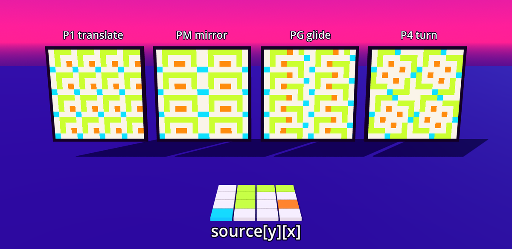

*One 4 x 4 source array read four ways: P1 translate, PM mirror, PG glide, P4 turn.*

**You make:** A patterned room: a 4 x 4 source you paint, copied over floor and walls by P1, PM, PG and P4, and a row of your figures wearing it.

**New:** arrays: [ ] and an index, steps[i] · arrays: size() and append() · arrays: for item in array · arrays: writing into an array, steps[i] = true · arrays: arrays of arrays, source[y][x] · arrays: % wraps an address back into the source · Image.set_pixel() and ImageTexture: a picture from an array · arrays: an array of objects  
**Follows:** Learning Processing ch. 9 (no Nature of Code chapter)

- **5.1 A list of steps.** var steps := [true, false, false, true] keeps values in order; steps[i] reads one, and the playhead reads them in turn.  
  *Figure: The step sequencer grid with a cyan playhead on one column and three lit cells.*
- **5.2 A palette is a list.** palette[value] turns a 0 or 1 into a colour; swap the palette and every square changes while the values stay.  
  *Figure: One checker split down the middle: cyan and orange on the left half, lime and lavender on the right, the same array of values under both.*
- **5.3 A tile is rows.** source[y][x] holds sixteen colours in four rows of four, and two loops draw it as cells.  
  *Figure: The 4 x 4 source: a lime bend, a cyan corner and an orange dot on off-white.*
- **5.4 Copy by rule.** Every cell of a big field reads source[y % 4][x % 4]; read x backwards in odd columns and the copies mirror.  
  *Figure: The P1 and PM panels side by side, made from one source.*
- **5.5 Write into the source.** Painting a cell writes a colour into the array and every copy changes at once; FLIP X rebuilds each row from its far end.  
  *Figure: The pattern maker console with one cell repainted, the new colour appearing across both fields.*
- **5.6 Wrap a room.** Write the field into an Image and the floor and walls wear it; % brings every address back into the source.  
  *Figure: The tunnel with floor cell [10, 1] outlined and source cell [2, 1] lit on the console.*
- **5.7 What counts as the same.** P1, PM, PG and P4 are four ways to read one array: translate, mirror, glide, turn.  
  *Figure: One source on the floor and four panels behind it: P1, PM, PG, P4.*
- **5.8 A list of bodies.** An array can hold objects: keep your figures in a list, dress each in the pattern, and send them down the catwalk in turn.  
  *Figure: Three lime figures in a row on a catwalk, their skirts in the patterned field.*

**Examples:** Example 5.1: a sixteen-step score · Example 5.2: one value, two palettes · Example 5.3: the 4 x 4 source painted by hand · Example 5.4: four wallpapers from one array · Example 5.5: a row of dressed figures  
**Exercises:** (1) Keep chapter 3's collected cubes in an array: values[i] = 0 when one is taken. (2) Write P2: odd tiles turned half a turn. (3) Make the source 5 x 5 by changing one number in the rule. (4) Sort your figures by height with two loops and a swap. (5) Put one grey square on an array of coloured grounds: why does it look like several greys?  
**Your room:** Paint a 4 x 4 source for your room, dress its floor and walls with one wallpaper rule, and keep your figures in an array.

*Borrowed (supplied, named):* a note per track: the AudioStreamPlayer behind each sequencer step · the catwalk path the figures walk along · pick(): the floor cell under the pointer or the controller, for painting a cell; the ray inside is supplied and not opened in this course · the skirt's UV repeat: shown as a shader in the hall; the course puts an ImageTexture on the skirt, and shaders come in ch12

*Hooks for later:* The Alhambra and the seventeen wallpaper groups (mill_alhambra_p6m, wallpaper_cage). · Escher's tessellations (loom_escher_mirror). · LeWitt's Wall Drawing 291 in Pattern_Foundry. · Persian girih (mill_persian_p4). · The drag runway: pattern as dress and performance (Ribbon_Patterns_03).

*Where Part I bends the ladder:*

- array_tutorial (ch3) is named for arrays, but the ladder puts arrays last. ch3 teaches loops and addresses; its stored values are only shown there and are written as arrays in ch5.
- GDScript has no static mode, so from the first line of ch1 code goes inside func _ready(). 1.1 now teaches that: how to make a script, attach it to a node and press Play.
- Making a copy in code (duplicate, add_child, instantiate, queue_free) is taught where it first matters: 1.7, 2.5 and 3.1.
- The later Primitives halls need loops and arrays; they are built with Godot's primitive meshes and the supplied line() and triangle(), which stay supplied until 11.7 opens the ArrayMesh they build.
- Learning Processing's mouse and key events move to conditionals (ch2), because Godot asks about input through if; ch1's interaction rung is reading the mouse every frame.
- random() waits for randomness (NOC 0, ch10). Godot built-ins (snapped, lerp, pingpong, Color.from_hsv) are called from the start; writing your own functions waits for ch4.
- Rays are used by the spray can (4.7) and the pattern painter (5.5) and are supplied, not opened.
- Objects arrive at Color_Paint (hall 7 of color), so Color_Flashlight's four lamps are first set by hand.

## Part II: Motion

Part II opens The Nature of Code. You already have the whole ladder from Part I; now things start to move. Chapter 6 starts with velocity and acceleration (NOC 1), then reads a rate and a sum out of the same steps, and ends on a field that tells a particle where to go next. Chapter 7 opens the vector itself (add, dot, length) and builds a Mover class that wind, drag, a spring and an attractor push around; it ends with a place that has its own gravity (NOC 1 and 2). Chapter 8 lets rules settle into forms: a point walks downhill, a net of Particles relaxes into a hanging form that turns over into a vault, arms balance, and an annealer climbs out of small valleys (NOC 6). Chapter 9 turns the circle sideways into a sine and follows what returns: a pendulum, its swing laid out across the floor, sine surfaces, travelling waves, a tone computed sample by sample, and sums of waves (NOC 3). Each chapter adds one thing to your figure and your room: a launch, a Mover with a corner of its own gravity, a hung-and-inverted vault, and something that returns.

### 6. A Curve of Steps

*A rate is a rise over a gap; motion is a sum of small steps.* (sequence `change`)

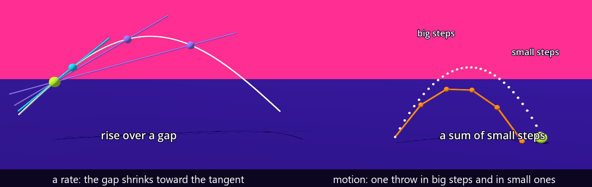

*A rate: the gap shrinks toward the tangent (left). One throw in big steps and in small ones (right).*

**You make:** A ball you launch with two lines of your own (velocity += gravity * delta; position += velocity * delta), and a canvas of particles that ask a field for their next step.

**New:** velocity: position += velocity * delta · acceleration: velocity += acceleration * delta, before the position line · _physics_process and a fixed step of your own · rate = (f(x + h) - f(x)) / h · accumulation: total += f(x) * width in a loop · a direction field: ask for a direction at the place you are now · wrapping at the edges with fposmod  
**Follows:** NOC 1 Vectors (motion: velocity and acceleration as rates); the flow field is borrowed from NOC 5 and used as prescribed motion

- **6.1 Velocity is a rate in time.** Velocity is how far you move in a second, so every frame you add velocity times delta to the position.  
  *Figure: A lime ball crossing the floor, leaving a white dot at every tick, evenly spaced, with a cyan velocity arrow at the ball.*
- **6.2 A curve made of steps.** Add gravity to the velocity, then the velocity to the position, every step, and a throw draws its own arc.  
  *Figure: A lime ball thrown across the floor: the same throw stepped in big orange steps and in small white dots, the ball at the landing.*
- **6.3 Two readings, one rate.** Read a curve at two places and divide the rise by the gap: that is a rate, and a smaller gap reads closer.  
  *Figure: Side view: a white curve against the pink sky with a lime point, and secant lines to a lavender and a cyan point that turn toward the tangent as the gap shrinks.*
- **6.4 One height for a width.** Let one height stand for a whole strip and add the strips: you get an area, and more strips give a closer total.  
  *Figure: A curve above the violet floor with sixty-four thin lime strips under it, and four wide lavender strips outlined over them.*
- **6.5 Ask the field.** A particle asks for a direction where it stands, takes a small step, and asks again, so the path draws itself.  
  *Figure: Top view of the flow field canvas: a grid of short white arrows, with lime particles leaving white trails that bend along them.*
- **6.6 The edge returns you.** When a particle leaves one side of the canvas, put it back on the other.  
  *Figure: The same canvas: one trail leaves the right edge and goes on from the left, with the stray line the drawing makes across the jump.*
- *Extension, Adding up the changes.* Add every small rise and fall along an arch and you get its height difference, but not where it started.  
  *Figure: An arch with signed strips beneath it, rising strips lime and falling strips orange.*

**Examples:** Example 6.1: A ball with a velocity · Example 6.2: The bullet: a throw in steps · Example 6.3: A secant becomes a tangent · Example 6.4: Strips under a curve · Example 6.5: Particles in a held field  
**Exercises:** (1) Swap the bullet's two lines and see where it lands. (2) Halve h five times and print the rate each time: when does it stop changing? (3) Take the strip heights from the left edge instead of the middle: which total is closer? (4) Replace the wrap with a wall the particle bounces off.  
**Your room:** Your figure is thrown: two lines of your own launch it across the room, at a step size you chose.

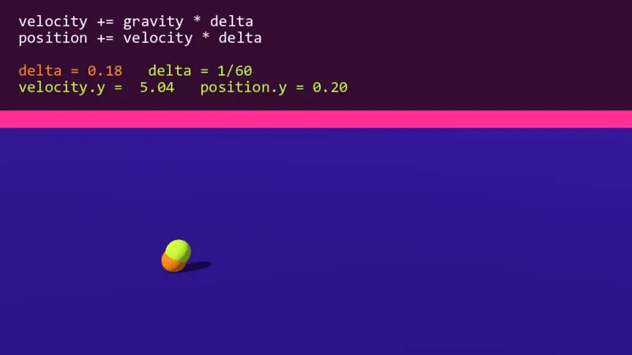

**Clip:** The throw stepped at 0.18 s and at 1/60 s, the two lines of code on screen.  `velocity += gravity * delta; position += velocity * delta`

*Borrowed (supplied, named):* f(x): the Change_Intro curve, a supplied function built from sines (sin and cos are opened in chapter 9) · field_direction(p): returns a unit direction at an address; supplied, because its noise comes in chapter 11 and its cos and sin in chapter 9 · trail(points, n): keeps the last n places of a moving body; opened in 9.4, where push_front() and resize() are taught

*Hooks for later:* Zeno's staircase (zeno_staircase): infinitely many steps with a finite total · Archimedes' pi from polygons (riemann_pi) · Marey's chronophotographs: motion recorded as steps

### 7. Arrows That Push

*A vector is a move; a force is a vector that changes velocity, divided by mass.* (sequence `forces`)

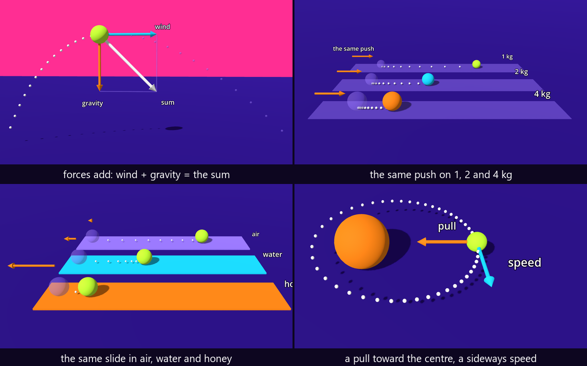

*Forces add (wind + gravity = the sum); the same push on 1, 2 and 4 kg; the same slide in air, water and honey; a pull toward a centre.*

**You make:** A Mover class of your own (position, velocity, acceleration, mass, apply_force) that wind, drag, a spring and an attractor push around, and a corner of your room with its own gravity.

**New:** length() and normalized(); vector addition and subtraction as moves · dot() and projection · mass, and acceleration = force / mass; apply_force(): forces summed into acceleration, cleared every step · RigidBody3D and apply_central_force() · drag (-c * velocity) and spring (-k * x) as functions that return vectors · attraction: G * m1 * m2 / r squared, along the line between two bodies · centre of mass and the support outline (Geometry2D.convex_hull) · Area3D: a region that overrides gravity; body_entered and body_exited  
**Follows:** NOC 1 Vectors (vector math) and NOC 2 Forces

- **7.1 The arrow between two points.** A vector is end minus start: a move you can carry anywhere, with a length and a direction.  
  *Figure: Two lime pins with a white arrow between them, and a lavender copy of both shifted sideways: the arrow is the same.*
- **7.2 Add two moves.** Adding joins two moves into one: walk the first, then the second, and you have arrived by their sum.  
  *Figure: Overhead plan: a lime leg, then an orange leg, ending at a cyan mark, with the direct white arrow from the start to the mark.*
- **7.3 How much two directions agree.** The dot product says how much two directions agree: large when they point the same way, zero at a right angle.  
  *Figure: A gap arrow and its shadow on a rail, seen from above: the shadow is long when the arrow runs along the rail.*
- **7.4 A push that ends.** A force changes velocity, a heavier body changes less, and when the push stops the velocity stays.  
  *Figure: Side view of a lime cube on the violet floor: an orange force arrow for the first second only, then a cyan velocity arrow that carries on, with white dots spreading out and then evenly spaced.*
- **7.5 One field, two receivers.** Read the field of 6.5 as the velocity and a body stops where the field is zero; add it to the velocity and the body overshoots.  
  *Figure: A sink field of white arrows on the floor; a cyan body comes to rest at the centre, while a lime body crosses it and turns back.*
- **7.6 Forces that answer the body.** Drag pushes against the velocity and a spring pulls back toward rest; each force is a function that returns a vector.  
  *Figure: One lime cube with two orange arrows: the drag against its velocity, and a spring's pull toward its rest line.*
- **7.7 Bodies that pull.** Attraction points from one body to the other and weakens with distance; a sideways velocity turns the fall into an orbit.  
  *Figure: An orange attractor and a lime satellite on a white elliptical trail, with an orange arrow pointing inward and a cyan arrow pointing along the path.*
- **7.8 Contact holds you up.** A body stands while its centre of mass is above the outline of its feet.  
  *Figure: A lime plate on three posts seen from above: the white outline of the post tops, and an orange mark at the plate's centre of mass inside it.*
- **7.9 A room with its own gravity.** An Area3D can replace gravity for whatever enters it, so a law becomes a place.  
  *Figure: A lavender cage of air over a gap, with a cube inside it rising along a tilted orange arrow.*

**Examples:** Example 7.1: An arrow between two pins · Example 7.2: The Mover: wind and gravity on three masses · Example 7.3: Drag on three equal throws · Example 7.4: A spring that overshoots · Example 7.5: An orbit  
**Exercises:** (1) Cap the Mover's speed with limit_length(). (2) Make drag act only inside a box on the floor: a pool of honey. (3) Put a plate on three posts and move its centre of mass until it tips; predict first. (4) Roll two carts into each other and find what the pair keeps.  
**Your room:** Your figure becomes a Mover (position, velocity, acceleration, mass): it moves only by forces you wrote, and one corner of your room has its own gravity.

**Clip planned:** Wind on three masses, then the same slide in air, water and honey, the force lines on screen.  `apply_force(wind); apply_force(drag)`

*Borrowed (supplied, named):* draw_arrow(from, to, colour): a supplied part that draws a vector as a rod and a cone (it turns the rod with a quaternion, which is not taught)

*Hooks for later:* The head crab choosing its target (VFM_08_Arena), once steering arrives in chapter 20 · The three-body problem as a first study of chaos · Galileo's two balls: why gravity grows with the mass it pulls

### 8. Finding the Form

*Let a rule settle: downhill steps, relaxed links and balanced arms find shapes nobody drew.* (sequence `formfinding`)

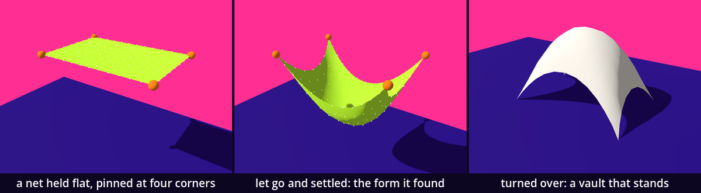

*A net pinned at four corners relaxes into a form nobody drew; turned over, it is a vault.*

**You make:** A net that relaxes into a hanging form you turn over into a vault, and a point that walks downhill to the bottom of a landscape you wrote.

**New:** the gradient from two samples on each side (central difference) · gradient descent: p -= rate * gradient(p); stopping rules: small slope, step limit, leaving the frame · cosh() and Curve3D · Verlet integration: a Particle class keeps position and previous; the velocity is now minus before; a pinned flag · constraints relaxed in passes · the lever law: m1 * d1 = m2 * d2 · simulated annealing: accept a worse step with chance exp(-dE / T) · a stillness test: RigidBody3D sleeping, timed  
**Follows:** NOC 6 Physics and relaxation (Verlet, springs, constraints); descent and annealing come from Ada's halls

- **8.1 Downhill, one step.** Read the slope on both sides of where you stand and step against it: p -= rate * gradient.  
  *Figure: A cyan cost surface seen from three-quarters above, with a lime point leaving white dots down into a valley and an orange arrow pointing downhill.*
- **8.2 Where it stops.** The start picks the valley, a step that is too large jumps out of it, and you decide when it is done.  
  *Figure: Two valleys: two trails from two starts ending in different hollows, and a third trail zigzagging out with a large rate.*
- **8.3 The hanging chain.** A chain hangs in a cosh curve, and drawing a sag by hand is not the same as finding it.  
  *Figure: Side view: a hand-drawn lime cable sagging away from the white cosh curve it should have followed, with the curve's lavender mirror arch above.*
- **8.4 The past is the velocity.** A Particle keeps where it is and where it was, so its next place is now + (now - before) + gravity * dt * dt.  
  *Figure: A row of lime Particles falling, each with a faint lavender copy at its previous place and the step drawn as a short white line.*
- **8.5 Relax, pass after pass.** Pull every link back toward its rest length, many times a step, and a net settles into a form nobody drew.  
  *Figure: A net of Particles pinned at four orange corners: held flat, settled into a bowl, and turned over into an off-white vault.*
- **8.6 Where forces cancel.** A lever balances when mass times distance is equal on both sides; hang arms from arms and a mobile balances itself.  
  *Figure: A two-level mobile of lime and orange discs on white wires, with the heavy disc on the short arm.*
- **8.7 Willing to get worse.** Accept an uphill step with a chance that shrinks as you cool, and the search can climb out of a small valley.  
  *Figure: A corrugated bowl from three-quarters above: wide white jumps at first, then tight steps in the deepest hollow.*
- **8.8 A shape that counts.** Release a stack and let the engine decide: it counts only if it stands tall and stays still.  
  *Figure: Two tiles: a tall lime stack standing, and the same pieces fallen into a quiet heap.*

**Examples:** Example 8.1: Downhill on a bowl · Example 8.2: Two valleys, two starts · Example 8.3: A Verlet chain · Example 8.4: A hanging net turned into a vault · Example 8.5: Annealing on a wrinkled bowl  
**Exercises:** (1) Make the step shrink as the slope flattens, and count the steps to the bottom. (2) Pin the net at three corners instead of four and turn it over. (3) Give the chain one heavy link: where does the curve bend? (4) Cool the annealer ten times faster: how often does it stop in the wrong valley?  
**Your room:** Hang a net of Particles in your room from points you choose, let it settle, and stand its turned-over form over your Mover as a vault; add a marble that rolls downhill on a landscape you wrote.

**Clip planned:** The net settling pass after pass, then turned over into the vault; the constraint pass on screen.  `relax(links)`

*Borrowed (supplied, named):* landscape(x, z): the halls' cost functions, wrinkled with sines (trig is opened in chapter 9) · chance(p): true with probability p, for annealing; supplied until chapter 10 teaches randf() · the Calder mobile's builder, which hangs arms from arms by calling itself (recursion is chapter 14; build two levels by hand here)

*Hooks for later:* Gaudi's hanging-chain model for the Colonia Guell crypt: form found by turning it over · Frei Otto's soap-film roofs (catenoid, minimal surfaces) · Calder's mobiles, balanced by the lever law

### 9. What Returns

*Turn a circle sideways and it is a sine: pendulums, waves, stairs and tones.* (sequence `wavefunctions`)

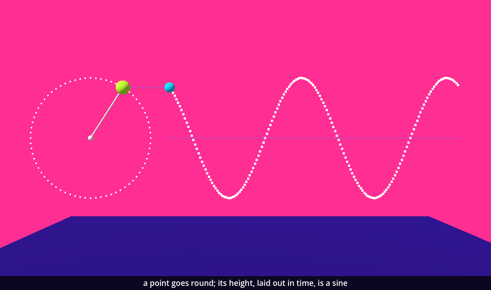

*A point goes round; its height, laid out in time, is a sine.*

**You make:** A point that goes round, a pendulum whose swing you can walk beside, and a bar that rings with a tone you computed sample by sample.

**New:** radians and TAU; sin() and cos() · polar coordinates: (r, angle) to x and y · amplitude, period, frequency, phase · angular velocity and angular acceleration (the pendulum) · a bounded record: push_front() and resize() · a wave: the same oscillation, delayed by distance · AudioStreamWAV filled sample by sample (PackedByteArray.encode_s16) · adding waves  
**Follows:** NOC 3 Oscillation (angles, trigonometry, polar coordinates, oscillation, waves, the pendulum); computed sound is Ada's own

- **9.1 A point goes round.** Add a little to an angle every frame and place the point at (cos, sin) times the radius: it goes round.  
  *Figure: A ring of white dots on the pink sky, a lime point on it, and a white radius line from the centre.*
- **9.2 Amplitude, period, phase.** Laid out in time, the point's height is a sine, and its amplitude, period and phase are three numbers.  
  *Figure: Twenty rods in a 4 by 5 grid, each a fifth of a turn ahead of its neighbour, their heights drawn as one sine above them.*
- **9.3 The pendulum.** Gravity pulls the bob back by the sine of its angle, and the angle together with the angular velocity says what comes next.  
  *Figure: A lime bob on a white line above a ring, shown twice at the same place with cyan velocity arrows pointing opposite ways.*
- **9.4 A swing laid into space.** Keep each sample with its time and push older ones farther away: a duration becomes a length you can walk beside.  
  *Figure: The pendulum frame with white marks receding along the violet floor in a long wave.*
- **9.5 A sine you stand on.** Feed a sine a position instead of a time and it becomes a surface, a twisted column or a stair.  
  *Figure: A spiral stair of lime treads whose radius breathes in and out, with the cyan walker halfway up.*
- **9.6 A wave travels.** Give every point the same oscillation, a little later the farther it is from the source, and a ripple moves while nothing travels.  
  *Figure: A grid of lime spheres seen from three-quarters above, with rings of height spreading from one corner.*
- **9.7 A wave you hear.** Write a sine into an AudioStreamWAV, 44 100 numbers a second, let it fade with exp(), and a bar rings.  
  *Figure: Eight lime bars on a table, one glowing, with its tone drawn above as a white sine under a fading lavender envelope.*
- **9.8 Adding waves.** Two close tones add into a slow beat.  
  *Figure: Three rows of lime bars, A, B and A+B, with the slow envelope traced on the sum. Caption: Five harmonics in the right amounts add into a sawtooth.*

**Examples:** Example 9.1: A point on a circle · Example 9.2: Twenty rods out of phase · Example 9.3: A pendulum · Example 9.4: The swing laid on the floor · Example 9.5: A tone computed sample by sample  
**Exercises:** (1) Give x and y different frequencies and draw a Lissajous figure. (2) Damp the pendulum, lay its record out, and watch the wave shrink. (3) Build a stair whose rise follows a sine instead of its radius: can the walker still climb it? (4) Ring the bars in a fixed order with fixed gaps: write a short piece of your own.  
**Your room:** Give your figure something that returns: its arm swings like a pendulum, a stair breathes under it, or a computed tone rings when it passes.

**Clip planned:** A point going round while its height is drawn out as a sine; the pendulum's swing laid on the floor.  `angle += speed * delta`

*Borrowed (supplied, named):* ValueMapper3D: the cage that turns where you hold a ball into three numbers for the FM rig (Effect_Sound)

*Hooks for later:* Bernini's Solomonic columns in the St Peter's baldacchino · John Cage's chance operations and 4'33" · Chladni plates (chladni_plate): standing waves made visible · The harmonograph: two pendulums drawing one figure

*Where Part II bends the ladder:*

- Chapter 6 uses Vector3 + and * for motion before chapter 7 opens vector maths. It holds because Part I already used b - a and offsets; NOC 1 is split across chapters 6 and 7.
- Chapters 6 and 8 use functions built from sin and cos before chapter 9 teaches trig. They are supplied as borrowed functions.
- Flow_Field needs noise (chapter 11). It is supplied as field_direction(p); it is NOC 5 material used early as prescribed motion, and 7.5 and 20.4 reuse it.
- Change_Choreography is in the forces sequence but teaches period and phase. It is built in 9.2, out of its sequence.
- VFM_08_Arena's primary (the head crab choosing a target) is steering, NOC 5, chapter 20. Chapter 7 uses only its collision carts, as an exercise.
- The wavefunctions hall order puts the pendulum before Unit_Circle, which teaches sin. Chapter 9 moves Unit_Circle to the front.
- Annealing needs a random draw before randomness (chapter 10). A supplied chance(p) stands in; the theory waits for chapter 10.
- A trimmed trail needs push_front() and resize(), taught in 9.4. 6.6 uses a supplied trail(points, n) until then.
- The Calder mobile's builder is recursive, before recursion (chapter 14). Two levels are built by hand and the rest is borrowed.
- The spine puts form finding (NOC 6) before oscillation (NOC 3), and soft bodies (chapter 17) is NOC 6 again. Springs are taught in 7.6 and the Particle class, Verlet and constraint passes in chapter 8, so chapter 17 builds on chapter 8.

## Part III: Chance and Skin

Part III covers NOC 0 in two chapters. First you draw numbers you did not choose and learn to bring them back with a seed. Then you give them a memory of their neighbours (noise) so they become ground you can walk. Chapter 12 is Ada's own: the same shaping, noise and octaves move onto the GPU, where they become a skin computed for every pixel. It ends with a buffer that gives the rule a past, which is the door into cellular automata.

### 10. Chance Enters the Grid

*Draw a number, keep its seed, and let it turn, choose, walk and wait.* (sequence `randomness`)

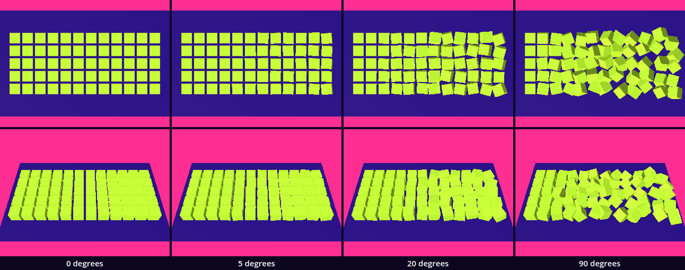

*One seeded floor of cubes at 0, 5, 20 and 90 degrees of chance, in plan and from above.*

**You make:** You end with a seeded floor of disturbed cubes, a 10 PRINT maze you can walk into, a random wanderer in a glass box, and three stones that sink after random waits.

**New:** RandomNumberGenerator, randf(), randi_range() · seed: the same draws again, in the same order · counting draws into an array: a histogram, the uniform distribution · probability that is not flat: two dice, the sum · the random walk: a Wanderer class with a Vector3 step and a trail · randfn(): the normal distribution · a drawn wait: chance decides when, not what  
**Follows:** NOC 0 Randomness (0.1 to 0.5: random walks, uniform and normal distributions, custom distributions)

- **10.1 A number you didn't choose.** randf() hands you a number between 0 and 1, and three of them make a colour.  
  *Figure: One lime cube whose colour came from three draws, the draws shown as red, green and blue bars standing in front of it.*
- **10.2 The seed brings it back.** Set the seed and the same numbers come back in the same order.  
  *Figure: Two 4 x 4 grids of coloured cubes from seed 42, side by side: in the right one an unused draw has shifted each colour one place. Caption: Spend one extra draw and every colour slides one place.*
- **10.3 Count the throws.** Throw a die 600 times and count each face in an array: the six bars come out nearly level.  
  *Figure: Six columns of stacked cubes, one per face, almost the same height. Caption: Sorting the throws leaves the bars unchanged.*
- **10.4 One of two: 10 PRINT.** randi_range(0, 1) leans each wall left or right, and a maze appears that you can walk into.  
  *Figure: The maze of leaning lime walls from above at one seed, with the cyan walker standing in a corridor.*
- **10.5 Chance against order.** Turn each cube of a grid by a draw, more with every column.  
  *Figure: A floor of 60 cubes in plan: in order on the left, turning into rubble on the right, at 0, 5, 20 and 90 degrees. Caption: You see the disorder only because the grid is there.*
- **10.6 A random wander.** A Wanderer object keeps a position and adds a random step every frame.  
  *Figure: A bead in a glass box seen from the side: on the left a 2D trail held at one height, on the right a 3D tangle. Caption: Its trail is an array of where it has been.*
- **10.7 The middle wins.** Add two dice and seven comes up six times as often as twelve.  
  *Figure: Eleven bars for the sums 2 to 12, rising to a peak at seven. Caption: Add many small chances and you get a bell, which randfn() draws from directly.*
- **10.8 Wait for it.** A stone stays up for a random wait and then sinks.  
  *Figure: Three cyan stones across a pit. The middle one is orange and halfway down, and a small number above each stone shows the time left of its drawn wait. Caption: You know the order of its states but never the length of the next pause.*

**Examples:** Example 10.1: A colour grid that returns (seeded generator) · Example 10.2: 10 PRINT, a maze you can walk · Example 10.3: Disturbed order, a floor of cubes · Example 10.4: The random wanderer · Example 10.5: A Gaussian splatter with randfn()  
**Exercises:** (1) Remove a random cube from a 4 x 4 range until it is empty: the cubes outside the range never go. (2) Give the wanderer a long step now and then: accept a length only if a second draw falls under its curve (accept-reject, NOC 0.5). (3) Plant a meadow of 80 mushrooms with sizes drawn from randfn(1.0, 0.15). (4) Let chance choose which bar of 9.7 rings and when: a piece by chance. (5) List three things in a room that are chance, and write the draw for each.  
**Your room:** Your figure gets a wander and its seed on a label: the same seed gives the same walk, and the same disturbed floor, in anyone's room.

**Clip planned:** The wanderer's trail growing step by step (10.6), then the same seed run twice.  `position += Vector3(randf_range(-1, 1), 0, randf_range(-1, 1))`

*Borrowed (supplied, named):* await get_tree().create_timer(wait).timeout: pauses the stone's function for the drawn number of seconds while the game runs on (await is taught later) · create_tween(): slides the stone down and back up smoothly · trace(points): draws a line through an array of positions for the wanderer's trail (supplied)

*Hooks for later:* Vera Molnar's board of 100 diagonals with 1, 5, 30 and 50 turned: where does order stop? (composition_stochastique) · Georg Nees, Schotter (1968), as the plotter original of 10.5 · A Pollock drip painting as a random walk (pollock_painting_in_3d) · The RAND book of a million random digits, 1955 (random_number_book_page_1955) · Frieder Nake's question: can a pseudo-random number stand in for intuition? · Ants that follow their own trail (Random_Pheromone), in the swarms chapter · Estimating pi by dropping marbles on a square with a circle in it (monte_carlo_dartboard)

### 11. Chance That Remembers

*Noise gives neighbours related values: a path, a body, and ground you can walk.* (sequence `noise`)

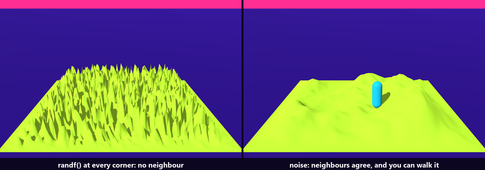

*One grid lifted by randf() and by noise: only the one that remembers its neighbour can be walked.*

**You make:** You end with a walkable noise terrain, reached by way of a breathing column, a voxel body cut by a threshold and a warped sphere.

**New:** FastNoiseLite: get_noise_1d/2d/3d, seed, frequency · noise in time: sample at t instead of drawing again · mapping a range: what a value from -1 to 1 becomes (a colour, a height, a push along the normal) · a threshold: 3D noise above a line makes a voxel · octaves: a fractal sum with lacunarity and gain · domain warp: sample at an address moved by another noise · a heightfield: an ArrayMesh built from a grid of heights, with create_trimesh_shape() for its collider  
**Follows:** NOC 0 Randomness (0.6 Perlin noise: noise in time, noise ranges, noise detail, 2D noise)

- **11.1 Randomness with a memory.** randf() gives each column its own height, while noise gives neighbours related heights, and a landscape appears.  
  *Figure: Two rows of 32 columns seen from a raised front view: white noise spiky and unrelated on the left, Perlin rolling in broad shapes on the right.*
- **11.2 Noise in time.** Sample noise at t, a little further each frame, and a value wanders smoothly without ever making the sine's return.  
  *Figure: Three columns side by side, one held still, one rising and sinking on a sine, one on noise. Under each is its value over ten seconds as a line.*
- **11.3 What a value becomes.** Noise answers between -1 and 1: you decide whether that becomes a colour, a height or a push.  
  *Figure: Two rings made from the same field: one folded by pushing its vertices along their normals, the other keeping its shape and coloured, a pale marker at the same address on both.*
- **11.4 The line that decides.** Ask 3D noise at every cell of a 12 x 12 x 12 grid and put a cube wherever the value passes a threshold.  
  *Figure: The same lime block body from one corner at three thresholds: solid, porous, a few islands. Caption: Move the line and the body changes.*
- **11.5 Octaves add detail.** Add the noise to itself at double the frequency and half the strength, a few times over, and detail grows inside the big shapes.  
  *Figure: Four square tiles of the same field at 1, 2, 4 and 6 octaves, side by side, seen from above.*
- **11.6 Borrow an address.** Move where you ask before you ask: noise sampled at p plus another noise folds the field like marble.  
  *Figure: A sphere with a colouring, warped on the right, and an orange point marking the same direction on both halves.*
- **11.7 Ground you can walk.** Build a mesh from a grid of heights, give it a collider, and walk across what you made.  
  *Figure: The cyan walker standing on a lime noise terrain over the violet floor.*

**Examples:** Example 11.1: White and Perlin columns side by side · Example 11.2: A body that breathes with noise in time · Example 11.3: Noise voxels and a threshold · Example 11.4: A walkable noise terrain  
**Exercises:** (1) Perlin or simplex: swap noise_type under the same seed and grid. What stays the same? (2) Colour the terrain by height, violet below and lime above. (3) Make the ground move: sample 3D noise with z = time. Can you still stand on it? (4) Warp the terrain's address with a second noise and walk the new ridges.  
**Your room:** Your room gets a walkable noise hill with its seed and height exported: your figure climbs it, and a marble rolls into its hollows.

*Borrowed (supplied, named):* grid_mesh(heights, cells, size): builds the surface and its trimesh collider from a grid of heights; supplied for 11.3 to 11.6, written by you in 11.7 · displace(mesh, f): moves each vertex along its normal by f(position); supplied for 11.3, opened in 11.7

*Hooks for later:* Bernini's columns, melting (MeltingBerniniScene) · Ken Perlin's noise for Tron (1982), and why it won an Oscar · The blob: why noisy bodies all start to look alike · Weather maps read as noise (related_weather) · Voxel worlds dug from a threshold (Noise_Voxel)

### 12. Every Pixel at Once

*The noise moves onto the graphics card: a skin made for every pixel.* (sequence `shaders`)

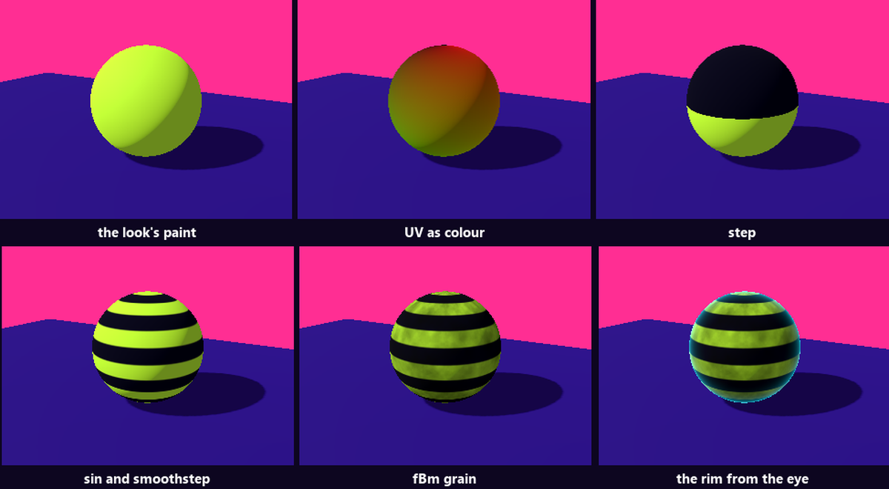

*One sphere, one shader growing: UV, step, sine stripes, fBm grain, and a rim that follows your eye.*

**You make:** You end with a sphere wearing a computed skin (stripes, grain and a rim that follows your eye), a pool of water driven by the clock, and a shader that remembers its last frame.

**New:** the shading language: shader_type spatial, fragment(), UV, ALBEDO · shaping functions: step, smoothstep, mix, sin · uniforms and set_shader_parameter(); TIME · fract() and floor(): folding space into tiles, a coin from the tile's address · NORMAL, VIEW and the rim; EMISSION against ALBEDO · value noise and fBm inside a shader · vertex(): moving vertices by a rule of position and time · a buffer: a SubViewport that hands the rule its last frame  
**Follows:** Ada's own (after The Book of Shaders)

- **12.1 A rule for every pixel.** A shader is one function the graphics card runs for every pixel at once.  
  *Figure: A square coloured by its UV: black at the lower left, red to the right, green upward, yellow in the far corner. Caption: Give it the pixel's UV and it answers with a colour.*
- **12.2 Shaping functions.** step() cuts, smoothstep() eases and sin() repeats: three ways to decide where value goes across a square.  
  *Figure: Three dark squares, each with a white graph line: a step, an S curve, a sine wave.*
- **12.3 Numbers from outside.** A uniform is a number your script hands the shader, and TIME is the one Godot hands it every frame.  
  *Figure: The step square at three slider values, with the stroke at 0.2, 0.5 and 0.8 and the slider drawn under each.*
- **12.4 Fold space.** fract() throws away the whole number, so every pixel thinks it is in the one tile.  
  *Figure: A Truchet labyrinth of quarter arcs whose seams cannot be found, one tile outlined. Caption: A coin drawn from the tile's address flips it.*
- **12.5 The skin answers your eye.** dot(NORMAL, VIEW) is small where the surface turns away from you.  
  *Figure: The striped lime sphere with a cyan rim, in four views: front, right, back and left. Caption: Put a colour there and the rim follows you round.*
- **12.6 Noise on the GPU.** The octaves of the last chapter, written as a shader function, cloud a skin at every pixel on every frame.  
  *Figure: The striped sphere with fBm grain across its skin, lime and dark.*
- **12.7 Water from the clock.** vertex() lifts every vertex by sines and noise of its position and TIME.  
  *Figure: A section through the basin showing the glass lid, the wave surface below it, the pool floor, and the walker standing on the glass. Caption: The water keeps no state, and you cannot stand on it.*
- **12.8 A rule with a past.** A shader remembers nothing until you hand it its last frame.  
  *Figure: The same reaction rule fed its own last frame: a pattern grown from ten seed cells. Caption: Two SubViewports passing a picture back and forth give the rule a past.*

**Examples:** Example 12.1: UV, step and smoothstep on a square · Example 12.2: Tiles and Truchet arcs from fract() · Example 12.3: The shader skin: stripes, grain, rim · Example 12.4: Water from the clock (a vertex shader) · Example 12.5: A feedback buffer (reaction-diffusion)  
**Exercises:** (1) Make the stripe count a uniform and step it with a key. (2) Bricks: slide every second row half a tile before fract(). (3) Put the rim in the sky's pink and walk round the body. Where does it vanish? (4) Hand the water your own clock as a uniform, then freeze it.  
**Your room:** Your figure wears a computed skin: stripes, grain and rim, with its colours handed over from the look as uniforms.

*Borrowed (supplied, named):* hash(p): one line from The Book of Shaders that turns a tile's address into a repeatable pseudo-random number · ping-pong rig: two SubViewports that swap their textures each frame, supplied for 12.8; chapter 13 meets the same two-buffer trick with arrays

*Hooks for later:* Truchet's tiles (1704) and Wang tiles · Latex, leather and oil slick: materials as answers to light (Shader_11_QueerRubber) · Turing's reaction-diffusion: spots and stripes, in the soft bodies chapter · Thin-film iridescence: the queer gloss shader · The Book of Shaders as a parallel path

*Where Part III bends the ladder:*

- NOC order: randomness is NOC 0, but the spine puts it after forces and oscillation (ch 6-9). Anything earlier that needs a random draw names it as borrowed (chance(p) in ch8); ch10 teaches it.
- Two randomness halls, Random_Space_Geometry and Random_Space, teach coherent noise and octaves; they move to ch11 and open it. Random_Pheromone waits for swarms in ch20.
- Ch10 uses Random_Cubes' dice in 10.3 and 10.7, around 10 PRINT, out of hall order.
- Ch10 10.8 (Random_Game) needs a timed wait and a tween before either is taught; both are supplied.
- 11.7 teaches ArrayMesh and the trimesh collider (the first mesh built from vertices in the course). 11.3 to 11.6 use a supplied grid_mesh and displace; 11.7 writes grid_mesh.
- Noise_6_Wall sits in the noise sequence but is a GPU shader: it moves to 12.6, and 11.5 draws its octave windows on the CPU.
- 12.8 hands the rule its last frame with two SubViewports; 13.3 meets the same two-buffer trick with arrays, and reaction-diffusion proper is written once, in 13.8.

## Part IV: Growth

Four chapters where small rules, repeated, grow large forms. Cellular automata (NOC 7): a cell reads its neighbours, and the history becomes a floor you stand on. Fractals (NOC 8.1-8.5): a function calls itself, and trees, dust, snowflakes and a sponge you walk into come out of one line. L-systems (NOC 8.6): a sentence is rewritten and a turtle reads it, so a string becomes a plant, a corridor, or a family of faces. Procedural generation (NOC 9, plus Ada's own): bodies are bred by a score, trees grow toward food, rooms are carved, and patterns are copied, all from one seed. Each chapter builds only on what came before it: two buffers (13), then recursion (14), then strings and stacks (15), then populations and search (16). Case studies (Turing, Haeckel, Conway, Sims) are noted as hooks for later.

### 13. Rules in Time

*Each cell reads only its neighbours, and the whole grid grows a world.* (sequence `cellularautomata`)

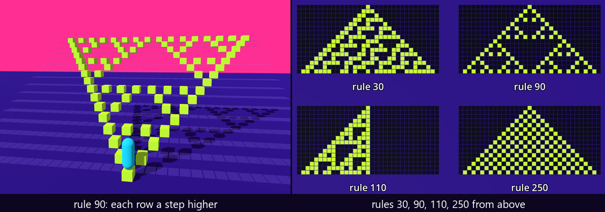

*Rule 90 laid as a stair, each row a step higher (left), and rules 30, 90, 110 and 250 grown from one live cell (right).*

**You make:** A Rule 90 stair that lays one row at a time and carries you up it, and a floor of reaction and diffusion that moves under your feet.

**New:** a row of cells as an array of 0 and 1, read with wrapping, (i + n) % n · a rule as a bit lookup: (l << 2) | (c << 1) | r indexes the rule number's bits, (rule >> index) & 1 · two buffers: read one, write the other, then swap · a 2D grid in one array: i = y * n + x; eight neighbours (Moore) and four (von Neumann) · MultiMesh: one mesh drawn many times · more states (an enum) and number states (float) · the Laplacian: four neighbours minus four times yourself  
**Follows:** NOC 7 Cellular Automata

- **13.1 A row of cells.** A cell is a number, 0 or 1, and a row of cells is an array.  
  *Figure: Seventeen tiles in a row on the violet floor, one lime tile alive in the middle, seen from in front and above.*
- **13.2 Eight answers make a rule.** Read left, self and right as a three-bit number; the rule's bit at that place is the cell's next state.  
  *Figure: The eight neighbourhoods 111 down to 000 as triplets of tiles, each above its answer tile for Rule 90, flat and from the front.*
- **13.3 Read one row, write another.** Write the next generation into a second array, as 12.8's two viewports did, or the rule reads its own new answers.  
  *Figure: Two Rule 90 triangles from above: the even one from two buffers, the lopsided one from one buffer.*
- **13.4 Time stacked into a floor.** Lay each new row one step higher and the history becomes a stair you can climb.  
  *Figure: The Rule 90 stair with the cyan walker standing on the seed row, three-quarter view.*
- **13.5 Life on a grid.** Give each cell eight neighbours and two rules, birth on three and survival on two or three, and a glider walks.  
  *Figure: A glider on a 2D grid at steps 0 to 4, one address outlined in orange, from above.*
- **13.6 A cell with a past.** A third state, fading, lets a cell stay present without being counted; in 3D it has twenty-six neighbours.  
  *Figure: A 3x3x3 neighbourhood pulled apart, the centre outlined in white, live cubes lime and fading cubes lavender.*
- **13.7 Cells that hold numbers.** Let a cell keep a number between 0 and 1, and your body can be one of its inputs: stand still and the bridge wears thin.  
  *Figure: The decaying bridge from the side: the walker on a faded tile, the basin visible below it.*
- **13.8 Reaction and diffusion.** Each cell holds two amounts; they spread to the four neighbours and react where they meet, and spots and rings appear.  
  *Figure: The reaction-diffusion pool after 0, 100, 300 and 1000 steps: orange heights rising from the violet floor.*

**Examples:** Example 13.1: One row, one rule, printed row by row · Example 13.2: The stair: each row a step · Example 13.3: Life in a dish: block, blinker, glider · Example 13.4: The pool: reaction and diffusion on a height field · Example 13.5: One difference, followed: two runs one cell apart  
**Exercises:** (1) Run rules 30, 90, 110 and 250 from one live cell; guess which two floors look most alike before you look. (2) Untick the ring and watch what the edges do. (3) Give Life a hexagonal neighbourhood and find a birth rule that still moves. (4) Run Rule 90 for sixteen rows and find the triangle inside the triangle; keep it for chapter 14.  
**Your room:** Your figure climbs a Rule 90 stair that the room lays one row at a time, with the rule number in an @export.

**Clip planned:** Rule 90 laying its stair one row at a time, the walker climbing it.  `next[i] = (rule >> index) & 1`

*Borrowed (supplied, named):* HeightMapShape3D (supplied in the pool scene): turns the pool's numbers into a collider, so the floor you stand on rises with the pattern.

*Hooks for later:* Turing's 1952 morphogenesis: the same reaction-diffusion as a theory of spots and stripes. · Conus textile: a sea snail's shell painted by something close to Rule 30. · Rule 30 used as a random-number generator: chapter 10's pseudo-randomness comes back. · Conway's Life as a computer: Gosper's glider gun. · Wireworld: electrons on wires, logic gates made of cells (CA_AgentsCircuits tutorial). · The Persian rug in CA_Introduction: a carpet whose symmetry is put back every step.

### 14. Again, Smaller

*A function that calls itself builds trees, dust and sponges until you tell it to stop.* (sequence `fractals`)

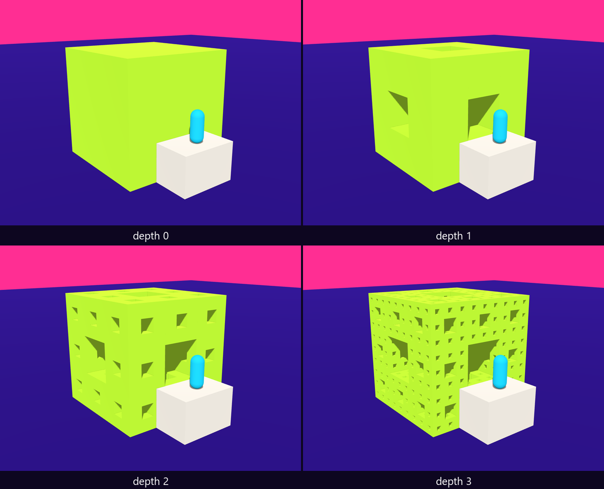

*One function calls itself on 20 of 27 smaller cubes: the Menger sponge at depths 0 to 3, cut along all three axes, with a cyan walker on a step at its middle opening.*

**You make:** A recursive tree and a Menger sponge whose biggest passage your body fits through, each built by one function that calls itself.

**New:** recursion: a function that calls itself · the base case: where it stops · the call stack, seen in the Debugger's Stack Frames · passing a Transform3D down the calls: origin moved, basis turned · replacing every part in an array with smaller parts, one generation at a time · three nested loops over 27 cells, skipping 7 · dimension: D = log N / log S · a recurrence: the next number made from the last two  
**Follows:** NOC 8 Fractals (8.1 to 8.5)

- **14.1 A function that calls itself.** Draw a square, then call yourself with half the size: one line of code makes many squares.  
  *Figure: Squares nested inside a frame, the same sizes standing as doorframes on the floor, three-quarter view.*
- **14.2 Where it stops.** Every recursion needs a base case; forget it and Godot stops with a stack overflow.  
  *Figure: A tower of lime plates, one plate per call, the lowest labelled depth 0 and standing on the floor, the plates above it numbered 1, 2, 3. Caption: Without a depth 0 the tower never stops, and Godot ends it with a stack overflow.*
- **14.3 Two calls make a tree.** Draw a branch, turn, and call yourself twice with a shorter length.  
  *Figure: A lime tree at generations 1 to 4, side by side, from the front.*
- **14.4 Cut out the middle.** Keep the outer thirds, drop the middle, and repeat: the Cantor set is a row of smaller and smaller bars.  
  *Figure: Five rows of Cantor bars stacked as storeys, the removed thirds as lavender ghosts, from the side.*
- **14.5 The boundary takes a detour.** Replace every segment with four, each a third as long: Koch's line grows longer while its ends stay where they were.  
  *Figure: The Koch curve at generations 0 to 4 stacked from above, each longer than the last.*
- **14.6 A hole becomes a place.** Split a cube into 27, keep 20, and call again on each: the Menger sponge opens passages.  
  *Figure: The Menger sponge at depth 2 in lime, the cyan walker on a step at its middle opening.*
- **14.7 How rough is it?.** Count the boxes that touch the shape on finer and finer grids; the slope of the counts is its dimension.  
  *Figure: The Sierpinski points under a fine grid with the covered cells lit lime. Caption: The slope of the counts on a log-log line is the dimension.*
- **14.8 A recurrence is not a shape.** 1, 1, 2, 3, 5: each number comes from the two before it, and a shape appears only when you choose how to draw it.  
  *Figure: The golden rectangle cut into squares with its quarter-arc spiral, from above. Caption: A row of Fibonacci columns is the same numbers drawn another way.*

**Examples:** Example 14.1: Squares inside squares · Example 14.2: The recursive tree · Example 14.3: The Cantor stair · Example 14.4: Koch's line · Example 14.5: The Menger sponge, walkable at depth 2  
**Exercises:** (1) Give the tree one seeded mad branch that turns the wrong way, and follow how far its children carry the mistake. (2) Predict how many cubes the sponge has at depth 3 before you run it. (3) Make the Cantor rule keep the middle and drop the ends; is it still a fractal? (4) Draw the Sierpinski triangle: keep three of the four half-size triangles at every call. (5) In a gallery of fractals, write down the stopping condition of each work, and say why 'make smaller things' is not enough to rebuild it.  
**Your room:** Your figure walks through a Menger sponge at depth 2, big enough to pass its largest tunnel.

*Borrowed (supplied, named):* fit_line() (supplied): draws the straight line through the box counts, so 14.7 can read a slope without a statistics lesson.

*Hooks for later:* Romanesco: a spiral of spirals, already standing in Fractal_GoldenSpiral. · Diffusion-limited aggregation: coral and lightning grown by random walkers that stick (it stands in Fractal_MengerSponge). · Mandelbrot and Julia sets (their halls are deferred): a recurrence on complex numbers, drawn as a shader. · How long is the coast of Britain? Richardson's and Mandelbrot's rough line. · Haeckel's radiolaria: silica lattices that look recursive, for later, once lathe and inset are taught.

### 15. A Sentence Grows

*Rewrite a sentence, let a turtle read it, and a plant grows.* (sequence `lsystems`)

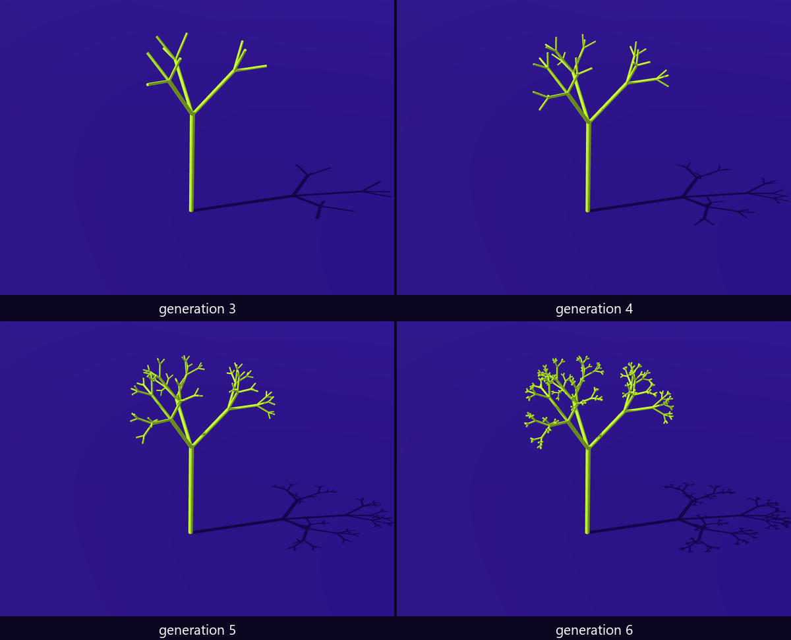

*One sentence, A -> F[&A]/[&A]/[&A] with F -> FF, read by a 3D turtle (& tilts 40 degrees, / rolls 120): generations 3 to 6.*

**You make:** A plant grown from one sentence by a 3D turtle, its genes saved as a file, and the same turtle laying corridors you can walk.

**New:** String: building a new string one character at a time · a Dictionary of rules · rewriting for n generations, and why the string explodes · a turtle: a position and a Basis, moved by F; + and - turn, & and ^ tilt, / rolls · a stack: push_back() and pop_back() of the turtle's state for [ and ] · a Resource of genes with @export, saved and loaded as .tres · a mesh grammar: rules that select faces and act on them  
**Follows:** NOC 8.6 L-systems

- **15.1 A sentence rewritten.** Start with F and replace every F by the rule, once per generation, and the sentence grows.  
  *Figure: F, F+F-F-F+F and the next generation printed as strings above their three drawings, from the front.*
- **15.2 The turtle reads.** F moves forward and draws, + and - turn: the same sentence at 90 and at 120 degrees gives two bodies.  
  *Figure: Two Koch drawings side by side with the same sentence printed under both, angle labels above.*
- **15.3 Brackets save the turtle.** [ pushes the turtle's position and heading onto a stack and ] pops it back, so a branch returns to its fork.  
  *Figure: F[+F]F[-F]F stepped through symbol by symbol, the cyan turtle back at the fork after ], the stack drawn as a pile of cards. Caption: Add & to tilt and / to roll, and the branches leave the plane.*
- **15.4 One sentence, three readers.** Change only how a symbol is read, and the same sentence draws turned, wider or mirrored.  
  *Figure: One sentence read three ways: at 25 degrees, at 45 degrees, and with x and y swapped.*
- **15.5 A line gets walls.** Give each F a width and walls, and the turtle's path becomes corridors that a body has to fit.  
  *Figure: The plan F[+RF][-RF]F laid out as corridors seen from above, the walker inside, a room at the R junction.*
- **15.6 Rules meet the soil.** Let a rule run only when there is food under it, and whoever goes first decides who grows.  
  *Figure: Two stems, orange and cyan, over a tiled soil field, the patch each one took darkened, three-quarter view.*
- **15.7 Genes behind the grammar.** Keep depth, angle and taper in a saved Resource of genes: one rule with different genes grows a family.  
  *Figure: A tree from the front with the gene panel in front of it, Depth going from 4 to 5.*
- **15.8 Faces instead of letters.** A mesh grammar's rule picks faces and insets or extrudes them, and one cube grows a family.  
  *Figure: Six cubes in a row: inset, extrude, three rounds, a wider inset, and all twelve faces grown.*

**Examples:** Example 15.1: Rewriting in the Output panel · Example 15.2: The turtle draws Koch · Example 15.3: The bracketed plant in 3D · Example 15.4: Corridors from a sentence · Example 15.5: A tree from a saved genome  
**Exercises:** (1) Turn the plant's angle from 25 to 45 degrees: when does a plant become a lattice? (2) Rewrite the string in place instead of into a new one, and explain why it runs away in one generation. (3) Write a rule for a plant of your own and give it three genes. (4) In the closing assemblage, read the same two marks three ways (diagonals, orthogonals, blocks) and say which choices stayed fixed.  
**Your room:** Your figure keeps a garden: a family of three plants grown by one rule with three gene files (.tres) that the room loads.

*Borrowed (supplied, named):* MeshGrammar (supplied from the project): seeds, selectors and face operations (inset, extrude), used in 15.8 as a box of tools whose insides are not yet opened.

*Hooks for later:* Lindenmayer's algae (1968): the first L-system, about cell division, not trees. · Prusinkiewicz's The Algorithmic Beauty of Plants: leaf spirals and flowers. · Space-filling curves (Hilbert, Peano) as one route through every room of a building. · Weaving drafts as a grammar: the panel bridge loom in Assemblage_Same_Desire. · Haeckel's radiolaria remade by a mesh grammar (cyrtoid_by_rule): a lathe seed and a cell inset.

### 16. Rules Build Worlds

*Breed bodies by a score, grow toward food, carve rooms, copy by mirrors.* (sequence `proceduralgeneration`)

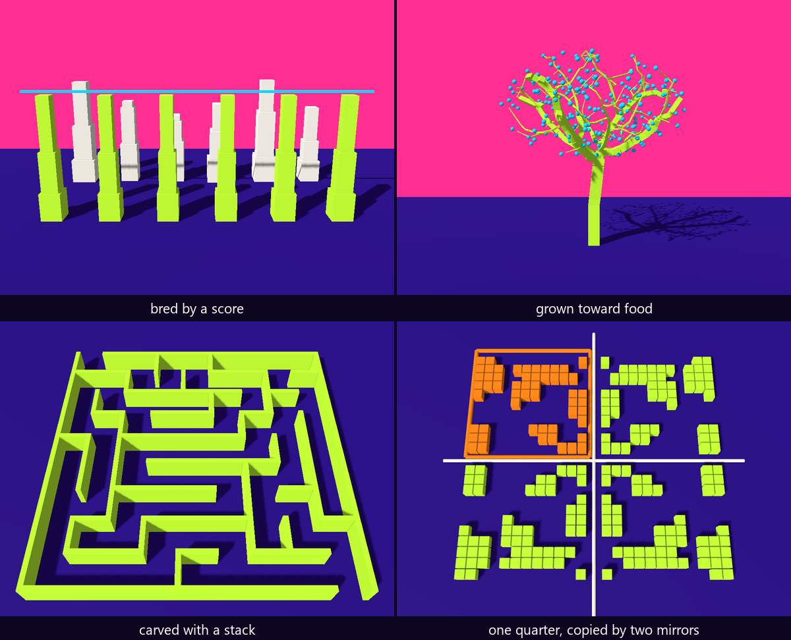

*Four ways a rule builds: bodies bred toward the cyan target, a tree grown toward cyan food, a maze carved with a stack, and one orange quarter copied by mirrors.*

**You make:** A small world from one seed: a body bred toward a target, a tree grown toward food, and a maze you can walk out of.

**New:** a genome: an array of numbers a builder reads, kept as a population across generations · a fitness function: one number per body; selection by tournament, crossover, mutation; elites kept · attraction: adding up unit vectors toward the nearest targets · a flood through six face neighbours · a random digger that removes cells · depth-first search with a stack: the backtracking maze · reflection by index: n - 1 - x  
**Follows:** NOC 9 Evolutionary Computing; growing, carving and copying are Ada's own

- **16.1 A body written as genes.** A genome is a list of numbers, and a builder reads it to make a body.  
  *Figure: Six bodies of stacked primitives on plinths, each with its gene list printed below, from the front.*
- **16.2 The score decides.** A fitness function gives each body one number, and it notices only what it counts.  
  *Figure: The six bodies reordered after the target changes from 8 to 16, the leader orange, a ring the score ignores circled.*
- **16.3 Breed the next generation.** Keep the best two, choose parents by tournament, mix their genes, mutate a few, and repeat.  
  *Figure: Two rows of towers: generation 0 in off-white at the back, generation 25 in lime at the front, reaching the cyan target line.*
- **16.4 Grow toward food.** Scatter food points; each tip steps toward the sum of the directions to the food nearest it, and eats what it reaches.  
  *Figure: A space-colonization tree with cyan food points in its crown, from the front.*
- **16.5 What reaches what.** Fill a lattice at random, pour flow in at one face, and let it pass only where faces touch.  
  *Figure: An 18-cube lattice at densities 0.2, 0.4 and 0.6, the flow in orange, three-quarter view.*
- **16.6 Carve room for a body.** A digger that removes cells hollows out a cave; a digger with a stack carves a maze and backs up at dead ends.  
  *Figure: The maze seen from above, the stack's path drawn in cyan. Caption: The cave is the same digger without a stack, its carving dots orange.*
- **16.7 Copy by mirrors.** Compute one quarter and mirror it into four with the index n - 1 - x.  
  *Figure: The mirrored field with its source quarter in orange and the two mirror axes in white.*

**Examples:** Example 16.1: Bodies from genomes · Example 16.2: Evolving toward a height · Example 16.3: Space colonization · Example 16.4: Percolation in a box · Example 16.5: The backtracking maze, walked  
**Exercises:** (1) Change the target and watch the leader change before any body does. (2) Add a gene the score cannot see, a ring, and check whether it survives the generations. (3) Carve the maze with a queue instead of a stack: how do the corridors change? (4) Raise the percolation density in steps of 0.1 and find where the flow first crosses.  
**Your room:** Your figure's world: a maze from a seed that your figure can enter and leave, with one body bred by a score waiting inside.

*Hooks for later:* Karl Sims' evolved virtual creatures (1994): bodies and behaviour bred by a score. · Leaf veins and tree crowns grown by space colonization (Runions and others). · Percolation as forest fire, or coffee through its grounds. · Roguelike dungeons: caves smoothed by a cellular rule, rooms by binary space partition (binary_space_partitioning stands in PG_Caves_Mazes). · Haeckel's Kunstformen: radial and bilateral symmetry as copying, and the radiolaria plate bred by a score. · Turing's reaction-diffusion as a skin generator, a return to 13.8.

*Where Part IV bends the ladder:*

- Ch13: CA_ElementaryRules holds a 3D automaton with three states and 26 neighbours. The chapter builds it sixth, after Life, so that the 1D rule and the 2D grid come first.
- Ch13: CA_AgentsCircuits shows a Sierpinski pyramid (recursion) before chapter 14 teaches recursion. The student only looks at it, and the Wireworld in its tutorial.md is kept as a hook.
- Ch14: Fractal_GoldenSpiral is a numerical recurrence, not recursion. It stays last in the chapter as the contrast that leads into L-systems.
- Ch15: LSystems_Shape_Grammars needs MeshGrammar face operations the course has not taught, so MeshGrammar is borrowed.
- Ch15: Assemblage_Same_Desire is not L-system content (it is 10 PRINT and weaving). It serves as the chapter's closing assemblage.
- Ch15: saving and loading a Resource moves here from the old genome chapter, because LSystems_Living stores genes and chapter 16 needs a genome. A family is one rule with different genes.
- Ch16: the voxel skin and CSG dome of PG_Sculpted_Forms return as exercises in ch18 and ch19, and the rhizome network of PG_Mirrored_Patterns in ch22, so nothing is supplied.
- Ch16: NOC 9 (evolution) fills only three sections. Space colonization, percolation, caves, mazes and mirroring are Ada's own, with no NOC chapter behind them.

## Part V: Many Kinds of Body

Four new ways to have a body: one that yields (soft bodies, NOC 6), one made from a field (isosurfaces, Ada's own), one made by combining solids (boolean surfaces, Ada's own), and many bodies moving as one (swarms, NOC 4 and 5). Each chapter ends with a body that goes into your figure's room.

### 17. Matter That Yields

*A body whose points move apart and come back: pinned, driven, pressed, frozen.* (sequence `softbodies`)

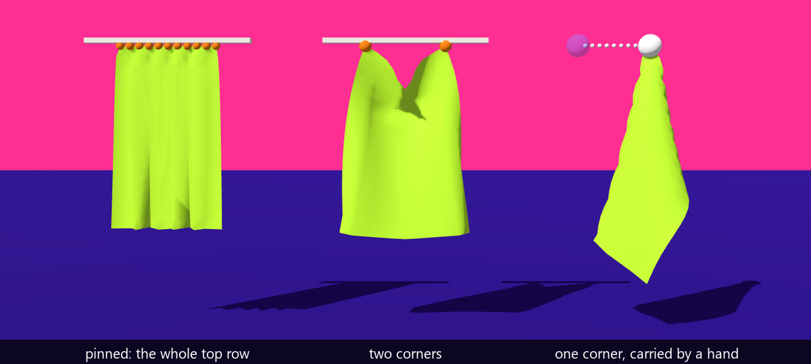

*One cloth, three sets of pins: the whole top row, two corners, and one corner carried by a hand.*

**You make:** A curtain of your own net and Godot's soft bodies, hung on pins you choose, carried by one corner, that a walker can push through.

**New:** SoftBody3D: Godot moves every point of a mesh (linear_stiffness, damping_coefficient, pressure_coefficient) · set_point_pinned(): boundary conditions as a list of point indices · inheritance: PinnedParticle extends Particle, overriding step() and calling super() · a driven support: AnimatableBody3D turned by code, bodies on HingeJoint3D links; a sine as the input (pressure from sin(t)) · contact: rigid colliders with bounce and friction; a seeded replay · reading a soft body back: point positions, strain as distance from rest · freezing: run N steps, bake the points into an ArrayMesh (opened in 11.7)  
**Follows:** NOC 6 (physics libraries: soft bodies, springs, Verlet)

- **17.1 A body that gives way.** Give Godot a closed mesh and it moves every point for you; three numbers decide how it answers: stiffness, damping, pressure.  
  *Figure: Three jelly cubes on violet ground just after the same drop, front view: stiff and upright, soft and spread, inflated and round.*
- **17.2 Which points must stay.** A pin is a point that may not move; change the pins and the same cloth hangs another way.  
  *Figure: Three lime strips from one bar, front view: top row pinned, two corners pinned, one corner pinned.*
- **17.3 A pinned particle is a particle.** A PinnedParticle extends your Particle from 8.4 and keeps its place: it is a particle that never moves on its own.  
  *Figure: Your net from chapter 8 hanging by two pinned points, each pin an orange PinnedParticle.*
- **17.4 Carry the pin with a hand.** Write step() again so the pin goes where a hand goes, and the net follows.  
  *Figure: Your net hanging by one corner, the pinned point carried by a white ball with its earlier place in lavender.*
- **17.5 Drive it from outside.** Turn a hub, or swing a wall's pressure with a sine: the body answers a motion it cannot push back.  
  *Figure: The carousel from front-above: lime teardrops swinging out on hinged links. Caption: A wall pinned at its edges breathes when its pressure follows a sine.*
- **17.6 Same fall, another obstacle.** Drop the same soft sphere onto different rigid shapes, and replay the drop from the same seed.  
  *Figure: Four cells in a row, front view: one soft sphere landed on a cube, a torus, a prism and a slippery slab.*
- **17.7 Measure it, freeze it.** Stop after N steps and keep the shape as a plain ArrayMesh that no longer yields.  
  *Figure: One vessel frozen at 40, 200 and 400 steps, side by side. Caption: Or read the points back and colour the strain, lime at rest to orange where stretched.*
- **17.8 A pattern with a metabolism.** Run your 13.8 rule with other feed and kill numbers: spots, stripes, a maze or dividing cells grow from one patch.  
  *Figure: Top view of one 32-cell grid after a thousand steps from the same centre seed, four regimes: spots, stripes, maze, mitosis.*

**Examples:** Example 17.1: Jelly cube with three sliders · Example 17.2: Three strips, three pin sets · Example 17.3: Your net with PinnedParticle and a carried corner · Example 17.4: A breathing wall · Example 17.5: Gray-Scott with other feed and kill numbers  
**Exercises:** (1) Match one silhouette twice: once by changing only pins, once by changing only stiffness. (2) Give PinnedParticle the walker's hand as its holder. (3) Freeze the vessel at 40, 200 and 400 steps and stand the three in a row. (4) Colour a cloth by a reaction-diffusion field running on its points.  
**Your room:** A soft part in your room: your net becomes a curtain on pins that your figure walks through, or a wall that breathes.

**Clip planned:** The carried corner pulling the net along (17.4).  `pin.position = hand.position`

*Borrowed (supplied, named):* Walker (supplied): a capsule body that walks into the cloth · Look (supplied): palette, sky and light

*Hooks for later:* Haeckel's radiolaria (SoftBodies_Affect_Theory_Visualization): remake one seeded shell as a soft body you can press. · Turing 1952: a reaction-diffusion coat on a soft creature. · The Confessing Body: a reaction-diffusion field displacing a body. · Soft mushroom and flag dancer: soft parts on a plant and on a dancer.

### 18. Bodies From Fields

*A number for every place, a level that cuts it, marching cubes for the skin.* (sequence `isosurfaces`)

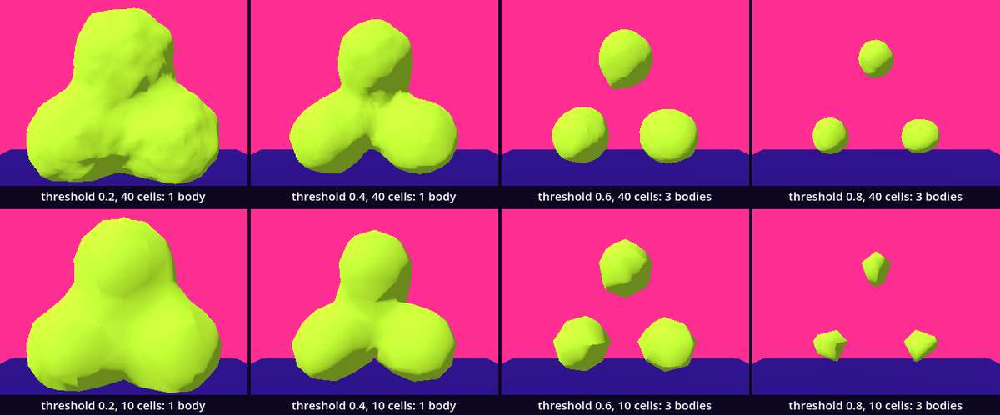

*One field of three sources cut at four levels, on 40 and on 10 cells: one body or three.*

**You make:** A body made from three sources and noise, cut at a level you chose, meshed by your own marching cubes on a worker thread, with a hole a walker can stand in.

**New:** a scalar field as a function value_at(p), sampled on a 3D grid (three nested loops into a PackedFloat32Array) · a level classifies samples inside or outside · marching cubes: eight corner bits make a case number that picks triangles from a table; edge interpolation t = (level - a) / (b - a), then lerp · combining fields: sum, min (union), max(a, -b) (cut) · a periodic field: sin(x)cos(y) + sin(y)cos(z) + sin(z)cos(x) · density terrain: h(x, z) - y plus 3D noise · building off the main thread: WorkerThreadPool, hand-back with call_deferred  
**Follows:** Ada's own

- **18.1 A number for every place.** A field is a function that returns one number for any point; sample it on a grid and draw the samples.  
  *Figure: A 10 x 10 x 10 lattice of white dots, iso view, each dot sized by its noise value.*
- **18.2 A level makes a boundary.** Pick one number: samples above it are inside, below it outside, and the boundary runs between.  
  *Figure: One field of three sources cut at 0.2, 0.4, 0.6 and 0.8, front view: one body, one body, three, three smaller.*
- **18.3 Eight corners, one case.** Each cell turns its eight corners into a case number; a table says which edges to join, and the corner values say where on each edge.  
  *Figure: One cube, corners lit lime (inside) or dark (outside), their bit numbers written on them, and the triangle the table draws across it.*
- **18.4 Sources that add up.** Add a falloff for each source and two bodies join with a neck before their centres meet.  
  *Figure: Two sources in three frames, front view: apart, joined by a neck, one body.*
- **18.5 Union is min, cut is max.** Combine distance fields point by point: min keeps either body, max(a, -b) carves b out of a.  
  *Figure: Chair and cup from the shapes gallery, front view, the cup's one-line formula under it.*
- **18.6 A formula that repeats.** sin(x)cos(y) + sin(y)cos(z) + sin(z)cos(x), cut at a level, is one surface that folds through all of space.  
  *Figure: A gyroid block at period 1 and period 2, iso view, side by side. Caption: One slider can move frequency, noise and level together; pull them apart to see what it bundled.*
- **18.7 Ground with a second answer.** Height minus y gives one ground per column; add 3D noise and one column can pass solid, air, solid: overhangs and caves.  
  *Figure: Side cut through a hill with an overhang and a cave, an orange vertical line crossing it: one column, three crossings.*
- **18.8 Rebuild while you watch.** Mesh on a worker thread and hand the result back with call_deferred, so a hand can sculpt while the room keeps its frame rate.  
  *Figure: The sculpting frame, front view: an orange brush point and a new lime deposit joined to the old one by a smooth seam.*

**Examples:** Example 18.1: Field dots · Example 18.2: Marching cubes on three sources · Example 18.3: The cup by min and max · Example 18.4: A gyroid with a period slider and one knob for three settings · Example 18.5: A threaded sculptor  
**Exercises:** (1) Find the level where three bodies become one; halve the grid and find it again. (2) Write a torus field and union it with the gyroid. (3) Bundle frequency, noise and level behind one slider and pull them apart: what did the slider hide? (4) Drop a pile of cubes, freeze them, and draw only the faces where a filled cell meets an empty one: a voxel skin. (5) Move the noise offset and rebuild twice a second: which block moved?  
**Your room:** A field-made body in your room, cut at your level, with a doorway carved by max(a, -b) that your figure can stand in.

*Borrowed (supplied, named):* Marching-cubes triangle table (Ada's MarchingCubesLookupTables): the edges to join for each of 256 cases · Walker (supplied): tests that the hole fits a body

*Hooks for later:* Rhizome body (ISO_RhizomeBody): a chamber graph with loops blended into passages you walk, once graphs arrive in ch22. · Caves from conditions (ISO_CaveGeneration): one generator, many caves; which ones can you walk? · A radiolarian lattice as a field: a gyroid shell cut by a sphere. · Raymarching the same sources in a shader (ISO_ImplicitModeling), if chapter 12 ever gains a distance-field step.

### 19. Three Verbs for Solids

*Union, intersection and difference: bodies combined, then baked so you can walk in them.* (sequence `boolean_surfaces`)

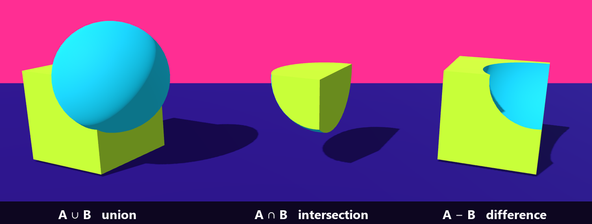

*A box and a sphere under the three verbs: union, intersection, difference.*

**You make:** A carved body in your room: two of your grown forms (chapters 15 and 16) united, a tunnel taken out, the order written on its plinth, baked so a walker can step inside.

**New:** a solid as a test: is this point inside? · volume by counting lattice points · CSGCombiner3D with CSG children: operation UNION, INTERSECTION, SUBTRACTION · child order is the order of the verbs · an @export enum that sweeps a family of cuts · use_collision, then bake_static_mesh() and bake_collision_shape() to a MeshInstance3D and StaticBody3D · recursion that leaves holes by not building cells  
**Follows:** Ada's own

- **19.1 Inside or outside.** A solid is a question you can ask any point: am I inside?  
  *Figure: A box and a sphere overlapping, front view, inside a lattice of dots: lime inside both, cyan inside one, none outside. Caption: Count the yeses on a lattice and you have its volume.*
- **19.2 Union keeps either.** Put two shapes under a CSGCombiner3D and the result is every point that belongs to either, with no seam.  
  *Figure: A box and a sphere overlapping as one lime union, front view, their two outlines in lavender.*
- **19.3 Intersection keeps both.** Only the points both shapes claim survive; move them apart and nothing is the right answer.  
  *Figure: The rounded lime survivor of a box and a sphere on its plinth, front view.*
- **19.4 Difference carves.** Subtract the sphere from the box and the cut grows a face neither shape had.  
  *Figure: A lime box with a spherical bite, iso view, the new face in the sphere's cyan.*
- **19.5 One setting, a family of cuts.** Export an enum that moves the operands, and build every value side by side.  
  *Figure: The gallery's union row from above: distinct, necked, lobed, single.*
- **19.6 Order is part of the form.** Children are applied top to bottom, so the same three shapes in another order make another body.  
  *Figure: Four carved bodies in a row, front view: (A u B) - C, (A - C) u B, (A n B) - C, A - (B u C).*
- **19.7 A hollow you can walk into.** A carved hollow is only a picture until you bake it to a mesh with a collider and a level floor.  
  *Figure: Cut-away side view of a burrow: the cyan walker standing on the baked floor inside the carved tunnel.*
- **19.8 The hole never made.** Recursion can leave holes by simply not building some cells: it looks like subtraction and cuts nothing.  
  *Figure: The recursive cube with its holes, iso view: nothing was subtracted, the cells were never built.*

**Examples:** Example 19.1: Lattice volume of two overlapping shapes · Example 19.2: Three verbs on a box and a sphere · Example 19.3: Four orders of the same three operands · Example 19.4: A baked burrow with a walker inside  
**Exercises:** (1) Predict which two of the four orders look alike, then build them. (2) Make the symmetric difference (A - B) u (B - A) with two combiners. (3) Put two faces in one plane and watch them flicker; move one by a millimetre. (4) Cut a dome's hollow out of a block with a difference, then bake it so a walker can stand inside.  
**Your room:** Carve a doorway or a niche into your room with the three verbs, the order written on the plinth, baked so your figure can stand in it.

*Borrowed (supplied, named):* Walker (supplied): proves a hollow can be entered · Look (supplied): palette, sky and light

*Hooks for later:* Kapoor's voids (boolean_eggs): an egg with a black cut you look into. · A Menger sponge you can enter: the recursive cube at room size. · The same verbs on fields: an SDF cavern carved by max(d, -sphere) (sdf_cavern_room).

### 20. Many Bodies, Local Rules

*Particles that age, agents that steer, and neighbours that make a crowd.* (sequence `swarmintelligence`)

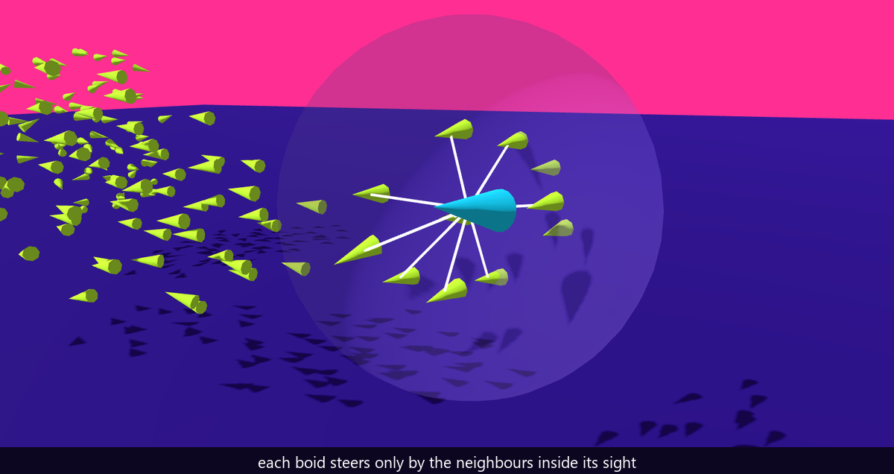

*A flock of 150: one boid (cyan) steers only by the neighbours inside its sight, the lavender sphere and the white lines.*

**You make:** A flock of your own bodies that steers through your room by separation, alignment and cohesion, drawn with one MultiMesh, leaving a trail others can follow.

**New:** a particle system: Spark objects (extends Particle) that are born, age and are removed (loop backwards) · a trail grid: agents deposit, the grid spreads and fades · steering: desired velocity minus velocity, limited to a maximum force · reading a flow field at your position (the field of 6.5) · neighbours within a radius; a weighted sum of behaviours; groups: add_to_group(), get_nodes_in_group() · agent state with an enum (seeking food, going home) · personal best and global best (particle swarm) · MultiMeshInstance3D for hundreds of bodies (met in ch13)  
**Follows:** NOC 4 (particle systems) and NOC 5 (autonomous agents)

- **20.1 Many of one class.** A Spark is a Particle with an age: keep them in an array, add a few each frame and remove the old ones.  
  *Figure: A fountain of lime points rising from one emitter, front view, turning lavender as they age.*
- **20.2 Agents that write the ground.** Each agent smells three spots ahead, turns toward the strongest and leaves trail; the trail spreads and fades.  
  *Figure: Top view of the colony: a bright network between three anchors, the agents as dots along it.*
- **20.3 Want minus have.** Steering is the velocity you want minus the velocity you have, limited to a maximum force.  
  *Figure: One agent with three arrows: its velocity (white), the desired velocity (cyan), and the steering (orange) that closes the gap.*
- **20.4 Follow the arrows.** You met the arrow field in 6.5: now an agent looks up the arrow where it stands and steers along it.  
  *Figure: Top view of a grid of arrows bending round a block, lime agents streaming along them.*
- **20.5 Three ways to be near.** Inside a radius, move away from the too close, turn with your neighbours, pull toward their middle; weight the three and add.  
  *Figure: One cyan boid inside its lavender sight sphere with three arrows (separate, align, cohere), the flock around it.*
- **20.6 Two trails, one change of mind.** An ant looking for food lays a home trail; finding food flips its state, and it lays a food trail home.  
  *Figure: Top view: a nest, two food piles, and two overlapping trails, cyan for home and orange for food.*
- **20.7 Memory and a score.** Each particle remembers its best spot and the swarm remembers the best of all; best is whatever the score says it is.  
  *Figure: The same swarm from above under CONVERGE and under SPREAD, same start, side by side.*
- **20.8 A population that lives on.** Predators and prey steer by one rule with the sign flipped; each birth passes on five numbers with a small mutation.  
  *Figure: The ecosystem from above, the two population counts drawn as lines under it.*

**Examples:** Example 20.1: A particle fountain · Example 20.2: Physarum on a trail grid · Example 20.3: Flow-field followers · Example 20.4: Boids with three sliders and a radius · Example 20.5: Ants with two trails  
**Exercises:** (1) Change only the radius and watch the same weights make another flock. (2) Let new ants arrive on an old trail; then clear the grid and compare. (3) Switch the particle swarm's score from CONVERGE to SPREAD mid-run. (4) Draw 800 boids, first as nodes, then as one MultiMesh.  
**Your room:** A flock of copies of your figure steers through your room and round the visitor.

**Clip planned:** The flock steering round the visitor, the three behaviours switched on one by one.  `steer = desired - velocity`

*Borrowed (supplied, named):* Cost field (graph search, taught in ch22): floods out from a target to give each cell its arrow in the route scenes of 20.4 · Walker (supplied): the visitor the flock steers around

*Hooks for later:* Physarum's rail map: anchors at real stations, compare the network it grows. · A murmuration flown through in the headset. · Termite building: agents that deposit material by trail, stigmergy as architecture. · Physarum meets L-systems (MissionPhysarum_Lsystems).

*Where Part V bends the ladder:*

- The spine puts soft bodies (NOC 6) before particles and agents (NOC 4 and 5), so inheritance, which NOC teaches with particle systems, is taught in ch17 (PinnedParticle extends Particle) and reused in 20.1 (Spark extends Particle).
- ch17 builds on ch8's Particle class and relax passes; the Verlet lesson is not repeated.
- ch17's SoftBodies_Affect_Theory_Visualization holds only Haeckel's radiolaria, so by rule 5 it leaves the path as a case study.
- Topology_Entropy_Morphogenesis needs ch18's mesher, so it moved from ch17 to 18.6.
- ch18 changes the hall order: ISO_Metaballs (11th in the sequence) is taught 4th, and ISO_Sculpting (5th) is taught last, with the thread.
- ch18's ISO_RhizomeBody builds from a chamber graph (ch22), so it is a case study, not a section.
- ch20's flow-field route scenes need a breadth-first flood over the grid (graph theory, ch22), supplied as a borrowed part.
- ch20 opens with NOC 4's particle system, but no hall is one, so 20.1 builds no Ada example.

## Part VI: Beyond

Part VI starts with bodies that learn: NOC 10 neural networks, framed by NOC 11 neuroevolution and the return of Chapter 16's genetic algorithm. Next comes graph theory: connections you can search, draw, cross, cut and pair. Then Ada's own ending. The crisis of foundations builds bodies that the rules you have used cannot hold. The QFEP laboratory takes Ada's formula apart into four handles and wires them to bodies. Post-crisis computing turns every earlier tool back on the room: who it lets in, what it keeps, who may change it. The running project, My Room, ends here, released to desktop and headset with a guest any visitor can change.

### 21. Bodies That Learn

*A learner is a rule that changes its own numbers when it is wrong.* (sequence `machinelearning`)

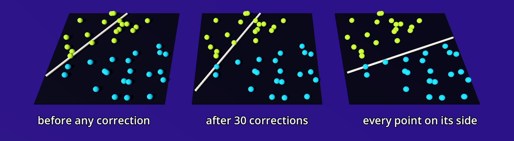

*A perceptron finds its line: before any correction, after 30, and when every point is on its side.*

**You make:** A floor that colours itself from labelled points, a perceptron that finds its line by walking down its error, and a vehicle whose brain is evolved, not taught.

**New:** a loss function: error as one number · the gradient by nudging (finite differences) and the learning rate · k-means: assign to the nearest centre, move the centre to the mean · the perceptron: weighted sum, sign, error times input times learning rate · a hidden layer: nine weights trained by the same nudge, no chain rule · a convolution kernel slid over an Image · weights as a genome (neuroevolution)  
**Follows:** NOC 10 Neural Networks and NOC 11 Neuroevolution (NOC 9's genetic algorithm returns)

- **21.1 A learner with no teacher.** Take the score out of your Chapter 16 genetic algorithm and the population still changes, because the world does the selecting.  
  *Figure: Two populations from above: bodies drifting over energy cells with their trails, and a scored population whose best are copied each generation.*
- **21.2 Error is a height.** Every line through your points has an error, so draw the error as a height over slope and intercept and you get a landscape.  
  *Figure: The squared-error bowl over a floor whose axes are slope and intercept, one candidate line marked as a lime point on it.*
- **21.3 Walk downhill.** Nudge each number, see which way the error falls and step that way: that is gradient descent.  
  *Figure: Top view of the bowl with two trails of steps: small steps curving into the bottom, large steps overshooting back and forth. Caption: The step size is the learning rate.*
- **21.4 Centres that move.** Give each point to its nearest centre, move each centre to the middle of its points and repeat until nothing changes.  
  *Figure: Three frames from above: random centres, the first colouring, the settled centres with their coloured points.*
- **21.5 The perceptron.** Weigh the inputs, add them up and take the sign; when the answer is wrong, move each weight by error times input times learning rate.  
  *Figure: Cyan and lime labelled points on the floor, with the perceptron's line after 0, 10 and 100 corrections.*
- **21.6 Hidden layers.** No line separates XOR: add a hidden layer and train its nine weights by the nudge of 21.3.  
  *Figure: A 2-2-1 network drawn as spheres and wires whose thickness is the weight, the four XOR points at its inputs.*
- **21.7 A filter that finds edges.** Slide a 3x3 grid of weights over an image and add up: a Sobel kernel lights up only where neighbours differ.  
  *Figure: A pixel image of a cross and a disk, the 3x3 window outlined on it, and its edges lit lime.*
- **21.8 A brain that evolves.** Give your Chapter 20 vehicle a small network for a brain, treat its weights as genes, and let selection do the training.  
  *Figure: Trails of a dozen vehicles toward a target at generations 1, 10 and 30: scattered, then converging.*

**Examples:** Example 21.1: Drift, a population with no fitness · Example 21.2: Downhill on a loss surface · Example 21.3: k-means on the floor · Example 21.4: A perceptron learns a line · Example 21.5: Neuroevolved steering  
**Exercises:** (1) Raise the outliers and compare the squared-error and Huber landscapes on the same points. (2) Run k-means with four centres on three blobs: what does the fourth centre do? (3) Build the memory cell c = f*c + i*x with three gate sliders, and feed it two histories that end on the same token. (4) Score each point by its distance from the mean in spreads and lift the ones past a threshold.  
**Your room:** Your figure learns: a floor in your room colours itself from places you label with two keys, and your figure steers by a small evolved network.

*Borrowed (supplied, named):* The floor painter (Image to ImageTexture, one pixel per cell) from the learning-body kit's supplied files.

*Hooks for later:* A creature that teaches itself to walk from a reward every tenth of a second (joint_learn_walk), as a reinforcement-learning extension. · A real generator and discriminator trained on the student's own shapes (what ML_Generative only diagrams). · Train on visitors' stops in the room, with consent, and print who labelled each point. · Backpropagation: the chain rule does the nudging of all the weights in one backward pass instead of nine nudges.

### 22. What Connections Permit

*Places and the connections between them: searched, drawn, crossed, cut and paired.* (sequence `graphtheory`)

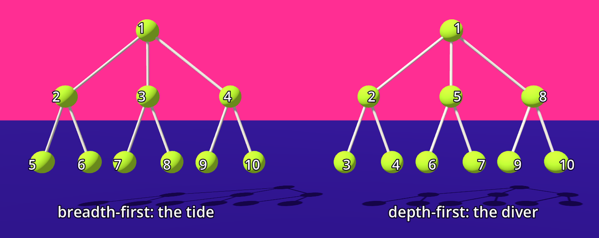

*One tree of lamps numbered in the order each search visits it: breadth-first, the tide, and depth-first, the diver.*

**You make:** A graph of your room's places that a companion can search, lay out, cross by the shortest route and connect at the lowest cost.

**New:** a graph as a Dictionary of neighbour Arrays (adjacency list) and degree · a queue and a stack (push_back, pop_front, pop_back); a visited set; came_from and walking a path back from the goal · force-directed layout: springs on edges, repulsion between every pair · AStar3D (add_point, connect_points, get_point_path, set_point_disabled) · directed edges and components you can return through · union-find · capacity, flow and the augmenting path · matching: greedy against maximum  
**Follows:** Ada's own (NOC 2 forces and Chapter 17's springs return in the layout)

- **22.1 Places and connections.** A graph lists places and, for each place, the places it connects to; count a place's connections and you have its degree.  
  *Figure: Four spheres and seven edges, one sphere per island, each labelled with its degree: all odd.*
- **22.2 The tide and the diver.** Keep the places still to visit in a list: take from the front to spread, from the back to dive.  
  *Figure: The same tree of lamps twice, numbered in visit order: row by row for the tide (breadth-first), branch by branch for the diver (depth-first).*
- **22.3 A drawing is not the graph.** Pull connected places together with springs and push every pair apart, and the graph draws itself: the drawing moves, the connections stay.  
  *Figure: A cube's eight vertices as a random tangle on the left, settled into a readable cube on the right.*
- **22.4 The shortest way across.** Breadth-first search notes where it came from, so following the notes back from the goal gives the shortest route.  
  *Figure: Stepping stones from above with the spark's route lit; one stone sunk and the new route drawn around it. Caption: AStar3D adds a guess of the distance left.*
- **22.5 One way, and back.** Give edges a direction and reaching a place no longer means you can come back; places that can all reach each other form a component.  
  *Figure: Eight spheres joined by arrows, three coloured groups each holding a cycle, one-way arrows running between the groups.*
- **22.6 The cheapest network.** Take edges from cheapest up and keep each one that joins two separate groups: you get every place connected with no loops.  
  *Figure: A weighted graph with accepted edges in lime and rejected ones lavender. Caption: A maze is a spanning tree of a grid.*
- **22.7 What a pipe can carry.** Give every edge a capacity and keep pushing along any path that still has room: the bottleneck decides the total.  
  *Figure: Source on the left, sink on the right, edges as tubes filled flow-over-capacity, and the full edges that form the cut marked.*
- **22.8 Pairing places.** A matching pairs places so that none is used twice; greedy pairs can block a better set.  
  *Figure: A ring of five with five spokes: a greedy matching in orange leaves a gap, and one swap in lime fills it. Caption: Look for a path that swaps pairs to add one more.*

**Examples:** Example 22.1: Königsberg's degrees · Example 22.2: The tide and the diver · Example 22.3: A cube draws itself · Example 22.4: A river of stones (AStar3D) · Example 22.5: A maze is a spanning tree  
**Exercises:** (1) Which place is busiest? Count the shortest paths through each vertex and compare that with its degree. (2) Remove one bridge from Konigsberg so that a walk over every bridge exists. (3) Swap the queue for a stack in your path search: is the route still the shortest? (4) Connect six seeds as a tree, then add one edge to make a loop: count the components and the cycles. (5) Order a list of chores with 'before' arrows (a topological sort).  
**Your room:** Your room becomes a graph: its forty places as vertices and walls as missing edges; your figure finds the way to any place, and a test proves every place can be reached.

*Borrowed (supplied, named):* Path compression in union-find: one supplied line; the idea of joining groups is taught.

*Hooks for later:* Desire lines: the route people actually walk against the shortest one, cut into the room's walls. · The rhizome cave (SpeculativeComputation_Rhizome_Network): a graph whose edges are walkable tunnels. · A salesman's tour drawn as one closed line (salesman_knot).

### 23. Where Foundations Fail

*Every system you have built stands on choices; here you build what those choices cannot hold.* (sequence `foundationscrisis`)

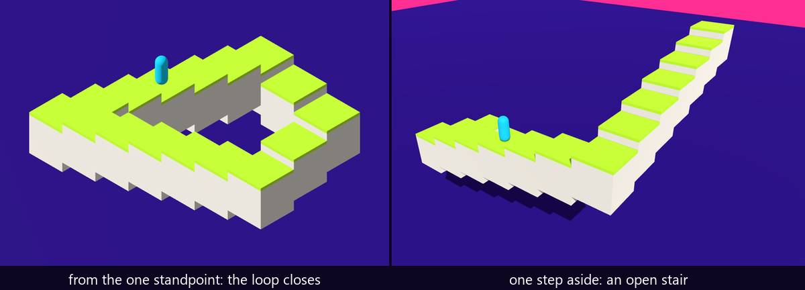

*The staircase from its one standpoint, where the loop closes, and from one step aside, where it opens.*

**You make:** A gallery of impossible bodies: a triangle whose angles add to more than 180°, a set that cannot decide, a staircase that closes from one standpoint, a row that waits for you, and a gate that holds two answers.

**New:** axioms as data: an Array of Strings and a toggle · the angle between directions (dot product, acos); great-circle sides with Vector3.slerp · a Boolean with no consistent value · a statement as an integer (Godel numbering) · a closed loop's height changes sum to zero · an illusion that closes from one camera position only · an enum with a third value: TRUE, FALSE, NOT_YET · keeping a contradiction without letting it prove everything  
**Follows:** Ada's own

- **23.1 Five sentences you agreed to.** Every world you have built rests on rules you never wrote down, so write Euclid's five as an array and switch the fifth off.  
  *Figure: Five plinths in a horseshoe, the fifth in orange, and two lime lines that run parallel from the first.*
- **23.2 A triangle on a sphere.** On a sphere, with sides drawn by slerp and corners measured by dot, the angles add up to more than 180°.  
  *Figure: The same three corners on a plane, on a sphere and in a Poincaré disk, with the angle sum printed under each.*
- **23.3 The set that cannot decide.** Ask whether the set of all sets that do not contain themselves contains itself: try true, try false, and both break the rule.  
  *Figure: Two buttons on a plinth, IN and OUT: pressing IN lights the OUT lamp orange and pressing OUT lights the IN lamp orange, so no lamp can stay lit.*
- **23.4 A statement that is a number.** Code each symbol as a number and a whole statement as one integer, and arithmetic can talk about its own statements.  
  *Figure: A row of five lime tiles carrying symbols, each with a tower of cubes for its prime raised to its code, and one tall off-white column whose height is their product.*
- **23.5 Every step right, the loop wrong.** The height changes around a closed loop always add up to zero, so a staircase that only climbs can close only where the drop is hidden.  
  *Figure: The staircase from its one standpoint, the loop closing, the hidden drop marked in lavender on the far side.*
- **23.6 True, false, not yet.** Give truth a third value: a row that grows only when you choose its next term cannot yet answer a question about all its terms.  
  *Figure: A row of cyan and orange beads ending in a question mark, and a readout: 'contains a 1' TRUE, 'never a 1' NOT_YET.*
- **23.7 Both, and nothing follows.** Keep two reports that disagree, open and closed, and do not let their clash prove anything else.  
  *Figure: A door frame with two see-through leaves, one open and one shut, and a readout: alarm, NO SUPPORT.*
- **23.8 A formula with handles.** Ada's formula waits at the end of the hall with a button for each term.  
  *Figure: The formula as floating 3D letters with one term lit and its question printed beneath.*

**Examples:** Example 23.1: Parallel lines, fifth on and off · Example 23.2: A triangle on a sphere · Example 23.3: Russell's two buttons · Example 23.4: The staircase that closes from one place · Example 23.5: The both-true gate  
**Exercises:** (1) In the Poincaré disk, find a triangle whose angles add up to almost nothing. (2) The barber shaves everyone who does not shave himself: write his two rows. (3) Plot x → r·x·(1−x) for r from 2.5 to 4 and watch one value split into two, four, then scatter (the hall's bifurcation diagram). (4) Build a Penrose tribar from three straight beams that closes from one camera position only.  
**Your room:** Put an impossible body in your room, a stair that closes from one place, and mark that place on the floor for your figure to stand on.

*Borrowed (supplied, named):* A Gödel encoder with a supplied list of primes that guards against overflow: prime powers pass GDScript's 64-bit int almost at once. The student writes the decoder for single symbols.

*Hooks for later:* Escher's Ascending and Descending as a walkable hall with one true standpoint (headset route). · Hilbert's hotel (in Russell_Paradox): a full hotel that still takes a guest. · Magritte's pipe (in Escher_Impossible): a label that denies its own body.

### 24. The QFEP Laboratory

*Ada's formula taken apart into four handles you turn, count and wire to bodies.* (sequence `qfeplaboratory`)

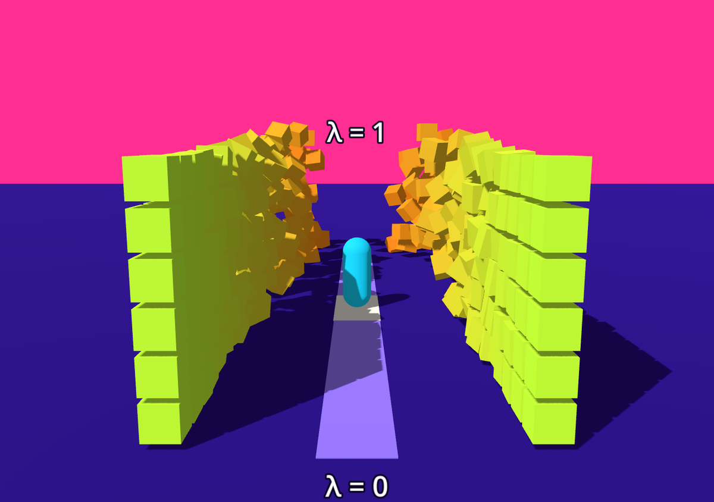

*The λ hall: an ordered lattice at λ = 0 and tumbling blocks at λ = 1, with the walker on the lit path between.*

**You make:** A laboratory of four handles, F, E, λ and φ, wired to a console, a walkable λ hall, a reaction-diffusion floor and a soft body, with one route you can cut.

**New:** a formula as a function of four parameters · Shannon entropy from a probability (log base 2) · counting outcomes: branches multiply, a logarithm adds · position as a parameter (the walker's place along a hall as 0 to 1) · a signed parameter: sign and size read apart · connecting and cutting a signal route (connect, disconnect) · parameters mapped onto a body's stiffness and damping  
**Follows:** Ada's own (NOC 0's probability and Chapter 17's soft body return)

- **24.1 Four handles, one number.** Write the formula as a function qfe(F, E, λ, φ), turn its handles and find two settings that give the same number.  
  *Figure: The console's four-axis diamond for two different settings drawn over each other, both reading the same total.*
- **24.2 How predictable is a bit?.** Draw bits that are 1 with probability p: −p log₂ p − (1−p) log₂ (1−p) is highest at one half and zero at both ends.  
  *Figure: Bit grids at p = 0.1, 0.5 and 0.9 above the entropy curve, with the three points marked on it.*
- **24.3 Counting futures.** Each choice multiplies the futures, and the logarithm of the count turns that product back into a sum.  
  *Figure: A fan from one point branching 1, 2 and 3 ways over four levels, with the leaf counts 1, 16 and 81 beneath.*
- **24.4 λ is where you stand.** Read your place along the hall as λ from 0 to 1 and lerp every block from its lattice place toward a scattered one.  
  *Figure: The λ hall from the entrance: a wall of aligned lime cubes dissolving into tumbling orange ones, with the lit strip between.*
- **24.5 A handle with a sign.** φ runs from −1 to +1: its sign says which way change is weighted and its size says how much, so read them apart.  
  *Figure: The φ rail at −0.6, 0 and +0.6, with particles sinking, still and rising.*
- **24.6 Driving a pattern.** Map λ onto your 13.8 field's feed and kill rates and slide it slowly: spots, then stripes, then a blank.  
  *Figure: Five tiles of one field along the λ route, same start and same time.*
- **24.7 Connect the route.** Connect a slider's signal to the reactor, then cut it: the reactor keeps its last value.  
  *Figure: Two sliders, the reactor orb and the wire between them, lit when connected and dark when cut, with the handle value and the used value side by side.*
- **24.8 What should this body keep?.** Send λ to your soft body's stiffness and φ to its damping: one changes how it holds a shape, the other how long it keeps moving.  
  *Figure: A 2x2 grid of the specimen in its jar at two λ values and two φ values.*

**Examples:** Example 24.1: The balance console · Example 24.2: Bits from p · Example 24.3: Same symbols, four orders (qfep-lab kit) · Example 24.4: Walking λ · Example 24.5: The wired reactor  
**Exercises:** (1) Find three settings of the console that give the same total: what does the number hide? (2) Make the dark room, a field where nothing changes: what is its entropy, and what is there to predict? (3) Throw a die three times: how many futures, and how many bits? (4) Sort 200 symbols by value, by colour and in reverse, and show that the entropy never moves.  
**Your room:** Give your room its handles: λ moves your figure's blocks from lattice toward scatter, φ sets its damping, and one route you can cut.

*Borrowed (supplied, named):* Your Gray-Scott step from 13.8. · The soft body from Chapter 17 (the student's own, or the hall's queer_morphology_specimen).

*Hooks for later:* Your own prediction log as a walkable F curve (the qfep-lab kit's f_curve), if the course ever keeps a sketchbook of predictions. · Langton's ant set loose on the reaction-diffusion floor at the edge. · The snap puzzle (QFEP_F_Term): a body that lowers its error as your hands assemble it.

### 25. Open the Room

*Every tool you have learned, turned back on the room you made.* (sequence `postfoundationscrisis`)

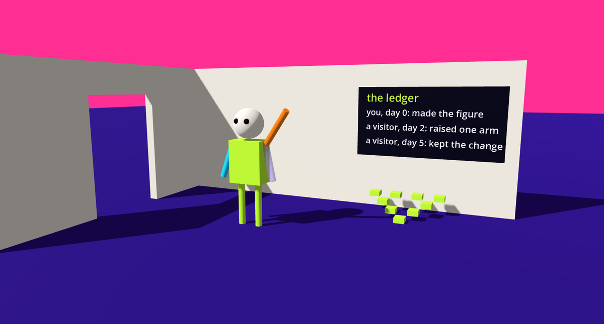

*Your room, released: the figure a visitor changed, its first pose in lavender, and the ledger that keeps who changed what.*

**You make:** Your room, released: one body any visitor can change, every change kept with its source, exported to desktop and headset.

**New:** a record that carries its source (who, when, what) · keeping both versions of a disagreement · a seen-list for counting distinct contributors · growth by nearest earlier neighbours; cutting a node and counting components · writing to user:// (FileAccess, JSON.stringify), appending (READ_WRITE, seek_end), loading in another scene · export presets for desktop and Quest  
**Follows:** Ada's own

- **25.1 Room to tell apart.** Lerp one group of labels into a tight knot and the other apart: every word stays, but some can no longer be told from each other.  
  *Figure: Floating labels at blend 1: the orange ones crowded into a knot, the off-white ones spread wide.*
- **25.2 Who the room faces.** One loop places six chairs round a table or in a line, and decides who is easy to speak to.  
  *Figure: Two miniature rooms side by side: a long table with a head chair, and a round table with six equal chairs.*
- **25.3 Keep both branches.** When two versions disagree, keep both with their sources instead of letting the last write win; a resolution is a choice you make in the open.  
  *Figure: Branch A and branch B as two pillars meeting at a lit junction, both kept. Caption: A resolution shrinks one to a labelled stump, in the open.*
- **25.4 A verdict with an address.** Let every reading carry the place it was made from, and four panels can disagree about one subject without any of them lying.  
  *Figure: Four panels facing inward around one subject number, each showing its verdict, its confidence and a footer giving its position.*
- **25.5 Count the voices.** Count contributions and contributors apart: a seen-list lets each source count once.  
  *Figure: A helix of facets fed by twelve rim nodes, coloured by source, with two counters: pieces and sources.*
- **25.6 Grow without a root.** Let each new point link to its three nearest earlier points, then cut a busy one and count what still connects with your Chapter 22 search.  
  *Figure: The rhizome from above, one busy node cut to a lavender ghost and the surviving groups in different colours.*
- **25.7 A body you can change.** Pull one joint of a body of spheres and springs and let go: the body keeps your change, and the change is now data.  
  *Figure: A figure of joints and links with one hand pulled far out, the original pose ghosted behind it.*
- **25.8 Save it, carry it, release it.** Write each change to user:// with who, when and what, and load it in another room.  
  *Figure: Two bodies side by side, the cyan start pose and the orange kept pose, with a ledger of entries scrolling between them. Caption: Then export the room for desktop and headset.*

**Examples:** Example 25.1: Compressed labels · Example 25.2: Two rooms from one loop · Example 25.3: A merge that keeps both · Example 25.4: A rhizome you can cut · Example 25.5: The body that returns (save and load)  
**Exercises:** (1) Build a fair pair: the same chair count, size and colour, with only the arrangement changed. (2) Feed one source ten times and watch contributions and contributors part. (3) Give the situated readout a fifth panel whose verdict is computed from what it can see. (4) Open the log with WRITE on every visit, watch the history stay one entry long, and repair it.  
**Your room:** FINAL: your room, released, with your figure standing and one body any visitor may change; each change is kept for the next visitor to read, and the room is exported to desktop and Quest.

*Borrowed (supplied, named):* The Quest export preset (export_presets.cfg, shipped in every kit) and Godot's export templates. · The spring-jointed body from Chapter 17, reused as the changeable guest.

*Hooks for later:* A shared class museum: each student's room as one hall, walked together in the headset. · Repairability as a brief: a guest that can be opened and mended by someone else. · The commons table: a round table with an opening at its centre instead of an object.

*Where Part VI bends the ladder:*

- Chapter 21: the halls start with evolution and Nature of Code starts with the perceptron. The chapter opens on the Chapter 16 genetic algorithm (no teacher), runs NOC 10, and closes on neuroevolution (NOC 11).
- Chapter 21: the hidden layer is trained by the finite-difference nudge of 21.3, so the chain rule is not needed; backpropagation is a hook.
- Chapter 21: ML_Generative trains nothing (scripted curves) and is not built. ML_Sequence_Memory drops to an exercise to keep 8 sections.
- Chapter 22 comes after machine learning, so a neural network (a graph) is drawn in Chapter 21 before graphs are taught. GT_Network_Analysis's exhibit computes nothing from its edges, so it is only an exercise.
- Chapter 23: Godel numbers overflow GDScript's 64-bit int, so a supplied encoder is used. The hall's Godel machine is a timed sculpture, not a search, so the student's build differs from the hall.
- Chapter 23.8 only teases the formula; 24.1 presents it.
- Chapter 24: hall names do not match content (QFEP_F_Term teaches Shannon entropy). Reaction-diffusion is the student's own from 13.8.
- Chapter 25: most halls reuse earlier code, so the chapter's new ideas (files in user://, provenance, export) gather in its last two sections.

## Open questions for Palle

1. Stills or video? You asked: use Godot video with the line of code over the actual scene? The sketch says yes for the chapters about motion (6, 7, 8, 9, 10, 13, 17, 20) and stills for static forms. A proof clip of chapter 6 plays under its picture. Confirm, and say whether the 197 section figures are rendered as stills, clips, or only the ones that carry a rate or a change.
2. The rendered ground is deep indigo (about 46, 12, 164), not violet, and it swallows near-black tiles. Retune the look's ground to a lighter violet, or call it indigo? Until then 3.5 to 3.8 use off-white and near-black tiles in a lime frame.
3. Rays: the spray can (4.7) and the pattern painter (5.5) need a ray from a hand to a surface. It is supplied and never opened. Teach Godot's ray cast once (chapter 7 or 20) or leave it supplied?
4. Chapter 7 has nine sections: add, subtract and dot no longer share one, and collisions became an exercise. Keep nine, or move the centre-of-mass section (7.8) to an exercise too?
5. 11.7 now teaches ArrayMesh and the trimesh collider, the first mesh built from vertices; line() and triangle() from chapter 1 stay supplied until then, and 17.7 reuses it. Fine, or should chapter 5 open them with a triangle built from an array?
6. Names: the random walker of 10.6 is a class Wanderer, so it does not clash with the supplied cyan walker, which the book calls the walker; 16.6's digger is a digger. Fine?
7. Chapter 1 is built around a court of your own shapes; Durer's Melencolia court is the hall's subject and a hook, and the picture is unchanged. Fine?
8. Backpropagation: 21.6 trains the hidden layer by the finite-difference nudge of 21.3 (nine weights, no chain rule); the chain rule is a hook. Or teach the chain rule in chapter 6?
9. Inheritance is taught in 17.3 (PinnedParticle extends Particle) because the spine puts soft bodies before particle systems, and reused in 20.1; Nature of Code teaches it with particles. Keep?
10. Halls moved out of their sequence: Topology_Entropy_Morphogenesis from 17 to 18.6 (it needs the mesher), Noise_6_Wall from 11 to 12.6, PG_Sculpted_Forms into exercises of 18 and 19, the rhizome network into an exercise of 22, and three randomness halls into exercises of 10. Agreed?
11. Chapter 6 now leads with velocity and acceleration; the fundamental theorem (ftc_bridge) is an extension, not a section. Agreed?
12. SHORT_SPEAK.md (2 October) names what is seen a mesh and what is touched a shape, one name per term; the sketch still says collider. Align when the lessons are written?
13. Chapter 1 now holds six ideas in eight sections (script and _ready, coordinates, mesh and collider, _process, mouse and a copy in code, variables); length() moved to 2.5 and snapped() to a chapter 3 exercise. Can a first-time programmer finish it?
