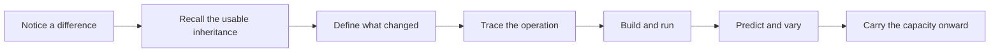
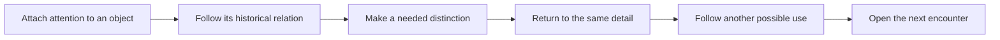
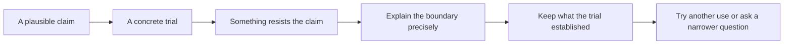

# Patterns for how a text moves

13 October 2026 · Working examples for Ada · [Interactive library](http://localhost:3003/writing-patterns) · [Source readings](REFERENCE_READINGS.md) · [Roles and budgets](../WRITING_ROLES_AND_DECISIONS.md)

These are choices to try, not a new template for every hall. The research tree can hold many relations; the timeline selects a path through them. At paragraph scale, record both what is given and how the reader is addressed. A subject label such as “history” does not describe how that paragraph works.

## What a paragraph card records

| Field | Question for the writer | Example |
| --- | --- | --- |
| Information | What specific knowledge, event or distinction enters? | The seed remains unchanged while one request is discarded. |
| Job | What does this paragraph do? | Complicate the expectation that a seed names a picture. |
| Attitude | How does the narrator approach object and reader? | Curious and exact; the unexpected result is worth investigating. |
| Reader change | What can the reader now notice, understand, do or question? | Separate the starting state from the procedure using it. |
| Bridge | What makes the next paragraph necessary or compelling? | If requests matter, follow their grouping into colour. |
| Size | What share of the text can this movement use? | Rough allowance from the node budget, not a quota to fill. |

Attitude is enacted through attention, verbs, pacing and the handling of certainty. It is not an adjective to sprinkle over neutral exposition. “Critical” can be an action of testing a claim; it need not sound disapproving. A historical paragraph can be intimate or unsettling. A formal definition can be patient and hospitable. A playful paragraph still distinguishes an imagined behaviour from an installed one.

Track the reader's starting and ending position. If consecutive paragraphs both provide the same explanation in the same way, combine them or make the second earn its space. If a new concept is introduced, give it room even when the voice remains steady. Do not demand a different attitude in every paragraph, a question at every transition, or exactly one rhetorical action per paragraph.

## Pattern A — Build, understand, vary

Use for a tutorial whose new capacity grows from an existing object. Retain the familiar object so the new operation can command attention.

| Move | Information and mini instruction | Attitude | Bridge |
| --- | --- | --- | --- |
| Notice | Show one observable difference in the existing artifact. | Inviting | Give the reader a reason to reconstruct it. |
| Recall | Name the exact object, file and knowledge already available. | Collegial | Isolate what must now be learned. |
| Define | Explain the new mechanism and the condition under which it works. | Patient, precise | Give that account a concrete consequence. |
| Trace | Follow a small amount of data through the operation. | Demonstrative | Make the coming code readable before it runs. |
| Build | Supply complete new code and necessary setup; identify the important lines. | Practical | Let execution answer the prediction. |
| Vary | Change one meaningful relation and explain what remains. | Experimental | Establish a capacity the next lesson can use. |
| Carry | State what is retained and what must change next. | Forward-looking | Hand over an object and a problem. |

**Three-paragraph rhythm sample — not a complete tutorial:**

*Inviting / notice:* Choose two neighbouring cubes whose colours you want to remember. Replay the grid. The pair returns. Now let the right panel discard its first request. Your pair has changed there, although the seed readout has stayed still.

*Exact / explain:* The seed selects a starting state for this generator. It does not decide which request becomes red, green or blue. Our procedure gives three successive values those jobs. Discarding one value changes where that grouping begins.

*Experimental / predict:* Before running again, move the first value to the blue channel and the third to red. Leave the requests in their original order. Which channel should remain unchanged? The result will help you distinguish a changed generator from a changed use of its values.

The bridge is **observed difference → explanation of the difference → testable use of the explanation**. A full lesson still needs its worked trace, runnable files and checks. These short samples demonstrate movement and are not replacements for them.

## Pattern B — Leave the object, return changed

Use for a final when one historical relation changes how the current object can be encountered. Keep a concrete detail alive through the excursion.

| Move | Information and mini instruction | Attitude | Bridge |
| --- | --- | --- | --- |
| Attach | Let a particular feature, pleasure or resistance hold attention. | Attentive | Identify the question that makes leaving worthwhile. |
| Follow | Introduce one person, practice or historical problem through its relevance. | Curious; sometimes uneasy | Show what the history makes us need to distinguish. |
| Distinguish | Give the exact relation necessary to understand the stakes. | Clear, measured | Use the distinction on the object we began with. |
| Return | Revisit the initial detail; make its changed meaning perceptible. | Searching | Let that changed relation suggest another use. |
| Possibility | Develop the specific consequence without resolving it immediately. | Playful, critical or tender | Carry a desire or unresolved difficulty forward. |
| Handoff | Let the next hall put pressure on that remaining question. | Open | Continue the story rather than recite its moral. |

**Three-paragraph return sample — the historical excursion would precede it:**

*Attentive / return:* Back at the grid, the violet cube is still beside the orange one. You have been away; their neighbourliness has survived. The machine can make this arrangement again. Whether you still want it is another matter.

*Searching / distinguish:* The numbers did not ask to become colours. Their assignment gave them that work, and the grid gave the colours places to stay. Another seed will repaint the cells. It will not let a cube cross the edge of the panel.

*Playful / open a possibility:* Imagine giving a few draws permission to send their cubes beyond that edge. A corner might trail behind your wrist like an unfinished sleeve. This is not an installed behaviour. For a moment, though, the picture has acquired a different possible relation to a body: something to wear, catch on, or leave hanging.

The bridge is **return to a familiar detail → notice a remaining constraint → imagine a consequential change**. This passage should earn its place through the chosen historical relation, not through a requirement that every final end surrealistically.

## Pattern C — A claim meets resistance

Use for a final or investigation when the artifact appears to promise more than its mechanism supplies. It can begin with confidence and become more cautious without treating the object as defective.

| Move | Information and mini instruction | Attitude | Bridge |
| --- | --- | --- | --- |
| Claim | Name what a visitor could reasonably expect. | Sympathetic | Make that expectation encounterable. |
| Trial | Describe a specific action and its visible result. | Observant | Identify the detail that the claim cannot explain. |
| Resistance | Let the discrepancy persist long enough to be noticed. | Puzzled, not accusatory | Seek the condition that explains it. |
| Boundary | Supply the relevant definition or implementation limit. | Exact | Revise the claim without discarding the object. |
| Retain | Say what the result genuinely establishes. | Candid | Find a use that benefits from this condition. |
| Reuse | Follow the new possibility or a better-defined question. | Inventive | Give the next encounter something to investigate. |

**Three-paragraph rhythm sample:**

*Sympathetic / expectation:* A seed seems a convenient name for a picture. Write down the number and the arrangement should be waiting when you return.

*Puzzled / resistance:* The right panel keeps that number but begins its colouring one request later. Its colours change. The name is still on the door; what it appeared to name has moved.

*Exact, then inventive / revise:* The recipe needs more than its seed. It also needs the same generator and the same use of its requests. That condition gives us something to work with: keep the starting point and change the procedure deliberately. We can investigate related constructions without pretending that the seed guarantees a particular picture.

The bridge is **plausible expectation → observed resistance → a more useful account**. A dramatic failure is not necessary; a small discrepancy can carry the passage.

## Try the patterns on the current pair

The [tutorial plan](../text-plans/Random_Definition/tutorial.md) follows A. Its paragraph score keeps definitions and a trace before the complete program, and treats code as a separate reading event.

The [final plan](../text-plans/Random_Definition/final.md) mainly follows B, with a short C movement at the unchanged seed. It does not need a complete second argument. The size budgets remain 800 and 660 prose words for these proposed drafts; extra attitudes are not extra topics or extra words.

Each node can contain several paragraphs. Draft the paragraphs, then check the score against the actual prose: did the intended movement occur? Change the plan when a better route emerges. Keep the existing map, inherited knowledge and next lesson as checks on what the writing claims.
