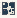

# GT_Network_Analysis

Authored dimensions: {"width": 13, "depth": 13, "max_height": 3}

Source plan only: columns=x, rows=z. Red dots are manuscript/role primary anchors; blue dots are other placed objects; green crosses are utilities. Numbers refer to A rows below. Dark blue is source 0, cream lower structure, grey source wall-height threshold, ochre platforms. Museum overrides can change the built interpretation. Dots show anchors, not footprints or a proven route.

Map: [commons/maps/GT_Network_Analysis/map_data.json](https://github.com/palletorsson/AdaResearch/blob/palm-scanner-door-entry/commons/maps/GT_Network_Analysis/map_data.json)

Text: [commons/maps/GT_Network_Analysis/final.md](https://github.com/palletorsson/AdaResearch/blob/palm-scanner-door-entry/commons/maps/GT_Network_Analysis/final.md)

| Instance | x,z | Raw token | Recorded role | Registry / scene |
|---|---|---|---|---|
| A1 | 2,2 | `rhizomatic_structure:0:0:0.6` | secondary | [commons/artifacts/registry/alternative_geometries.json](https://github.com/palletorsson/AdaResearch/blob/palm-scanner-door-entry/commons/artifacts/registry/alternative_geometries.json) → [algorithms/alternativegeometries/rhizomaticstructure/rhizomatic_structure.tscn](https://github.com/palletorsson/AdaResearch/blob/palm-scanner-door-entry/algorithms/alternativegeometries/rhizomaticstructure/rhizomatic_structure.tscn) |
| A2 | 2,8 | `network_analysis:0:0:0.6` | primary | [commons/artifacts/registry/algorithms_misc.json](https://github.com/palletorsson/AdaResearch/blob/palm-scanner-door-entry/commons/artifacts/registry/algorithms_misc.json) → [algorithms/graphtheory/network_analysis/network_analysis.tscn](https://github.com/palletorsson/AdaResearch/blob/palm-scanner-door-entry/algorithms/graphtheory/network_analysis/network_analysis.tscn) |
| A3 | 5,8 | `networkflow3d:0:0:0.6` | secondary | [commons/artifacts/registry/algorithms_misc.json](https://github.com/palletorsson/AdaResearch/blob/palm-scanner-door-entry/commons/artifacts/registry/algorithms_misc.json) → [algorithms/graphtheory/networkflow3d/networkflow3d.tscn](https://github.com/palletorsson/AdaResearch/blob/palm-scanner-door-entry/algorithms/graphtheory/networkflow3d/networkflow3d.tscn) |

Utilities are listed with exact coordinates and raw tokens in space.json. `utility-index.json` resolves active codes to the literal utility registry and scene, separately from the ordinary artifact registry. Their scene sources and the grid/museum dispatch context are included. Unresolved/special dispatch stays explicitly labelled. Read map_info.museum and utility_definitions before inferring pits, entrances, movement or collision.
