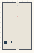

# Topology_Entropy_Morphogenesis

Authored dimensions: {"width": 30, "depth": 48, "max_height": 10}

Source plan only: columns=x, rows=z. Red dots are manuscript/role primary anchors; blue dots are other placed objects; green crosses are utilities. Numbers refer to A rows below. Dark blue is source 0, cream lower structure, grey source wall-height threshold, ochre platforms. Museum overrides can change the built interpretation. Dots show anchors, not footprints or a proven route.

Map: [commons/maps/Topology_Entropy_Morphogenesis/map_data.json](https://github.com/palletorsson/AdaResearch/blob/palm-scanner-door-entry/commons/maps/Topology_Entropy_Morphogenesis/map_data.json)

Text: [commons/maps/Topology_Entropy_Morphogenesis/final.md](https://github.com/palletorsson/AdaResearch/blob/palm-scanner-door-entry/commons/maps/Topology_Entropy_Morphogenesis/final.md)

| Instance | x,z | Raw token | Recorded role | Registry / scene |
|---|---|---|---|---|
| A1 | 15,3 | `soft_workshop_console:180#chapter:morphogenesis` | decoration | [commons/artifacts/registry/soft_bodies.json](https://github.com/palletorsson/AdaResearch/blob/palm-scanner-door-entry/commons/artifacts/registry/soft_bodies.json) → [commons/artifacts/timing_machines/soft_workshop.tscn](https://github.com/palletorsson/AdaResearch/blob/palm-scanner-door-entry/commons/artifacts/timing_machines/soft_workshop.tscn) |
| A2 | 15,14 | `entropy_morphogenesis:0:4#field_seed:1337` | primary | [commons/artifacts/registry/alternative_geometries.json](https://github.com/palletorsson/AdaResearch/blob/palm-scanner-door-entry/commons/artifacts/registry/alternative_geometries.json) → [algorithms/spacetopology/entropy_morphogenesis/entropy_morphogenesis_vr.tscn](https://github.com/palletorsson/AdaResearch/blob/palm-scanner-door-entry/algorithms/spacetopology/entropy_morphogenesis/entropy_morphogenesis_vr.tscn) |

Utilities are listed with exact coordinates and raw tokens in space.json. `utility-index.json` resolves active codes to the literal utility registry and scene, separately from the ordinary artifact registry. Their scene sources and the grid/museum dispatch context are included. Unresolved/special dispatch stays explicitly labelled. Read map_info.museum and utility_definitions before inferring pits, entrances, movement or collision.
