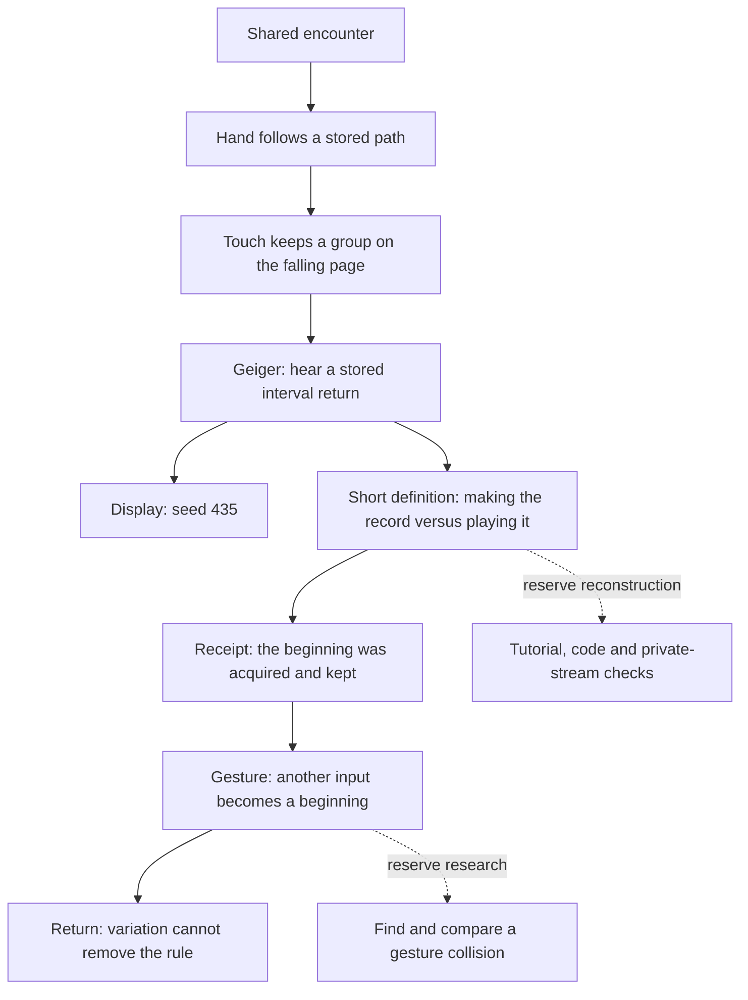

# 435 — a witness, a display and a record

15 October 2026. A complete reading trial responding to Palle’s supplied feedback. The current chapter remains in place. This version is available to compare, not recorded as an accepted replacement.

- [Read the complete trial](index.html)
- [Compare both complete texts](compare.html)
- [Trial Markdown](trial.md)
- [Preserved current chapter](current.md)
- [Word counts and snapshot hash](counts.json)

The trial has 926 words; the preserved chapter has 1,074 under the same counting method. This includes the displayed receipt and excludes the title, footnotes and editorial apparatus. Both fit the gem-based 600–1,500-word range. The preceding iteration counted headings and Markdown markers differently; its 1,081 is not a different source version.

## What this tests

The feedback locates the strongest writing in consequences of the apparatus: less time inside the same distance; a still place made in falling digits; different gestures treated alike by a procedure. It proposes loosening the explanatory middle, separating forms of knowledge, keeping the shared voice from becoming an unidentified research team, and ending at the compulsory return.

The candidate criterion is: a strange observation should arise from a specific operation. The current trial uses three selectable strategies from the existing author collection: follow a rule through its consequences (Carroll), place distinct records beside narration (Eliot), and let a recurrence return in a changed relation (Joyce). These are local editorial adaptations of the supplied feedback, not new scholarly claims or a permanent voice for Ada.

The moving-hand opening is preserved. The book’s final sentence leaves its digits available to read rather than narrating another compulsory act of attention. The Geiger begins with an actual screen excerpt. Audible recurrence precedes the definition. A transcribed acquisition receipt carries its own date and provider. A short inline definition of seed and pseudorandom generation remains. The gesture collision is conditional; the narrator no longer reports on the research team’s progress. The last explanatory paragraph and its closing question are removed.

“We” remains a shared imagined encounter. It does not claim that a participant performed these actions or felt a specified sensation. The room can still be ignored, misunderstood or explored differently.

## Content tree and paragraph timeline

The diagram names dependencies rather than imposing a universal chapter structure. In the prose the screen is met before the repeated clicks.

| Passage | Information and job | Attitude / possible reader change | Bridge |
| --- | --- | --- | --- |
| Geiger screen and other readouts | Establish visible recurrence of 435 without claiming every optional object was already encountered. | Notice a shared beginning across unlike objects. | Hear what one instrument does with it. |
| Clicks, RESTART, same gap | Replay the already calculated sound. | Repetition becomes available to check. | What was kept before the listening began? |
| Ninety-six times; seed and state | Explain generation briefly and distinguish it from playback. | Keep an audible event and its production procedure distinct. | The beginning has an acquisition record too. |
| Receipt | Supply dated provenance as a document in the book. | Separate original atmospheric acquisition from present reuse. | A beginning can be chosen again or supplied another way. |
| Deliberate choice and perceived irregularity | Explain why shared seed does not imply identical sequences or a repeated experience. | Keep unfamiliarity open without claiming true randomness. | A movement can supply another input. |
| MOVE / KEEP | Describe a trace and explain rounding, hashing and finite seed range inline. | The hand’s movement becomes a retained number. | Ask conditionally what different gestures might lose in that reduction. |
| Out / Back | Encounter variable travel and compulsory return. | The limitation remains in the experience. | End; no added interpretive instruction. |

## Accountability to the current build

The feedback’s integration warning refers to an earlier draft. Shared 435 behavior is already implemented and covered by the [preceding integration checks](../2026-10-15-seed-435-middle/README.md). No runtime code changes were made for this literary trial.

- `geiger_counter.gd` displays `seed %d`, and its actual button is RESTART. The trial quotes that screen excerpt rather than placing a new sign above the machine.
- `geiger_model.gd` computes all 96 times; `_set_record()` renders a stored sound, and `restart()` replays it. The generator does not advance once per audible click. This distinguishes reproduction of a record from regeneration of it.
- The colour window displays the current seed in large figures. The lamp capture readout includes its seed. Both can substantiate the number’s recurrence. This does not assert a sightline between all objects.
- The [receipt copy](opening-receipt.json) matches the saved acquisition document exactly. The transcription is identified as a book document; no paper receipt was added to the room.
- Gesture-derived seeds still feed pseudorandom generators. A pair of different gestures with the same seed has not been found and retained in this research loop. The trial describes that comparison conditionally.
- The same five artifact markers occur in the same order as the current Final-tagged wall. The room, tags, conceptual links, tutorial and 48-value first pilot remain as they were.

## Reading response · 15 October 2026

Asked: “In the reading trial, does the Geiger passage let the display, clicks and receipt carry the explanation while keeping the seed understandable?”

Palle: “The balance is closer”

Working decision: preserve this balance in the Geiger passage. Let the visible display, heard recurrence and acquisition record carry more of the explanation, with short definitions where needed. This is a local response to the passage, not a decision to replace the whole chapter or evidence that a newcomer understands seed, state and playback.

## Judgement still to collect

The strongest candidate change is the distinction between times kept before listening and a number kept before generation. The risk is that the display and receipt only decorate the same explanatory lesson. The technical paragraph still carries several ideas; shortening it further would require checking that a newcomer can distinguish seed, state and playback.

The local response above leaves the complete sequence and newcomer comprehension open. Test the ending separately: does stopping at the return leave a consequence, or does it feel prematurely closed? Record the reader’s words, including a preference for the existing version. No literary improvement or comprehension result is claimed from source checks or word count.

## Rebuild and verification

Run `python doc/book/iterations/2026-10-15-435-witness-trial/build.py` with Python Markdown installed. The HTML is static and uses the existing read-only `/book-review/` route; it adds no scripts, trackers or server changes. `current.md` is a byte-preserving snapshot, so its original relative links are rebased only for the browser rendering.

Checks: unchanged canonical chapter hash; five identical ordered artifact markers; matching receipt fields; valid HTML anchor targets; count within budget; source/notes links; browser rendering. Code tests from the preceding runtime revision remain evidence of that revision, not new tests of literary quality.
