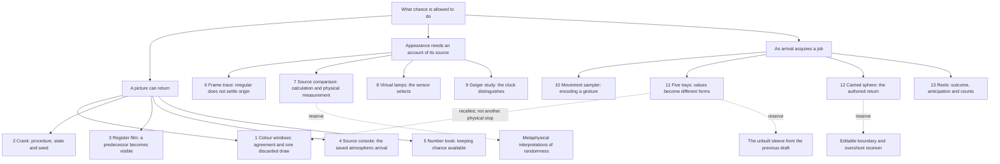

# Random Definition — one room order and one final-text journey

15 October 2026 · [Current final](../../../../commons/maps/Random_Definition/final.md) · [Previous text](before/final.md) · [Previous plan](before/final-plan.md)

**User direction for this trial:** final-text order and room order are the same. Reveal the subject at an interesting rate, beginning with a concrete example and bringing in definitions when they become useful. Seek a simple generative principle rather than a repeated chapter template.

**Working principle:** let an encounter change what the reader wants to know next. Name the unresolved question, then choose an object, definition, historical excursion or bodily event that can develop it. Sometimes answer it; sometimes complicate it. Do not require the same sequence of rhetorical moves in every hall.

**This hall's candidate:** what chance can do depends on the rules that receive, retain and assign its values. Reproducibility makes the apparatus available for revision. The sequence investigates that relation without claiming to establish an ontology of randomness.

**Place:** after Wavefunctions, before Random Entropy. The entrance is at the top, exit at the bottom. The east doorway divides stops 7 and 8. Each numbered magnet reserves three floor cells across and two deep. The 48-value bench remains the first research pilot, now at stop 11 in this visitor journey.

## Content tree

Selected branches occur in the actual final. Reserve branches remain possible experiments, not installed behaviour. The boundary probe is a separate numerical study; no new boundary control is claimed for the sphere.

## Reading and walking timeline

Coordinates are the top-left cell of the reserved magnet footprint. Each row corresponds to one source passage, but this is a local consequence of matching thirteen stops, not a template for future chapters. Word allowances below are rounded local budgets; the resulting draft is 732 body words, excluding title, markers and source notes.

| Stop / cell | Reader gains | Mini instruction, attention and allowance | Bridge to next |
| --- | --- | --- | --- |
| 1 Colour windows / 1,1 | Replay and one skipped draw make a concrete puzzle. | Stay with the two pictures before explaining their construction; curious, about 70 words. | What makes an apparently unchosen picture return? |
| 2 PRNG crank / 4,1 | State, procedure and seed name the mechanism behind return. | Define only the distinctions needed by that puzzle; precise, about 70 words. | Can the hidden dependency itself be seen? |
| 3 Register film / 8,1 | A number has a predecessor. | Give the mechanism a brief material close-up; about 30 words. | Where did the initial state arrive from? |
| 4 Source console / 8,4 | Acquiring a seed differs from reusing it. | Locate the real saved 435 and its preselected range; about 55 words. | How else have people kept chance available? |
| 5 Number book / 1,4 | Historical preparation and the installation's disappearing digits complicate preservation. | Take one purposeful historical excursion and return to the falling page; about 65 words. | Does a stream's appearance tell us how it was obtained? |
| 6 Frame study / 1,7 | Irregular measurement is not evidence enough of source quality. | Let the eye's impression encounter a limit; about 50 words. | What distinction does the impression leave unresolved? |
| 7 TRNG vs PRNG / 8,7 | Calculation, physical-source measurement and simulation are distinguished. | Clarify source and evidence without settling metaphysics; about 60 words. | What does measuring contribute? Cross the doorway. |
| 8 Lava wall / 8,11 | Sensor selection changes what enters the record. | Stay with the virtual lamps and partial view; about 55 words. | What if the selection concerns time instead of view? |
| 9 Geiger study / 1,11 | Retained events can yield different accounts under different clock resolution. | Give the measured interval an audible duration; about 60 words. | Can a visitor supply the arrival? |
| 10 Movement sampler / 1,14 | Encoding makes a gesture usable while retaining only a specified account. | Bring the hand into the chain without claiming the seed stores the whole gesture; about 50 words. | Once acquired, what can a value become? |
| 11 48-value bench / 8,14 | RGB triples and their means acquire different spatial jobs. | Return mentally to the opening colour window with a larger repertoire; about 65 words. | Could assignment have consequences for a body? |
| 12 Out / Back sphere / 8,17 | Variation operates inside an authored journey. | Describe the actual ride, then mark a changed return as an imagined extension; about 60 words. | What happens between a result and someone's expectation? |
| 13 Slot machine / 1,17 | Counting can retain symbols while losing the wait. | Let delay and the next hall open a question; about 50 words. | Random Entropy examines what counts preserve. |

The 732-word result is slightly above the provisional 450–700 target and below the 800-word scope-review line. Keep it for this thirteen-stop trial, then cut a stop or compress a passage if the reading stalls. Do not silently make this a new budget for other halls. Source notes add provenance separately. No tutorial code or new prerequisite is introduced by this final-text revision.

## Evidence, implementation and judgement

- The installed order matches all thirteen final passage markers, including the independently placed source console, frame study and movement sampler. The encyclopedia now matches those exact part IDs to their source passages.
- Existing tutorial seeds/tags, conceptual connections, subject memberships and research records are preserved. All thirteen artifacts now carry the Final tag for this trial.
- Eleven raw map-cell edits rearrange the existing artifacts and pin independent part placements; the room dimensions and doorway remain the same. Previous files are retained in `before/`, and the normal placement/wall histories retain the changes.
- The source read confirms the bench uses sixteen RGB triples from 48 values, with the mean of each triple driving height, size and rotation. It is not 48 separate cubes or one scalar independently driving every RGB component.
- RAND's production account and RANDOM.ORG's interface documentation were checked for the short historical/source passages. Virtual lamps and Geiger detections remain explicitly simulated. The sphere's generator is independent of the window's; the text makes no shared-stream claim.
- Layout verification finds no reserved-footprint overlaps, twelve connected walking legs and one crossing at x=11,z=9 after stop 7. The museum-strip rebuild exits successfully; it reports existing size inconsistencies in Random_Rotate_Random_XYZ and Noise_Inside_Noise. This does not establish actual mesh clearance, viewing angles, comfort or literary effect.
- The 28 writing-wall tests and focused TypeScript check pass. Browser/headset inspection remains unverified.

**Provisional Ada alignment: 7/10**, an editorial estimate for this final only: subject/truth 2, learning/agency 1, situated encounter 2, wider possibility 1, voice/desire 1. The returning-picture opening earns the definition; the different spatial jobs develop a particular object relation. The source/measurement middle is still crowded, and each artifact receiving one paragraph risks a catalogue rhythm. No reader response is implied by this score.

**First judgement to make:** does the book → frame trace → source comparison transition sustain curiosity, or does it feel like we have changed to a lecture? If it stalls, test making the register and comparison exhibit optional side encounters, with their definitions carried by nearby objects. That is a proposed alternative, not part of the installed trial.
