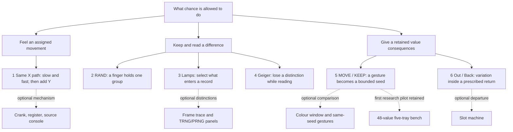

# Random Definition — six main encounters

15 October 2026 · [Current final](../../../../../commons/maps/Random_Definition/final.md) · [Trial evidence](../../../iterations/2026-10-15-six-encounters/README.md) · [Previous plan](../../../iterations/2026-10-15-six-encounters/before/final-plan.md)

Palle requests the six-artifact trial, keeps RAND central, and replaces the opening with a felt comparison: horizontal motion, faster horizontal motion, then horizontal plus vertical motion. The final and main room route share one order. Other artifacts stay accessible and draggable as optional encounters. This is a revised selection, not a deletion of the room's research pool.

Length follows the selected gems, normally 600–1,500 prose words. This draft is 936 words. It has nearly the previous draft's length but six focal encounters instead of thirteen. That buys time within each encounter; whether it feels less dense remains a reading question. No quota requires every artifact or every theoretical connection to appear.

## Content tree

## Reading and walking timeline

Cells are the top-left corner of each three-wide/two-high magnet. The main route crosses the east doorway after the lamps. The full room order also includes optional objects; filtering it to Final tags produces exactly this sequence.

| Final stop / cell | Candidate gem and reader gain | Writing instruction / attention | Bridge |
| --- | --- | --- | --- |
| 1 Moving spheres / 1,1 | Same path, changed rate; same X with Y added. Unpredictability to the hand can coexist with replay. | Stay with following and contact before naming seed/PRNG; about 220 words. Do not prescribe a feeling or imply force feedback. | What in this unfolding event would we keep? |
| 2 RAND book / 1,4 | Keeping enables a later investigation without supplying every answer about origin. | Let a finger hold a five-digit group, make a short historical excursion, return to the authored falling page; about 150 words. | What gets into a record in the first place? |
| 3 Lava lamps / 8,7 | A scene can retain what its sensor excludes. | Name the two captures and change the cover with the scene held; about 130 words. | Can an already recorded difference disappear during reading? |
| 4 Geiger clock / 1,11 | Identical event times can yield fewer bits at coarser resolution. | Listen, identify gaps and bits, then observe a skipped tie; about 120 words. | What if the recorded event belongs to a hand? |
| 5 MOVE / KEEP / 8,11 | Different sampled gestures can share a bounded seed while their fuller records remain distinct. | Describe traces, define the reduction, propose the unobserved collision experiment; about 190 words. | What can this number change in a world? |
| 6 Out / Back / 8,14 | Random variation cannot itself change an invariant rule. | Let the body encounter the prescribed return; recall the opening axes, about 125 words. | What would we keep and what would we rebuild? |

These are attention allowances, not targets to pad. The draft spends its words on a felt comparison, the book, a changing record and a bodily limit. The TRNG comparison's definitions no longer require their own stop. Source acquisition remains accurately distinguished from simulation in the lamp and Geiger passages.

## Optional objects and tutorial

The colour window, crank, register film, source console, frame trace, TRNG/PRNG rig, five-tray bench and slot machine retain their room objects and writing notes. Their Final tags are off; Tutorial tags are preserved. Optional means available for a detour, not technically unimportant or obsolete. The 48-value bench remains the first research pilot. The tutorial now reconstructs the opening sphere comparison; the existing colour-grid program remains a linked optional extension.

## Evidence and next judgement

The three-sphere scene and record tests cover shared X targets, timing transformation, axis restriction, bounds, serialized restoration, rejection of invalid data and control actions. No reader response or headset contact observation for this opening has been recorded. The final does not claim to have found two distinct gestures with the same seed.

Test attention separately from code: what does the person notice when following each sphere? Does the book answer a desire to keep something, or interrupt that attention? Does the later return change their understanding of the opening? A wish to stay at the book may justify duration, not another explanation. Provisional editorial alignment remains 7/10; the longer pauses are a hypothesis about rhythm, not an established improvement.
