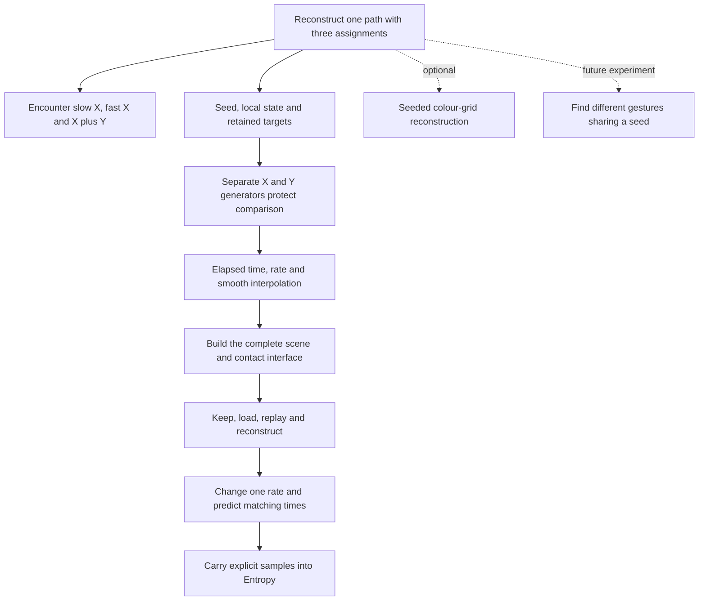

# Random Definition — reconstruct the felt comparison

15 October 2026 · [Tutorial](../../../../../commons/maps/Random_Definition/tutorial.md) · [Optional colour-grid extension](../../../../../commons/maps/Random_Definition/seed-picture-extension.md) · [Previous plan](../../../iterations/2026-10-15-six-encounters/before/tutorial-plan.md)

The tutorial begins with the same moving spheres as the final. Its task is one reconstruction, not six separate programs. It inherits the museum player, PointBody/path-preserving point, stage helpers and rectangular controls. It supplies the complete new motion-record and scene files. The optional colour-grid reconstruction is retained; Random Entropy's incoming paragraph now also accepts the movement-record route.

## Selected and reserve tree

## Timeline and budget

| Step | Gain / writing instruction | Allowance and bridge |
| --- | --- | --- |
| 1 Encounter | Ask how following changes; do not prescribe sensation or claim mechanical force. | 100 words; the comparison needs a repeatable baseline. |
| 2 Mechanism | Explain seed/state and separate streams, then distinguish stored targets from seed alone. | 150 words; the targets need a temporal interpretation. |
| 3 Worked trace | Follow −0.2 to +0.2 at two rates. Explain interpolation as a chosen smoothing rule. | 150 words; predictions can now be checked in a reconstruction. |
| 4 Build | Identify all inherited components, exact setup and two complete new files. | 200 words plus code; required interface code is visible but not a second conceptual lesson. |
| 5 Investigation | Keep the same targets, load time paused, replay, independently reconstruct, then vary one rate. | 200 words; retain the observation as well as the record. |
| 6 Handoff | Keep the book as a preservation encounter, colour as an optional assignment extension and Entropy as the next record-reading operation. | 120 words. |

Current prose: 918 words; complete new code: 155 nonblank lines, counted separately. Within the new gem-based 600–1,500 range. Much of the code is supplied interaction support; reading begins with make_record and offset. If that support overwhelms the learning, improve its presentation instead of hiding prerequisites.

## Verification and remaining work

Check matching positions at t and t/2, X agreement at equal times, range/axis bounds, saved record restoration and invalid-load retention. The meaningful learner variation changes one rate and predicts the corresponding time relationship. Technical tests pass for the scene/model. Independent learner reconstruction, XR hand contact and the comparison's felt character remain unobserved. No automatic transport to the next hall is claimed.
