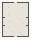

# Change_Intro

Authored dimensions: {"width": 27, "depth": 35, "max_height": 4}

Source plan only: columns=x, rows=z. Red dots are manuscript/role primary anchors; blue dots are other placed objects; green crosses are utilities. Numbers refer to A rows below. Dark blue is source 0, cream lower structure, grey source wall-height threshold, ochre platforms. Museum overrides can change the built interpretation. Dots show anchors, not footprints or a proven route.

Map: [commons/maps/Change_Intro/map_data.json](https://github.com/palletorsson/AdaResearch/blob/palm-scanner-door-entry/commons/maps/Change_Intro/map_data.json)

Text: [commons/maps/Change_Intro/final.md](https://github.com/palletorsson/AdaResearch/blob/palm-scanner-door-entry/commons/maps/Change_Intro/final.md)

| Instance | x,z | Raw token | Recorded role | Registry / scene |
|---|---|---|---|---|
| A1 | 6,5 | `tangent_slope_workbench:90:0:1#comparison:true#pin:1#plinth:0` | primary | [commons/artifacts/registry/change.json](https://github.com/palletorsson/AdaResearch/blob/palm-scanner-door-entry/commons/artifacts/registry/change.json) → [commons/artifacts/tangent_slope_workbench/tangent_slope_workbench.tscn](https://github.com/palletorsson/AdaResearch/blob/palm-scanner-door-entry/commons/artifacts/tangent_slope_workbench/tangent_slope_workbench.tscn) |
| A2 | 20,5 | `riemann_sum_workbench:270:0:1#comparison:true#pin:1#plinth:0` | primary | [commons/artifacts/registry/change.json](https://github.com/palletorsson/AdaResearch/blob/palm-scanner-door-entry/commons/artifacts/registry/change.json) → [commons/artifacts/riemann_sum_workbench/riemann_sum_workbench.tscn](https://github.com/palletorsson/AdaResearch/blob/palm-scanner-door-entry/commons/artifacts/riemann_sum_workbench/riemann_sum_workbench.tscn) |
| A3 | 23,10 | `velocity_arrow:0:0:1#pin:1#plinth:0` | secondary | [commons/artifacts/registry/change.json](https://github.com/palletorsson/AdaResearch/blob/palm-scanner-door-entry/commons/artifacts/registry/change.json) → [algorithms/change/velocity_arrow.tscn](https://github.com/palletorsson/AdaResearch/blob/palm-scanner-door-entry/algorithms/change/velocity_arrow.tscn) |
| A4 | 6,12 | `ftc_bridge:0:0:1#pin:1#plinth:0#evidence:longhand` | primary | [commons/artifacts/registry/change.json](https://github.com/palletorsson/AdaResearch/blob/palm-scanner-door-entry/commons/artifacts/registry/change.json) → [algorithms/change/ftc_bridge.tscn](https://github.com/palletorsson/AdaResearch/blob/palm-scanner-door-entry/algorithms/change/ftc_bridge.tscn) |
| A5 | 20,12 | `derivative_pair:0:0:1#pin:1#plinth:0` | secondary | [commons/artifacts/registry/change.json](https://github.com/palletorsson/AdaResearch/blob/palm-scanner-door-entry/commons/artifacts/registry/change.json) → [algorithms/change/derivative_pair.tscn](https://github.com/palletorsson/AdaResearch/blob/palm-scanner-door-entry/algorithms/change/derivative_pair.tscn) |
| A6 | 18,17 | `integral_area:0:0:1#pin:1#plinth:0` | secondary | [commons/artifacts/registry/change.json](https://github.com/palletorsson/AdaResearch/blob/palm-scanner-door-entry/commons/artifacts/registry/change.json) → [algorithms/change/integral_area.tscn](https://github.com/palletorsson/AdaResearch/blob/palm-scanner-door-entry/algorithms/change/integral_area.tscn) |
| A7 | 23,17 | `riemann_pump:0:0:1#pin:1#plinth:0` | secondary | [commons/artifacts/registry/change.json](https://github.com/palletorsson/AdaResearch/blob/palm-scanner-door-entry/commons/artifacts/registry/change.json) → [algorithms/change/riemann_pump.tscn](https://github.com/palletorsson/AdaResearch/blob/palm-scanner-door-entry/algorithms/change/riemann_pump.tscn) |
| A8 | 6,19 | `gradient_descent_well:0:0:1#pin:1#plinth:0` | secondary | [commons/artifacts/registry/self_portrait.json](https://github.com/palletorsson/AdaResearch/blob/palm-scanner-door-entry/commons/artifacts/registry/self_portrait.json) → [commons/artifacts/gradient_descent_well/gradient_descent_well.tscn](https://github.com/palletorsson/AdaResearch/blob/palm-scanner-door-entry/commons/artifacts/gradient_descent_well/gradient_descent_well.tscn) |
| A9 | 9,20 | `code_display:0:0:1#pin:1#plinth:0` | secondary | [commons/artifacts/registry/commons_artifacts.json](https://github.com/palletorsson/AdaResearch/blob/palm-scanner-door-entry/commons/artifacts/registry/commons_artifacts.json) → [commons/context/clipboard/codeDisplay.tscn](https://github.com/palletorsson/AdaResearch/blob/palm-scanner-door-entry/commons/context/clipboard/codeDisplay.tscn) |
| A10 | 20,21 | `paper_regatta:0:0:1#pin:1#plinth:0` | secondary | [commons/artifacts/registry/change.json](https://github.com/palletorsson/AdaResearch/blob/palm-scanner-door-entry/commons/artifacts/registry/change.json) → [commons/artifacts/paper_regatta/paper_regatta.tscn](https://github.com/palletorsson/AdaResearch/blob/palm-scanner-door-entry/commons/artifacts/paper_regatta/paper_regatta.tscn) |
| A11 | 23,24 | `slope_tangent_demo:0:0:1#pin:1#plinth:0` | secondary | [commons/artifacts/registry/change.json](https://github.com/palletorsson/AdaResearch/blob/palm-scanner-door-entry/commons/artifacts/registry/change.json) → [algorithms/change/slope_tangent_demo.tscn](https://github.com/palletorsson/AdaResearch/blob/palm-scanner-door-entry/algorithms/change/slope_tangent_demo.tscn) |
| A12 | 6,25 | `partial_derivative_terrain:0:0:1#pin:1#plinth:0` | secondary | [commons/artifacts/registry/change.json](https://github.com/palletorsson/AdaResearch/blob/palm-scanner-door-entry/commons/artifacts/registry/change.json) → [algorithms/change/partial_derivative_terrain.tscn](https://github.com/palletorsson/AdaResearch/blob/palm-scanner-door-entry/algorithms/change/partial_derivative_terrain.tscn) |
| A13 | 20,27 | `descent_marble_toy:0:0:1#pin:1#plinth:0` | secondary | [commons/artifacts/registry/soft_bodies.json](https://github.com/palletorsson/AdaResearch/blob/palm-scanner-door-entry/commons/artifacts/registry/soft_bodies.json) → [commons/artifacts/descent_marble_toy/descent_marble_toy.tscn](https://github.com/palletorsson/AdaResearch/blob/palm-scanner-door-entry/commons/artifacts/descent_marble_toy/descent_marble_toy.tscn) |
| A14 | 2,29 | `riemann_pi:0:0:0.18#pin:1#plinth:0` | secondary | [commons/artifacts/registry/alternative_geometries.json](https://github.com/palletorsson/AdaResearch/blob/palm-scanner-door-entry/commons/artifacts/registry/alternative_geometries.json) → [algorithms/spacetopology/riemann_pi/pi_infinity_surface.tscn](https://github.com/palletorsson/AdaResearch/blob/palm-scanner-door-entry/algorithms/spacetopology/riemann_pi/pi_infinity_surface.tscn) |
| A15 | 10,29 | `zeno_staircase:0:0:1#pin:1#plinth:0` | secondary | [commons/artifacts/registry/change.json](https://github.com/palletorsson/AdaResearch/blob/palm-scanner-door-entry/commons/artifacts/registry/change.json) → [algorithms/change/zeno_staircase/zeno_staircase.tscn](https://github.com/palletorsson/AdaResearch/blob/palm-scanner-door-entry/algorithms/change/zeno_staircase/zeno_staircase.tscn) |
| A16 | 18,30 | `science_screen:0:0:1#pin:1#plinth:0` | secondary | [commons/artifacts/registry/shaders.json](https://github.com/palletorsson/AdaResearch/blob/palm-scanner-door-entry/commons/artifacts/registry/shaders.json) → [commons/artifacts/science_screen/science_screen.tscn](https://github.com/palletorsson/AdaResearch/blob/palm-scanner-door-entry/commons/artifacts/science_screen/science_screen.tscn) |
| A17 | 20,32 | `synthesis_stand:0:0:1#subject:science_screen#mode:hero#pin:1#plinth:0` | secondary | [commons/artifacts/registry/synthesis.json](https://github.com/palletorsson/AdaResearch/blob/palm-scanner-door-entry/commons/artifacts/registry/synthesis.json) → [commons/artifacts/synthesis/synthesis_stand.tscn](https://github.com/palletorsson/AdaResearch/blob/palm-scanner-door-entry/commons/artifacts/synthesis/synthesis_stand.tscn) |

Utilities are listed with exact coordinates and raw tokens in space.json. Read map_info.museum and utility_definitions before inferring pits, entrances, movement or collision.
