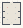

# Flow_Field

Authored dimensions: {"width": 19, "depth": 23, "max_height": 4}

Source plan only: columns=x, rows=z. Red dots are manuscript/role primary anchors; blue dots are other placed objects; green crosses are utilities. Numbers refer to A rows below. Dark blue is source 0, cream lower structure, grey source wall-height threshold, ochre platforms. Museum overrides can change the built interpretation. Dots show anchors, not footprints or a proven route.

Map: [commons/maps/Flow_Field/map_data.json](https://github.com/palletorsson/AdaResearch/blob/palm-scanner-door-entry/commons/maps/Flow_Field/map_data.json)

Text: [commons/maps/Flow_Field/final.md](https://github.com/palletorsson/AdaResearch/blob/palm-scanner-door-entry/commons/maps/Flow_Field/final.md)

| Instance | x,z | Raw token | Recorded role | Registry / scene |
|---|---|---|---|---|
| A1 | 5,5 | `flow_field_painter:0:1.05:2.5#pin:1#plinth:0#lesson:shared_field` | primary | [commons/artifacts/registry/commons_artifacts.json](https://github.com/palletorsson/AdaResearch/blob/palm-scanner-door-entry/commons/artifacts/registry/commons_artifacts.json) → [commons/artifacts/flow_field_painter/flow_field_painter.tscn](https://github.com/palletorsson/AdaResearch/blob/palm-scanner-door-entry/commons/artifacts/flow_field_painter/flow_field_painter.tscn) |
| A2 | 13,5 | `vector_field_visualizer:0:0.8:1#pin:1#plinth:0` | secondary | [commons/artifacts/registry/vectors.json](https://github.com/palletorsson/AdaResearch/blob/palm-scanner-door-entry/commons/artifacts/registry/vectors.json) → [commons/artifacts/vector_field_visualizer/vector_field_visualizer.tscn](https://github.com/palletorsson/AdaResearch/blob/palm-scanner-door-entry/commons/artifacts/vector_field_visualizer/vector_field_visualizer.tscn) |
| A3 | 5,11 | `vector_field_grid:0:0.8:1#pin:1#plinth:0` | secondary | [commons/artifacts/registry/change.json](https://github.com/palletorsson/AdaResearch/blob/palm-scanner-door-entry/commons/artifacts/registry/change.json) → [algorithms/change/vector_field_grid.tscn](https://github.com/palletorsson/AdaResearch/blob/palm-scanner-door-entry/algorithms/change/vector_field_grid.tscn) |
| A4 | 13,11 | `particle_flow_swarm:0:0.8:1#pin:1#plinth:0` | secondary | [commons/artifacts/registry/change.json](https://github.com/palletorsson/AdaResearch/blob/palm-scanner-door-entry/commons/artifacts/registry/change.json) → [algorithms/change/particle_flow_swarm.tscn](https://github.com/palletorsson/AdaResearch/blob/palm-scanner-door-entry/algorithms/change/particle_flow_swarm.tscn) |
| A5 | 5,17 | `noc_5_04_flow_field:0:0.8:1#pin:1#plinth:0` | secondary | [commons/artifacts/registry/steering.json](https://github.com/palletorsson/AdaResearch/blob/palm-scanner-door-entry/commons/artifacts/registry/steering.json) → [algorithms/steering/noc_ch05/noc_5_04_flow_field_vr.tscn](https://github.com/palletorsson/AdaResearch/blob/palm-scanner-door-entry/algorithms/steering/noc_ch05/noc_5_04_flow_field_vr.tscn) |
| A6 | 13,17 | `grand_zoetrope:0:0:1#pin:1#plinth:0` | secondary | [commons/artifacts/registry/change.json](https://github.com/palletorsson/AdaResearch/blob/palm-scanner-door-entry/commons/artifacts/registry/change.json) → [commons/artifacts/grand_zoetrope/grand_zoetrope.tscn](https://github.com/palletorsson/AdaResearch/blob/palm-scanner-door-entry/commons/artifacts/grand_zoetrope/grand_zoetrope.tscn) |

Utilities are listed with exact coordinates and raw tokens in space.json. Read map_info.museum and utility_definitions before inferring pits, entrances, movement or collision.
