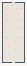

# Color_Context_Placed

Authored dimensions: {"width": 23, "depth": 61, "max_height": 8}

Source plan only: columns=x, rows=z. Red dots are manuscript/role primary anchors; blue dots are other placed objects; green crosses are utilities. Numbers refer to A rows below. Dark blue is source 0, cream lower structure, grey source wall-height threshold, ochre platforms. Museum overrides can change the built interpretation. Dots show anchors, not footprints or a proven route.

Map: [commons/maps/Color_Context_Placed/map_data.json](https://github.com/palletorsson/AdaResearch/blob/palm-scanner-door-entry/commons/maps/Color_Context_Placed/map_data.json)

Text: [commons/maps/Color_Context_Placed/final.md](https://github.com/palletorsson/AdaResearch/blob/palm-scanner-door-entry/commons/maps/Color_Context_Placed/final.md)

| Instance | x,z | Raw token | Recorded role | Registry / scene |
|---|---|---|---|---|
| A1 | 4,6 | `chroma_stack:180#rule:one` | primary | [commons/artifacts/registry/chroma_stack.json](https://github.com/palletorsson/AdaResearch/blob/palm-scanner-door-entry/commons/artifacts/registry/chroma_stack.json) → [commons/artifacts/chroma_stack/chroma_stack.tscn](https://github.com/palletorsson/AdaResearch/blob/palm-scanner-door-entry/commons/artifacts/chroma_stack/chroma_stack.tscn) |
| A2 | 8,6 | `chroma_stack:180#rule:by_shape` | primary | [commons/artifacts/registry/chroma_stack.json](https://github.com/palletorsson/AdaResearch/blob/palm-scanner-door-entry/commons/artifacts/registry/chroma_stack.json) → [commons/artifacts/chroma_stack/chroma_stack.tscn](https://github.com/palletorsson/AdaResearch/blob/palm-scanner-door-entry/commons/artifacts/chroma_stack/chroma_stack.tscn) |
| A3 | 14,6 | `chroma_stack:180#rule:by_height` | primary | [commons/artifacts/registry/chroma_stack.json](https://github.com/palletorsson/AdaResearch/blob/palm-scanner-door-entry/commons/artifacts/registry/chroma_stack.json) → [commons/artifacts/chroma_stack/chroma_stack.tscn](https://github.com/palletorsson/AdaResearch/blob/palm-scanner-door-entry/commons/artifacts/chroma_stack/chroma_stack.tscn) |
| A4 | 18,6 | `chroma_stack:180#rule:by_neighbour` | primary | [commons/artifacts/registry/chroma_stack.json](https://github.com/palletorsson/AdaResearch/blob/palm-scanner-door-entry/commons/artifacts/registry/chroma_stack.json) → [commons/artifacts/chroma_stack/chroma_stack.tscn](https://github.com/palletorsson/AdaResearch/blob/palm-scanner-door-entry/commons/artifacts/chroma_stack/chroma_stack.tscn) |
| A5 | 4,12 | `chroma_stack:180#rule:by_shape#stack:bauhaus` | primary | [commons/artifacts/registry/chroma_stack.json](https://github.com/palletorsson/AdaResearch/blob/palm-scanner-door-entry/commons/artifacts/registry/chroma_stack.json) → [commons/artifacts/chroma_stack/chroma_stack.tscn](https://github.com/palletorsson/AdaResearch/blob/palm-scanner-door-entry/commons/artifacts/chroma_stack/chroma_stack.tscn) |
| A6 | 8,12 | `chroma_stack:180#rule:by_shape#stack:turned` | primary | [commons/artifacts/registry/chroma_stack.json](https://github.com/palletorsson/AdaResearch/blob/palm-scanner-door-entry/commons/artifacts/registry/chroma_stack.json) → [commons/artifacts/chroma_stack/chroma_stack.tscn](https://github.com/palletorsson/AdaResearch/blob/palm-scanner-door-entry/commons/artifacts/chroma_stack/chroma_stack.tscn) |
| A7 | 16,12 | `chroma_stack:180#rule:by_shape#stack:cut` | primary | [commons/artifacts/registry/chroma_stack.json](https://github.com/palletorsson/AdaResearch/blob/palm-scanner-door-entry/commons/artifacts/registry/chroma_stack.json) → [commons/artifacts/chroma_stack/chroma_stack.tscn](https://github.com/palletorsson/AdaResearch/blob/palm-scanner-door-entry/commons/artifacts/chroma_stack/chroma_stack.tscn) |
| A8 | 4,18 | `chroma_stack:180#rule:by_shape#stack:cut#pose:aligned` | primary | [commons/artifacts/registry/chroma_stack.json](https://github.com/palletorsson/AdaResearch/blob/palm-scanner-door-entry/commons/artifacts/registry/chroma_stack.json) → [commons/artifacts/chroma_stack/chroma_stack.tscn](https://github.com/palletorsson/AdaResearch/blob/palm-scanner-door-entry/commons/artifacts/chroma_stack/chroma_stack.tscn) |
| A9 | 8,18 | `chroma_stack:180#rule:by_shape#stack:cut#pose:twist` | primary | [commons/artifacts/registry/chroma_stack.json](https://github.com/palletorsson/AdaResearch/blob/palm-scanner-door-entry/commons/artifacts/registry/chroma_stack.json) → [commons/artifacts/chroma_stack/chroma_stack.tscn](https://github.com/palletorsson/AdaResearch/blob/palm-scanner-door-entry/commons/artifacts/chroma_stack/chroma_stack.tscn) |
| A10 | 14,18 | `chroma_stack:180#rule:by_shape#stack:cut#pose:taper` | primary | [commons/artifacts/registry/chroma_stack.json](https://github.com/palletorsson/AdaResearch/blob/palm-scanner-door-entry/commons/artifacts/registry/chroma_stack.json) → [commons/artifacts/chroma_stack/chroma_stack.tscn](https://github.com/palletorsson/AdaResearch/blob/palm-scanner-door-entry/commons/artifacts/chroma_stack/chroma_stack.tscn) |
| A11 | 18,18 | `chroma_stack:180#rule:by_shape#stack:cut#pose:combined` | primary | [commons/artifacts/registry/chroma_stack.json](https://github.com/palletorsson/AdaResearch/blob/palm-scanner-door-entry/commons/artifacts/registry/chroma_stack.json) → [commons/artifacts/chroma_stack/chroma_stack.tscn](https://github.com/palletorsson/AdaResearch/blob/palm-scanner-door-entry/commons/artifacts/chroma_stack/chroma_stack.tscn) |
| A12 | 4,26 | `chroma_stack:180#rule:composed#stack:beads` | primary | [commons/artifacts/registry/chroma_stack.json](https://github.com/palletorsson/AdaResearch/blob/palm-scanner-door-entry/commons/artifacts/registry/chroma_stack.json) → [commons/artifacts/chroma_stack/chroma_stack.tscn](https://github.com/palletorsson/AdaResearch/blob/palm-scanner-door-entry/commons/artifacts/chroma_stack/chroma_stack.tscn) |
| A13 | 8,26 | `chroma_stack:180#rule:composed#stack:discs` | primary | [commons/artifacts/registry/chroma_stack.json](https://github.com/palletorsson/AdaResearch/blob/palm-scanner-door-entry/commons/artifacts/registry/chroma_stack.json) → [commons/artifacts/chroma_stack/chroma_stack.tscn](https://github.com/palletorsson/AdaResearch/blob/palm-scanner-door-entry/commons/artifacts/chroma_stack/chroma_stack.tscn) |
| A14 | 14,26 | `chroma_stack:180#rule:composed#stack:offset` | primary | [commons/artifacts/registry/chroma_stack.json](https://github.com/palletorsson/AdaResearch/blob/palm-scanner-door-entry/commons/artifacts/registry/chroma_stack.json) → [commons/artifacts/chroma_stack/chroma_stack.tscn](https://github.com/palletorsson/AdaResearch/blob/palm-scanner-door-entry/commons/artifacts/chroma_stack/chroma_stack.tscn) |
| A15 | 18,26 | `chroma_stack:180#rule:composed#stack:festival` | primary | [commons/artifacts/registry/chroma_stack.json](https://github.com/palletorsson/AdaResearch/blob/palm-scanner-door-entry/commons/artifacts/registry/chroma_stack.json) → [commons/artifacts/chroma_stack/chroma_stack.tscn](https://github.com/palletorsson/AdaResearch/blob/palm-scanner-door-entry/commons/artifacts/chroma_stack/chroma_stack.tscn) |
| A16 | 4,35 | `color_dna_stack:180#study:mondrian` | primary | [commons/artifacts/registry/color_dna_stack.json](https://github.com/palletorsson/AdaResearch/blob/palm-scanner-door-entry/commons/artifacts/registry/color_dna_stack.json) → [commons/artifacts/color_dna_stack/color_dna_stack.tscn](https://github.com/palletorsson/AdaResearch/blob/palm-scanner-door-entry/commons/artifacts/color_dna_stack/color_dna_stack.tscn) |
| A17 | 8,35 | `color_dna_stack:180#study:albers` | primary | [commons/artifacts/registry/color_dna_stack.json](https://github.com/palletorsson/AdaResearch/blob/palm-scanner-door-entry/commons/artifacts/registry/color_dna_stack.json) → [commons/artifacts/color_dna_stack/color_dna_stack.tscn](https://github.com/palletorsson/AdaResearch/blob/palm-scanner-door-entry/commons/artifacts/color_dna_stack/color_dna_stack.tscn) |
| A18 | 14,35 | `color_dna_stack:180#study:memphis` | primary | [commons/artifacts/registry/color_dna_stack.json](https://github.com/palletorsson/AdaResearch/blob/palm-scanner-door-entry/commons/artifacts/registry/color_dna_stack.json) → [commons/artifacts/color_dna_stack/color_dna_stack.tscn](https://github.com/palletorsson/AdaResearch/blob/palm-scanner-door-entry/commons/artifacts/color_dna_stack/color_dna_stack.tscn) |
| A19 | 18,35 | `color_dna_stack:180#study:bauhaus_tall` | primary | [commons/artifacts/registry/color_dna_stack.json](https://github.com/palletorsson/AdaResearch/blob/palm-scanner-door-entry/commons/artifacts/registry/color_dna_stack.json) → [commons/artifacts/color_dna_stack/color_dna_stack.tscn](https://github.com/palletorsson/AdaResearch/blob/palm-scanner-door-entry/commons/artifacts/color_dna_stack/color_dna_stack.tscn) |
| A20 | 6,44 | `color_dna_stack:180#study:blue` | primary | [commons/artifacts/registry/color_dna_stack.json](https://github.com/palletorsson/AdaResearch/blob/palm-scanner-door-entry/commons/artifacts/registry/color_dna_stack.json) → [commons/artifacts/color_dna_stack/color_dna_stack.tscn](https://github.com/palletorsson/AdaResearch/blob/palm-scanner-door-entry/commons/artifacts/color_dna_stack/color_dna_stack.tscn) |
| A21 | 16,44 | `color_dna_stack:180#study:kras_rainbow` | primary | [commons/artifacts/registry/color_dna_stack.json](https://github.com/palletorsson/AdaResearch/blob/palm-scanner-door-entry/commons/artifacts/registry/color_dna_stack.json) → [commons/artifacts/color_dna_stack/color_dna_stack.tscn](https://github.com/palletorsson/AdaResearch/blob/palm-scanner-door-entry/commons/artifacts/color_dna_stack/color_dna_stack.tscn) |
| A22 | 6,53 | `color_dna_stack:180#study:rainbow_crown` | primary | [commons/artifacts/registry/color_dna_stack.json](https://github.com/palletorsson/AdaResearch/blob/palm-scanner-door-entry/commons/artifacts/registry/color_dna_stack.json) → [commons/artifacts/color_dna_stack/color_dna_stack.tscn](https://github.com/palletorsson/AdaResearch/blob/palm-scanner-door-entry/commons/artifacts/color_dna_stack/color_dna_stack.tscn) |
| A23 | 16,53 | `color_dna_stack:180#study:memphis_beacon` | primary | [commons/artifacts/registry/color_dna_stack.json](https://github.com/palletorsson/AdaResearch/blob/palm-scanner-door-entry/commons/artifacts/registry/color_dna_stack.json) → [commons/artifacts/color_dna_stack/color_dna_stack.tscn](https://github.com/palletorsson/AdaResearch/blob/palm-scanner-door-entry/commons/artifacts/color_dna_stack/color_dna_stack.tscn) |

Utilities are listed with exact coordinates and raw tokens in space.json. Read map_info.museum and utility_definitions before inferring pits, entrances, movement or collision.
