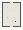

# Color_Paint

Authored dimensions: {"width": 19, "depth": 25, "max_height": 8}

Source plan only: columns=x, rows=z. Red dots are manuscript/role primary anchors; blue dots are other placed objects; green crosses are utilities. Numbers refer to A rows below. Dark blue is source 0, cream lower structure, grey source wall-height threshold, ochre platforms. Museum overrides can change the built interpretation. Dots show anchors, not footprints or a proven route.

Map: [commons/maps/Color_Paint/map_data.json](https://github.com/palletorsson/AdaResearch/blob/palm-scanner-door-entry/commons/maps/Color_Paint/map_data.json)

Text: [commons/maps/Color_Paint/final.md](https://github.com/palletorsson/AdaResearch/blob/palm-scanner-door-entry/commons/maps/Color_Paint/final.md)

| Instance | x,z | Raw token | Recorded role | Registry / scene |
|---|---|---|---|---|
| A1 | 5,5 | `dark_sphere` | decoration | [commons/artifacts/registry/lsystems.json](https://github.com/palletorsson/AdaResearch/blob/palm-scanner-door-entry/commons/artifacts/registry/lsystems.json) → [commons/artifacts/dark_sphere/dark_sphere.tscn](https://github.com/palletorsson/AdaResearch/blob/palm-scanner-door-entry/commons/artifacts/dark_sphere/dark_sphere.tscn) |
| A2 | 5,15 | `albers_wall_gallery:180:0.5` | primary | [commons/artifacts/registry/algorithms_misc.json](https://github.com/palletorsson/AdaResearch/blob/palm-scanner-door-entry/commons/artifacts/registry/algorithms_misc.json) → [algorithms/primitives/homagetothesquare/albers_wall_gallery.tscn](https://github.com/palletorsson/AdaResearch/blob/palm-scanner-door-entry/algorithms/primitives/homagetothesquare/albers_wall_gallery.tscn) |
| A3 | 12,15 | `ball_painting_demo:0:0.5#automated:true` | primary | [commons/artifacts/registry/commons_artifacts.json](https://github.com/palletorsson/AdaResearch/blob/palm-scanner-door-entry/commons/artifacts/registry/commons_artifacts.json) → [commons/context/drawingboard/ball_painting_demo_v2.tscn](https://github.com/palletorsson/AdaResearch/blob/palm-scanner-door-entry/commons/context/drawingboard/ball_painting_demo_v2.tscn) |

Utilities are listed with exact coordinates and raw tokens in space.json. Read map_info.museum and utility_definitions before inferring pits, entrances, movement or collision.
