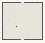

# Color_Pillar

Authored dimensions: {"width": 41, "depth": 38, "max_height": 8}

Source plan only: columns=x, rows=z. Red dots are manuscript/role primary anchors; blue dots are other placed objects; green crosses are utilities. Numbers refer to A rows below. Dark blue is source 0, cream lower structure, grey source wall-height threshold, ochre platforms. Museum overrides can change the built interpretation. Dots show anchors, not footprints or a proven route.

Map: [commons/maps/Color_Pillar/map_data.json](https://github.com/palletorsson/AdaResearch/blob/palm-scanner-door-entry/commons/maps/Color_Pillar/map_data.json)

Text: [commons/maps/Color_Pillar/final.md](https://github.com/palletorsson/AdaResearch/blob/palm-scanner-door-entry/commons/maps/Color_Pillar/final.md)

| Instance | x,z | Raw token | Recorded role | Registry / scene |
|---|---|---|---|---|
| A1 | 9,7 | `visual_color_mixing:0:-0.4:0.9` | secondary | [commons/artifacts/registry/color.json](https://github.com/palletorsson/AdaResearch/blob/palm-scanner-door-entry/commons/artifacts/registry/color.json) → [algorithms/color/color_mixing/visual_color_mixing.tscn](https://github.com/palletorsson/AdaResearch/blob/palm-scanner-door-entry/algorithms/color/color_mixing/visual_color_mixing.tscn) |
| A2 | 20,8 | `pillarcolorcollection:0:-0.5:1#layout:spatial_gradient#plinth:0` | primary | [commons/artifacts/registry/color.json](https://github.com/palletorsson/AdaResearch/blob/palm-scanner-door-entry/commons/artifacts/registry/color.json) → [algorithms/color/pillarcolorcollection/pillarcolorcollection.tscn](https://github.com/palletorsson/AdaResearch/blob/palm-scanner-door-entry/algorithms/color/pillarcolorcollection/pillarcolorcollection.tscn) |
| A3 | 7,10 | `grab_rainbow_stick:-90:1` | secondary | [commons/artifacts/registry/primitives.json](https://github.com/palletorsson/AdaResearch/blob/palm-scanner-door-entry/commons/artifacts/registry/primitives.json) → [commons/primitives/cubes/grab_rainbow_stick.tscn](https://github.com/palletorsson/AdaResearch/blob/palm-scanner-door-entry/commons/primitives/cubes/grab_rainbow_stick.tscn) |
| A4 | 13,21 | `dark_sphere` | decoration | [commons/artifacts/registry/lsystems.json](https://github.com/palletorsson/AdaResearch/blob/palm-scanner-door-entry/commons/artifacts/registry/lsystems.json) → [commons/artifacts/dark_sphere/dark_sphere.tscn](https://github.com/palletorsson/AdaResearch/blob/palm-scanner-door-entry/commons/artifacts/dark_sphere/dark_sphere.tscn) |
| A5 | 10,23 | `SpectrumVisualizer` | secondary | [commons/artifacts/registry/color.json](https://github.com/palletorsson/AdaResearch/blob/palm-scanner-door-entry/commons/artifacts/registry/color.json) → [algorithms/color/spectrum_visualizer/SpectrumVisualizer.tscn](https://github.com/palletorsson/AdaResearch/blob/palm-scanner-door-entry/algorithms/color/spectrum_visualizer/SpectrumVisualizer.tscn) |
| A6 | 26,32 | `color_sets_overview:180:-0.5:1#mount:wall#plinth:0` | primary | [commons/artifacts/registry/color.json](https://github.com/palletorsson/AdaResearch/blob/palm-scanner-door-entry/commons/artifacts/registry/color.json) → [algorithms/color/grabcolor/color_sets_overview.tscn](https://github.com/palletorsson/AdaResearch/blob/palm-scanner-door-entry/algorithms/color/grabcolor/color_sets_overview.tscn) |

Utilities are listed with exact coordinates and raw tokens in space.json. Read map_info.museum and utility_definitions before inferring pits, entrances, movement or collision.
