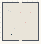

# Color_Walls

Authored dimensions: {"width": 37, "depth": 39, "max_height": 8}

Source plan only: columns=x, rows=z. Red dots are manuscript/role primary anchors; blue dots are other placed objects; green crosses are utilities. Numbers refer to A rows below. Dark blue is source 0, cream lower structure, grey source wall-height threshold, ochre platforms. Museum overrides can change the built interpretation. Dots show anchors, not footprints or a proven route.

Map: [commons/maps/Color_Walls/map_data.json](https://github.com/palletorsson/AdaResearch/blob/palm-scanner-door-entry/commons/maps/Color_Walls/map_data.json)

Text: [commons/maps/Color_Walls/final.md](https://github.com/palletorsson/AdaResearch/blob/palm-scanner-door-entry/commons/maps/Color_Walls/final.md)

| Instance | x,z | Raw token | Recorded role | Registry / scene |
|---|---|---|---|---|
| A1 | 6,8 | `dark_sphere` | decoration | [commons/artifacts/registry/lsystems.json](https://github.com/palletorsson/AdaResearch/blob/palm-scanner-door-entry/commons/artifacts/registry/lsystems.json) → [commons/artifacts/dark_sphere/dark_sphere.tscn](https://github.com/palletorsson/AdaResearch/blob/palm-scanner-door-entry/commons/artifacts/dark_sphere/dark_sphere.tscn) |
| A2 | 8,9 | `rainbow_hallway:180:1.0` | secondary | [commons/artifacts/registry/wavefunctions.json](https://github.com/palletorsson/AdaResearch/blob/palm-scanner-door-entry/commons/artifacts/registry/wavefunctions.json) → [algorithms/wavefunctions/rainbow_hallway/rainbow_hallway.tscn](https://github.com/palletorsson/AdaResearch/blob/palm-scanner-door-entry/algorithms/wavefunctions/rainbow_hallway/rainbow_hallway.tscn) |
| A3 | 18,10 | `color_space_navigator:180:1.2:1#mount:comparison#plinth:0` | primary | [commons/artifacts/registry/color.json](https://github.com/palletorsson/AdaResearch/blob/palm-scanner-door-entry/commons/artifacts/registry/color.json) → [commons/artifacts/color_space_navigator/color_space_navigator.tscn](https://github.com/palletorsson/AdaResearch/blob/palm-scanner-door-entry/commons/artifacts/color_space_navigator/color_space_navigator.tscn) |
| A4 | 28,10 | `gradient_interpolator:180:0.95:1#mount:comparison#plinth:0` | primary | [commons/artifacts/registry/color.json](https://github.com/palletorsson/AdaResearch/blob/palm-scanner-door-entry/commons/artifacts/registry/color.json) → [algorithms/color/gradient_interpolator/gradient_interpolator.tscn](https://github.com/palletorsson/AdaResearch/blob/palm-scanner-door-entry/algorithms/color/gradient_interpolator/gradient_interpolator.tscn) |
| A5 | 23,20 | `color_constellation_office:0:0:1#layout:cubicles#compare:visibility#plinth:0` | primary | [commons/artifacts/registry/color.json](https://github.com/palletorsson/AdaResearch/blob/palm-scanner-door-entry/commons/artifacts/registry/color.json) → [algorithms/color/color_mixing/color_constellation_office.tscn](https://github.com/palletorsson/AdaResearch/blob/palm-scanner-door-entry/algorithms/color/color_mixing/color_constellation_office.tscn) |
| A6 | 12,26 | `subpixel_display:0:-0.5` | secondary | [commons/artifacts/registry/color.json](https://github.com/palletorsson/AdaResearch/blob/palm-scanner-door-entry/commons/artifacts/registry/color.json) → [algorithms/color/subpixel_display/subpixel_display.tscn](https://github.com/palletorsson/AdaResearch/blob/palm-scanner-door-entry/algorithms/color/subpixel_display/subpixel_display.tscn) |

Utilities are listed with exact coordinates and raw tokens in space.json. Read map_info.museum and utility_definitions before inferring pits, entrances, movement or collision.
