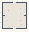

# Change_Choreography

Authored dimensions: {"width": 25, "depth": 27, "max_height": 4}

Source plan only: columns=x, rows=z. Red dots are manuscript/role primary anchors; blue dots are other placed objects; green crosses are utilities. Numbers refer to A rows below. Dark blue is source 0, cream lower structure, grey source wall-height threshold, ochre platforms. Museum overrides can change the built interpretation. Dots show anchors, not footprints or a proven route.

Map: [commons/maps/Change_Choreography/map_data.json](https://github.com/palletorsson/AdaResearch/blob/palm-scanner-door-entry/commons/maps/Change_Choreography/map_data.json)

Text: [commons/maps/Change_Choreography/final.md](https://github.com/palletorsson/AdaResearch/blob/palm-scanner-door-entry/commons/maps/Change_Choreography/final.md)

| Instance | x,z | Raw token | Recorded role | Registry / scene |
|---|---|---|---|---|
| A1 | 18,6 | `if_not_exist_create:180:0:1#make:floor_eyes_delayed_attention#why:Twenty_boxed_floor_eyes_follow_the_player_with_different_delays#like:phase_rod_array#cells:4x4#height:1.8#solid:0#pin:1#plinth:0` | decoration | [commons/artifacts/registry/commons_artifacts.json](https://github.com/palletorsson/AdaResearch/blob/palm-scanner-door-entry/commons/artifacts/registry/commons_artifacts.json) → [commons/artifacts/if_not_exist_create/if_not_exist_create.tscn](https://github.com/palletorsson/AdaResearch/blob/palm-scanner-door-entry/commons/artifacts/if_not_exist_create/if_not_exist_create.tscn) |
| A2 | 6,8 | `phase_rod_array:180:0:1#pin:1#plinth:0` | primary | [commons/artifacts/registry/change.json](https://github.com/palletorsson/AdaResearch/blob/palm-scanner-door-entry/commons/artifacts/registry/change.json) → [commons/artifacts/timing_machines/phase_rod_array.tscn](https://github.com/palletorsson/AdaResearch/blob/palm-scanner-door-entry/commons/artifacts/timing_machines/phase_rod_array.tscn) |
| A3 | 18,11 | `if_not_exist_create:180:0:1#make:late_connection_platform#why:Two_platforms_miss_each_other_until_the_player_adjusts_phase#like:phase_rod_array#cells:4x3#height:1.8#solid:0#pin:1#plinth:0` | decoration | [commons/artifacts/registry/commons_artifacts.json](https://github.com/palletorsson/AdaResearch/blob/palm-scanner-door-entry/commons/artifacts/registry/commons_artifacts.json) → [commons/artifacts/if_not_exist_create/if_not_exist_create.tscn](https://github.com/palletorsson/AdaResearch/blob/palm-scanner-door-entry/commons/artifacts/if_not_exist_create/if_not_exist_create.tscn) |
| A4 | 5,18 | `if_not_exist_create:180:0:1#make:escalator_wrong_destination#why:An_escalator_meets_a_wall_with_a_clear_alternate_exit#like:conveyor_belt#cells:5x4#height:1.8#solid:0#pin:1#plinth:0` | decoration | [commons/artifacts/registry/commons_artifacts.json](https://github.com/palletorsson/AdaResearch/blob/palm-scanner-door-entry/commons/artifacts/registry/commons_artifacts.json) → [commons/artifacts/if_not_exist_create/if_not_exist_create.tscn](https://github.com/palletorsson/AdaResearch/blob/palm-scanner-door-entry/commons/artifacts/if_not_exist_create/if_not_exist_create.tscn) |
| A5 | 18,18 | `conveyor_backlog:180:0:1#pin:1#plinth:0` | primary | [commons/artifacts/registry/change.json](https://github.com/palletorsson/AdaResearch/blob/palm-scanner-door-entry/commons/artifacts/registry/change.json) → [commons/artifacts/timing_machines/conveyor_backlog.tscn](https://github.com/palletorsson/AdaResearch/blob/palm-scanner-door-entry/commons/artifacts/timing_machines/conveyor_backlog.tscn) |
| A6 | 19,22 | `parametric_pendulum_waves:180` | unassigned | [commons/artifacts/registry/wavefunctions.json](https://github.com/palletorsson/AdaResearch/blob/palm-scanner-door-entry/commons/artifacts/registry/wavefunctions.json) → [algorithms/wavefunctions/parametric_pendulum_waves/parametric_pendulum_waves.tscn](https://github.com/palletorsson/AdaResearch/blob/palm-scanner-door-entry/algorithms/wavefunctions/parametric_pendulum_waves/parametric_pendulum_waves.tscn) |
| A7 | 6,24 | `if_not_exist_create:180:0:1#make:mutual_cleanup_machines#why:Two_sweepers_deliver_their_remainder_into_each_others_patch#like:conveyor_backlog#cells:5x2#height:1.8#solid:0#pin:1#plinth:0` | decoration | [commons/artifacts/registry/commons_artifacts.json](https://github.com/palletorsson/AdaResearch/blob/palm-scanner-door-entry/commons/artifacts/registry/commons_artifacts.json) → [commons/artifacts/if_not_exist_create/if_not_exist_create.tscn](https://github.com/palletorsson/AdaResearch/blob/palm-scanner-door-entry/commons/artifacts/if_not_exist_create/if_not_exist_create.tscn) |

Utilities are listed with exact coordinates and raw tokens in space.json. Read map_info.museum and utility_definitions before inferring pits, entrances, movement or collision.
