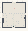

# VFM_02_Operations

Authored dimensions: {"width": 24, "depth": 26, "max_height": 3}

Source plan only: columns=x, rows=z. Red dots are manuscript/role primary anchors; blue dots are other placed objects; green crosses are utilities. Numbers refer to A rows below. Dark blue is source 0, cream lower structure, grey source wall-height threshold, ochre platforms. Museum overrides can change the built interpretation. Dots show anchors, not footprints or a proven route.

Map: [commons/maps/VFM_02_Operations/map_data.json](https://github.com/palletorsson/AdaResearch/blob/palm-scanner-door-entry/commons/maps/VFM_02_Operations/map_data.json)

Text: [commons/maps/VFM_02_Operations/final.md](https://github.com/palletorsson/AdaResearch/blob/palm-scanner-door-entry/commons/maps/VFM_02_Operations/final.md)

| Instance | x,z | Raw token | Recorded role | Registry / scene |
|---|---|---|---|---|
| A1 | 12,6 | `adder_board:180:0:1#lesson:room_sum#pin:1#plinth:0` | primary | [commons/artifacts/registry/adder_board.json](https://github.com/palletorsson/AdaResearch/blob/palm-scanner-door-entry/commons/artifacts/registry/adder_board.json) → [commons/artifacts/adder_board/adder_board.tscn](https://github.com/palletorsson/AdaResearch/blob/palm-scanner-door-entry/commons/artifacts/adder_board/adder_board.tscn) |
| A2 | 1,11 | `vector_projection_demo` | secondary | [commons/artifacts/registry/vectors.json](https://github.com/palletorsson/AdaResearch/blob/palm-scanner-door-entry/commons/artifacts/registry/vectors.json) → [commons/artifacts/vector_projection_demo/vector_projection_demo.tscn](https://github.com/palletorsson/AdaResearch/blob/palm-scanner-door-entry/commons/artifacts/vector_projection_demo/vector_projection_demo.tscn) |
| A3 | 3,11 | `2d_in_3d_vectors_vis:0:0` | secondary | [commons/artifacts/registry/commons_artifacts.json](https://github.com/palletorsson/AdaResearch/blob/palm-scanner-door-entry/commons/artifacts/registry/commons_artifacts.json) → [commons/infoboards_3d/boards/Vectors/2d_in_3d_vectors_vis.tscn](https://github.com/palletorsson/AdaResearch/blob/palm-scanner-door-entry/commons/infoboards_3d/boards/Vectors/2d_in_3d_vectors_vis.tscn) |
| A4 | 7,11 | `basis_vectors_rig:0:0` | secondary | [commons/artifacts/registry/vectors.json](https://github.com/palletorsson/AdaResearch/blob/palm-scanner-door-entry/commons/artifacts/registry/vectors.json) → [commons/artifacts/basis_vectors_rig/basis_vectors_rig.tscn](https://github.com/palletorsson/AdaResearch/blob/palm-scanner-door-entry/commons/artifacts/basis_vectors_rig/basis_vectors_rig.tscn) |
| A5 | 9,11 | `coordinate_system_switcher:0:0` | secondary | [commons/artifacts/registry/vectors.json](https://github.com/palletorsson/AdaResearch/blob/palm-scanner-door-entry/commons/artifacts/registry/vectors.json) → [commons/artifacts/coordinate_system_switcher/coordinate_system_switcher.tscn](https://github.com/palletorsson/AdaResearch/blob/palm-scanner-door-entry/commons/artifacts/coordinate_system_switcher/coordinate_system_switcher.tscn) |
| A6 | 12,11 | `VectorSubtraction` | secondary | [commons/artifacts/registry/vectors.json](https://github.com/palletorsson/AdaResearch/blob/palm-scanner-door-entry/commons/artifacts/registry/vectors.json) → [algorithms/vectors/04_vector_subtraction/VectorSubtraction.tscn](https://github.com/palletorsson/AdaResearch/blob/palm-scanner-door-entry/algorithms/vectors/04_vector_subtraction/VectorSubtraction.tscn) |
| A7 | 14,11 | `example_1_4_vector_multiplication_vr:0:0` | secondary | [commons/artifacts/registry/vectors.json](https://github.com/palletorsson/AdaResearch/blob/palm-scanner-door-entry/commons/artifacts/registry/vectors.json) → [algorithms/vectors/noc_ch01/example_1_4_vector_multiplication_vr.tscn](https://github.com/palletorsson/AdaResearch/blob/palm-scanner-door-entry/algorithms/vectors/noc_ch01/example_1_4_vector_multiplication_vr.tscn) |
| A8 | 16,11 | `stretch_bench:0:0` | secondary | [commons/artifacts/registry/stretch_bench.json](https://github.com/palletorsson/AdaResearch/blob/palm-scanner-door-entry/commons/artifacts/registry/stretch_bench.json) → [commons/artifacts/stretch_bench/stretch_bench.tscn](https://github.com/palletorsson/AdaResearch/blob/palm-scanner-door-entry/commons/artifacts/stretch_bench/stretch_bench.tscn) |
| A9 | 18,11 | `vector_addition_demo:0:0` | secondary | [commons/artifacts/registry/vectors.json](https://github.com/palletorsson/AdaResearch/blob/palm-scanner-door-entry/commons/artifacts/registry/vectors.json) → [commons/artifacts/vector_addition_demo/vector_addition_demo.tscn](https://github.com/palletorsson/AdaResearch/blob/palm-scanner-door-entry/commons/artifacts/vector_addition_demo/vector_addition_demo.tscn) |
| A10 | 20,11 | `vector_addition_xl:0:0` | secondary | [commons/artifacts/registry/vectors.json](https://github.com/palletorsson/AdaResearch/blob/palm-scanner-door-entry/commons/artifacts/registry/vectors.json) |
| A11 | 22,11 | `vector_magnitude_demo:0:0` | secondary | [commons/artifacts/registry/vectors.json](https://github.com/palletorsson/AdaResearch/blob/palm-scanner-door-entry/commons/artifacts/registry/vectors.json) → [commons/artifacts/vector_magnitude_demo/vector_magnitude_demo.tscn](https://github.com/palletorsson/AdaResearch/blob/palm-scanner-door-entry/commons/artifacts/vector_magnitude_demo/vector_magnitude_demo.tscn) |
| A12 | 1,13 | `vector_subtraction_demo:0:0` | secondary | [commons/artifacts/registry/vectors.json](https://github.com/palletorsson/AdaResearch/blob/palm-scanner-door-entry/commons/artifacts/registry/vectors.json) → [commons/artifacts/vector_subtraction_demo/vector_subtraction_demo.tscn](https://github.com/palletorsson/AdaResearch/blob/palm-scanner-door-entry/commons/artifacts/vector_subtraction_demo/vector_subtraction_demo.tscn) |
| A13 | 4,13 | `vector_dot_product_xl` | secondary | [commons/artifacts/registry/vectors.json](https://github.com/palletorsson/AdaResearch/blob/palm-scanner-door-entry/commons/artifacts/registry/vectors.json) |
| A14 | 19,13 | `vector_cross_product_xl` | secondary | [commons/artifacts/registry/vectors.json](https://github.com/palletorsson/AdaResearch/blob/palm-scanner-door-entry/commons/artifacts/registry/vectors.json) |
| A15 | 22,13 | `vector_translation_demo:0:0` | secondary | [commons/artifacts/registry/vectors.json](https://github.com/palletorsson/AdaResearch/blob/palm-scanner-door-entry/commons/artifacts/registry/vectors.json) → [commons/artifacts/vector_translation_demo/vector_translation_demo.tscn](https://github.com/palletorsson/AdaResearch/blob/palm-scanner-door-entry/commons/artifacts/vector_translation_demo/vector_translation_demo.tscn) |
| A16 | 4,15 | `dot_aligner` | secondary | [commons/artifacts/registry/vectors_demos.json](https://github.com/palletorsson/AdaResearch/blob/palm-scanner-door-entry/commons/artifacts/registry/vectors_demos.json) → [commons/artifacts/dot_aligner/dot_aligner.tscn](https://github.com/palletorsson/AdaResearch/blob/palm-scanner-door-entry/commons/artifacts/dot_aligner/dot_aligner.tscn) |
| A17 | 19,15 | `torque_crank` | secondary | [commons/artifacts/registry/vectors_demos.json](https://github.com/palletorsson/AdaResearch/blob/palm-scanner-door-entry/commons/artifacts/registry/vectors_demos.json) → [commons/artifacts/torque_crank/torque_crank.tscn](https://github.com/palletorsson/AdaResearch/blob/palm-scanner-door-entry/commons/artifacts/torque_crank/torque_crank.tscn) |
| A18 | 10,16 | `VectorTorque` | secondary | [commons/artifacts/registry/vectors.json](https://github.com/palletorsson/AdaResearch/blob/palm-scanner-door-entry/commons/artifacts/registry/vectors.json) → [algorithms/vectors/09_vector_torque/VectorTorque.tscn](https://github.com/palletorsson/AdaResearch/blob/palm-scanner-door-entry/algorithms/vectors/09_vector_torque/VectorTorque.tscn) |
| A19 | 22,18 | `dot_product_projector` | secondary | [commons/artifacts/registry/vectors.json](https://github.com/palletorsson/AdaResearch/blob/palm-scanner-door-entry/commons/artifacts/registry/vectors.json) → [commons/artifacts/dot_product_projector/dot_product_projector.tscn](https://github.com/palletorsson/AdaResearch/blob/palm-scanner-door-entry/commons/artifacts/dot_product_projector/dot_product_projector.tscn) |
| A20 | 4,19 | `VectorWorkbench` | secondary | [commons/artifacts/registry/vectors.json](https://github.com/palletorsson/AdaResearch/blob/palm-scanner-door-entry/commons/artifacts/registry/vectors.json) → [algorithms/vectors/vector_workbench/VectorWorkbench.tscn](https://github.com/palletorsson/AdaResearch/blob/palm-scanner-door-entry/algorithms/vectors/vector_workbench/VectorWorkbench.tscn) |
| A21 | 14,19 | `vector_add` | secondary | [commons/artifacts/registry/vectors_demos.json](https://github.com/palletorsson/AdaResearch/blob/palm-scanner-door-entry/commons/artifacts/registry/vectors_demos.json) → [commons/artifacts/vector_op_console/vector_op_console.tscn](https://github.com/palletorsson/AdaResearch/blob/palm-scanner-door-entry/commons/artifacts/vector_op_console/vector_op_console.tscn) |
| A22 | 16,19 | `vector_projection_reflection_xl` | secondary | [commons/artifacts/registry/vectors.json](https://github.com/palletorsson/AdaResearch/blob/palm-scanner-door-entry/commons/artifacts/registry/vectors.json) |
| A23 | 16,21 | `projection_shadow` | secondary | [commons/artifacts/registry/vectors_demos.json](https://github.com/palletorsson/AdaResearch/blob/palm-scanner-door-entry/commons/artifacts/registry/vectors_demos.json) → [commons/artifacts/projection_shadow/projection_shadow.tscn](https://github.com/palletorsson/AdaResearch/blob/palm-scanner-door-entry/commons/artifacts/projection_shadow/projection_shadow.tscn) |
| A24 | 5,23 | `agreement_gauge` | secondary | [commons/artifacts/registry/agreement_gauge.json](https://github.com/palletorsson/AdaResearch/blob/palm-scanner-door-entry/commons/artifacts/registry/agreement_gauge.json) → [commons/artifacts/agreement_gauge/agreement_gauge.tscn](https://github.com/palletorsson/AdaResearch/blob/palm-scanner-door-entry/commons/artifacts/agreement_gauge/agreement_gauge.tscn) |
| A25 | 9,23 | `opening_pair:0:0` | secondary | [commons/artifacts/registry/opening_pair.json](https://github.com/palletorsson/AdaResearch/blob/palm-scanner-door-entry/commons/artifacts/registry/opening_pair.json) → [commons/artifacts/opening_pair/opening_pair.tscn](https://github.com/palletorsson/AdaResearch/blob/palm-scanner-door-entry/commons/artifacts/opening_pair/opening_pair.tscn) |
| A26 | 13,23 | `torque_demo` | secondary | [commons/artifacts/registry/vectors_demos.json](https://github.com/palletorsson/AdaResearch/blob/palm-scanner-door-entry/commons/artifacts/registry/vectors_demos.json) → [algorithms/vectors/06_vector_cross_product/TorqueDemo.tscn](https://github.com/palletorsson/AdaResearch/blob/palm-scanner-door-entry/algorithms/vectors/06_vector_cross_product/TorqueDemo.tscn) |
| A27 | 21,23 | `exercise_5_9_angle_between` | secondary | [commons/artifacts/registry/steering.json](https://github.com/palletorsson/AdaResearch/blob/palm-scanner-door-entry/commons/artifacts/registry/steering.json) → [algorithms/steering/noc_ch05/exercise_5_9_angle_between_vr.tscn](https://github.com/palletorsson/AdaResearch/blob/palm-scanner-door-entry/algorithms/steering/noc_ch05/exercise_5_9_angle_between_vr.tscn) |

Utilities are listed with exact coordinates and raw tokens in space.json. Read map_info.museum and utility_definitions before inferring pits, entrances, movement or collision.
