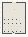

# VFM_03_Motion

Authored dimensions: {"width": 24, "depth": 32, "max_height": 3}

Source plan only: columns=x, rows=z. Red dots are manuscript/role primary anchors; blue dots are other placed objects; green crosses are utilities. Numbers refer to A rows below. Dark blue is source 0, cream lower structure, grey source wall-height threshold, ochre platforms. Museum overrides can change the built interpretation. Dots show anchors, not footprints or a proven route.

Map: [commons/maps/VFM_03_Motion/map_data.json](https://github.com/palletorsson/AdaResearch/blob/palm-scanner-door-entry/commons/maps/VFM_03_Motion/map_data.json)

Text: [commons/maps/VFM_03_Motion/final.md](https://github.com/palletorsson/AdaResearch/blob/palm-scanner-door-entry/commons/maps/VFM_03_Motion/final.md)

| Instance | x,z | Raw token | Recorded role | Registry / scene |
|---|---|---|---|---|
| A1 | 12,7 | `VectorMotion:180:0:1#lesson:motion_chamber#pin:1#plinth:0` | primary | [commons/artifacts/registry/vectors.json](https://github.com/palletorsson/AdaResearch/blob/palm-scanner-door-entry/commons/artifacts/registry/vectors.json) → [algorithms/vectors/08_vector_motion/VectorMotion.tscn](https://github.com/palletorsson/AdaResearch/blob/palm-scanner-door-entry/algorithms/vectors/08_vector_motion/VectorMotion.tscn) |
| A2 | 1,15 | `normal_force_demo` | secondary | [commons/artifacts/registry/vectors_demos.json](https://github.com/palletorsson/AdaResearch/blob/palm-scanner-door-entry/commons/artifacts/registry/vectors_demos.json) → [algorithms/vectors/07_vector_projection_reflection/NormalForceDemo.tscn](https://github.com/palletorsson/AdaResearch/blob/palm-scanner-door-entry/algorithms/vectors/07_vector_projection_reflection/NormalForceDemo.tscn) |
| A3 | 10,15 | `example_1_9_motion_101_velocity_and_random_acceleration_vr` | secondary | [commons/artifacts/registry/vectors.json](https://github.com/palletorsson/AdaResearch/blob/palm-scanner-door-entry/commons/artifacts/registry/vectors.json) → [algorithms/vectors/noc_ch01/example_1_9_motion_101_velocity_and_random_acceleration_vr.tscn](https://github.com/palletorsson/AdaResearch/blob/palm-scanner-door-entry/algorithms/vectors/noc_ch01/example_1_9_motion_101_velocity_and_random_acceleration_vr.tscn) |
| A4 | 22,15 | `vector_drone` | secondary | [commons/artifacts/registry/vectors.json](https://github.com/palletorsson/AdaResearch/blob/palm-scanner-door-entry/commons/artifacts/registry/vectors.json) → [algorithms/vectors/08_vector_throwing/vector_drone.tscn](https://github.com/palletorsson/AdaResearch/blob/palm-scanner-door-entry/algorithms/vectors/08_vector_throwing/vector_drone.tscn) |
| A5 | 4,18 | `bouncing_ball` | secondary | [commons/artifacts/registry/physics_simulation.json](https://github.com/palletorsson/AdaResearch/blob/palm-scanner-door-entry/commons/artifacts/registry/physics_simulation.json) → [algorithms/physicssimulation/bouncingball/bouncingball.tscn](https://github.com/palletorsson/AdaResearch/blob/palm-scanner-door-entry/algorithms/physicssimulation/bouncingball/bouncingball.tscn) |
| A6 | 17,18 | `trajectory_artifact` | secondary | [commons/artifacts/registry/dna_grammar_artifacts.json](https://github.com/palletorsson/AdaResearch/blob/palm-scanner-door-entry/commons/artifacts/registry/dna_grammar_artifacts.json) → [commons/artifacts/trajectory_artifact/trajectory_artifact.tscn](https://github.com/palletorsson/AdaResearch/blob/palm-scanner-door-entry/commons/artifacts/trajectory_artifact/trajectory_artifact.tscn) |
| A7 | 6,24 | `ForceMagnitudeDemo` | secondary | [commons/artifacts/registry/vectors.json](https://github.com/palletorsson/AdaResearch/blob/palm-scanner-door-entry/commons/artifacts/registry/vectors.json) → [algorithms/vectors/01_vector_basics/ForceMagnitudeDemo.tscn](https://github.com/palletorsson/AdaResearch/blob/palm-scanner-door-entry/algorithms/vectors/01_vector_basics/ForceMagnitudeDemo.tscn) |
| A8 | 9,24 | `VectorForces` | secondary | [commons/artifacts/registry/vectors.json](https://github.com/palletorsson/AdaResearch/blob/palm-scanner-door-entry/commons/artifacts/registry/vectors.json) → [algorithms/vectors/05_vector_forces/VectorForces.tscn](https://github.com/palletorsson/AdaResearch/blob/palm-scanner-door-entry/algorithms/vectors/05_vector_forces/VectorForces.tscn) |
| A9 | 12,24 | `exercise_1_3_solution_3_d_bouncing_ball_vr` | secondary | [commons/artifacts/registry/vectors.json](https://github.com/palletorsson/AdaResearch/blob/palm-scanner-door-entry/commons/artifacts/registry/vectors.json) → [algorithms/vectors/noc_ch01/exercise_1_3_solution_3_d_bouncing_ball_vr.tscn](https://github.com/palletorsson/AdaResearch/blob/palm-scanner-door-entry/algorithms/vectors/noc_ch01/exercise_1_3_solution_3_d_bouncing_ball_vr.tscn) |
| A10 | 15,24 | `exercise_1_5_solution_accelerate_and_decelerate_vr` | secondary | [commons/artifacts/registry/vectors.json](https://github.com/palletorsson/AdaResearch/blob/palm-scanner-door-entry/commons/artifacts/registry/vectors.json) → [algorithms/vectors/noc_ch01/exercise_1_5_solution_accelerate_and_decelerate_vr.tscn](https://github.com/palletorsson/AdaResearch/blob/palm-scanner-door-entry/algorithms/vectors/noc_ch01/exercise_1_5_solution_accelerate_and_decelerate_vr.tscn) |
| A11 | 18,24 | `example_2_5_fluid_resistance_vr` | secondary | [commons/artifacts/registry/physics_simulation.json](https://github.com/palletorsson/AdaResearch/blob/palm-scanner-door-entry/commons/artifacts/registry/physics_simulation.json) → [algorithms/forces/example_2_5_fluid_resistance_vr.tscn](https://github.com/palletorsson/AdaResearch/blob/palm-scanner-door-entry/algorithms/forces/example_2_5_fluid_resistance_vr.tscn) |
| A12 | 3,27 | `example_3_2_forces_with_arbitrary_angular_motion_vr` | secondary | [commons/artifacts/registry/physics_simulation.json](https://github.com/palletorsson/AdaResearch/blob/palm-scanner-door-entry/commons/artifacts/registry/physics_simulation.json) → [algorithms/oscillation/noc_ch03/example_3_2_forces_with_arbitrary_angular_motion_vr.tscn](https://github.com/palletorsson/AdaResearch/blob/palm-scanner-door-entry/algorithms/oscillation/noc_ch03/example_3_2_forces_with_arbitrary_angular_motion_vr.tscn) |
| A13 | 6,27 | `example_3_3_pointing_in_the_direction_of_motion_vr` | secondary | [commons/artifacts/registry/physics_simulation.json](https://github.com/palletorsson/AdaResearch/blob/palm-scanner-door-entry/commons/artifacts/registry/physics_simulation.json) → [algorithms/oscillation/noc_ch03/example_3_3_pointing_in_the_direction_of_motion_vr.tscn](https://github.com/palletorsson/AdaResearch/blob/palm-scanner-door-entry/algorithms/oscillation/noc_ch03/example_3_3_pointing_in_the_direction_of_motion_vr.tscn) |
| A14 | 9,27 | `friction_ramp:180:0.1:1#table:1#pin:1#plinth:0` | primary | [commons/artifacts/registry/physics_simulation.json](https://github.com/palletorsson/AdaResearch/blob/palm-scanner-door-entry/commons/artifacts/registry/physics_simulation.json) → [commons/artifacts/friction_ramp/friction_ramp.tscn](https://github.com/palletorsson/AdaResearch/blob/palm-scanner-door-entry/commons/artifacts/friction_ramp/friction_ramp.tscn) |
| A15 | 12,27 | `newton_cradle` | secondary | [commons/artifacts/registry/physics_simulation.json](https://github.com/palletorsson/AdaResearch/blob/palm-scanner-door-entry/commons/artifacts/registry/physics_simulation.json) → [algorithms/physicssimulation/newtoncradle/newtoncradle.tscn](https://github.com/palletorsson/AdaResearch/blob/palm-scanner-door-entry/algorithms/physicssimulation/newtoncradle/newtoncradle.tscn) |
| A16 | 15,27 | `combined_forces_demo` | secondary | [commons/artifacts/registry/vectors_demos.json](https://github.com/palletorsson/AdaResearch/blob/palm-scanner-door-entry/commons/artifacts/registry/vectors_demos.json) → [algorithms/vectors/02_vector_addition/CombinedForcesDemo.tscn](https://github.com/palletorsson/AdaResearch/blob/palm-scanner-door-entry/algorithms/vectors/02_vector_addition/CombinedForcesDemo.tscn) |
| A17 | 21,30 | `collision_crasher` | secondary | [commons/artifacts/registry/hazards.json](https://github.com/palletorsson/AdaResearch/blob/palm-scanner-door-entry/commons/artifacts/registry/hazards.json) → [commons/hazards/collision_crasher/collision_crasher.tscn](https://github.com/palletorsson/AdaResearch/blob/palm-scanner-door-entry/commons/hazards/collision_crasher/collision_crasher.tscn) |

Utilities are listed with exact coordinates and raw tokens in space.json. Read map_info.museum and utility_definitions before inferring pits, entrances, movement or collision.
