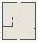

# VFM_05_Launch

Authored dimensions: {"width": 34, "depth": 38, "max_height": 3}

Source plan only: columns=x, rows=z. Red dots are manuscript/role primary anchors; blue dots are other placed objects; green crosses are utilities. Numbers refer to A rows below. Dark blue is source 0, cream lower structure, grey source wall-height threshold, ochre platforms. Museum overrides can change the built interpretation. Dots show anchors, not footprints or a proven route.

Map: [commons/maps/VFM_05_Launch/map_data.json](https://github.com/palletorsson/AdaResearch/blob/palm-scanner-door-entry/commons/maps/VFM_05_Launch/map_data.json)

Text: [commons/maps/VFM_05_Launch/final.md](https://github.com/palletorsson/AdaResearch/blob/palm-scanner-door-entry/commons/maps/VFM_05_Launch/final.md)

| Instance | x,z | Raw token | Recorded role | Registry / scene |
|---|---|---|---|---|
| A1 | 17,7 | `launch_arc:180:0:1#lesson:launch_chamber#pin:1#plinth:0` | primary | [commons/artifacts/registry/vectors_demos.json](https://github.com/palletorsson/AdaResearch/blob/palm-scanner-door-entry/commons/artifacts/registry/vectors_demos.json) → [commons/artifacts/launch_arc/launch_arc.tscn](https://github.com/palletorsson/AdaResearch/blob/palm-scanner-door-entry/commons/artifacts/launch_arc/launch_arc.tscn) |
| A2 | 15,14 | `ForceMagnitudeDemo:0:0` | secondary | [commons/artifacts/registry/vectors.json](https://github.com/palletorsson/AdaResearch/blob/palm-scanner-door-entry/commons/artifacts/registry/vectors.json) → [algorithms/vectors/01_vector_basics/ForceMagnitudeDemo.tscn](https://github.com/palletorsson/AdaResearch/blob/palm-scanner-door-entry/algorithms/vectors/01_vector_basics/ForceMagnitudeDemo.tscn) |
| A3 | 17,14 | `VectorForces:0:0` | secondary | [commons/artifacts/registry/vectors.json](https://github.com/palletorsson/AdaResearch/blob/palm-scanner-door-entry/commons/artifacts/registry/vectors.json) → [algorithms/vectors/05_vector_forces/VectorForces.tscn](https://github.com/palletorsson/AdaResearch/blob/palm-scanner-door-entry/algorithms/vectors/05_vector_forces/VectorForces.tscn) |
| A4 | 14,16 | `catapult:90:0` | secondary | [commons/artifacts/registry/catapult.json](https://github.com/palletorsson/AdaResearch/blob/palm-scanner-door-entry/commons/artifacts/registry/catapult.json) → [commons/artifacts/catapult/catapult.tscn](https://github.com/palletorsson/AdaResearch/blob/palm-scanner-door-entry/commons/artifacts/catapult/catapult.tscn) |
| A5 | 28,17 | `hl_turret_vectors:270:0` | secondary | [commons/artifacts/registry/vectors.json](https://github.com/palletorsson/AdaResearch/blob/palm-scanner-door-entry/commons/artifacts/registry/vectors.json) → [commons/artifacts/hl_turret_vectors/hl_turret_vectors.tscn](https://github.com/palletorsson/AdaResearch/blob/palm-scanner-door-entry/commons/artifacts/hl_turret_vectors/hl_turret_vectors.tscn) |
| A6 | 32,17 | `turret_boll_infoboard:270:0` | secondary | [commons/artifacts/registry/vectors.json](https://github.com/palletorsson/AdaResearch/blob/palm-scanner-door-entry/commons/artifacts/registry/vectors.json) → [commons/infoboards_3d/boards/TurretBoll/2d_in_3d_turretboll_vis.tscn](https://github.com/palletorsson/AdaResearch/blob/palm-scanner-door-entry/commons/infoboards_3d/boards/TurretBoll/2d_in_3d_turretboll_vis.tscn) |
| A7 | 4,18 | `mortar_vector_siege` | secondary | [commons/artifacts/registry/mortar_vector_siege.json](https://github.com/palletorsson/AdaResearch/blob/palm-scanner-door-entry/commons/artifacts/registry/mortar_vector_siege.json) → [commons/artifacts/mortar_vector_siege/mortar_vector_siege.tscn](https://github.com/palletorsson/AdaResearch/blob/palm-scanner-door-entry/commons/artifacts/mortar_vector_siege/mortar_vector_siege.tscn) |
| A8 | 18,19 | `firework_burst:90` | secondary | [commons/artifacts/registry/vectors_demos.json](https://github.com/palletorsson/AdaResearch/blob/palm-scanner-door-entry/commons/artifacts/registry/vectors_demos.json) → [commons/artifacts/firework_burst/firework_burst.tscn](https://github.com/palletorsson/AdaResearch/blob/palm-scanner-door-entry/commons/artifacts/firework_burst/firework_burst.tscn) |
| A9 | 14,20 | `VectorThrowing:90:0` | secondary | [commons/artifacts/registry/vectors.json](https://github.com/palletorsson/AdaResearch/blob/palm-scanner-door-entry/commons/artifacts/registry/vectors.json) → [algorithms/vectors/08_vector_throwing/VectorThrowing.tscn](https://github.com/palletorsson/AdaResearch/blob/palm-scanner-door-entry/algorithms/vectors/08_vector_throwing/VectorThrowing.tscn) |
| A10 | 24,23 | `firework_launcher:90` | secondary | [commons/artifacts/registry/physics_simulation.json](https://github.com/palletorsson/AdaResearch/blob/palm-scanner-door-entry/commons/artifacts/registry/physics_simulation.json) → [algorithms/physicssimulation/fireworklauncher/fireworklauncher.tscn](https://github.com/palletorsson/AdaResearch/blob/palm-scanner-door-entry/algorithms/physicssimulation/fireworklauncher/fireworklauncher.tscn) |
| A11 | 9,25 | `return_launcher` | secondary | [commons/artifacts/registry/vectors_demos.json](https://github.com/palletorsson/AdaResearch/blob/palm-scanner-door-entry/commons/artifacts/registry/vectors_demos.json) → [commons/artifacts/return_launcher/return_launcher.tscn](https://github.com/palletorsson/AdaResearch/blob/palm-scanner-door-entry/commons/artifacts/return_launcher/return_launcher.tscn) |
| A12 | 3,29 | `human_catapult:90:0` | secondary | [commons/artifacts/registry/human_catapult.json](https://github.com/palletorsson/AdaResearch/blob/palm-scanner-door-entry/commons/artifacts/registry/human_catapult.json) → [commons/artifacts/human_catapult/human_catapult.tscn](https://github.com/palletorsson/AdaResearch/blob/palm-scanner-door-entry/commons/artifacts/human_catapult/human_catapult.tscn) |
| A13 | 28,30 | `force_pad` | secondary | [commons/artifacts/registry/force_pad.json](https://github.com/palletorsson/AdaResearch/blob/palm-scanner-door-entry/commons/artifacts/registry/force_pad.json) → [commons/artifacts/force_pad/force_pad.tscn](https://github.com/palletorsson/AdaResearch/blob/palm-scanner-door-entry/commons/artifacts/force_pad/force_pad.tscn) |
| A14 | 3,31 | `drag_lane:90` | secondary | [commons/artifacts/registry/vectors_demos.json](https://github.com/palletorsson/AdaResearch/blob/palm-scanner-door-entry/commons/artifacts/registry/vectors_demos.json) → [commons/artifacts/drag_lane/drag_lane.tscn](https://github.com/palletorsson/AdaResearch/blob/palm-scanner-door-entry/commons/artifacts/drag_lane/drag_lane.tscn) |
| A15 | 28,32 | `circle_train:90` | secondary | [commons/artifacts/registry/vectors_demos.json](https://github.com/palletorsson/AdaResearch/blob/palm-scanner-door-entry/commons/artifacts/registry/vectors_demos.json) → [commons/artifacts/circle_train/circle_train.tscn](https://github.com/palletorsson/AdaResearch/blob/palm-scanner-door-entry/commons/artifacts/circle_train/circle_train.tscn) |
| A16 | 3,34 | `slingshot_launcher:90:0` | secondary | [commons/artifacts/registry/physics_simulation.json](https://github.com/palletorsson/AdaResearch/blob/palm-scanner-door-entry/commons/artifacts/registry/physics_simulation.json) → [algorithms/physicssimulation/slingshotlauncher/slingshotlauncher.tscn](https://github.com/palletorsson/AdaResearch/blob/palm-scanner-door-entry/algorithms/physicssimulation/slingshotlauncher/slingshotlauncher.tscn) |
| A17 | 16,36 | `foresight_range` | secondary | [commons/artifacts/registry/foresight_range.json](https://github.com/palletorsson/AdaResearch/blob/palm-scanner-door-entry/commons/artifacts/registry/foresight_range.json) → [commons/artifacts/foresight_range/foresight_range.tscn](https://github.com/palletorsson/AdaResearch/blob/palm-scanner-door-entry/commons/artifacts/foresight_range/foresight_range.tscn) |

Utilities are listed with exact coordinates and raw tokens in space.json. Read map_info.museum and utility_definitions before inferring pits, entrances, movement or collision.
