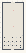

# VFM_07_Gravity

Authored dimensions: {"width": 22, "depth": 48, "max_height": 3}

Source plan only: columns=x, rows=z. Red dots are manuscript/role primary anchors; blue dots are other placed objects; green crosses are utilities. Numbers refer to A rows below. Dark blue is source 0, cream lower structure, grey source wall-height threshold, ochre platforms. Museum overrides can change the built interpretation. Dots show anchors, not footprints or a proven route.

Map: [commons/maps/VFM_07_Gravity/map_data.json](https://github.com/palletorsson/AdaResearch/blob/palm-scanner-door-entry/commons/maps/VFM_07_Gravity/map_data.json)

Text: [commons/maps/VFM_07_Gravity/final.md](https://github.com/palletorsson/AdaResearch/blob/palm-scanner-door-entry/commons/maps/VFM_07_Gravity/final.md)

| Instance | x,z | Raw token | Recorded role | Registry / scene |
|---|---|---|---|---|
| A1 | 11,8 | `orbital_mechanics_demo:0:0:1#lesson:gravity_orbit#pin:1#plinth:0` | primary | [commons/artifacts/registry/commons_artifacts.json](https://github.com/palletorsson/AdaResearch/blob/palm-scanner-door-entry/commons/artifacts/registry/commons_artifacts.json) → [commons/artifacts/orbital_mechanics_demo/orbital_mechanics_demo.tscn](https://github.com/palletorsson/AdaResearch/blob/palm-scanner-door-entry/commons/artifacts/orbital_mechanics_demo/orbital_mechanics_demo.tscn) |
| A2 | 11,24 | `three_body_problem:0:0:1#lesson:gravity_relations#pin:1#plinth:0` | primary | [commons/artifacts/registry/physics_simulation.json](https://github.com/palletorsson/AdaResearch/blob/palm-scanner-door-entry/commons/artifacts/registry/physics_simulation.json) → [algorithms/physicssimulation/threebodyproblem/threebodyproblem.tscn](https://github.com/palletorsson/AdaResearch/blob/palm-scanner-door-entry/algorithms/physicssimulation/threebodyproblem/threebodyproblem.tscn) |
| A3 | 20,33 | `nbody_simulation` | secondary | [commons/artifacts/registry/physics_simulation.json](https://github.com/palletorsson/AdaResearch/blob/palm-scanner-door-entry/commons/artifacts/registry/physics_simulation.json) → [algorithms/physicssimulation/nbodysimulation/nbody_problem.tscn](https://github.com/palletorsson/AdaResearch/blob/palm-scanner-door-entry/algorithms/physicssimulation/nbodysimulation/nbody_problem.tscn) |
| A4 | 14,35 | `forcedirected3d:0:2:0.08#presentation:museum#pin:1#plinth:0` | secondary | [commons/artifacts/registry/algorithms_misc.json](https://github.com/palletorsson/AdaResearch/blob/palm-scanner-door-entry/commons/artifacts/registry/algorithms_misc.json) → [algorithms/graphtheory/forcedirected3d/forcedirected3d.tscn](https://github.com/palletorsson/AdaResearch/blob/palm-scanner-door-entry/algorithms/graphtheory/forcedirected3d/forcedirected3d.tscn) |
| A5 | 4,40 | `exercise_1_8_solution_attraction_magnitude_vr` | secondary | [commons/artifacts/registry/vectors.json](https://github.com/palletorsson/AdaResearch/blob/palm-scanner-door-entry/commons/artifacts/registry/vectors.json) → [algorithms/vectors/noc_ch01/exercise_1_8_solution_attraction_magnitude_vr.tscn](https://github.com/palletorsson/AdaResearch/blob/palm-scanner-door-entry/algorithms/vectors/noc_ch01/exercise_1_8_solution_attraction_magnitude_vr.tscn) |
| A6 | 8,40 | `example_2_8_two_body_attraction_vr` | secondary | [commons/artifacts/registry/physics_simulation.json](https://github.com/palletorsson/AdaResearch/blob/palm-scanner-door-entry/commons/artifacts/registry/physics_simulation.json) → [algorithms/forces/example_2_8_two_body_attraction_vr.tscn](https://github.com/palletorsson/AdaResearch/blob/palm-scanner-door-entry/algorithms/forces/example_2_8_two_body_attraction_vr.tscn) |
| A7 | 12,40 | `example_2_9_n_body_attraction_vr` | secondary | [commons/artifacts/registry/physics_simulation.json](https://github.com/palletorsson/AdaResearch/blob/palm-scanner-door-entry/commons/artifacts/registry/physics_simulation.json) → [algorithms/forces/example_2_9_n_body_attraction_vr.tscn](https://github.com/palletorsson/AdaResearch/blob/palm-scanner-door-entry/algorithms/forces/example_2_9_n_body_attraction_vr.tscn) |
| A8 | 8,42 | `orbit_pair` | secondary | [commons/artifacts/registry/vectors_demos.json](https://github.com/palletorsson/AdaResearch/blob/palm-scanner-door-entry/commons/artifacts/registry/vectors_demos.json) → [commons/artifacts/orbit_pair/orbit_pair.tscn](https://github.com/palletorsson/AdaResearch/blob/palm-scanner-door-entry/commons/artifacts/orbit_pair/orbit_pair.tscn) |
| A9 | 4,43 | `gravity_well` | secondary | [commons/artifacts/registry/physics_simulation.json](https://github.com/palletorsson/AdaResearch/blob/palm-scanner-door-entry/commons/artifacts/registry/physics_simulation.json) → [algorithms/physicssimulation/gravitywell/gravitywell.tscn](https://github.com/palletorsson/AdaResearch/blob/palm-scanner-door-entry/algorithms/physicssimulation/gravitywell/gravitywell.tscn) |
| A10 | 12,43 | `grid3d_force_directed` | secondary | [commons/artifacts/registry/grid3d.json](https://github.com/palletorsson/AdaResearch/blob/palm-scanner-door-entry/commons/artifacts/registry/grid3d.json) → [commons/substrates/grid3d/grid3d_substrate.tscn](https://github.com/palletorsson/AdaResearch/blob/palm-scanner-door-entry/commons/substrates/grid3d/grid3d_substrate.tscn) |
| A11 | 20,46 | `chaos_attractor` | secondary | [commons/artifacts/registry/primitives.json](https://github.com/palletorsson/AdaResearch/blob/palm-scanner-door-entry/commons/artifacts/registry/primitives.json) → [algorithms/chaos/strangeattractors/strange_attractors.tscn](https://github.com/palletorsson/AdaResearch/blob/palm-scanner-door-entry/algorithms/chaos/strangeattractors/strange_attractors.tscn) |

Utilities are listed with exact coordinates and raw tokens in space.json. Read map_info.museum and utility_definitions before inferring pits, entrances, movement or collision.
