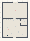

# VFM_08_Arena

Authored dimensions: {"width": 26, "depth": 36, "max_height": 3}

Source plan only: columns=x, rows=z. Red dots are manuscript/role primary anchors; blue dots are other placed objects; green crosses are utilities. Numbers refer to A rows below. Dark blue is source 0, cream lower structure, grey source wall-height threshold, ochre platforms. Museum overrides can change the built interpretation. Dots show anchors, not footprints or a proven route.

Map: [commons/maps/VFM_08_Arena/map_data.json](https://github.com/palletorsson/AdaResearch/blob/palm-scanner-door-entry/commons/maps/VFM_08_Arena/map_data.json)

Text: [commons/maps/VFM_08_Arena/final.md](https://github.com/palletorsson/AdaResearch/blob/palm-scanner-door-entry/commons/maps/VFM_08_Arena/final.md)

| Instance | x,z | Raw token | Recorded role | Registry / scene |
|---|---|---|---|---|
| A1 | 13,8 | `arena_relation_lab:0:0:1#pin:1#plinth:0` | primary | [commons/artifacts/registry/arena_experiments.json](https://github.com/palletorsson/AdaResearch/blob/palm-scanner-door-entry/commons/artifacts/registry/arena_experiments.json) → [commons/artifacts/arena_relation_lab/arena_relation_lab.tscn](https://github.com/palletorsson/AdaResearch/blob/palm-scanner-door-entry/commons/artifacts/arena_relation_lab/arena_relation_lab.tscn) |
| A2 | 11,16 | `brake_skid:0:0#label_depth:scene` | secondary | [commons/artifacts/registry/vectors_demos.json](https://github.com/palletorsson/AdaResearch/blob/palm-scanner-door-entry/commons/artifacts/registry/vectors_demos.json) → [commons/artifacts/brake_skid/brake_skid.tscn](https://github.com/palletorsson/AdaResearch/blob/palm-scanner-door-entry/commons/artifacts/brake_skid/brake_skid.tscn) |
| A3 | 13,16 | `parlour_orbits:0:0` | secondary | [commons/artifacts/registry/vectors_demos.json](https://github.com/palletorsson/AdaResearch/blob/palm-scanner-door-entry/commons/artifacts/registry/vectors_demos.json) → [commons/artifacts/parlour_orbits/parlour_orbits.tscn](https://github.com/palletorsson/AdaResearch/blob/palm-scanner-door-entry/commons/artifacts/parlour_orbits/parlour_orbits.tscn) |
| A4 | 1,17 | `newtons_laws` | secondary | [commons/artifacts/registry/physics_simulation.json](https://github.com/palletorsson/AdaResearch/blob/palm-scanner-door-entry/commons/artifacts/registry/physics_simulation.json) → [algorithms/physicssimulation/newtonslaws/newtonslaws.tscn](https://github.com/palletorsson/AdaResearch/blob/palm-scanner-door-entry/algorithms/physicssimulation/newtonslaws/newtonslaws.tscn) |
| A5 | 4,17 | `paused_fountain:0:0` | secondary | [commons/artifacts/registry/vectors_demos.json](https://github.com/palletorsson/AdaResearch/blob/palm-scanner-door-entry/commons/artifacts/registry/vectors_demos.json) → [commons/artifacts/paused_fountain/paused_fountain.tscn](https://github.com/palletorsson/AdaResearch/blob/palm-scanner-door-entry/commons/artifacts/paused_fountain/paused_fountain.tscn) |
| A6 | 6,17 | `prop_mobile:0:0` | secondary | [commons/artifacts/registry/vectors_demos.json](https://github.com/palletorsson/AdaResearch/blob/palm-scanner-door-entry/commons/artifacts/registry/vectors_demos.json) → [commons/artifacts/prop_mobile/prop_mobile.tscn](https://github.com/palletorsson/AdaResearch/blob/palm-scanner-door-entry/commons/artifacts/prop_mobile/prop_mobile.tscn) |
| A7 | 8,17 | `prop_spigot:0:0` | secondary | [commons/artifacts/registry/vectors_demos.json](https://github.com/palletorsson/AdaResearch/blob/palm-scanner-door-entry/commons/artifacts/registry/vectors_demos.json) → [commons/artifacts/prop_spigot/prop_spigot.tscn](https://github.com/palletorsson/AdaResearch/blob/palm-scanner-door-entry/commons/artifacts/prop_spigot/prop_spigot.tscn) |
| A8 | 15,17 | `revolving_door:0:0` | secondary | [commons/artifacts/registry/vectors_demos.json](https://github.com/palletorsson/AdaResearch/blob/palm-scanner-door-entry/commons/artifacts/registry/vectors_demos.json) → [commons/artifacts/revolving_door/revolving_door.tscn](https://github.com/palletorsson/AdaResearch/blob/palm-scanner-door-entry/commons/artifacts/revolving_door/revolving_door.tscn) |
| A9 | 17,17 | `three_gravities:0:0` | secondary | [commons/artifacts/registry/vectors_demos.json](https://github.com/palletorsson/AdaResearch/blob/palm-scanner-door-entry/commons/artifacts/registry/vectors_demos.json) → [commons/artifacts/three_gravities/three_gravities.tscn](https://github.com/palletorsson/AdaResearch/blob/palm-scanner-door-entry/commons/artifacts/three_gravities/three_gravities.tscn) |
| A10 | 19,17 | `tug_of_war:0:0#label_depth:scene` | secondary | [commons/artifacts/registry/vectors_demos.json](https://github.com/palletorsson/AdaResearch/blob/palm-scanner-door-entry/commons/artifacts/registry/vectors_demos.json) → [commons/artifacts/tug_of_war/tug_of_war.tscn](https://github.com/palletorsson/AdaResearch/blob/palm-scanner-door-entry/commons/artifacts/tug_of_war/tug_of_war.tscn) |
| A11 | 21,17 | `umbrella_field:0:0` | secondary | [commons/artifacts/registry/vectors_demos.json](https://github.com/palletorsson/AdaResearch/blob/palm-scanner-door-entry/commons/artifacts/registry/vectors_demos.json) → [commons/artifacts/umbrella_field/umbrella_field.tscn](https://github.com/palletorsson/AdaResearch/blob/palm-scanner-door-entry/commons/artifacts/umbrella_field/umbrella_field.tscn) |
| A12 | 11,18 | `turret_targeting` | secondary | [commons/artifacts/registry/vectors.json](https://github.com/palletorsson/AdaResearch/blob/palm-scanner-door-entry/commons/artifacts/registry/vectors.json) → [commons/artifacts/turret_targeting/turret_targeting.tscn](https://github.com/palletorsson/AdaResearch/blob/palm-scanner-door-entry/commons/artifacts/turret_targeting/turret_targeting.tscn); [commons/artifacts/registry/vectors_demos.json](https://github.com/palletorsson/AdaResearch/blob/palm-scanner-door-entry/commons/artifacts/registry/vectors_demos.json) → [algorithms/vectors/11_turret_targeting/TurretTargeting.tscn](https://github.com/palletorsson/AdaResearch/blob/palm-scanner-door-entry/algorithms/vectors/11_turret_targeting/TurretTargeting.tscn) |
| A13 | 22,19 | `reflection_hall` | secondary | [commons/artifacts/registry/reflection_hall.json](https://github.com/palletorsson/AdaResearch/blob/palm-scanner-door-entry/commons/artifacts/registry/reflection_hall.json) → [commons/artifacts/reflection_hall/reflection_hall.tscn](https://github.com/palletorsson/AdaResearch/blob/palm-scanner-door-entry/commons/artifacts/reflection_hall/reflection_hall.tscn) |
| A14 | 13,24 | `queer_cylinder_target` | decoration | [commons/artifacts/registry/primitives.json](https://github.com/palletorsson/AdaResearch/blob/palm-scanner-door-entry/commons/artifacts/registry/primitives.json) → [commons/primitives/targets/queer_cylinder_target.tscn](https://github.com/palletorsson/AdaResearch/blob/palm-scanner-door-entry/commons/primitives/targets/queer_cylinder_target.tscn) |
| A15 | 5,25 | `vector_arena` | secondary | [commons/artifacts/registry/vector_arena.json](https://github.com/palletorsson/AdaResearch/blob/palm-scanner-door-entry/commons/artifacts/registry/vector_arena.json) → [commons/artifacts/vector_arena/vector_arena.tscn](https://github.com/palletorsson/AdaResearch/blob/palm-scanner-door-entry/commons/artifacts/vector_arena/vector_arena.tscn) |
| A16 | 6,27 | `collision_carts` | primary | [commons/artifacts/registry/vectors_demos.json](https://github.com/palletorsson/AdaResearch/blob/palm-scanner-door-entry/commons/artifacts/registry/vectors_demos.json) → [commons/artifacts/collision_carts/collision_carts.tscn](https://github.com/palletorsson/AdaResearch/blob/palm-scanner-door-entry/commons/artifacts/collision_carts/collision_carts.tscn) |
| A17 | 16,29 | `momentum_cradle` | secondary | [commons/artifacts/registry/vectors_demos.json](https://github.com/palletorsson/AdaResearch/blob/palm-scanner-door-entry/commons/artifacts/registry/vectors_demos.json) → [commons/artifacts/momentum_cradle/momentum_cradle.tscn](https://github.com/palletorsson/AdaResearch/blob/palm-scanner-door-entry/commons/artifacts/momentum_cradle/momentum_cradle.tscn) |
| A18 | 16,30 | `sentry_turret` | secondary | [commons/artifacts/registry/vectors.json](https://github.com/palletorsson/AdaResearch/blob/palm-scanner-door-entry/commons/artifacts/registry/vectors.json) → [commons/artifacts/sentry_turret/sentry_turret.tscn](https://github.com/palletorsson/AdaResearch/blob/palm-scanner-door-entry/commons/artifacts/sentry_turret/sentry_turret.tscn) |
| A19 | 9,31 | `head_crab:0` | secondary | [commons/artifacts/registry/hazards.json](https://github.com/palletorsson/AdaResearch/blob/palm-scanner-door-entry/commons/artifacts/registry/hazards.json) → [commons/hazards/head_crab/head_crab.tscn](https://github.com/palletorsson/AdaResearch/blob/palm-scanner-door-entry/commons/hazards/head_crab/head_crab.tscn) |
| A20 | 20,32 | `head_crab:180#scale:0.11#accent:7fd8cf` | secondary | [commons/artifacts/registry/hazards.json](https://github.com/palletorsson/AdaResearch/blob/palm-scanner-door-entry/commons/artifacts/registry/hazards.json) → [commons/hazards/head_crab/head_crab.tscn](https://github.com/palletorsson/AdaResearch/blob/palm-scanner-door-entry/commons/hazards/head_crab/head_crab.tscn) |
| A21 | 1,34 | `momentum_collision` | secondary | [commons/artifacts/registry/physics_simulation.json](https://github.com/palletorsson/AdaResearch/blob/palm-scanner-door-entry/commons/artifacts/registry/physics_simulation.json) → [algorithms/physicssimulation/momentum_collision/momentum_collision.tscn](https://github.com/palletorsson/AdaResearch/blob/palm-scanner-door-entry/algorithms/physicssimulation/momentum_collision/momentum_collision.tscn) |
| A22 | 24,34 | `example_2_1_forces_vr` | secondary | [commons/artifacts/registry/physics_simulation.json](https://github.com/palletorsson/AdaResearch/blob/palm-scanner-door-entry/commons/artifacts/registry/physics_simulation.json) → [algorithms/forces/example_2_1_forces_vr.tscn](https://github.com/palletorsson/AdaResearch/blob/palm-scanner-door-entry/algorithms/forces/example_2_1_forces_vr.tscn) |

Utilities are listed with exact coordinates and raw tokens in space.json. Read map_info.museum and utility_definitions before inferring pits, entrances, movement or collision.
