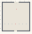

# VFM_09_Legs

Authored dimensions: {"width": 32, "depth": 34, "max_height": 3}

Source plan only: columns=x, rows=z. Red dots are manuscript/role primary anchors; blue dots are other placed objects; green crosses are utilities. Numbers refer to A rows below. Dark blue is source 0, cream lower structure, grey source wall-height threshold, ochre platforms. Museum overrides can change the built interpretation. Dots show anchors, not footprints or a proven route.

Map: [commons/maps/VFM_09_Legs/map_data.json](https://github.com/palletorsson/AdaResearch/blob/palm-scanner-door-entry/commons/maps/VFM_09_Legs/map_data.json)

Text: [commons/maps/VFM_09_Legs/final.md](https://github.com/palletorsson/AdaResearch/blob/palm-scanner-door-entry/commons/maps/VFM_09_Legs/final.md)

| Instance | x,z | Raw token | Recorded role | Registry / scene |
|---|---|---|---|---|
| A1 | 16,8 | `support_polygon_lab:0:0:1#pin:1#plinth:0` | primary | [commons/artifacts/registry/support_experiments.json](https://github.com/palletorsson/AdaResearch/blob/palm-scanner-door-entry/commons/artifacts/registry/support_experiments.json) → [commons/artifacts/support_polygon_lab/support_polygon_lab.tscn](https://github.com/palletorsson/AdaResearch/blob/palm-scanner-door-entry/commons/artifacts/support_polygon_lab/support_polygon_lab.tscn) |
| A2 | 3,25 | `one_leg#driven_by_player:false#show_foot_markers:false#pace_reach:1.4#patrol_speed:0.35` | secondary | [commons/artifacts/registry/hazards.json](https://github.com/palletorsson/AdaResearch/blob/palm-scanner-door-entry/commons/artifacts/registry/hazards.json) → [commons/hazards/octapod_crawler/one_leg.tscn](https://github.com/palletorsson/AdaResearch/blob/palm-scanner-door-entry/commons/hazards/octapod_crawler/one_leg.tscn) |
| A3 | 7,25 | `two_leg_critter#driven_by_player:false#show_foot_markers:false#pace_reach:1.4#patrol_speed:0.35` | secondary | [commons/artifacts/registry/hazards.json](https://github.com/palletorsson/AdaResearch/blob/palm-scanner-door-entry/commons/artifacts/registry/hazards.json) → [commons/hazards/octapod_crawler/two_leg_critter.tscn](https://github.com/palletorsson/AdaResearch/blob/palm-scanner-door-entry/commons/hazards/octapod_crawler/two_leg_critter.tscn) |
| A4 | 11,25 | `three_leg_critter#driven_by_player:false#show_foot_markers:false#pace_reach:1.4#patrol_speed:0.35` | secondary | [commons/artifacts/registry/hazards.json](https://github.com/palletorsson/AdaResearch/blob/palm-scanner-door-entry/commons/artifacts/registry/hazards.json) → [commons/hazards/octapod_crawler/three_leg_critter.tscn](https://github.com/palletorsson/AdaResearch/blob/palm-scanner-door-entry/commons/hazards/octapod_crawler/three_leg_critter.tscn) |
| A5 | 15,25 | `four_leg_critter#driven_by_player:false#show_foot_markers:false#pace_reach:1.4#patrol_speed:0.35` | primary | [commons/artifacts/registry/hazards.json](https://github.com/palletorsson/AdaResearch/blob/palm-scanner-door-entry/commons/artifacts/registry/hazards.json) → [commons/hazards/octapod_crawler/four_leg_critter.tscn](https://github.com/palletorsson/AdaResearch/blob/palm-scanner-door-entry/commons/hazards/octapod_crawler/four_leg_critter.tscn) |
| A6 | 19,25 | `five_leg_critter#driven_by_player:false#show_foot_markers:false#pace_reach:1.4#patrol_speed:0.35` | secondary | [commons/artifacts/registry/hazards.json](https://github.com/palletorsson/AdaResearch/blob/palm-scanner-door-entry/commons/artifacts/registry/hazards.json) → [commons/hazards/octapod_crawler/five_leg_critter.tscn](https://github.com/palletorsson/AdaResearch/blob/palm-scanner-door-entry/commons/hazards/octapod_crawler/five_leg_critter.tscn) |
| A7 | 23,25 | `six_leg_critter#driven_by_player:false#show_foot_markers:false#pace_reach:1.4#patrol_speed:0.35` | secondary | [commons/artifacts/registry/hazards.json](https://github.com/palletorsson/AdaResearch/blob/palm-scanner-door-entry/commons/artifacts/registry/hazards.json) → [commons/hazards/octapod_crawler/six_leg_critter.tscn](https://github.com/palletorsson/AdaResearch/blob/palm-scanner-door-entry/commons/hazards/octapod_crawler/six_leg_critter.tscn) |
| A8 | 27,25 | `octapod_ik#driven_by_player:false#show_foot_markers:false#pace_reach:1.4#patrol_speed:0.35#walker_scale:8.0` | secondary | [commons/artifacts/registry/hazards.json](https://github.com/palletorsson/AdaResearch/blob/palm-scanner-door-entry/commons/artifacts/registry/hazards.json) → [commons/hazards/octapod_crawler/octapod_ik.tscn](https://github.com/palletorsson/AdaResearch/blob/palm-scanner-door-entry/commons/hazards/octapod_crawler/octapod_ik.tscn) |

Utilities are listed with exact coordinates and raw tokens in space.json. Read map_info.museum and utility_definitions before inferring pits, entrances, movement or collision.
