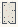

# Vectors_Act1_WhatAVectorIs

Authored dimensions: {"width": 14, "depth": 22, "max_height": 3}

Source plan only: columns=x, rows=z. Red dots are manuscript/role primary anchors; blue dots are other placed objects; green crosses are utilities. Numbers refer to A rows below. Dark blue is source 0, cream lower structure, grey source wall-height threshold, ochre platforms. Museum overrides can change the built interpretation. Dots show anchors, not footprints or a proven route.

Map: [commons/maps/Vectors_Act1_WhatAVectorIs/map_data.json](https://github.com/palletorsson/AdaResearch/blob/palm-scanner-door-entry/commons/maps/Vectors_Act1_WhatAVectorIs/map_data.json)

Text: [commons/maps/Vectors_Act1_WhatAVectorIs/final.md](https://github.com/palletorsson/AdaResearch/blob/palm-scanner-door-entry/commons/maps/Vectors_Act1_WhatAVectorIs/final.md)

| Instance | x,z | Raw token | Recorded role | Registry / scene |
|---|---|---|---|---|
| A1 | 6,2 | `3t#text:WHAT_IS_A_VECTOR_BEFORE_IT_IS_ANY_PARTICULAR_ARROW#size:0.5` | decoration | [commons/artifacts/registry/commons_artifacts.json](https://github.com/palletorsson/AdaResearch/blob/palm-scanner-door-entry/commons/artifacts/registry/commons_artifacts.json) → [commons/scenes/mapobjects/word_is.tscn](https://github.com/palletorsson/AdaResearch/blob/palm-scanner-door-entry/commons/scenes/mapobjects/word_is.tscn) |
| A2 | 9,4 | `route_vector` | secondary | [commons/artifacts/registry/vectors_demos.json](https://github.com/palletorsson/AdaResearch/blob/palm-scanner-door-entry/commons/artifacts/registry/vectors_demos.json) → [commons/artifacts/route_vector/route_vector.tscn](https://github.com/palletorsson/AdaResearch/blob/palm-scanner-door-entry/commons/artifacts/route_vector/route_vector.tscn) |
| A3 | 7,5 | `CoordinateSystem3M` | secondary | [commons/artifacts/registry/vectors.json](https://github.com/palletorsson/AdaResearch/blob/palm-scanner-door-entry/commons/artifacts/registry/vectors.json) → [algorithms/vectors/00_coordinates/CoordinateSystem3M.tscn](https://github.com/palletorsson/AdaResearch/blob/palm-scanner-door-entry/algorithms/vectors/00_coordinates/CoordinateSystem3M.tscn) |
| A4 | 4,8 | `VectorBasics:90:1.1:1#lesson:room_reading#pin:1#plinth:0` | primary | [commons/artifacts/registry/vectors.json](https://github.com/palletorsson/AdaResearch/blob/palm-scanner-door-entry/commons/artifacts/registry/vectors.json) → [algorithms/vectors/01_vector_basics/VectorBasics.tscn](https://github.com/palletorsson/AdaResearch/blob/palm-scanner-door-entry/algorithms/vectors/01_vector_basics/VectorBasics.tscn) |
| A5 | 9,11 | `length_lantern` | secondary | [commons/artifacts/registry/length_lantern.json](https://github.com/palletorsson/AdaResearch/blob/palm-scanner-door-entry/commons/artifacts/registry/length_lantern.json) → [commons/artifacts/length_lantern/length_lantern.tscn](https://github.com/palletorsson/AdaResearch/blob/palm-scanner-door-entry/commons/artifacts/length_lantern/length_lantern.tscn) |
| A6 | 6,14 | `vector_normalize_demo` | primary | [commons/artifacts/registry/vectors.json](https://github.com/palletorsson/AdaResearch/blob/palm-scanner-door-entry/commons/artifacts/registry/vectors.json) → [commons/artifacts/vector_normalize_demo/vector_normalize_demo.tscn](https://github.com/palletorsson/AdaResearch/blob/palm-scanner-door-entry/commons/artifacts/vector_normalize_demo/vector_normalize_demo.tscn) |

Utilities are listed with exact coordinates and raw tokens in space.json. Read map_info.museum and utility_definitions before inferring pits, entrances, movement or collision.
