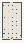

# Vectors_Act2_VectorArithmetic

Authored dimensions: {"width": 20, "depth": 38, "max_height": 3}

Source plan only: columns=x, rows=z. Red dots are manuscript/role primary anchors; blue dots are other placed objects; green crosses are utilities. Numbers refer to A rows below. Dark blue is source 0, cream lower structure, grey source wall-height threshold, ochre platforms. Museum overrides can change the built interpretation. Dots show anchors, not footprints or a proven route.

Map: [commons/maps/Vectors_Act2_VectorArithmetic/map_data.json](https://github.com/palletorsson/AdaResearch/blob/palm-scanner-door-entry/commons/maps/Vectors_Act2_VectorArithmetic/map_data.json)

Text: [commons/maps/Vectors_Act2_VectorArithmetic/final.md](https://github.com/palletorsson/AdaResearch/blob/palm-scanner-door-entry/commons/maps/Vectors_Act2_VectorArithmetic/final.md)

| Instance | x,z | Raw token | Recorded role | Registry / scene |
|---|---|---|---|---|
| A1 | 4,4 | `vector_addition_walk:270` | secondary | [commons/artifacts/registry/vectors.json](https://github.com/palletorsson/AdaResearch/blob/palm-scanner-door-entry/commons/artifacts/registry/vectors.json) → [commons/artifacts/vector_addition_walk/vector_addition_walk.tscn](https://github.com/palletorsson/AdaResearch/blob/palm-scanner-door-entry/commons/artifacts/vector_addition_walk/vector_addition_walk.tscn) |
| A2 | 13,4 | `vector_add` | primary | [commons/artifacts/registry/vectors_demos.json](https://github.com/palletorsson/AdaResearch/blob/palm-scanner-door-entry/commons/artifacts/registry/vectors_demos.json) → [commons/artifacts/vector_op_console/vector_op_console.tscn](https://github.com/palletorsson/AdaResearch/blob/palm-scanner-door-entry/commons/artifacts/vector_op_console/vector_op_console.tscn) |
| A3 | 6,9 | `vector_sub:180:0:1#lesson:room_gap#pin:1#plinth:0` | primary | [commons/artifacts/registry/vectors_demos.json](https://github.com/palletorsson/AdaResearch/blob/palm-scanner-door-entry/commons/artifacts/registry/vectors_demos.json) → [commons/artifacts/vector_op_console/vector_sub.tscn](https://github.com/palletorsson/AdaResearch/blob/palm-scanner-door-entry/commons/artifacts/vector_op_console/vector_sub.tscn) |
| A4 | 11,11 | `example_2_3_gravity_scaled_by_mass_vr` | secondary | [commons/artifacts/registry/physics_simulation.json](https://github.com/palletorsson/AdaResearch/blob/palm-scanner-door-entry/commons/artifacts/registry/physics_simulation.json) → [algorithms/forces/example_2_3_gravity_scaled_by_mass_vr.tscn](https://github.com/palletorsson/AdaResearch/blob/palm-scanner-door-entry/algorithms/forces/example_2_3_gravity_scaled_by_mass_vr.tscn) |
| A5 | 6,15 | `dot_aligner` | primary | [commons/artifacts/registry/vectors_demos.json](https://github.com/palletorsson/AdaResearch/blob/palm-scanner-door-entry/commons/artifacts/registry/vectors_demos.json) → [commons/artifacts/dot_aligner/dot_aligner.tscn](https://github.com/palletorsson/AdaResearch/blob/palm-scanner-door-entry/commons/artifacts/dot_aligner/dot_aligner.tscn) |
| A6 | 14,15 | `vector_dot_product_xl` | secondary | [commons/artifacts/registry/vectors.json](https://github.com/palletorsson/AdaResearch/blob/palm-scanner-door-entry/commons/artifacts/registry/vectors.json) |
| A7 | 6,21 | `projection_shadow:180:0:1#lesson:room_projection#pin:1#plinth:0` | primary | [commons/artifacts/registry/vectors_demos.json](https://github.com/palletorsson/AdaResearch/blob/palm-scanner-door-entry/commons/artifacts/registry/vectors_demos.json) → [commons/artifacts/projection_shadow/projection_shadow.tscn](https://github.com/palletorsson/AdaResearch/blob/palm-scanner-door-entry/commons/artifacts/projection_shadow/projection_shadow.tscn) |
| A8 | 14,21 | `vector_projection_reflection_xl` | secondary | [commons/artifacts/registry/vectors.json](https://github.com/palletorsson/AdaResearch/blob/palm-scanner-door-entry/commons/artifacts/registry/vectors.json) |
| A9 | 6,27 | `torque_crank` | primary | [commons/artifacts/registry/vectors_demos.json](https://github.com/palletorsson/AdaResearch/blob/palm-scanner-door-entry/commons/artifacts/registry/vectors_demos.json) → [commons/artifacts/torque_crank/torque_crank.tscn](https://github.com/palletorsson/AdaResearch/blob/palm-scanner-door-entry/commons/artifacts/torque_crank/torque_crank.tscn) |
| A10 | 14,27 | `vector_cross_product_xl` | secondary | [commons/artifacts/registry/vectors.json](https://github.com/palletorsson/AdaResearch/blob/palm-scanner-door-entry/commons/artifacts/registry/vectors.json) |
| A11 | 1,36 | `vector_addition_xl_laser` | secondary | [commons/artifacts/registry/vectors.json](https://github.com/palletorsson/AdaResearch/blob/palm-scanner-door-entry/commons/artifacts/registry/vectors.json) |
| A12 | 18,36 | `vector_subtraction_xl_laser` | secondary | [commons/artifacts/registry/vectors.json](https://github.com/palletorsson/AdaResearch/blob/palm-scanner-door-entry/commons/artifacts/registry/vectors.json) |

Utilities are listed with exact coordinates and raw tokens in space.json. Read map_info.museum and utility_definitions before inferring pits, entrances, movement or collision.
