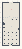

# Vectors_Act3_FieldsAndMotion

Authored dimensions: {"width": 18, "depth": 44, "max_height": 3}

Source plan only: columns=x, rows=z. Red dots are manuscript/role primary anchors; blue dots are other placed objects; green crosses are utilities. Numbers refer to A rows below. Dark blue is source 0, cream lower structure, grey source wall-height threshold, ochre platforms. Museum overrides can change the built interpretation. Dots show anchors, not footprints or a proven route.

Map: [commons/maps/Vectors_Act3_FieldsAndMotion/map_data.json](https://github.com/palletorsson/AdaResearch/blob/palm-scanner-door-entry/commons/maps/Vectors_Act3_FieldsAndMotion/map_data.json)

Text: [commons/maps/Vectors_Act3_FieldsAndMotion/final.md](https://github.com/palletorsson/AdaResearch/blob/palm-scanner-door-entry/commons/maps/Vectors_Act3_FieldsAndMotion/final.md)

| Instance | x,z | Raw token | Recorded role | Registry / scene |
|---|---|---|---|---|
| A1 | 9,7 | `VectorFieldFlow:180:0:1#lesson:field_receivers#pin:1#plinth:0` | primary | [commons/artifacts/registry/vectors.json](https://github.com/palletorsson/AdaResearch/blob/palm-scanner-door-entry/commons/artifacts/registry/vectors.json) → [algorithms/vectors/10_vector_field_flow/VectorFieldFlow.tscn](https://github.com/palletorsson/AdaResearch/blob/palm-scanner-door-entry/algorithms/vectors/10_vector_field_flow/VectorFieldFlow.tscn) |
| A2 | 7,14 | `field_room:0:0` | secondary | [commons/artifacts/registry/field_room.json](https://github.com/palletorsson/AdaResearch/blob/palm-scanner-door-entry/commons/artifacts/registry/field_room.json) → [commons/artifacts/field_room/field_room.tscn](https://github.com/palletorsson/AdaResearch/blob/palm-scanner-door-entry/commons/artifacts/field_room/field_room.tscn) |
| A3 | 1,15 | `force_field_visualizer:0:0` | secondary | [commons/artifacts/registry/commons_artifacts.json](https://github.com/palletorsson/AdaResearch/blob/palm-scanner-door-entry/commons/artifacts/registry/commons_artifacts.json) → [commons/artifacts/force_field_visualizer/force_field_visualizer.tscn](https://github.com/palletorsson/AdaResearch/blob/palm-scanner-door-entry/commons/artifacts/force_field_visualizer/force_field_visualizer.tscn) |
| A4 | 3,15 | `force_fields:0:0` | secondary | [commons/artifacts/registry/physics_simulation.json](https://github.com/palletorsson/AdaResearch/blob/palm-scanner-door-entry/commons/artifacts/registry/physics_simulation.json) → [algorithms/physicssimulation/forcefields/forcefields.tscn](https://github.com/palletorsson/AdaResearch/blob/palm-scanner-door-entry/algorithms/physicssimulation/forcefields/forcefields.tscn) |
| A5 | 5,15 | `force_vortex:0:0` | secondary | [commons/artifacts/registry/force_vortex.json](https://github.com/palletorsson/AdaResearch/blob/palm-scanner-door-entry/commons/artifacts/registry/force_vortex.json) → [commons/artifacts/force_vortex/force_vortex.tscn](https://github.com/palletorsson/AdaResearch/blob/palm-scanner-door-entry/commons/artifacts/force_vortex/force_vortex.tscn) |
| A6 | 11,15 | `magnetic_simulation:0:0` | secondary | [commons/artifacts/registry/physics_simulation.json](https://github.com/palletorsson/AdaResearch/blob/palm-scanner-door-entry/commons/artifacts/registry/physics_simulation.json) → [algorithms/physicssimulation/magneticsimulation/magnetic_simulation.tscn](https://github.com/palletorsson/AdaResearch/blob/palm-scanner-door-entry/algorithms/physicssimulation/magneticsimulation/magnetic_simulation.tscn) |
| A7 | 13,15 | `particle_systems:0:0` | secondary | [commons/artifacts/registry/physics_simulation.json](https://github.com/palletorsson/AdaResearch/blob/palm-scanner-door-entry/commons/artifacts/registry/physics_simulation.json) → [algorithms/physicssimulation/particlesystems/particlesystems.tscn](https://github.com/palletorsson/AdaResearch/blob/palm-scanner-door-entry/algorithms/physicssimulation/particlesystems/particlesystems.tscn) |
| A8 | 15,15 | `vector_field:0:1.5:0.18#pin:1#plinth:0` | secondary | [commons/artifacts/registry/transforms.json](https://github.com/palletorsson/AdaResearch/blob/palm-scanner-door-entry/commons/artifacts/registry/transforms.json) → [algorithms/transformation/vector_field/vector_field.tscn](https://github.com/palletorsson/AdaResearch/blob/palm-scanner-door-entry/algorithms/transformation/vector_field/vector_field.tscn) |
| A9 | 1,17 | `vector_fields:0:0` | secondary | [commons/artifacts/registry/physics_simulation.json](https://github.com/palletorsson/AdaResearch/blob/palm-scanner-door-entry/commons/artifacts/registry/physics_simulation.json) → [algorithms/physicssimulation/vectorfields/vectorfields.tscn](https://github.com/palletorsson/AdaResearch/blob/palm-scanner-door-entry/algorithms/physicssimulation/vectorfields/vectorfields.tscn) |
| A10 | 9,24 | `weather_vector_field` | secondary | [commons/artifacts/registry/vectors_demos.json](https://github.com/palletorsson/AdaResearch/blob/palm-scanner-door-entry/commons/artifacts/registry/vectors_demos.json) → [algorithms/vectors/weather_vector_field/weather_vector_field.tscn](https://github.com/palletorsson/AdaResearch/blob/palm-scanner-door-entry/algorithms/vectors/weather_vector_field/weather_vector_field.tscn) |
| A11 | 4,31 | `launch_arc` | secondary | [commons/artifacts/registry/vectors_demos.json](https://github.com/palletorsson/AdaResearch/blob/palm-scanner-door-entry/commons/artifacts/registry/vectors_demos.json) → [commons/artifacts/launch_arc/launch_arc.tscn](https://github.com/palletorsson/AdaResearch/blob/palm-scanner-door-entry/commons/artifacts/launch_arc/launch_arc.tscn) |
| A12 | 13,31 | `bubble_blaster` | secondary | [commons/artifacts/registry/vectors_demos.json](https://github.com/palletorsson/AdaResearch/blob/palm-scanner-door-entry/commons/artifacts/registry/vectors_demos.json) → [commons/artifacts/bubble_blaster/bubble_blaster.tscn](https://github.com/palletorsson/AdaResearch/blob/palm-scanner-door-entry/commons/artifacts/bubble_blaster/bubble_blaster.tscn) |
| A13 | 9,34 | `VectorMotion` | secondary | [commons/artifacts/registry/vectors.json](https://github.com/palletorsson/AdaResearch/blob/palm-scanner-door-entry/commons/artifacts/registry/vectors.json) → [algorithms/vectors/08_vector_motion/VectorMotion.tscn](https://github.com/palletorsson/AdaResearch/blob/palm-scanner-door-entry/algorithms/vectors/08_vector_motion/VectorMotion.tscn) |

Utilities are listed with exact coordinates and raw tokens in space.json. Read map_info.museum and utility_definitions before inferring pits, entrances, movement or collision.
