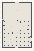

# Vectors_Act4a_KineticForces

Authored dimensions: {"width": 30, "depth": 46, "max_height": 3}

Source plan only: columns=x, rows=z. Red dots are manuscript/role primary anchors; blue dots are other placed objects; green crosses are utilities. Numbers refer to A rows below. Dark blue is source 0, cream lower structure, grey source wall-height threshold, ochre platforms. Museum overrides can change the built interpretation. Dots show anchors, not footprints or a proven route.

Map: [commons/maps/Vectors_Act4a_KineticForces/map_data.json](https://github.com/palletorsson/AdaResearch/blob/palm-scanner-door-entry/commons/maps/Vectors_Act4a_KineticForces/map_data.json)

Text: [commons/maps/Vectors_Act4a_KineticForces/final.md](https://github.com/palletorsson/AdaResearch/blob/palm-scanner-door-entry/commons/maps/Vectors_Act4a_KineticForces/final.md)

| Instance | x,z | Raw token | Recorded role | Registry / scene |
|---|---|---|---|---|
| A1 | 15,8 | `drag_corridor:0:0:1#lesson:kinetic_drag#pin:1#plinth:0` | primary | [commons/artifacts/registry/vectors_demos.json](https://github.com/palletorsson/AdaResearch/blob/palm-scanner-door-entry/commons/artifacts/registry/vectors_demos.json) → [commons/artifacts/drag_corridor/drag_corridor.tscn](https://github.com/palletorsson/AdaResearch/blob/palm-scanner-door-entry/commons/artifacts/drag_corridor/drag_corridor.tscn) |
| A2 | 1,17 | `wedge_slide` | secondary | [commons/artifacts/registry/vectors_demos.json](https://github.com/palletorsson/AdaResearch/blob/palm-scanner-door-entry/commons/artifacts/registry/vectors_demos.json) → [commons/artifacts/wedge_slide/wedge_slide.tscn](https://github.com/palletorsson/AdaResearch/blob/palm-scanner-door-entry/commons/artifacts/wedge_slide/wedge_slide.tscn) |
| A3 | 9,24 | `centrifuge_ring:0:0:1#lesson:kinetic_turn#speed:0#pin:1#plinth:0` | primary | [commons/artifacts/registry/vectors_demos.json](https://github.com/palletorsson/AdaResearch/blob/palm-scanner-door-entry/commons/artifacts/registry/vectors_demos.json) → [commons/artifacts/centrifuge_ring/centrifuge_ring.tscn](https://github.com/palletorsson/AdaResearch/blob/palm-scanner-door-entry/commons/artifacts/centrifuge_ring/centrifuge_ring.tscn) |
| A4 | 21,24 | `orbit_walk` | secondary | [commons/artifacts/registry/vectors_demos.json](https://github.com/palletorsson/AdaResearch/blob/palm-scanner-door-entry/commons/artifacts/registry/vectors_demos.json) → [commons/artifacts/orbit_walk/orbit_walk.tscn](https://github.com/palletorsson/AdaResearch/blob/palm-scanner-door-entry/commons/artifacts/orbit_walk/orbit_walk.tscn) |
| A5 | 15,30 | `force_pad` | secondary | [commons/artifacts/registry/force_pad.json](https://github.com/palletorsson/AdaResearch/blob/palm-scanner-door-entry/commons/artifacts/registry/force_pad.json) → [commons/artifacts/force_pad/force_pad.tscn](https://github.com/palletorsson/AdaResearch/blob/palm-scanner-door-entry/commons/artifacts/force_pad/force_pad.tscn) |
| A6 | 8,37 | `force_mower` | primary | [commons/artifacts/registry/vectors_demos.json](https://github.com/palletorsson/AdaResearch/blob/palm-scanner-door-entry/commons/artifacts/registry/vectors_demos.json) → [commons/artifacts/force_mower/force_mower.tscn](https://github.com/palletorsson/AdaResearch/blob/palm-scanner-door-entry/commons/artifacts/force_mower/force_mower.tscn) |
| A7 | 9,40 | `sisyphus_mower` | secondary | [commons/artifacts/registry/vectors_demos.json](https://github.com/palletorsson/AdaResearch/blob/palm-scanner-door-entry/commons/artifacts/registry/vectors_demos.json) → [commons/artifacts/sisyphus_mower/sisyphus_mower.tscn](https://github.com/palletorsson/AdaResearch/blob/palm-scanner-door-entry/commons/artifacts/sisyphus_mower/sisyphus_mower.tscn) |
| A8 | 17,41 | `prop_carousel` | secondary | [commons/artifacts/registry/vectors_demos.json](https://github.com/palletorsson/AdaResearch/blob/palm-scanner-door-entry/commons/artifacts/registry/vectors_demos.json) → [commons/artifacts/prop_carousel/prop_carousel.tscn](https://github.com/palletorsson/AdaResearch/blob/palm-scanner-door-entry/commons/artifacts/prop_carousel/prop_carousel.tscn) |

Utilities are listed with exact coordinates and raw tokens in space.json. Read map_info.museum and utility_definitions before inferring pits, entrances, movement or collision.
