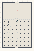

# Vectors_Act4b_Oscillation

Authored dimensions: {"width": 30, "depth": 46, "max_height": 3}

Source plan only: columns=x, rows=z. Red dots are manuscript/role primary anchors; blue dots are other placed objects; green crosses are utilities. Numbers refer to A rows below. Dark blue is source 0, cream lower structure, grey source wall-height threshold, ochre platforms. Museum overrides can change the built interpretation. Dots show anchors, not footprints or a proven route.

Map: [commons/maps/Vectors_Act4b_Oscillation/map_data.json](https://github.com/palletorsson/AdaResearch/blob/palm-scanner-door-entry/commons/maps/Vectors_Act4b_Oscillation/map_data.json)

Text: [commons/maps/Vectors_Act4b_Oscillation/final.md](https://github.com/palletorsson/AdaResearch/blob/palm-scanner-door-entry/commons/maps/Vectors_Act4b_Oscillation/final.md)

| Instance | x,z | Raw token | Recorded role | Registry / scene |
|---|---|---|---|---|
| A1 | 15,8 | `spring_tower:0:0:1#lesson:restoring_forces#pin:1#plinth:0` | primary | [commons/artifacts/registry/vectors_demos.json](https://github.com/palletorsson/AdaResearch/blob/palm-scanner-door-entry/commons/artifacts/registry/vectors_demos.json) → [commons/artifacts/spring_tower/spring_tower.tscn](https://github.com/palletorsson/AdaResearch/blob/palm-scanner-door-entry/commons/artifacts/spring_tower/spring_tower.tscn) |
| A2 | 13,16 | `ChainSwing:0:0` | secondary | [commons/artifacts/registry/physics_simulation.json](https://github.com/palletorsson/AdaResearch/blob/palm-scanner-door-entry/commons/artifacts/registry/physics_simulation.json) → [algorithms/joint/07_chain_swing/ChainSwing.tscn](https://github.com/palletorsson/AdaResearch/blob/palm-scanner-door-entry/algorithms/joint/07_chain_swing/ChainSwing.tscn) |
| A3 | 15,16 | `ConeTwistBag:0:0` | secondary | [commons/artifacts/registry/physics_simulation.json](https://github.com/palletorsson/AdaResearch/blob/palm-scanner-door-entry/commons/artifacts/registry/physics_simulation.json) → [algorithms/joint/06_cone_twist_bag/ConeTwistBag.tscn](https://github.com/palletorsson/AdaResearch/blob/palm-scanner-door-entry/algorithms/joint/06_cone_twist_bag/ConeTwistBag.tscn) |
| A4 | 1,17 | `calder_object_mobile#label_depth:scene` | secondary | [commons/artifacts/registry/vectors_demos.json](https://github.com/palletorsson/AdaResearch/blob/palm-scanner-door-entry/commons/artifacts/registry/vectors_demos.json) → [commons/artifacts/calder_mobile/calder_object_mobile.tscn](https://github.com/palletorsson/AdaResearch/blob/palm-scanner-door-entry/commons/artifacts/calder_mobile/calder_object_mobile.tscn) |
| A5 | 3,17 | `HingeCrank:0:0` | secondary | [commons/artifacts/registry/physics_simulation.json](https://github.com/palletorsson/AdaResearch/blob/palm-scanner-door-entry/commons/artifacts/registry/physics_simulation.json) → [algorithms/joint/03_hinge_crank/HingeCrank.tscn](https://github.com/palletorsson/AdaResearch/blob/palm-scanner-door-entry/algorithms/joint/03_hinge_crank/HingeCrank.tscn) |
| A6 | 5,17 | `SliderPress:0:0` | secondary | [commons/artifacts/registry/physics_simulation.json](https://github.com/palletorsson/AdaResearch/blob/palm-scanner-door-entry/commons/artifacts/registry/physics_simulation.json) → [algorithms/joint/04_slider_press/SliderPress.tscn](https://github.com/palletorsson/AdaResearch/blob/palm-scanner-door-entry/algorithms/joint/04_slider_press/SliderPress.tscn) |
| A7 | 7,17 | `coupled_pendulums:0:0` | secondary | [commons/artifacts/registry/commons_artifacts.json](https://github.com/palletorsson/AdaResearch/blob/palm-scanner-door-entry/commons/artifacts/registry/commons_artifacts.json) → [commons/artifacts/coupled_pendulums/coupled_pendulums.tscn](https://github.com/palletorsson/AdaResearch/blob/palm-scanner-door-entry/commons/artifacts/coupled_pendulums/coupled_pendulums.tscn) |
| A8 | 9,17 | `harmonic_motion_demo:0:0` | secondary | [commons/artifacts/registry/commons_artifacts.json](https://github.com/palletorsson/AdaResearch/blob/palm-scanner-door-entry/commons/artifacts/registry/commons_artifacts.json) → [commons/artifacts/harmonic_motion_demo/harmonic_motion_demo.tscn](https://github.com/palletorsson/AdaResearch/blob/palm-scanner-door-entry/commons/artifacts/harmonic_motion_demo/harmonic_motion_demo.tscn) |
| A9 | 11,17 | `mass_spring_damper:0:0` | secondary | [commons/artifacts/registry/physics_simulation.json](https://github.com/palletorsson/AdaResearch/blob/palm-scanner-door-entry/commons/artifacts/registry/physics_simulation.json) → [algorithms/physicssimulation/massspringdamper/massspringdamper.tscn](https://github.com/palletorsson/AdaResearch/blob/palm-scanner-door-entry/algorithms/physicssimulation/massspringdamper/massspringdamper.tscn) |
| A10 | 17,17 | `slingshot_pull:0:0` | secondary | [commons/artifacts/registry/vectors_demos.json](https://github.com/palletorsson/AdaResearch/blob/palm-scanner-door-entry/commons/artifacts/registry/vectors_demos.json) → [commons/artifacts/slingshot_pull/slingshot_pull.tscn](https://github.com/palletorsson/AdaResearch/blob/palm-scanner-door-entry/commons/artifacts/slingshot_pull/slingshot_pull.tscn) |
| A11 | 19,17 | `spring_network:0:0` | secondary | [commons/artifacts/registry/commons_artifacts.json](https://github.com/palletorsson/AdaResearch/blob/palm-scanner-door-entry/commons/artifacts/registry/commons_artifacts.json) → [commons/artifacts/spring_network/spring_network.tscn](https://github.com/palletorsson/AdaResearch/blob/palm-scanner-door-entry/commons/artifacts/spring_network/spring_network.tscn); [commons/artifacts/registry/wavefunctions.json](https://github.com/palletorsson/AdaResearch/blob/palm-scanner-door-entry/commons/artifacts/registry/wavefunctions.json) → [algorithms/wavefunctions/spring_network/spring_network.tscn](https://github.com/palletorsson/AdaResearch/blob/palm-scanner-door-entry/algorithms/wavefunctions/spring_network/spring_network.tscn) |
| A12 | 21,17 | `spring_system:0:0` | secondary | [commons/artifacts/registry/physics_simulation.json](https://github.com/palletorsson/AdaResearch/blob/palm-scanner-door-entry/commons/artifacts/registry/physics_simulation.json) → [algorithms/physicssimulation/springsystem/spring_system.tscn](https://github.com/palletorsson/AdaResearch/blob/palm-scanner-door-entry/algorithms/physicssimulation/springsystem/spring_system.tscn) |
| A13 | 23,17 | `surreal_kinetic_sculpture:0:0.7:0.12#presentation:museum#pin:1#plinth:0` | decoration | [commons/artifacts/registry/physics_simulation.json](https://github.com/palletorsson/AdaResearch/blob/palm-scanner-door-entry/commons/artifacts/registry/physics_simulation.json) → [algorithms/physicssimulation/surrealkineticsculpture/SurrealKineticSculpture.tscn](https://github.com/palletorsson/AdaResearch/blob/palm-scanner-door-entry/algorithms/physicssimulation/surrealkineticsculpture/SurrealKineticSculpture.tscn) |
| A14 | 25,17 | `vector_joint_playground:0:0` | secondary | [commons/artifacts/registry/vectors.json](https://github.com/palletorsson/AdaResearch/blob/palm-scanner-door-entry/commons/artifacts/registry/vectors.json) → [algorithms/vectors/playground/vector_joint_playground.tscn](https://github.com/palletorsson/AdaResearch/blob/palm-scanner-door-entry/algorithms/vectors/playground/vector_joint_playground.tscn) |
| A15 | 27,17 | `work_energy_demo:0:0` | secondary | [commons/artifacts/registry/vectors_demos.json](https://github.com/palletorsson/AdaResearch/blob/palm-scanner-door-entry/commons/artifacts/registry/vectors_demos.json) → [algorithms/vectors/03_dot_product/WorkEnergyDemo.tscn](https://github.com/palletorsson/AdaResearch/blob/palm-scanner-door-entry/algorithms/vectors/03_dot_product/WorkEnergyDemo.tscn) |
| A16 | 8,24 | `pendulum_hall#label_depth:scene` | secondary | [commons/artifacts/registry/vectors_demos.json](https://github.com/palletorsson/AdaResearch/blob/palm-scanner-door-entry/commons/artifacts/registry/vectors_demos.json) → [commons/artifacts/pendulum_hall/pendulum_hall.tscn](https://github.com/palletorsson/AdaResearch/blob/palm-scanner-door-entry/commons/artifacts/pendulum_hall/pendulum_hall.tscn) |
| A17 | 3,25 | `example_6_4_windmill_vr` | secondary | [commons/artifacts/registry/physics_simulation.json](https://github.com/palletorsson/AdaResearch/blob/palm-scanner-door-entry/commons/artifacts/registry/physics_simulation.json) → [algorithms/physics/example_6_4_windmill_vr.tscn](https://github.com/palletorsson/AdaResearch/blob/palm-scanner-door-entry/algorithms/physics/example_6_4_windmill_vr.tscn) |
| A18 | 5,30 | `weather_vane` | secondary | [commons/artifacts/registry/vectors_demos.json](https://github.com/palletorsson/AdaResearch/blob/palm-scanner-door-entry/commons/artifacts/registry/vectors_demos.json) → [commons/artifacts/weather_vane/weather_vane.tscn](https://github.com/palletorsson/AdaResearch/blob/palm-scanner-door-entry/commons/artifacts/weather_vane/weather_vane.tscn) |
| A19 | 15,30 | `calder_mobile#label_depth:scene` | secondary | [commons/artifacts/registry/vectors_demos.json](https://github.com/palletorsson/AdaResearch/blob/palm-scanner-door-entry/commons/artifacts/registry/vectors_demos.json) → [commons/artifacts/calder_mobile/calder_mobile.tscn](https://github.com/palletorsson/AdaResearch/blob/palm-scanner-door-entry/commons/artifacts/calder_mobile/calder_mobile.tscn) |
| A20 | 15,36 | `lever_balance` | secondary | [commons/artifacts/registry/vectors_demos.json](https://github.com/palletorsson/AdaResearch/blob/palm-scanner-door-entry/commons/artifacts/registry/vectors_demos.json) → [commons/artifacts/lever_balance/lever_balance.tscn](https://github.com/palletorsson/AdaResearch/blob/palm-scanner-door-entry/commons/artifacts/lever_balance/lever_balance.tscn) |
| A21 | 8,37 | `momentum_cradle` | secondary | [commons/artifacts/registry/vectors_demos.json](https://github.com/palletorsson/AdaResearch/blob/palm-scanner-door-entry/commons/artifacts/registry/vectors_demos.json) → [commons/artifacts/momentum_cradle/momentum_cradle.tscn](https://github.com/palletorsson/AdaResearch/blob/palm-scanner-door-entry/commons/artifacts/momentum_cradle/momentum_cradle.tscn) |
| A22 | 21,37 | `bounce_well` | secondary | [commons/artifacts/registry/vectors_demos.json](https://github.com/palletorsson/AdaResearch/blob/palm-scanner-door-entry/commons/artifacts/registry/vectors_demos.json) → [commons/artifacts/bounce_well/bounce_well.tscn](https://github.com/palletorsson/AdaResearch/blob/palm-scanner-door-entry/commons/artifacts/bounce_well/bounce_well.tscn) |

Utilities are listed with exact coordinates and raw tokens in space.json. Read map_info.museum and utility_definitions before inferring pits, entrances, movement or collision.
