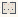

# FormFinding_Annealing

Authored dimensions: {"width": 14, "depth": 12, "max_height": 3}

Source plan only: columns=x, rows=z. Red dots are manuscript/role primary anchors; blue dots are other placed objects; green crosses are utilities. Numbers refer to A rows below. Dark blue is source 0, cream lower structure, grey source wall-height threshold, ochre platforms. Museum overrides can change the built interpretation. Dots show anchors, not footprints or a proven route.

Map: [commons/maps/FormFinding_Annealing/map_data.json](https://github.com/palletorsson/AdaResearch/blob/palm-scanner-door-entry/commons/maps/FormFinding_Annealing/map_data.json)

Text: [commons/maps/FormFinding_Annealing/final.md](https://github.com/palletorsson/AdaResearch/blob/palm-scanner-door-entry/commons/maps/FormFinding_Annealing/final.md)

| Instance | x,z | Raw token | Recorded role | Registry / scene |
|---|---|---|---|---|
| A1 | 2,2 | `max_q_basin_room:270` | secondary | [commons/artifacts/registry/soft_bodies.json](https://github.com/palletorsson/AdaResearch/blob/palm-scanner-door-entry/commons/artifacts/registry/soft_bodies.json) → [commons/artifacts/max_q_basin_room/max_q_basin_room.tscn](https://github.com/palletorsson/AdaResearch/blob/palm-scanner-door-entry/commons/artifacts/max_q_basin_room/max_q_basin_room.tscn) |
| A2 | 6,2 | `energy_landscape_bench:90` | primary | [commons/artifacts/registry/soft_bodies.json](https://github.com/palletorsson/AdaResearch/blob/palm-scanner-door-entry/commons/artifacts/registry/soft_bodies.json) → [commons/artifacts/energy_landscape_bench/energy_landscape_bench.tscn](https://github.com/palletorsson/AdaResearch/blob/palm-scanner-door-entry/commons/artifacts/energy_landscape_bench/energy_landscape_bench.tscn) |
| A3 | 10,2 | `simulated_annealing:90` | primary | [commons/artifacts/registry/algorithms_misc.json](https://github.com/palletorsson/AdaResearch/blob/palm-scanner-door-entry/commons/artifacts/registry/algorithms_misc.json) → [algorithms/optimization/simulatedannealing/simulated_annealing_visualization.tscn](https://github.com/palletorsson/AdaResearch/blob/palm-scanner-door-entry/algorithms/optimization/simulatedannealing/simulated_annealing_visualization.tscn) |
| A4 | 9,5 | `impossible_end_table` | secondary | [commons/artifacts/registry/primitives.json](https://github.com/palletorsson/AdaResearch/blob/palm-scanner-door-entry/commons/artifacts/registry/primitives.json) → [commons/artifacts/impossible_end_table/impossible_end_table.tscn](https://github.com/palletorsson/AdaResearch/blob/palm-scanner-door-entry/commons/artifacts/impossible_end_table/impossible_end_table.tscn) |
| A5 | 8,9 | `science_screen:90` | secondary | [commons/artifacts/registry/shaders.json](https://github.com/palletorsson/AdaResearch/blob/palm-scanner-door-entry/commons/artifacts/registry/shaders.json) → [commons/artifacts/science_screen/science_screen.tscn](https://github.com/palletorsson/AdaResearch/blob/palm-scanner-door-entry/commons/artifacts/science_screen/science_screen.tscn) |

Utilities are listed with exact coordinates and raw tokens in space.json. Read map_info.museum and utility_definitions before inferring pits, entrances, movement or collision.
