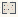

# FormFinding_Catenary

Authored dimensions: {"width": 14, "depth": 12, "max_height": 3}

Source plan only: columns=x, rows=z. Red dots are manuscript/role primary anchors; blue dots are other placed objects; green crosses are utilities. Numbers refer to A rows below. Dark blue is source 0, cream lower structure, grey source wall-height threshold, ochre platforms. Museum overrides can change the built interpretation. Dots show anchors, not footprints or a proven route.

Map: [commons/maps/FormFinding_Catenary/map_data.json](https://github.com/palletorsson/AdaResearch/blob/palm-scanner-door-entry/commons/maps/FormFinding_Catenary/map_data.json)

Text: [commons/maps/FormFinding_Catenary/final.md](https://github.com/palletorsson/AdaResearch/blob/palm-scanner-door-entry/commons/maps/FormFinding_Catenary/final.md)

| Instance | x,z | Raw token | Recorded role | Registry / scene |
|---|---|---|---|---|
| A1 | 5,3 | `cable_builder` | primary | [commons/artifacts/registry/wavefunctions.json](https://github.com/palletorsson/AdaResearch/blob/palm-scanner-door-entry/commons/artifacts/registry/wavefunctions.json) → [algorithms/wavefunctions/line_builder_3d/cable_builder.tscn](https://github.com/palletorsson/AdaResearch/blob/palm-scanner-door-entry/algorithms/wavefunctions/line_builder_3d/cable_builder.tscn) |
| A2 | 9,5 | `catenoid` | primary | [commons/artifacts/registry/parametric.json](https://github.com/palletorsson/AdaResearch/blob/palm-scanner-door-entry/commons/artifacts/registry/parametric.json) → [commons/primitives/parametric/catenoid.tscn](https://github.com/palletorsson/AdaResearch/blob/palm-scanner-door-entry/commons/primitives/parametric/catenoid.tscn) |
| A3 | 4,7 | `helicoid` | secondary | [commons/artifacts/registry/parametric.json](https://github.com/palletorsson/AdaResearch/blob/palm-scanner-door-entry/commons/artifacts/registry/parametric.json) → [commons/primitives/parametric/helicoid.tscn](https://github.com/palletorsson/AdaResearch/blob/palm-scanner-door-entry/commons/primitives/parametric/helicoid.tscn) |
| A4 | 10,7 | `science_screen` | secondary | [commons/artifacts/registry/shaders.json](https://github.com/palletorsson/AdaResearch/blob/palm-scanner-door-entry/commons/artifacts/registry/shaders.json) → [commons/artifacts/science_screen/science_screen.tscn](https://github.com/palletorsson/AdaResearch/blob/palm-scanner-door-entry/commons/artifacts/science_screen/science_screen.tscn) |
| A5 | 2,9 | `laundry_line_cathedral` | secondary | [commons/artifacts/registry/primitives.json](https://github.com/palletorsson/AdaResearch/blob/palm-scanner-door-entry/commons/artifacts/registry/primitives.json) → [commons/artifacts/laundry_line_cathedral/laundry_line_cathedral.tscn](https://github.com/palletorsson/AdaResearch/blob/palm-scanner-door-entry/commons/artifacts/laundry_line_cathedral/laundry_line_cathedral.tscn) |

Utilities are listed with exact coordinates and raw tokens in space.json. Read map_info.museum and utility_definitions before inferring pits, entrances, movement or collision.
