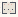

# FormFinding_Relaxation

Authored dimensions: {"width": 14, "depth": 12, "max_height": 3}

Source plan only: columns=x, rows=z. Red dots are manuscript/role primary anchors; blue dots are other placed objects; green crosses are utilities. Numbers refer to A rows below. Dark blue is source 0, cream lower structure, grey source wall-height threshold, ochre platforms. Museum overrides can change the built interpretation. Dots show anchors, not footprints or a proven route.

Map: [commons/maps/FormFinding_Relaxation/map_data.json](https://github.com/palletorsson/AdaResearch/blob/palm-scanner-door-entry/commons/maps/FormFinding_Relaxation/map_data.json)

Text: [commons/maps/FormFinding_Relaxation/final.md](https://github.com/palletorsson/AdaResearch/blob/palm-scanner-door-entry/commons/maps/FormFinding_Relaxation/final.md)

| Instance | x,z | Raw token | Recorded role | Registry / scene |
|---|---|---|---|---|
| A1 | 2,2 | `mass_spring_bench:270` | primary | [commons/artifacts/registry/soft_bodies.json](https://github.com/palletorsson/AdaResearch/blob/palm-scanner-door-entry/commons/artifacts/registry/soft_bodies.json) → [commons/artifacts/mass_spring_bench/mass_spring_bench.tscn](https://github.com/palletorsson/AdaResearch/blob/palm-scanner-door-entry/commons/artifacts/mass_spring_bench/mass_spring_bench.tscn) |
| A2 | 6,2 | `verlet_workbench:90` | primary | [commons/artifacts/registry/soft_bodies.json](https://github.com/palletorsson/AdaResearch/blob/palm-scanner-door-entry/commons/artifacts/registry/soft_bodies.json) → [commons/artifacts/verlet_workbench/verlet_workbench.tscn](https://github.com/palletorsson/AdaResearch/blob/palm-scanner-door-entry/commons/artifacts/verlet_workbench/verlet_workbench.tscn) |
| A3 | 9,2 | `frozen_glass_vessel:90` | secondary | [commons/artifacts/registry/soft_bodies.json](https://github.com/palletorsson/AdaResearch/blob/palm-scanner-door-entry/commons/artifacts/registry/soft_bodies.json) → [commons/artifacts/frozen_glass_vessel/frozen_glass_vessel.tscn](https://github.com/palletorsson/AdaResearch/blob/palm-scanner-door-entry/commons/artifacts/frozen_glass_vessel/frozen_glass_vessel.tscn) |
| A4 | 8,9 | `science_screen:90` | secondary | [commons/artifacts/registry/shaders.json](https://github.com/palletorsson/AdaResearch/blob/palm-scanner-door-entry/commons/artifacts/registry/shaders.json) → [commons/artifacts/science_screen/science_screen.tscn](https://github.com/palletorsson/AdaResearch/blob/palm-scanner-door-entry/commons/artifacts/science_screen/science_screen.tscn) |

Utilities are listed with exact coordinates and raw tokens in space.json. Read map_info.museum and utility_definitions before inferring pits, entrances, movement or collision.
