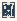

# Brouwer_Intuitionism

Authored dimensions: {"width": 13, "depth": 16, "max_height": 3}

Source plan only: columns=x, rows=z. Red dots are manuscript/role primary anchors; blue dots are other placed objects; green crosses are utilities. Numbers refer to A rows below. Dark blue is source 0, cream lower structure, grey source wall-height threshold, ochre platforms. Museum overrides can change the built interpretation. Dots show anchors, not footprints or a proven route.

Map: [commons/maps/Brouwer_Intuitionism/map_data.json](https://github.com/palletorsson/AdaResearch/blob/palm-scanner-door-entry/commons/maps/Brouwer_Intuitionism/map_data.json)

Text: [commons/maps/Brouwer_Intuitionism/final.md](https://github.com/palletorsson/AdaResearch/blob/palm-scanner-door-entry/commons/maps/Brouwer_Intuitionism/final.md)

| Instance | x,z | Raw token | Recorded role | Registry / scene |
|---|---|---|---|---|
| A1 | 9,4 | `cantor_diagonal_workbench` | secondary | [commons/artifacts/registry/qfep.json](https://github.com/palletorsson/AdaResearch/blob/palm-scanner-door-entry/commons/artifacts/registry/qfep.json) → [commons/artifacts/cantor_diagonal_workbench/cantor_diagonal_workbench.tscn](https://github.com/palletorsson/AdaResearch/blob/palm-scanner-door-entry/commons/artifacts/cantor_diagonal_workbench/cantor_diagonal_workbench.tscn) |
| A2 | 4,10 | `intractable_evidence:0:0` | unassigned | [commons/artifacts/registry/foundations.json](https://github.com/palletorsson/AdaResearch/blob/palm-scanner-door-entry/commons/artifacts/registry/foundations.json) → [commons/artifacts/intractable_evidence/intractable_evidence.tscn](https://github.com/palletorsson/AdaResearch/blob/palm-scanner-door-entry/commons/artifacts/intractable_evidence/intractable_evidence.tscn) |
| A3 | 9,11 | `angle_sum_triangle` | secondary | [commons/artifacts/registry/foundations.json](https://github.com/palletorsson/AdaResearch/blob/palm-scanner-door-entry/commons/artifacts/registry/foundations.json) → [commons/artifacts/angle_sum_triangle/angle_sum_triangle.tscn](https://github.com/palletorsson/AdaResearch/blob/palm-scanner-door-entry/commons/artifacts/angle_sum_triangle/angle_sum_triangle.tscn) |
| A4 | 5,12 | `constructive_proof:0:0.8` | primary | [commons/artifacts/registry/foundations.json](https://github.com/palletorsson/AdaResearch/blob/palm-scanner-door-entry/commons/artifacts/registry/foundations.json) → [commons/artifacts/constructive_proof/constructive_proof.tscn](https://github.com/palletorsson/AdaResearch/blob/palm-scanner-door-entry/commons/artifacts/constructive_proof/constructive_proof.tscn) |
| A5 | 6,12 | `brouwer_choice_sequence:0:1` | primary | [commons/artifacts/registry/foundations.json](https://github.com/palletorsson/AdaResearch/blob/palm-scanner-door-entry/commons/artifacts/registry/foundations.json) → [commons/artifacts/brouwer_choice_sequence/brouwer_choice_sequence.tscn](https://github.com/palletorsson/AdaResearch/blob/palm-scanner-door-entry/commons/artifacts/brouwer_choice_sequence/brouwer_choice_sequence.tscn) |
| A6 | 2,13 | `constructive_staircase:0:1:1` | secondary | [commons/artifacts/registry/foundations_crisis.json](https://github.com/palletorsson/AdaResearch/blob/palm-scanner-door-entry/commons/artifacts/registry/foundations_crisis.json) → [commons/artifacts/constructive_staircase/constructive_staircase.tscn](https://github.com/palletorsson/AdaResearch/blob/palm-scanner-door-entry/commons/artifacts/constructive_staircase/constructive_staircase.tscn) |
| A7 | 3,13 | `excluded_middle_demo:0:0.8` | secondary | [commons/artifacts/registry/foundations.json](https://github.com/palletorsson/AdaResearch/blob/palm-scanner-door-entry/commons/artifacts/registry/foundations.json) → [commons/artifacts/excluded_middle_demo/excluded_middle_demo.tscn](https://github.com/palletorsson/AdaResearch/blob/palm-scanner-door-entry/commons/artifacts/excluded_middle_demo/excluded_middle_demo.tscn) |
| A8 | 11,14 | `parallel_lines` | secondary | [commons/artifacts/registry/primitives.json](https://github.com/palletorsson/AdaResearch/blob/palm-scanner-door-entry/commons/artifacts/registry/primitives.json) → [commons/primitives/line/parallel_lines.tscn](https://github.com/palletorsson/AdaResearch/blob/palm-scanner-door-entry/commons/primitives/line/parallel_lines.tscn) |

Utilities are listed with exact coordinates and raw tokens in space.json. Read map_info.museum and utility_definitions before inferring pits, entrances, movement or collision.
