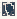

# Escher_Impossible

Authored dimensions: {"width": 13, "depth": 14, "max_height": 4}

Source plan only: columns=x, rows=z. Red dots are manuscript/role primary anchors; blue dots are other placed objects; green crosses are utilities. Numbers refer to A rows below. Dark blue is source 0, cream lower structure, grey source wall-height threshold, ochre platforms. Museum overrides can change the built interpretation. Dots show anchors, not footprints or a proven route.

Map: [commons/maps/Escher_Impossible/map_data.json](https://github.com/palletorsson/AdaResearch/blob/palm-scanner-door-entry/commons/maps/Escher_Impossible/map_data.json)

Text: [commons/maps/Escher_Impossible/final.md](https://github.com/palletorsson/AdaResearch/blob/palm-scanner-door-entry/commons/maps/Escher_Impossible/final.md)

| Instance | x,z | Raw token | Recorded role | Registry / scene |
|---|---|---|---|---|
| A1 | 2,2 | `escher_staircase:0:0.5:1` | primary | [commons/artifacts/registry/foundations.json](https://github.com/palletorsson/AdaResearch/blob/palm-scanner-door-entry/commons/artifacts/registry/foundations.json) → [commons/interfaces/foundations/escher_staircase.tscn](https://github.com/palletorsson/AdaResearch/blob/palm-scanner-door-entry/commons/interfaces/foundations/escher_staircase.tscn) |
| A2 | 5,2 | `magritte_pipe:0:0.8` | secondary | [commons/artifacts/registry/foundations.json](https://github.com/palletorsson/AdaResearch/blob/palm-scanner-door-entry/commons/artifacts/registry/foundations.json) → [commons/interfaces/foundations/magritte_pipe.tscn](https://github.com/palletorsson/AdaResearch/blob/palm-scanner-door-entry/commons/interfaces/foundations/magritte_pipe.tscn) |
| A3 | 5,4 | `penrose_triangle:0:0.8` | primary | [commons/artifacts/registry/foundations.json](https://github.com/palletorsson/AdaResearch/blob/palm-scanner-door-entry/commons/artifacts/registry/foundations.json) → [commons/artifacts/penrose_triangle/penrose_triangle.tscn](https://github.com/palletorsson/AdaResearch/blob/palm-scanner-door-entry/commons/artifacts/penrose_triangle/penrose_triangle.tscn) |
| A4 | 2,11 | `impossible_trident:0:1:1` | secondary | [commons/artifacts/registry/foundations_crisis.json](https://github.com/palletorsson/AdaResearch/blob/palm-scanner-door-entry/commons/artifacts/registry/foundations_crisis.json) → [commons/artifacts/impossible_trident/impossible_trident.tscn](https://github.com/palletorsson/AdaResearch/blob/palm-scanner-door-entry/commons/artifacts/impossible_trident/impossible_trident.tscn) |

Utilities are listed with exact coordinates and raw tokens in space.json. Read map_info.museum and utility_definitions before inferring pits, entrances, movement or collision.
