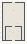

# Fractal_GoldenSpiral

Authored dimensions: {"width": 23, "depth": 39, "max_height": 9}

Source plan only: columns=x, rows=z. Red dots are manuscript/role primary anchors; blue dots are other placed objects; green crosses are utilities. Numbers refer to A rows below. Dark blue is source 0, cream lower structure, grey source wall-height threshold, ochre platforms. Museum overrides can change the built interpretation. Dots show anchors, not footprints or a proven route.

Map: [commons/maps/Fractal_GoldenSpiral/map_data.json](https://github.com/palletorsson/AdaResearch/blob/palm-scanner-door-entry/commons/maps/Fractal_GoldenSpiral/map_data.json)

Text: [commons/maps/Fractal_GoldenSpiral/final.md](https://github.com/palletorsson/AdaResearch/blob/palm-scanner-door-entry/commons/maps/Fractal_GoldenSpiral/final.md)

| Instance | x,z | Raw token | Recorded role | Registry / scene |
|---|---|---|---|---|
| A1 | 11,8 | `fibonacci_sequences:0:0#lesson:true` | primary | [commons/artifacts/registry/algorithms_misc.json](https://github.com/palletorsson/AdaResearch/blob/palm-scanner-door-entry/commons/artifacts/registry/algorithms_misc.json) → [algorithms/fractals/fibonacci_sequences/fibonacci_sequences.tscn](https://github.com/palletorsson/AdaResearch/blob/palm-scanner-door-entry/algorithms/fractals/fibonacci_sequences/fibonacci_sequences.tscn) |
| A2 | 15,21 | `golden_rectangle:0:0#preset:rainbow#lesson:true` | primary | [commons/artifacts/registry/procgen_extra.json](https://github.com/palletorsson/AdaResearch/blob/palm-scanner-door-entry/commons/artifacts/registry/procgen_extra.json) → [algorithms/fractals/golden_rectangle/golden_rectangle.tscn](https://github.com/palletorsson/AdaResearch/blob/palm-scanner-door-entry/algorithms/fractals/golden_rectangle/golden_rectangle.tscn) |
| A3 | 7,29 | `the_recursion_cabinet` | secondary | [commons/artifacts/registry/fractals.json](https://github.com/palletorsson/AdaResearch/blob/palm-scanner-door-entry/commons/artifacts/registry/fractals.json) → [commons/artifacts/the_recursion_cabinet/the_recursion_cabinet.tscn](https://github.com/palletorsson/AdaResearch/blob/palm-scanner-door-entry/commons/artifacts/the_recursion_cabinet/the_recursion_cabinet.tscn) |
| A4 | 16,29 | `diffusion_limited_aggregation` | secondary | [commons/artifacts/registry/procgen_extra.json](https://github.com/palletorsson/AdaResearch/blob/palm-scanner-door-entry/commons/artifacts/registry/procgen_extra.json) → [algorithms/patterngeneration/diffusion_limited_aggregation/diffusion_limited_aggregation.tscn](https://github.com/palletorsson/AdaResearch/blob/palm-scanner-door-entry/algorithms/patterngeneration/diffusion_limited_aggregation/diffusion_limited_aggregation.tscn) |
| A5 | 11,30 | `dark_sphere` | decoration | [commons/artifacts/registry/lsystems.json](https://github.com/palletorsson/AdaResearch/blob/palm-scanner-door-entry/commons/artifacts/registry/lsystems.json) → [commons/artifacts/dark_sphere/dark_sphere.tscn](https://github.com/palletorsson/AdaResearch/blob/palm-scanner-door-entry/commons/artifacts/dark_sphere/dark_sphere.tscn) |
| A6 | 6,34 | `fibonacci_terrain#preset:deep` | secondary | [commons/artifacts/registry/procgen_extra.json](https://github.com/palletorsson/AdaResearch/blob/palm-scanner-door-entry/commons/artifacts/registry/procgen_extra.json) → [algorithms/fractals/fibonacci_terrain/fibonacci_terrain.tscn](https://github.com/palletorsson/AdaResearch/blob/palm-scanner-door-entry/algorithms/fractals/fibonacci_terrain/fibonacci_terrain.tscn) |
| A7 | 15,34 | `romanesco` | secondary | [commons/artifacts/registry/procgen_extra.json](https://github.com/palletorsson/AdaResearch/blob/palm-scanner-door-entry/commons/artifacts/registry/procgen_extra.json) → [algorithms/fractals/romanesco/romanesco.tscn](https://github.com/palletorsson/AdaResearch/blob/palm-scanner-door-entry/algorithms/fractals/romanesco/romanesco.tscn) |

Utilities are listed with exact coordinates and raw tokens in space.json. Read map_info.museum and utility_definitions before inferring pits, entrances, movement or collision.
