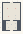

# Fractal_KochSierpinski

Authored dimensions: {"width": 19, "depth": 29, "max_height": 3}

Source plan only: columns=x, rows=z. Red dots are manuscript/role primary anchors; blue dots are other placed objects; green crosses are utilities. Numbers refer to A rows below. Dark blue is source 0, cream lower structure, grey source wall-height threshold, ochre platforms. Museum overrides can change the built interpretation. Dots show anchors, not footprints or a proven route.

Map: [commons/maps/Fractal_KochSierpinski/map_data.json](https://github.com/palletorsson/AdaResearch/blob/palm-scanner-door-entry/commons/maps/Fractal_KochSierpinski/map_data.json)

Text: [commons/maps/Fractal_KochSierpinski/final.md](https://github.com/palletorsson/AdaResearch/blob/palm-scanner-door-entry/commons/maps/Fractal_KochSierpinski/final.md)

| Instance | x,z | Raw token | Recorded role | Registry / scene |
|---|---|---|---|---|
| A1 | 5,6 | `fractal_koch_curve:180#lesson:true` | primary | [commons/artifacts/registry/procgen_extra.json](https://github.com/palletorsson/AdaResearch/blob/palm-scanner-door-entry/commons/artifacts/registry/procgen_extra.json) → [algorithms/fractals/example_8_5_koch_curve_vr.tscn](https://github.com/palletorsson/AdaResearch/blob/palm-scanner-door-entry/algorithms/fractals/example_8_5_koch_curve_vr.tscn) |
| A2 | 13,6 | `sierpinski_triangle:180#lesson:true` | primary | [commons/artifacts/registry/procgen_extra.json](https://github.com/palletorsson/AdaResearch/blob/palm-scanner-door-entry/commons/artifacts/registry/procgen_extra.json) → [algorithms/fractals/sierpinskitriangle/sierpinski_triangle.tscn](https://github.com/palletorsson/AdaResearch/blob/palm-scanner-door-entry/algorithms/fractals/sierpinskitriangle/sierpinski_triangle.tscn) |
| A3 | 13,13 | `recursion_observatory:180#tick:coarse` | secondary | [commons/artifacts/registry/recursion_observatory.json](https://github.com/palletorsson/AdaResearch/blob/palm-scanner-door-entry/commons/artifacts/registry/recursion_observatory.json) → [commons/artifacts/recursion_observatory/recursion_observatory.tscn](https://github.com/palletorsson/AdaResearch/blob/palm-scanner-door-entry/commons/artifacts/recursion_observatory/recursion_observatory.tscn) |
| A4 | 6,14 | `box_counting_dimension:180#lesson:true` | primary | [commons/artifacts/registry/procgen_extra.json](https://github.com/palletorsson/AdaResearch/blob/palm-scanner-door-entry/commons/artifacts/registry/procgen_extra.json) → [algorithms/fractals/box_counting_dimension/box_counting_dimension.tscn](https://github.com/palletorsson/AdaResearch/blob/palm-scanner-door-entry/algorithms/fractals/box_counting_dimension/box_counting_dimension.tscn) |
| A5 | 13,16 | `science_screen:180:0:0.6#mode:trace` | secondary | [commons/artifacts/registry/shaders.json](https://github.com/palletorsson/AdaResearch/blob/palm-scanner-door-entry/commons/artifacts/registry/shaders.json) → [commons/artifacts/science_screen/science_screen.tscn](https://github.com/palletorsson/AdaResearch/blob/palm-scanner-door-entry/commons/artifacts/science_screen/science_screen.tscn) |
| A6 | 5,21 | `cube_cabin:180:0:0.65` | secondary | [commons/artifacts/registry/procgen_extra.json](https://github.com/palletorsson/AdaResearch/blob/palm-scanner-door-entry/commons/artifacts/registry/procgen_extra.json) → [algorithms/fractals/cubesubdivision/cube_cabin.tscn](https://github.com/palletorsson/AdaResearch/blob/palm-scanner-door-entry/algorithms/fractals/cubesubdivision/cube_cabin.tscn) |
| A7 | 13,21 | `cube_bookshelf:180:0:0.75` | secondary | [commons/artifacts/registry/procgen_extra.json](https://github.com/palletorsson/AdaResearch/blob/palm-scanner-door-entry/commons/artifacts/registry/procgen_extra.json) → [algorithms/fractals/cubesubdivision/cube_bookshelf.tscn](https://github.com/palletorsson/AdaResearch/blob/palm-scanner-door-entry/algorithms/fractals/cubesubdivision/cube_bookshelf.tscn) |
| A8 | 9,22 | `dark_sphere` | decoration | [commons/artifacts/registry/lsystems.json](https://github.com/palletorsson/AdaResearch/blob/palm-scanner-door-entry/commons/artifacts/registry/lsystems.json) → [commons/artifacts/dark_sphere/dark_sphere.tscn](https://github.com/palletorsson/AdaResearch/blob/palm-scanner-door-entry/commons/artifacts/dark_sphere/dark_sphere.tscn) |
| A9 | 6,25 | `sierpinski_pyramid:0:1.0125:0.45#tick:fine` | secondary | [commons/artifacts/registry/cellular_automata.json](https://github.com/palletorsson/AdaResearch/blob/palm-scanner-door-entry/commons/artifacts/registry/cellular_automata.json) → [algorithms/cellularautomata/sierpinski_pyramid/SierpinskiPyramid.tscn](https://github.com/palletorsson/AdaResearch/blob/palm-scanner-door-entry/algorithms/cellularautomata/sierpinski_pyramid/SierpinskiPyramid.tscn) |
| A10 | 13,25 | `koch_curve_3d:180:0.05#tick:coarse` | secondary | [commons/artifacts/registry/procgen_extra.json](https://github.com/palletorsson/AdaResearch/blob/palm-scanner-door-entry/commons/artifacts/registry/procgen_extra.json) → [algorithms/fractals/koshcurve/KochCurve3D.tscn](https://github.com/palletorsson/AdaResearch/blob/palm-scanner-door-entry/algorithms/fractals/koshcurve/KochCurve3D.tscn) |

Utilities are listed with exact coordinates and raw tokens in space.json. Read map_info.museum and utility_definitions before inferring pits, entrances, movement or collision.
