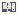

# GT_Connectivity

Authored dimensions: {"width": 14, "depth": 10, "max_height": 5}

Source plan only: columns=x, rows=z. Red dots are manuscript/role primary anchors; blue dots are other placed objects; green crosses are utilities. Numbers refer to A rows below. Dark blue is source 0, cream lower structure, grey source wall-height threshold, ochre platforms. Museum overrides can change the built interpretation. Dots show anchors, not footprints or a proven route.

Map: [commons/maps/GT_Connectivity/map_data.json](https://github.com/palletorsson/AdaResearch/blob/palm-scanner-door-entry/commons/maps/GT_Connectivity/map_data.json)

Text: [commons/maps/GT_Connectivity/final.md](https://github.com/palletorsson/AdaResearch/blob/palm-scanner-door-entry/commons/maps/GT_Connectivity/final.md)

| Instance | x,z | Raw token | Recorded role | Registry / scene |
|---|---|---|---|---|
| A1 | 2,2 | `topological_sort:0:0:0.6` | secondary | [commons/artifacts/registry/algorithms_misc.json](https://github.com/palletorsson/AdaResearch/blob/palm-scanner-door-entry/commons/artifacts/registry/algorithms_misc.json) → [algorithms/graphtheory/topological_sort/topological_sort.tscn](https://github.com/palletorsson/AdaResearch/blob/palm-scanner-door-entry/algorithms/graphtheory/topological_sort/topological_sort.tscn) |
| A2 | 3,2 | `tarjan_algorithm:0:0:0.6` | primary | [commons/artifacts/registry/algorithms_misc.json](https://github.com/palletorsson/AdaResearch/blob/palm-scanner-door-entry/commons/artifacts/registry/algorithms_misc.json) → [algorithms/graphtheory/tarjan_algorithm/tarjan_algorithm.tscn](https://github.com/palletorsson/AdaResearch/blob/palm-scanner-door-entry/algorithms/graphtheory/tarjan_algorithm/tarjan_algorithm.tscn) |
| A3 | 6,2 | `kosaraju_algorithm:0:0:0.6` | secondary | [commons/artifacts/registry/algorithms_misc.json](https://github.com/palletorsson/AdaResearch/blob/palm-scanner-door-entry/commons/artifacts/registry/algorithms_misc.json) → [algorithms/graphtheory/kosaraju_algorithm/kosaraju_algorithm.tscn](https://github.com/palletorsson/AdaResearch/blob/palm-scanner-door-entry/algorithms/graphtheory/kosaraju_algorithm/kosaraju_algorithm.tscn) |

Utilities are listed with exact coordinates and raw tokens in space.json. Read map_info.museum and utility_definitions before inferring pits, entrances, movement or collision.
