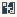

# GT_Foundations

Authored dimensions: {"width": 13, "depth": 12, "max_height": 3}

Source plan only: columns=x, rows=z. Red dots are manuscript/role primary anchors; blue dots are other placed objects; green crosses are utilities. Numbers refer to A rows below. Dark blue is source 0, cream lower structure, grey source wall-height threshold, ochre platforms. Museum overrides can change the built interpretation. Dots show anchors, not footprints or a proven route.

Map: [commons/maps/GT_Foundations/map_data.json](https://github.com/palletorsson/AdaResearch/blob/palm-scanner-door-entry/commons/maps/GT_Foundations/map_data.json)

Text: [commons/maps/GT_Foundations/final.md](https://github.com/palletorsson/AdaResearch/blob/palm-scanner-door-entry/commons/maps/GT_Foundations/final.md)

| Instance | x,z | Raw token | Recorded role | Registry / scene |
|---|---|---|---|---|
| A1 | 5,1 | `synthesis_stand#subject:graphspace#mode:hero` | secondary | [commons/artifacts/registry/synthesis.json](https://github.com/palletorsson/AdaResearch/blob/palm-scanner-door-entry/commons/artifacts/registry/synthesis.json) → [commons/artifacts/synthesis/synthesis_stand.tscn](https://github.com/palletorsson/AdaResearch/blob/palm-scanner-door-entry/commons/artifacts/synthesis/synthesis_stand.tscn) |
| A2 | 2,2 | `graphspace:0:0:0.6` | secondary | [commons/artifacts/registry/algorithms_misc.json](https://github.com/palletorsson/AdaResearch/blob/palm-scanner-door-entry/commons/artifacts/registry/algorithms_misc.json) → [algorithms/graphtheory/graphspace/graphspace.tscn](https://github.com/palletorsson/AdaResearch/blob/palm-scanner-door-entry/algorithms/graphtheory/graphspace/graphspace.tscn) |
| A3 | 11,5 | `graphspace3d` | secondary | [commons/artifacts/registry/algorithms_misc.json](https://github.com/palletorsson/AdaResearch/blob/palm-scanner-door-entry/commons/artifacts/registry/algorithms_misc.json) → [algorithms/graphtheory/graphspace3d/graphspace3d.tscn](https://github.com/palletorsson/AdaResearch/blob/palm-scanner-door-entry/algorithms/graphtheory/graphspace3d/graphspace3d.tscn) |
| A4 | 6,6 | `KonigsbergBridge:0:0:0.6` | secondary | [commons/artifacts/registry/algorithms_misc.json](https://github.com/palletorsson/AdaResearch/blob/palm-scanner-door-entry/commons/artifacts/registry/algorithms_misc.json) → [algorithms/graphtheory/graphspace3d/konigsberg3d.tscn](https://github.com/palletorsson/AdaResearch/blob/palm-scanner-door-entry/algorithms/graphtheory/graphspace3d/konigsberg3d.tscn) |
| A5 | 10,9 | `two_travelers` | primary | [commons/artifacts/registry/graphtheory.json](https://github.com/palletorsson/AdaResearch/blob/palm-scanner-door-entry/commons/artifacts/registry/graphtheory.json) → [commons/artifacts/two_travelers/two_travelers.tscn](https://github.com/palletorsson/AdaResearch/blob/palm-scanner-door-entry/commons/artifacts/two_travelers/two_travelers.tscn) |

Utilities are listed with exact coordinates and raw tokens in space.json. Read map_info.museum and utility_definitions before inferring pits, entrances, movement or collision.
