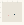

# ISO_PortalLandscape

Authored dimensions: {"width": 20, "depth": 20, "max_height": 1}

Source plan only: columns=x, rows=z. Red dots are manuscript/role primary anchors; blue dots are other placed objects; green crosses are utilities. Numbers refer to A rows below. Dark blue is source 0, cream lower structure, grey source wall-height threshold, ochre platforms. Museum overrides can change the built interpretation. Dots show anchors, not footprints or a proven route.

Map: [commons/maps/ISO_PortalLandscape/map_data.json](https://github.com/palletorsson/AdaResearch/blob/palm-scanner-door-entry/commons/maps/ISO_PortalLandscape/map_data.json)

Text: [commons/maps/ISO_PortalLandscape/final.md](https://github.com/palletorsson/AdaResearch/blob/palm-scanner-door-entry/commons/maps/ISO_PortalLandscape/final.md)

| Instance | x,z | Raw token | Recorded role | Registry / scene |
|---|---|---|---|---|
| A1 | 6,13 | `marchingcubes_portal_landscape:0:6` | primary | [commons/artifacts/registry/procgen_extra.json](https://github.com/palletorsson/AdaResearch/blob/palm-scanner-door-entry/commons/artifacts/registry/procgen_extra.json) → [algorithms/proceduralgeneration/isosurfaces/marchingcave/Scenes/marchingcubes_overhang_landscape.tscn](https://github.com/palletorsson/AdaResearch/blob/palm-scanner-door-entry/algorithms/proceduralgeneration/isosurfaces/marchingcave/Scenes/marchingcubes_overhang_landscape.tscn) |

Utilities are listed with exact coordinates and raw tokens in space.json. Read map_info.museum and utility_definitions before inferring pits, entrances, movement or collision.
