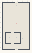

# ISO_ShapesGallery

Authored dimensions: {"width": 28, "depth": 48, "max_height": 9}

Source plan only: columns=x, rows=z. Red dots are manuscript/role primary anchors; blue dots are other placed objects; green crosses are utilities. Numbers refer to A rows below. Dark blue is source 0, cream lower structure, grey source wall-height threshold, ochre platforms. Museum overrides can change the built interpretation. Dots show anchors, not footprints or a proven route.

Map: [commons/maps/ISO_ShapesGallery/map_data.json](https://github.com/palletorsson/AdaResearch/blob/palm-scanner-door-entry/commons/maps/ISO_ShapesGallery/map_data.json)

Text: [commons/maps/ISO_ShapesGallery/final.md](https://github.com/palletorsson/AdaResearch/blob/palm-scanner-door-entry/commons/maps/ISO_ShapesGallery/final.md)

| Instance | x,z | Raw token | Recorded role | Registry / scene |
|---|---|---|---|---|
| A1 | 14,3 | `iso_shapes_console:180` | decoration | [commons/artifacts/registry/isosurfaces.json](https://github.com/palletorsson/AdaResearch/blob/palm-scanner-door-entry/commons/artifacts/registry/isosurfaces.json) → [commons/artifacts/timing_machines/iso_shapes_workshop.tscn](https://github.com/palletorsson/AdaResearch/blob/palm-scanner-door-entry/commons/artifacts/timing_machines/iso_shapes_workshop.tscn) |
| A2 | 14,21 | `mc_shapes_gallery:0:3#spacing:5.5#shape_scale:0.09#preserve_empty_result:true` | primary | [commons/artifacts/registry/isosurfaces.json](https://github.com/palletorsson/AdaResearch/blob/palm-scanner-door-entry/commons/artifacts/registry/isosurfaces.json) → [algorithms/proceduralgeneration/isosurfaces/marchingcave/Scenes/MarchingShapesGallery.tscn](https://github.com/palletorsson/AdaResearch/blob/palm-scanner-door-entry/algorithms/proceduralgeneration/isosurfaces/marchingcave/Scenes/MarchingShapesGallery.tscn) |
| A3 | 7,35 | `mc_torus_sculpture:0:1:0.04` | secondary | [commons/artifacts/registry/isosurfaces.json](https://github.com/palletorsson/AdaResearch/blob/palm-scanner-door-entry/commons/artifacts/registry/isosurfaces.json) → [algorithms/proceduralgeneration/isosurfaces/marchingcave/Scenes/marchingcubes_torus_sculpture.tscn](https://github.com/palletorsson/AdaResearch/blob/palm-scanner-door-entry/algorithms/proceduralgeneration/isosurfaces/marchingcave/Scenes/marchingcubes_torus_sculpture.tscn) |
| A4 | 14,35 | `mc_sculpt_vr:0:1:0.2` | secondary | [commons/artifacts/registry/isosurfaces.json](https://github.com/palletorsson/AdaResearch/blob/palm-scanner-door-entry/commons/artifacts/registry/isosurfaces.json) → [algorithms/proceduralgeneration/isosurfaces/marchingcave/Scenes/MarchingCubesSculptVR.tscn](https://github.com/palletorsson/AdaResearch/blob/palm-scanner-door-entry/algorithms/proceduralgeneration/isosurfaces/marchingcave/Scenes/MarchingCubesSculptVR.tscn) |
| A5 | 20,36 | `gyroid_demo:0:1:0.04` | secondary | [commons/artifacts/registry/isosurfaces.json](https://github.com/palletorsson/AdaResearch/blob/palm-scanner-door-entry/commons/artifacts/registry/isosurfaces.json) → [algorithms/proceduralgeneration/isosurfaces/marchingcave/Scenes/GyroidDemo.tscn](https://github.com/palletorsson/AdaResearch/blob/palm-scanner-door-entry/algorithms/proceduralgeneration/isosurfaces/marchingcave/Scenes/GyroidDemo.tscn) |

Utilities are listed with exact coordinates and raw tokens in space.json. Read map_info.museum and utility_definitions before inferring pits, entrances, movement or collision.
