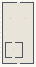

# ISO_TorusGyroid

Authored dimensions: {"width": 32, "depth": 62, "max_height": 12}

Source plan only: columns=x, rows=z. Red dots are manuscript/role primary anchors; blue dots are other placed objects; green crosses are utilities. Numbers refer to A rows below. Dark blue is source 0, cream lower structure, grey source wall-height threshold, ochre platforms. Museum overrides can change the built interpretation. Dots show anchors, not footprints or a proven route.

Map: [commons/maps/ISO_TorusGyroid/map_data.json](https://github.com/palletorsson/AdaResearch/blob/palm-scanner-door-entry/commons/maps/ISO_TorusGyroid/map_data.json)

Text: [commons/maps/ISO_TorusGyroid/final.md](https://github.com/palletorsson/AdaResearch/blob/palm-scanner-door-entry/commons/maps/ISO_TorusGyroid/final.md)

| Instance | x,z | Raw token | Recorded role | Registry / scene |
|---|---|---|---|---|
| A1 | 16,3 | `iso_gyroid_console:180` | decoration | [commons/artifacts/registry/isosurfaces.json](https://github.com/palletorsson/AdaResearch/blob/palm-scanner-door-entry/commons/artifacts/registry/isosurfaces.json) → [commons/artifacts/timing_machines/iso_gyroid_workshop.tscn](https://github.com/palletorsson/AdaResearch/blob/palm-scanner-door-entry/commons/artifacts/timing_machines/iso_gyroid_workshop.tscn) |
| A2 | 8,16 | `mc_torus_sculpture:0:0:0.07` | primary | [commons/artifacts/registry/isosurfaces.json](https://github.com/palletorsson/AdaResearch/blob/palm-scanner-door-entry/commons/artifacts/registry/isosurfaces.json) → [algorithms/proceduralgeneration/isosurfaces/marchingcave/Scenes/marchingcubes_torus_sculpture.tscn](https://github.com/palletorsson/AdaResearch/blob/palm-scanner-door-entry/algorithms/proceduralgeneration/isosurfaces/marchingcave/Scenes/marchingcubes_torus_sculpture.tscn) |
| A3 | 23,16 | `GyroidDemo:0:0:0.5` | primary | [commons/artifacts/registry/procgen_extra.json](https://github.com/palletorsson/AdaResearch/blob/palm-scanner-door-entry/commons/artifacts/registry/procgen_extra.json) → [algorithms/proceduralgeneration/isosurfaces/marchingcave/Scenes/GyroidDemo.tscn](https://github.com/palletorsson/AdaResearch/blob/palm-scanner-door-entry/algorithms/proceduralgeneration/isosurfaces/marchingcave/Scenes/GyroidDemo.tscn) |
| A4 | 11,47 | `voxel_noise_demo:0:1:0.12` | secondary | [commons/artifacts/registry/isosurfaces.json](https://github.com/palletorsson/AdaResearch/blob/palm-scanner-door-entry/commons/artifacts/registry/isosurfaces.json) → [algorithms/spacetopology/marchingcubes/voxel_noise_demo.tscn](https://github.com/palletorsson/AdaResearch/blob/palm-scanner-door-entry/algorithms/spacetopology/marchingcubes/voxel_noise_demo.tscn) |

Utilities are listed with exact coordinates and raw tokens in space.json. Read map_info.museum and utility_definitions before inferring pits, entrances, movement or collision.
